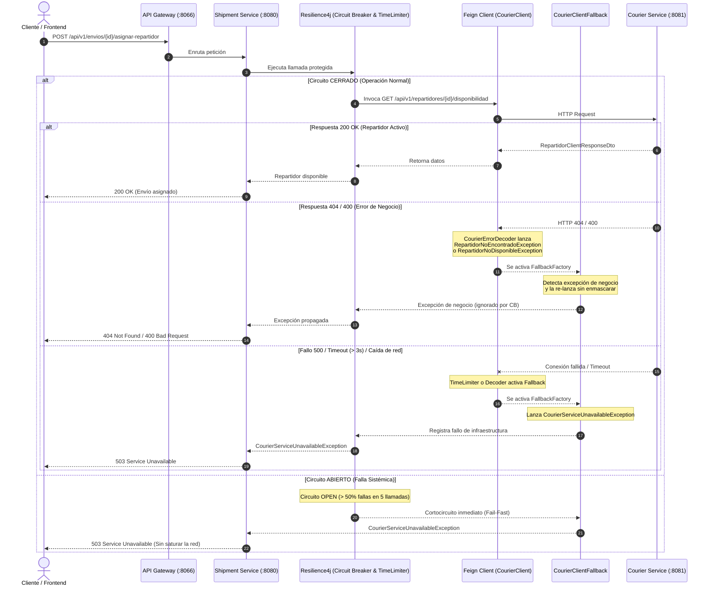

---
tags:
  - daas
  - sprint4
  - microservicios
  - resiliencia
  - openfeign
  - resilience4j
  - shipment-service
date: 2026-11-08
author: Luis Carlos Manuel Mamaní
pr: https://github.com/logitrack-lazyhawk/shipment-service/pull/62
branch: feature/epica-03-resiliencia
---

# 🛡️ Épica 03 — Resiliencia y Deuda Técnica (`shipment-service`)

Documento técnico que detalla la refactorización arquitectónica implementada en la comunicación síncrona entre **`shipment-service`** y **`courier-service`** mediante **OpenFeign**, **Resilience4j Circuit Breaker** y **TimeLimiter**.

Esta entrega resuelve formalmente las issues **#58 (F13)**, **#59 (F14)**, **#60 (F15)** y **#61 (F16)** de la **Épica 03 (#55)**.

---

## 🎯 1. Problema y Deuda Técnica Previa

Antes de esta refactorización, el sistema sufría los siguientes problemas de diseño:

1. **Abuso de Excepciones Genéricas del JDK:**
   * El decodificador `CourierErrorDecoder` lanzaba `IllegalArgumentException` para errores `404` e `IllegalStateException` para errores `500`.
   * En `GlobalExceptionHandler`, atrapar `IllegalArgumentException` como `404 Not Found` generaba colisiones: cualquier error de argumento en otra parte del sistema se disfrazaba incorrectamente como un "recurso no encontrado".
2. **Switch Monolítico de Errores:**
   * La interceptación de códigos de error HTTP estaba acoplada en un solo bloque `switch` sin separación clara entre errores de cliente (`4xx`) y fallas de servidor/red (`5xx`).
3. **Ausencia de Configuración Explícita de Circuit Breaker y Timeouts:**
   * Las peticiones remotas carecían de un `TimeLimiterConfig` explícito en código con cancelación de hilo, arriesgando bloqueos ante lentitud extrema del servicio remoto.
   * Las excepciones de negocio (`404` repartidor inexistente o `400` inactivo) podían contabilizarse erróneamente como fallas de infraestructura, abriendo el circuito sin justificación.
4. **Falta de Pruebas de Transición de Estados:**
   * No existía una prueba automatizada que demostrara la recuperación del circuito desde el estado `OPEN` pasando por `HALF_OPEN` hasta volver a `CLOSED`.

---

## 🏗️ 2. Flujo de Resiliencia Implementado



---

## 📋 3. Desglose de Cambios por Issue

### [F13] Refactorización del Switch de Interceptación (`#58`)
* **Archivo:** `CourierErrorDecoder.java`
* **Cambio:** Se modularizó la decodificación separando responsabilidades:
  * `handleClientError(status)`: Administra códigos `400`, `404` y `409`, transformándolos en excepciones tipadas de negocio.
  * `handleServerError(status)`: Administra códigos `500`, `502`, `503` y `504`, transformándolos en fallas de servicio/red tipadas.
* **Logging:** Registro de advertencia (`log.warn`) para cada petición interceptada con método y código HTTP.

---

### [F14] Creación de Excepciones Tipadas y Fallback Robusto (`#59`)
Se crearon **3 excepciones tipadas** en el paquete `com.logitrack.shipmentservice.dominio.exception`:

| Excepción | Código HTTP | Significado |
| :--- | :---: | :--- |
| `RepartidorNoEncontradoException` | `404 Not Found` | El ID de repartidor no existe en `courier-service`. |
| `RepartidorNoDisponibleException` | `400 Bad Request` | El repartidor existe pero está inactivo o ya ocupado (extiende `ReglaNegocioException`). |
| `CourierServiceUnavailableException` | `503 Service Unavailable` | `courier-service` está apagado, se agotó el timeout o el circuito está abierto. |

* **`CourierClientFallback.java`:** 
  Identifica explícitamente el tipo de causa:
  * Si es error de negocio (`RepartidorNoEncontradoException`, `RepartidorNoDisponibleException`, `ReglaNegocioException`), **lo re-lanza directamente** para que el cliente reciba el error correspondiente sin ser enmascarado.
  * Si es error técnico o caída, lanza `CourierServiceUnavailableException` con mensaje claro de contingencia.
* **`GlobalExceptionHandler.java`:**
  Agregados manejadores `@ExceptionHandler` dedicados que devuelven el esquema JSON estándar `ErrorResponseDto`.

---

### [F15] Configuración de Timeouts y Circuit Breaker (`#60`)
* **Archivo:** `CourierCircuitBreakerConfig.java`
* **Bean `courierCircuitBreakerCustomizer`:**
  * **TimeLimiter:** Timeout máximo de **3 segundos** (`timeoutDuration: Duration.ofSeconds(3)`) con interrupción forzada del hilo (`cancelRunningFuture: true`).
  * **Ventana deslizante:** Basada en conteo con tamaño de **5 llamadas** (`slidingWindowSize: 5`, `minimumNumberOfCalls: 3`).
  * **Umbral de fallo:** **50%** de fallos para transicionar a `OPEN`.
  * **Tiempo de espera en abierto:** **5 segundos** antes de probar el estado `HALF_OPEN`.
  * **Llamadas permitidas en prueba:** **2 llamadas** en `HALF_OPEN`.
  * **Excepciones ignoradas (`ignoreExceptions`):**
    * `RepartidorNoEncontradoException.class`
    * `RepartidorNoDisponibleException.class`
    * `ReglaNegocioException.class`
    * `IllegalArgumentException.class`
    *(Evita que errores legítimos de validación de usuario abran el circuito).*
* **Configuración Centralizada en Git (`configserver-ms`):**
  En `shipment-service-dev.yml` y `shipment-service-prod.yml`:
  ```yaml
  spring:
    cloud:
      openfeign:
        circuitbreaker:
          enabled: true
        client:
          config:
            courier-service:
              connectTimeout: 2000
              readTimeout: 3000
  ```

---

### [F16] Pruebas de Fallo, Recuperación y Observabilidad (`#61`)
Se actualizaron y ampliaron todas las suites de prueba:

1. **`CourierFeignIntegrationTest.java`:**
   * `successfulResponseIsDecodedByFeign`: Verifica decodificación exitosa de `200 OK`.
   * `businessErrorsDoNotCountAsCircuitFailures`: Verifica que llamadas consecutivas con error `404` o `400` no incrementan el contador de fallos del Circuit Breaker y este se mantiene `CLOSED`.
   * `missingCourierRemainsNotFoundThroughTheRealFallback`: Verifica que un `404` lanza `RepartidorNoEncontradoException`.
   * `unavailableCourierUsesFallbackForServerErrorsAndConnectionFailures`: Verifica que `500` y caída de conexión lanzan `CourierServiceUnavailableException`.
   * `openCircuitUsesFallbackWithoutCallingCourier`: Verifica el comportamiento *Fail-Fast* cuando el circuito está `OPEN`.
   * **`circuitBreakerRecoversFromOpenToHalfOpenToClosed` (NUEVO):**
     Demuestra explícitamente el ciclo completo de auto-recuperación:
     $$\text{OPEN} \xrightarrow{\text{espera}} \text{HALF\_OPEN} \xrightarrow{\text{llamadas 200 OK}} \text{CLOSED}$$
2. **`CourierErrorDecoderTest.java`:** Verifica respuestas `400`, `404`, `409`, `500` y `503`.
3. **`CourierClientFallbackTest.java`:** Verifica propagación de timeouts y excepciones tipadas.
4. **`RepartidorValidatorTest.java`:** Verifica validación de DTOs, inactividad y fallos de conexión.

---

## 📊 4. Evidencia de Ejecución de Pruebas

```text
[INFO] -------------------------------------------------------
[INFO]  T E S T S
[INFO] -------------------------------------------------------
[INFO] Running com.logitrack.shipmentservice.config.CourierCircuitBreakerContextTest
[INFO] Tests run: 1, Failures: 0, Errors: 0, Skipped: 0
[INFO] Running com.logitrack.shipmentservice.config.CourierClientFallbackTest
[INFO] Tests run: 4, Failures: 0, Errors: 0, Skipped: 0
[INFO] Running com.logitrack.shipmentservice.config.CourierErrorDecoderTest
[INFO] Tests run: 5, Failures: 0, Errors: 0, Skipped: 0
[INFO] Running com.logitrack.shipmentservice.config.CourierFeignIntegrationTest
[INFO] Tests run: 7, Failures: 0, Errors: 0, Skipped: 0
[INFO] Running com.logitrack.shipmentservice.servicio.validador.RepartidorValidatorTest
[INFO] Tests run: 5, Failures: 0, Errors: 0, Skipped: 0
...
[INFO] Results:
[INFO] 
[INFO] Tests run: 67, Failures: 0, Errors: 0, Skipped: 0
[INFO] 
[INFO] ------------------------------------------------------------------------
[INFO] BUILD SUCCESS
[INFO] ------------------------------------------------------------------------
```

---

## 🔗 5. Enlaces y Trazabilidad en Git

* **Rama:** `feature/epica-03-resiliencia`
* **Pull Request:** [GitHub PR #62](https://github.com/logitrack-lazyhawk/shipment-service/pull/62)
* **Issues Cerradas:**
  * Resolves #58 (`[F13] Refactorizar switch de interceptación de errores`)
  * Resolves #59 (`[F14] Crear ErrorDecoder, fallbacks y excepciones tipadas`)
  * Resolves #60 (`[F15] Configurar timeouts y circuit breaker`)
  * Resolves #61 (`[F16] Probar fallos, recuperación y observabilidad`)
* **Épica Padre:** Resolves #55 (`Épica 03 — Resiliencia y deuda técnica`)
