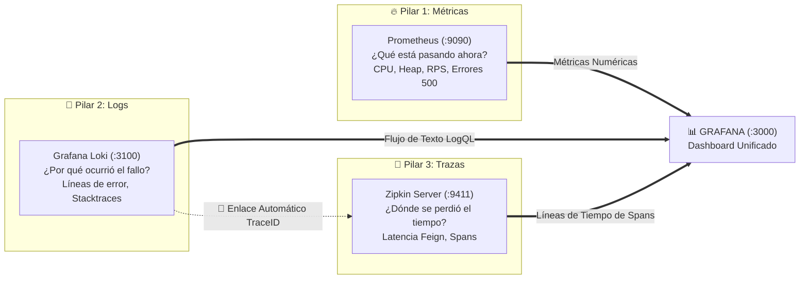
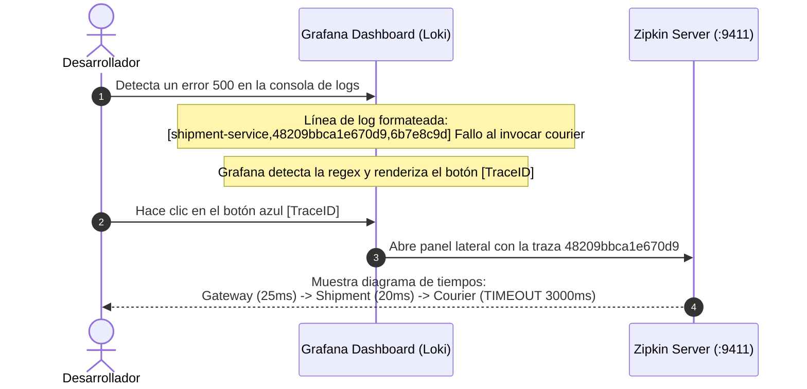

---
tags:
  - daas
  - sprint4
  - grafana
  - observabilidad
  - prometheus
  - loki
  - zipkin
  - logs
  - metricas
  - trazas
date: 2026-11-10
author: Luis Carlos Manuel Mamaní
reference: "[[Issue 10 - Observabilidad y Monitoreo Unificado]]"
---

# **📈 Guía Completa de Grafana — Observabilidad Unificada en LogiTrack**

**URL de Acceso Local:** [http://localhost:3000](http://localhost:3000)  
**Credenciales por defecto:** `admin` / `admin`  
**Nota de arquitectura y puertos:** [[Issue 10 - Observabilidad y Monitoreo Unificado]]  

---

## **🌟 1. El Concepto: ¿Cómo Unifica Todo Grafana?**

En una arquitectura de microservicios distribuida como LogiTrack, la resolución de incidencias en producción tradicionalmente requería abrir tres herramientas separadas:
1. Una consola para ver si el microservicio está vivo y cuánta RAM consume.
2. Una terminal para leer los archivos de logs de cada contenedor.
3. Un navegador con Zipkin para ver cuánto demoró cada llamada entre servicios.

**Grafana actúa como el "panel de control único" (*Single Pane of Glass*)**, integrando los **tres pilares de la observabilidad** mediante Data Sources aprovisionados automáticamente:



---

## **🧭 2. Recorrido por la Interfaz de Grafana**

Al ingresar a [http://localhost:3000](http://localhost:3000), dispones del menú principal en la barra lateral izquierda:

1. **🏠 Home (Inicio):** Muestra el resumen de bienvenida, dashboards recientemente visitados y accesos directos.
2. **📊 Dashboards:** Lista de carpetas. Aquí se encuentra la carpeta **`LogiTrack`**, que contiene los dos tableros oficiales del proyecto.
3. **🧭 Explore (Explorador ad-hoc):** Herramienta interactiva para depuración rápida. Permite escribir consultas libres en PromQL (para métricas) o LogQL (para logs) sin necesidad de crear un panel permanente.
4. **🔌 Connections $\rightarrow$ Data Sources:** Muestra los 3 orígenes de datos conectados y en estado verde:
   * **`Prometheus` (default):** Métricas de Actuator / JVM.
   * **`Loki`:** Logs agregados de Docker.
   * **`Zipkin`:** Trazas distribuidas.
5. **⏱️ Barra Superior (Selector de Tiempo y Refresco):**
   * **Rango temporal:** Por defecto en `Last 15 minutes` o `Last 30 minutes`.
   * **Auto-refresh:** Configurado en `5s` para que los gráficos se actualicen en tiempo real sin recargar la página.

---

## **📊 3. Dashboard 1: Salud y Rendimiento de Microservicios**

* **Ruta en Grafana:** `Dashboards` $\rightarrow$ `LogiTrack` $\rightarrow$ `LogiTrack — Salud y Rendimiento de Microservicios`.
* **Origen de datos:** **Prometheus** (consultando `/actuator/prometheus` cada 5 segundos).

Este tablero responde a la pregunta: **_¿Está el sistema saludable y respondiendo eficientemente?_**

### **A. Fila 1: 🚦 Estado de Salud de Microservicios**
* **Panel de Estadísticas (Stat):** Muestra tarjetas grandes para cada servicio registrado:
  * `api-gateway`
  * `shipment-service`
  * `courier-service`
  * `commerce-service`
  * `eureka-server`
* **Umbral dinámico:**
  * 🟩 **`UP` (Verde):** El microservicio está activo, respondiendo a los healthchecks y reportando métricas.
  * 🟥 **`DOWN` (Rojo):** El contenedor o proceso se cayó o no responde en el puerto asignado.
* **Ventaja operativa:** Evita tener que ingresar periódicamente a la consola web de Eureka (`:8065`) para verificar el estado de los servicios.

### **B. Fila 2: 📈 Tráfico HTTP y Tasas de Error**
* **Solicitudes HTTP por Segundo (RPS):**
  * Gráfico de líneas temporales suaves que mide el caudal de tráfico procesado por cada servicio mediante la métrica `rate(http_server_requests_seconds_count[1m])`.
* **Errores HTTP (4xx y 5xx):**
  * Gráfico de barras apiladas que clasifica peticiones fallidas por código HTTP y por microservicio.
  * Si un cliente genera llamadas sin autenticación (`401`) o prohibidas (`403`), o si un servicio remoto falla (`500` / `503`), las barras alertan el pico inmediatamente.

### **C. Fila 3: ⚙️ Métricas JVM & Conexiones a Base de Datos (HikariCP)**
* **Memoria JVM Heap en Uso:**
  * Monitorea el consumo de memoria Heap en megabytes (`jvm_memory_used_bytes{area="heap"}`).
  * Permite detectar fugas de memoria (*memory leaks*) o verificar si el recolector de basura (Garbage Collector) está liberando memoria tras picos de carga.
* **Pool HikariCP (Conexiones JDBC a MySQL):**
  * Mide dos valores críticos:
    1. **Conexiones activas:** Conexiones que están ejecutando consultas SQL en este instante.
    2. **Conexiones pendientes:** Hilos en cola esperando una conexión libre. Si este valor sube, indica que el pool de base de datos se saturó.

---

## **📜 4. Dashboard 2: Logs Centralizados y Correlación de Trazas**

* **Ruta en Grafana:** `Dashboards` $\rightarrow$ `LogiTrack` $\rightarrow$ `LogiTrack — Logs Centralizados y Correlación de Trazas`.
* **Origen de datos:** **Grafana Loki** (ingesta vía Promtail desde Docker) + enlace a **Zipkin**.

Este tablero responde a la pregunta: **_¿Qué ocurrió exactamente cuando falló una operación y qué camino recorrió la petición?_**

### **A. Controles Dinámicos Superiores (Variables)**
* **Contenedor / Servicio:** Menú desplegable para ver los logs de todos los contenedores al mismo tiempo (`All`) o aislar uno en particular (ej. solo `logitrack-shipment-service`).
* **Buscar texto:** Caja de búsqueda por texto libre. Permite ingresar palabras como `Exception`, `Error`, `repartidor`, `asignar`, etc., para filtrar instantáneamente millones de líneas.

### **B. Volumen de Logs**
* Gráfico temporal de barras que ilustra la cantidad de líneas de registro emitidas por cada contenedor. Es el primer lugar donde mirar para detectar anomalías o ráfagas imprevistas de mensajes de advertencia.

### **C. Consola de Logs en Vivo**
* Muestra las líneas de consola de los contenedores Docker en orden cronológico inverso (lo más reciente arriba).
* Incluye formato coloreado por severidad (`INFO`, `WARN`, `ERROR`, `DEBUG`).

---

## **🔗 5. La Funcionalidad Estrella: Correlación Log-to-Trace**

La innovación principal implementada en la **Épica 10** es la navegación contextual con un solo clic:



### **¿Cómo funciona técnicamente?**
1. En `configserver-ms`, todos los microservicios tienen configurado el patrón de registro:
   ```yaml
   logging:
     pattern:
       level: "%5p [${spring.application.name:},%X{traceId:-},%X{spanId:-}]"
   ```
2. Cuando `shipment-service` invoca a `courier-service` con OpenFeign, Spring Cloud / Micrometer Tracing inyecta el mismo `traceId` en ambos servicios.
3. En el Data Source de **Loki** (`datasources.yml`), se configuró una regla de campo derivado (*Derived Field*):
   ```yaml
   derivedFields:
     - datasourceUid: zipkin
       matcherRegex: "(?:traceId=|\\[[a-zA-Z0-9_-]+,)([a-f0-9]{16,32})"
       name: TraceID
       url: "$${__value.raw}"
   ```
4. Grafana extrae automáticamente ese hash hexadecimal de 16 o 32 dígitos y lo transforma en un botón interactivo llamado **`TraceID`**. Al pulsarlo, el desarrollador salta directamente al diagrama de cascada en Zipkin sin necesidad de copiar ni pegar identificadores.

---

## **🧪 6. Consultas Útiles en la Sección `Explore` (🧭)**

Para pruebas libres o diagnósticos rápidos en la barra lateral `Explore`:

### **Consultas PromQL (Data Source: Prometheus)**
* **Ver qué servicios están arriba:**
  ```promql
  up
  ```
* **RPS totales que ingresan al Gateway:**
  ```promql
  sum(rate(http_server_requests_seconds_count{application="api-gateway"}[1m]))
  ```
* **Uso de memoria Heap de todos los microservicios en MB:**
  ```promql
  jvm_memory_used_bytes{area="heap"} / 1024 / 1024
  ```

### **Consultas LogQL (Data Source: Loki)**
* **Ver todos los logs de un microservicio específico:**
  ```logql
  {container="logitrack-shipment-service"}
  ```
* **Filtrar solo los mensajes de error en todo el clúster:**
  ```logql
  {container=~".+"} |= "ERROR"
  ```
* **Buscar excepciones de base de datos o timeout:**
  ```logql
  {container=~".+"} |~ "(?i)(timeout|deadlock|exception)"
  ```

---

> [!TIP]
> **Recomendación para defensas o demostraciones:**  
> Abre en una pestaña el endpoint del API Gateway o ejecuta una llamada con Postman, y mantén Grafana abierto en otra pantalla. Podrás mostrar simultáneamente cómo sube la aguja de peticiones por segundo en el **Dashboard de Salud** y cómo aparece la línea de log con su botón de **TraceID** en el **Dashboard de Logs**.
