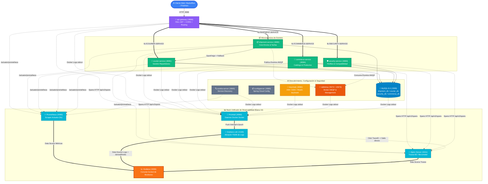

---
tags:
  - daas
  - sprint4
  - microservicios
  - observabilidad
  - grafana
  - prometheus
  - loki
  - zipkin
  - docker
date: 2026-11-10
author: Luis Carlos Manuel Mamaní
branch: feature/epica-10-observabilidad
epic: "https://github.com/logitrack-lazyhawk/logitrack-infra/issues/43"
---

# **📊 Plan Técnico y Ecosistema — Épica 10: Observabilidad y Monitoreo Unificado**

**Épica Padre:** `logitrack-infra#43` — _Épica 10: Observabilidad y Monitoreo Unificado (Grafana, Prometheus, Loki y Zipkin)_  
**Responsable:** Luis Carlos Manuel Mamaní ([@LuisMPlus](https://github.com/LuisMPlus))  
**Guía complementaria:** [[Grafana - Guía de Interfaz y Observabilidad Unificada]]  
**Estado:** `Implementado y Operativo (15 Contenedores Up)`  

---

## **🎯 1. Objetivos de la Épica**

Consolidar en una plataforma única y declarativa (*Infrastructure as Code*) los **tres pilares fundamentales de la observabilidad industrial** para el ecosistema distribuido de LogiTrack:

1. **Métricas de Rendimiento (Prometheus):** Scraping continuo cada 5 segundos de los endpoints `/actuator/prometheus` provistos por Spring Boot Actuator y Micrometer en todos los microservicios.
2. **Centralización de Logs (Grafana Loki + Promtail):** Ingesta automática de las salidas estándar (`stdout`/`stderr`) de todos los contenedores Docker mediante socket sin intrusión en el código fuente.
3. **Trazabilidad Distribuida (Zipkin Server):** Registro de latencias inter-servicio y correlación contextual con propagación de encabezados B3 (`traceId` y `spanId`).
4. **Correlación Cruzada (Log-to-Trace):** Detección automática de identificadores de traza en las líneas de logs para navegar desde un error hacia su árbol de spans en Zipkin con un solo clic.
5. **Paneles Operativos (Grafana):** Aprovisionamiento automático de Data Sources y Dashboards pre-diseñados de salud del clúster y consola de auditoría de logs.

---

## **🗺️ 2. Arquitectura Global de Microservicios y Observabilidad**



---

## **📋 3. Matriz Maestra de Puertos, Contenedores y Credenciales**

A continuación se detalla la configuración de red y credenciales de los **15 contenedores** orquestados en `logitrack-network`:

| Componente / Servicio   | Contenedor Docker            | Puerto Host | Puerto Interno | Protocolo / Uso                            | Credenciales / Acceso                                                                                     |
| :---------------------- | :--------------------------- | :---------: | :------------: | :----------------------------------------- | :-------------------------------------------------------------------------------------------------------- |
| **Grafana**             | `logitrack-grafana`          | **`3000`**  |     `3000`     | HTTP / Dashboard Unificado                 | `admin` / `admin`                                                                                         |
| **Prometheus**          | `logitrack-prometheus`       | **`9090`**  |     `9090`     | HTTP / Scraper & Consultas PromQL          | [http://localhost:9090](http://localhost:9090)                                                            |
| **Grafana Loki**        | `logitrack-loki`             | **`3100`**  |     `3100`     | HTTP / Ingestión y LogQL                   | [http://localhost:3100/ready](http://localhost:3100/ready)                                                |
| **Promtail**            | `logitrack-promtail`         |      —      |     `9080`     | HTTP / Daemon colector Docker              | Conectado a `/var/run/docker.sock`                                                                        |
| **Zipkin Server**       | `logitrack-zipkin`           | **`9411`**  |     `9411`     | HTTP / Consola de Trazabilidad             | [http://localhost:9411](http://localhost:9411)                                                            |
| **Keycloak (IAM)**      | `logitrack-keycloak`         | **`8082`**  |     `8080`     | HTTP / OpenID Connect & Consola Admin      | `admin` / `admin`                                                                                         |
| **API Gateway**         | `logitrack-api-gateway`      | **`8066`**  |     `8066`     | HTTP / Enrutamiento y Filtro JWT           | [Rutas Actuator](http://localhost:8066/actuator/gateway/routes)                                           |
| **Eureka Server**       | `logitrack-eureka-server`    | **`8065`**  |     `8065`     | HTTP / Registro de Microservicios          | [http://localhost:8065](http://localhost:8065)                                                            |
| **Config Server**       | `logitrack-configserver`     | **`8085`**  |     `8085`     | HTTP / Propiedades Git (`configserver-ms`) | [Config Gateway Dev](http://localhost:8085/api-gateway/dev)                                               |
| **Shipment Service**    | `logitrack-shipment-service` | **`8080`**  |     `8080`     | HTTP / Core de Envíos                      | [Health](http://localhost:8080/actuator/health) · [Prometheus](http://localhost:8080/actuator/prometheus) |
| **Courier Service**     | `logitrack-courier-service`  | **`8081`**  |     `8081`     | HTTP / Repartidores y Disponibilidad       | [Health](http://localhost:8081/actuator/health) · [Prometheus](http://localhost:8081/actuator/prometheus) |
| **Commerce Service**    | `logitrack-commerce-service` | **`8084`**  |     `8084`     | HTTP / Catálogo de Productos               | [Health](http://localhost:8084/actuator/health) · [Prometheus](http://localhost:8084/actuator/prometheus) |
| **Security Service**    | `logitrack-security-service` | **`8083`**  |     `8083`     | HTTP / Perfiles y Auth Legacy              | [Health](http://localhost:8083/actuator/health)                                                           |
| **RabbitMQ AMQP**       | `logitrack-rabbitmq`         | **`5673`**  |     `5672`     | AMQP 0-9-1 / Cola de mensajes              | `lazyhawk_dev` / `lazyhawk123`                                                                            |
| **RabbitMQ Management** | `logitrack-rabbitmq`         | **`15673`** |    `15672`     | HTTP / Consola de gestión web              | [http://localhost:15673](http://localhost:15673)                                                          |
| **MySQL 8.4**           | `logitrack-mysql`            | **`3309`**  |     `3306`     | TCP / Base de datos relacional             | `root` / `root` (vía `127.0.0.1:3309`)                                                                    |

> [!IMPORTANT]
> **Resolución de conflictos de puertos aplicada:**
> * `keycloak` se publica en el puerto **`8082`** del host para evitar colisiones con el puerto **`8080`** asignado a `shipment-service`. Internamente en la red de Docker se comunica por el puerto nativo `8080`.
> * `rabbitmq` se publica en los puertos **`5673`** (AMQP) y **`15673`** (Management) del host para evitar interferencias con posibles instancias locales de RabbitMQ en Windows.

---

## **🛠️ 4. Estructura de Archivos Implementada**

```text
logitrack-infra/
├── docker-compose.yml              # Orquestación de los 15 servicios y volúmenes
├── .env                            # Variables locales con puertos y claves
├── .env.example                    # Plantilla de variables para el equipo
├── prometheus/
│   └── prometheus.yml              # Scraping a Gateway, Eureka y Microservicios
├── loki/
│   └── loki-config.yml             # Almacenamiento TSDB local y retención 7 días
├── promtail/
│   └── promtail-config.yml         # Ingesta vía /var/run/docker.sock
└── grafana/
    ├── provisioning/
    │   ├── datasources/
    │   │   └── datasources.yml     # Prometheus + Loki + Zipkin (Derived Fields)
    │   └── dashboards/
    │       └── dashboards.yml      # Auto-carga de JSONs en carpeta LogiTrack
    └── dashboards/
        ├── dashboard-logitrack-overview.json  # Métricas JVM, RPS, 4xx/5xx, HikariCP
        └── dashboard-logs-tracing.json        # Consola LogQL en vivo y salto a Zipkin
```

---

## **💻 5. Comandos Operativos Frecuentes**

```bash
# Situarse en la carpeta de infraestructura
cd "H:\facultad\Ingenieria Informatica\DAAS\Proyecto Final\LazyHawk\logitrack-infra"

# Levantar todo el stack en segundo plano
docker compose up -d

# Levantar exclusivamente el stack de observabilidad
docker compose up -d zipkin-server prometheus loki promtail grafana

# Verificar estado y puertos de los contenedores
docker compose ps

# Inspeccionar logs en vivo de un componente específico
docker compose logs -f grafana
docker compose logs -f prometheus
docker compose logs -f loki

# Detener los contenedores preservando todos los volúmenes de datos
docker compose stop

# Reiniciar limpiamente los servicios
docker compose restart
```
