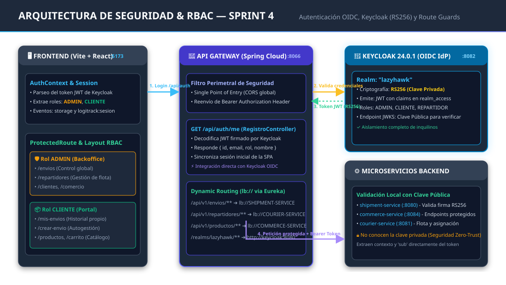
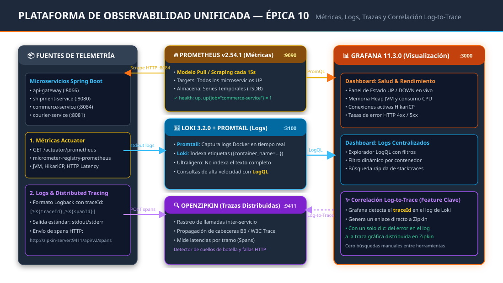
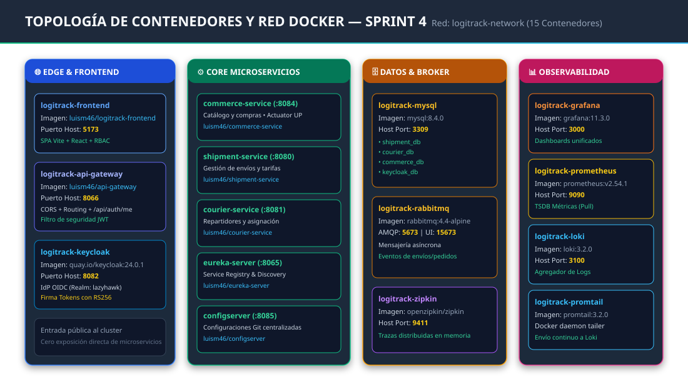

# Arquitectura y Diagramas Técnicos — Sprint 4 (LogiTrack)

> **Materia:** DAAS — Desarrollo de Aplicaciones Ágiles y Seguras  
> **Proyecto:** LogiTrack (LazyHawk) — Sprint 4  
> **Contenido:** Diagramas particionados para la presentación y defensa técnica (Seguridad, Observabilidad y Red Docker).

---

## 📌 Índice de Diagramas

1. [[#1. Diagrama de Seguridad, Keycloak & RBAC (Frontend + Gateway + Backend)]]
2. [[#2. Diagrama de Observabilidad Unificada (Prometheus, Loki, Zipkin & Grafana)]]
3. [[#3. Diagrama de Topología de Red y Contenedores Docker (15 Servicios)]]

---

## 1. Diagrama de Seguridad, Keycloak & RBAC (Frontend + Gateway + Backend)

Este diagrama ilustra el flujo completo de autenticación OIDC y autorización RBAC, desde el navegador del usuario hasta la validación de tokens en los microservicios downstream:

### Puntos Clave del Flujo de Seguridad:
1. **Frontend (Vite + React en `:5173`):**
   - El `AuthContext` intercepta el token JWT emitido por Keycloak y parsea en cliente los roles contenidos en `realm_access.roles`.
   - **Route Guards:** `<ProtectedRoute roles={['ADMIN']} />` bloquea accesos no autorizados por URL y redirige a `/` sin renderizar vistas protegidas.
   - **Shell Dinámico:** El Layout se dibuja como **Backoffice** para `ADMIN` o **Portal del Cliente** para `CLIENTE`.
2. **API Gateway (`:8066`):**
   - Centraliza el acceso perimetral y gestiona CORS de forma unificada.
   - Expone `GET /api/auth/me` para sincronizar la identidad y contexto del usuario con la SPA.
   - Enruta el tráfico dinámicamente mediante `lb://` apoyándose en Eureka.
3. **Keycloak 24.0.1 (`:8082`):**
   - Configurado bajo el Realm `lazyhawk` con aislamiento total de inquilinos.
   - Firma asimétrica mediante **RS256** con su clave privada.
   - Expone la clave pública en su endpoint de certificados JWKS.
4. **Microservicios (`shipment-service`, `commerce-service`, etc.):**
   - Validan la firma digital de los tokens usando la clave pública (sin secretos compartidos).
   - Extraen el contexto (`sub`, email, roles) directamente de los claims del JWT.

---

## 2. Diagrama de Observabilidad Unificada (Prometheus, Loki, Zipkin & Grafana)

Este diagrama detalla los **tres pilares fundamentales de la observabilidad** integrados en la Épica 10:

### Puntos Clave de la Telemetría:
1. **Pilar 1 — Métricas Numéricas (Prometheus en `:9090`):**
   - Modelo **Pull**: Prometheus consulta cada 15s el endpoint `/actuator/prometheus`.
   - Habilitado mediante `micrometer-registry-prometheus` en todos los microservicios.
   - Supervisa estado `UP`, memoria Heap de la JVM, hilos y pools de conexiones JDBC HikariCP.
2. **Pilar 2 — Logs Centralizados (Promtail + Loki en `:3100`):**
   - **Promtail** captura los logs en tiempo real directamente del daemon de Docker.
   - **Loki** indexa exclusivamente etiquetas (`container_name`, `environment`, etc.), logrando un consumo ultrabajo de recursos.
   - Consultas dinámicas con lenguaje **LogQL** desde Grafana.
3. **Pilar 3 — Trazabilidad Distribuida (Zipkin en `:9411`):**
   - Rastreo de saltos HTTP inter-servicio propagando cabeceras `traceId` y `spanId`.
   - Medición precisa de latencias y detección de cuellos de botella en la red de microservicios.
4. **✨ Feature Estrella: Correlación Log-to-Trace:**
   - Grafana correlaciona automáticamente el `traceId` presente en las líneas de logs de Loki y renderiza un enlace directo hacia Zipkin, permitiendo pasar de un error en el log a la gráfica de la traza con un solo clic.

---

## 3. Diagrama de Topología de Red y Contenedores Docker (15 Servicios)

Este diagrama representa la arquitectura física y de contenedores desplegada en la red interna bridge `logitrack-network`:

### Distribución de Puertos Host del Ecosistema:

| Servicio | Contenedor | Puerto Host | Rol / Responsabilidad |
| :--- | :--- | :---: | :--- |
| **Frontend** | `logitrack-frontend` | `5173` | Aplicación SPA React + Vite con RBAC |
| **Gateway** | `logitrack-api-gateway` | `8066` | Enrutamiento perimetral y filtro JWT |
| **Keycloak** | `logitrack-keycloak` | `8082` | Servidor de Identidad OIDC y roles |
| **Commerce Service** | `logitrack-commerce-service` | `8084` | Catálogo, pedidos y Actuator Prometheus |
| **Shipment Service** | `logitrack-shipment-service` | `8080` | Gestión de envíos y tarifas |
| **Courier Service** | `logitrack-courier-service` | `8081` | Gestión y asignación de repartidores |
| **Eureka Server** | `logitrack-eureka-server` | `8065` | Registro y descubrimiento dinámico de servicios |
| **Config Server** | `logitrack-configserver` | `8085` | Repositorio central de propiedades de entorno |
| **MySQL** | `logitrack-mysql` | `3309` | Motor de base de datos relacional unificado |
| **RabbitMQ** | `logitrack-rabbitmq` | `15673` | Broker de mensajería AMQP y consola web |
| **Grafana** | `logitrack-grafana` | `3000` | Consola unificada de métricas y dashboards |
| **Prometheus** | `logitrack-prometheus` | `9090` | Recolección y scraping de métricas TSDB |
| **Loki** | `logitrack-loki` | `3100` | Almacenamiento e indexación de logs |
| **Promtail** | `logitrack-promtail` | *-* | Agente de streaming de logs de contenedores |
| **Zipkin** | `logitrack-zipkin` | `9411` | Interfaz y servidor de trazas distribuidas |
