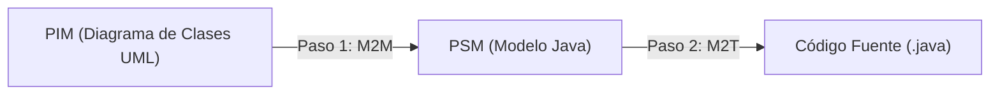
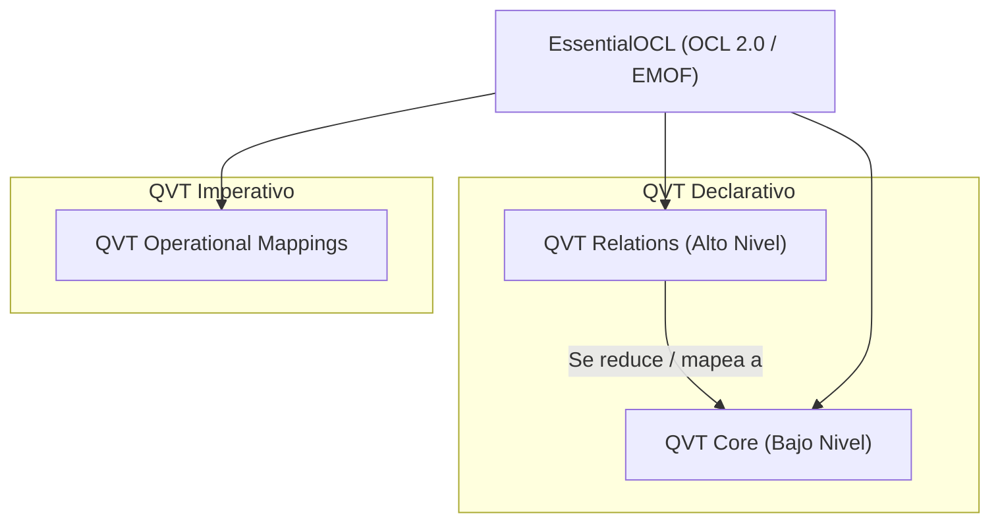
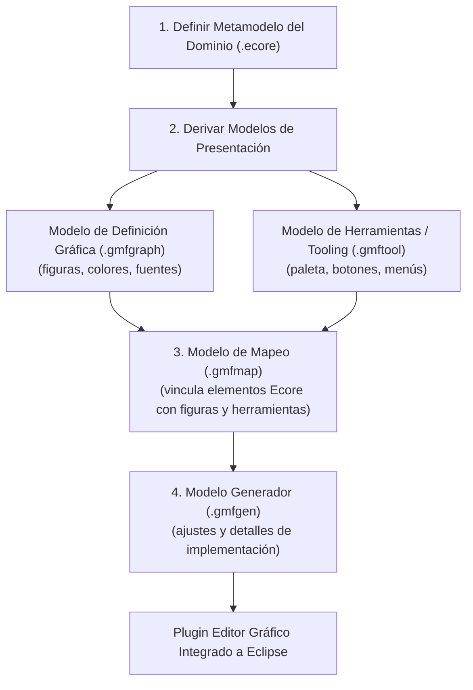

# Unidad 1: Arquitectura Dirigida por Modelos (MDA) - Parte II

**Materia:** DAAS  
**Origen:** [[Unidad-1-P2.pdf]]  
**Tags:** #DAAS #MDA #MDD #Transformaciones #MOF #QVT #OCL #Eclipse #EMF #GMF

---

## 1. El Motor de MDD: Transformaciones de Modelos

En el enfoque **MDD (Model-Driven Development)**, las transformaciones constituyen el mecanismo esencial para avanzar en el ciclo de vida del software: toman modelos abstractos y los convierten sistemáticamente en modelos más concretos hasta llegar a la implementación.

```
[ PIM ] ──(Transformación M2M) ──> [ PSM ] ──(Transformación M2T) ──> [ Código Fuente ]
```

En algún lugar dentro de la herramienta esta la **definición de la transformación** que describe como se debe transformar el modelo fuente para producir el modelo destino.
* **Flujo estándar:**
  1. Una herramienta de transformación toma un **PIM** (*Platform Independent Model*) como entrada y lo transforma en un **PSM** (*Platform Specific Model*).
  2. La misma herramienta u otra posterior toma el **PSM** y lo transforma en **Código ejecutable** (IM).


---

### 1.1 Definiciones Formales Clave

Es fundamental diferenciar el proceso en sí de las reglas que lo gobiernan:

> [!IMPORTANT]
> 1. **Transformación:** Es la generación automática de un modelo destino a partir de un modelo fuente.
> 2. **Definición de la Transformación:** Es una colección de reglas que, actuando en conjunto, describen con precisión cómo un modelo expresado en el lenguaje fuente se transforma en un modelo expresado en el lenguaje destino.
> 3. **Regla de Transformación:** Es una especificación no ambigua de cómo una o más construcciones del lenguaje fuente se traducen en una o más construcciones del lenguaje destino.

```
┌────────────────────────────────────────────────────────┐
│              Herramienta de Transformación             │
│                                                        │
│  ┌──────────────┐     ┌────────────────┐     ┌──────┐  │
│  │ Modelo Fuente│ ──> │ Definición de  │ ──> │Modelo│  │
│  │   (Entrada)  │     │ Transformación │     │ Salida│  │
│  │              │     │ (Conj. Reglas) │     │      │  │
│  └──────────────┘     └────────────────┘     └──────┘  │
└────────────────────────────────────────────────────────┘
```

---

### 1.2 ¿Cómo se define e implementa una transformación?

Una transformación entre modelos puede concebirse conceptualmente como un **programa de computadora** que recibe un modelo como entrada y produce otro modelo como salida.

* **Enfoque general (Lenguajes de propósito general):** Las transformaciones pueden codificarse en cualquier lenguaje tradicional (por ejemplo, Java o C++). Sin embargo, esto requiere un esfuerzo considerable de infraestructura y manipulación manual de ASTs o árboles de objetos.
* **Enfoque MDD especializado (DSLs de transformación):** Para simplificar y formalizar la tarea, se desarrollaron lenguajes de alto nivel específicos del dominio de transformaciones, tales como:
  * **ATL** (*ATLAS Transformation Language*)
  * **QVT** (*Query / View / Transformation*)

---

## 2. Ejemplo Práctico de Transformación: De UML (PIM) a Java (Código)

Para ilustrar el mecanismo, se analiza el modelado de un sistema de venta de libros (*Bookstore*) y su proceso de traducción en dos fases:



### Reglas de Transformación Aplicadas (PIM $\to$ PSM):

| # | Elemento en el PIM (UML) | Regla de Transformación | Elemento resultante en el PSM / Código |
| :-: | :--- | :--- | :--- |
| **1** | **Clase UML** | Para cada clase en el PIM se genera una clase homónima en la plataforma destino. | `class Bookstore`, `class ClientAccount` |
| **2** | **Relación de Composición (1 a $N$)** | Por cada composición entre `ClassA` y `ClassB` (1 a *), se genera un atributo en `ClassA` con el nombre de `ClassB` de tipo colección. | Atributo `clientAccounts: Collection` (o `List`) dentro de `Bookstore`. |
| **3** | **Atributos Públicos** | Para cada atributo público `nombre: Tipo` del PIM, se encapsula y se generan los métodos de acceso: | <ul><li>Atributo **privado**: `private Tipo nombre;`</li><li>Getter público: `getNombre(): Tipo`</li><li>Setter público: `setNombre(att: Tipo): void`</li></ul> |

### Salida resultante en Código Java:

```java
public class Bookstore {
    private List clientAccounts = new ArrayList();

    public List getClientAccounts() {
        return clientAccounts;
    }

    public void addClientAccount(ClientAccount c) {
        clientAccounts.add(c);
    }
}
```

---

## 3. Herramientas de Soporte Requeridas para MDD

La puesta en práctica efectiva de MDD demanda un entorno integrado de herramientas especializadas:

1. **Editores Gráficos:** Para diagramar y construir modelos visualmente (tanto en notaciones estándar como UML, como en DSLs específicos).
2. **Repositorios de Modelos:** Para persistir los modelos, gestionar versiones, ramas y cambios concurrentes.
3. **Herramientas de Validación:** Para comprobar la consistencia, completitud, ausencia de ambigüedades y respeto a las invariantes de negocio.
4. **Editores de Transformaciones:** Entornos con resaltado sintáctico, autocompletado y validación de lenguajes como QVT o ATL.
5. **Compiladores y Debuggers de Transformaciones:** Para ejecutar, depurar paso a paso y evaluar las transformaciones.
6. **Herramientas de Verificación y Testing:** Para probar que las transformaciones producen modelos sintáctica y semánticamente correctos.

```
       ┌─────────────────┐
       │  Editor Visual  │
       └────────┬────────┘
                │
                ▼
      ┌───────────────────┐  ──(Transformación M2M)──►  ┌───────────────────┐
      │   Repositorio de  │                             │   Repositorio de  │
      │   Modelos (PIM)   │  ◄────────────────────────  │   Modelos (PSM)   │
      └───────────────────┘                             └─────────┬─────────┘
                                                                  │
                                                        (Transformación M2T)
                                                                  │
                                                                  ▼
                                                        ┌───────────────────┐
                                                        │   Código Fuente   │
                                                        └───────────────────┘
```

---

## 4. El Metalenguaje MOF (*Meta Object Facility*)

El estándar **MOF** es la cúspide de la arquitectura de metamodelado de cuatro capas del **OMG**:

* Se sitúa en la **capa M3 (Meta-metamodelo)**.
* Provee el lenguaje formal utilizado para definir los metamodelos situados en la capa M2 (por ejemplo, el metamodelo de UML, el metamodelo de CWM o metamodelos de bases de datos relacionales).

```
[ M3: Meta-metamodelo ]  ──> MOF (Define cómo se describen los metamodelos)
          ▲
          │ describe / instancia
[ M2: Metamodelo ]       ──> Metamodelo UML, Metamodelo Java, Metamodelo Relacional
          ▲
          │ describe / instancia
[ M1: Modelo ]           ──> Modelo del sistema del usuario (Clases: Bookstore, ClientAccount)
          ▲
          │ describe / instancia
[ M0: Objetos / Datos ]  ──> Instancias reales en memoria (:ClientAccount id=1, user="juangarcia")
```

### 4.1 Principales Propiedades de MOF

* **Arquitectura Cerrada:** El meta-metamodelo MOF se describe y define en términos de sí mismo (autorreferencial en el nivel M3).
* **Arquitectura Estricta:** Cada elemento ubicado en una capa tiene una correspondencia estricta, unívoca y formal con un elemento de la capa inmediatamente superior.
* **Basado en el Paradigma Orientado a Objetos:** Utiliza conceptos análogos a la OO (clases, atributos, operaciones, asociaciones, paquetes y herencia múltiple) compartiendo la notación de los diagramas de clases.

> [!WARNING]
> **No confundir `Class` en MOF con `Class` en UML:**  
> Aunque comparten sintaxis gráfica y el mismo nombre, pertenecen a niveles de abstracción distintos:
> * `Class` en MOF (Nivel M3) define la noción de metaclase para especificar lenguajes de modelado.
> * `Class` en UML (Nivel M2/M1) modela las clases del dominio del problema del usuario final.

---

### 4.2 Subconjuntos: EMOF vs. CMOF

La especificación de MOF se divide en dos niveles según su complejidad:

```
┌──────────────────────────────────────────────┐
│                  Paquete Core                │
│   ┌─────────────┐            ┌───────────┐   │
│   │    Basic    │ ◄──import─ │Constructs │   │
│   └─────────────┘            └───────────┘   │
└──────────▲─────────────────────────▲─────────┘
           │ combine                 │ merge
┌──────────┴─────────────────────────┴─────────┐
│                  Paquete MOF                 │
│   ┌─────────────┐            ┌───────────┐   │
│   │    EMOF     │ ◄──merge── │   CMOF    │   │
│   └─────────────┘            └───────────┘   │
└──────────────────────────────────────────────┘
```

* **EMOF (*Essential MOF*):** Subconjunto simplificado que contiene las construcciones elementales y esenciales para definir metamodelos sencillos. Se mapea de forma directa y limpia con conceptos de programación OO (como Java o C++).
* **CMOF (*Complete MOF*):** Extensión avanzada que fusiona construcciones más sofisticadas, utilizada para describir lenguajes complejos y ricos como la especificación completa de UML 2.x.

---

### 4.3 MOF en Eclipse: El Metamodelo Ecore

En el ecosistema Eclipse, la implementación por excelencia de MOF (específicamente de EMOF) es **Ecore** (el metamodelo núcleo de EMF):
* Las metaclases de Ecore reflejan directamente las metaclases de MOF anteponiendo el prefijo **`E`**:
  * `Class` (MOF) $\to$ **`EClass`**
  * `Attribute` (MOF) $\to$ **`EAttribute`**
  * `Reference` (MOF) $\to$ **`EReference`**
  * `DataType` (MOF) $\to$ **`EDataType`**
* Soporta herencia múltiple, atributos tipados, operaciones y agrupación en paquetes (`EPackage`).

---

## 5. El Lenguaje Estándar de Transformación: QVT

**QVT** (*Query / View / Transformation*) es el estándar oficial del OMG para describir formalmente transformaciones entre metamodelos definidos en MOF.

### 5.1 Los Tres Lenguajes de QVT

QVT se estructura en tres lenguajes organizados según su nivel de abstracción y paradigma:



1. **QVT Relations (Declarativo de alto nivel):**
   * Especifica transformaciones como relaciones lógicas o patrones que deben cumplirse entre modelos candidatos.
   * Permite tanto ejecución **unidireccional** como **bidireccional**.
2. **QVT Core (Declarativo de bajo nivel):**
   * Núcleo formal y minimalista basado en reglas de correspondencia entre patrones de grafos.
   * Sirve de objetivo de compilación para QVT Relations.
3. **QVT Operational Mappings (Imperativo / Procedural):**
   * Extiende el enfoque declarativo con construcciones de control de flujo clásicas (bucles, asignaciones, llamadas a métodos).
   * Especialmente útil cuando las transformaciones son complejas o requieren invocar bibliotecas externas de código ("caja negra").

> [!NOTE]
> Todos los paquetes de QVT (`QVTCore`, `QVTRelation`, `QVT`) dependen directamente de **EssentialOCL** (definido en OCL 2.0) y, a través de éste, se apoyan en **EMOF**.

---

### 5.2 Capacidades y Escenarios de Ejecución en QVT

La semántica de QVT (principalmente en *Relations*) contempla múltiples modos de ejecución:

* **Transformaciones de Control / Verificación (*Check-only*):** Verifica si dos o más modelos existentes cumplen las reglas de correspondencia sin modificar ninguno de ellos.
* **Transformaciones Unidireccionales:** Genera un modelo destino a partir de un modelo fuente.
* **Transformaciones Bidireccionales:** Permite propagar cambios en ambos sentidos (de fuente a destino o viceversa).
* **Actualización Incremental:** Si tras una primera ejecución uno de los modelos sufre modificaciones, QVT actualiza de manera incremental únicamente los elementos afectados.
* **Preservación de Elementos:** Capacidad explícita para definir qué objetos y valores pueden crearse o borrarse y cuáles deben mantenerse intactos.
* **Limitación de Enfoques Imperativos / Caja Negra:** Tanto *Operational Mappings* como las operaciones externas de caja negra (*black-box*) funcionan **exclusivamente en una única dirección (unidireccional)**.

---

### 5.3 Tipos de Modelos y Modelos Candidatos

* **Tipo de Modelo (*Model Type*):** Es la especificación formal de los tipos de elementos que un modelo puede contener; coincide con el metamodelo respectivo.
  ```
  transformation umlRdbms(uml: SimpleUML, rdbms: SimpleRDBMS)
  ```
  Donde `SimpleUML` y `SimpleRDBMS` actúan como los tipos de modelo (metamodelos) que definen la signatura de la transformación.
* **Modelo Candidato:** Es un modelo que se ajusta a un tipo de modelo.

---

## 6. El Lenguaje OCL (*Object Constraint Language*)

**OCL** es el estándar de OMG para complementar los modelos visuales con restricciones e invariantes formales precisas.

### Características Esenciales de OCL:

* **Complemento de Precisión:** El modelado gráfico (como diagramas de clases) no puede expresar ciertas reglas sutiles (ej. *"el sueldo de un empleado no puede superar al de su gerente"* o *"la edad debe ser mayor o igual a 18"*). OCL llena este vacío de forma rigurosa.
* **NO ES UN LENGUAJE DE PROGRAMACIÓN:**
  * No tiene sentencias de asignación ni control imperativo que modifique memoria.
  * **Libre de efectos laterales (*Side-Effect Free*):** La evaluación de una expresión OCL jamás altera el estado del sistema ni de los objetos evaluados.
  * Todas sus operaciones son de **pura CONSULTA**.
* **Impacto en el ciclo de vida:** Permite a los analistas y diseñadores generar modelos matemáticamente precisos y completos en las fases tempranas, asegurando la consistencia antes de transformar o generar código.

---

## 7. El Ecosistema Eclipse y el Eclipse Modeling Project (EMP)

La comunidad **Eclipse** promueve el desarrollo abierto mediante una plataforma extensible basada en plugins y frameworks multiplataforma. Originalmente impulsada por **IBM** para suceder a *VisualAge*, evolucionó de ser un IDE Java a la principal plataforma de desarrollo de herramientas de software e ingeniería dirigida por modelos.

### 7.1 Eclipse Modeling Project (EMP)

Es el paraguas principal de proyectos para el desarrollo de tecnologías MDD dentro de Eclipse:

```
┌────────────────────────────────────────────────────────────────────────┐
│                        Eclipse Modeling Project (EMP)                  │
├────────────────────────────────┬───────────────────────────────────────┤
│ Categoría / Propósito          │ Proyectos / Plugins Principales       │
├────────────────────────────────┼───────────────────────────────────────┤
│ Desarrollo Sintaxis Abstracta  │ • EMF (Eclipse Modeling Framework)    │
│                                │ • OCL (Plugin de Restricciones)       │
├────────────────────────────────┼───────────────────────────────────────┤
│ Desarrollo Sintaxis Concreta   │ • GMF (Graphical Modeling Framework)  │
│                                │ • TMF (Textual Modeling Framework)    │
├────────────────────────────────┼───────────────────────────────────────┤
│ Transformación de Modelos      │ • QVT                                 │
│                                │ • JET (Java Emitter Templates)        │
│                                │ • MOF2Text (Acceleo)                  │
├────────────────────────────────┼───────────────────────────────────────┤
│ Implementación de Estándares   │ • UML2, OCL, XSD, OMD                 │
├────────────────────────────────┼───────────────────────────────────────┤
│ Tecnología e Investigación     │ • GMT, MDDi, Query, Transaction       │
└────────────────────────────────┴───────────────────────────────────────┘
```

---

### 7.2 Eclipse Modeling Framework (EMF)

**EMF** es el pilar tecnológico de todo el modelado en Eclipse.
* Nació como una implementación pragmática de MOF (EMOF) denominada **Ecore**.
* **Propósito:** Generar automáticamente código Java eficiente y estructurado para construir herramientas, modelos y aplicaciones a partir de definiciones Ecore.
* **Ciclo iterativo de refinamiento:** El usuario puede refinar el modelo, regenerar código y mantener de forma segura el código personalizado agregado a mano (mediante mecanismos como anotaciones `@generated`).
* **Componentes que genera EMF:**
  * Clases Java de la interfaz e implementación del modelo del dominio.
  * Adaptadores (*Item Providers*) para presentar y editar el modelo en interfaces gráficas.
  * Editor en árbol básico para instanciar y modificar modelos.

#### El Plugin OCL en EMF
* Permite validar las restricciones OCL sobre modelos Ecore.
* Como OCL no puede alterar los elementos, las reglas se insertan como **anotaciones** en el metamodelo Ecore.
* Durante la validación, interactúa con plantillas JET para emitir código de chequeo que luego es interpretado por el motor de validación de OCL.

---

### 7.3 Graphical Modeling Framework (GMF)

**GMF** es el framework de código abierto encargado de crear **editores gráficos visuales** integrados en Eclipse para cualquier modelo de dominio.
* Se apoya fundamentalmente en la combinación de **EMF** (que maneja la sintaxis abstracta y persistencia) y **GEF** (*Graphical Editing Framework*, que maneja controladores gráficos y renderizado visual).
* Un claro ejemplo de editor construido con GMF son los editores de diagramas UML.

#### Proceso de Desarrollo en GMF (4 Pasos):



1. **Definición del Metamodelo del Dominio:** Se crea la estructura formal de conceptos en Ecore.
2. **Definición de Gráficos y Tooling:**
   * `.gmfgraph`: Especifica las figuras visuales, nodos, conexiones y estilos.
   * `.gmftool`: Define la paleta de herramientas del editor (botones de creación, selecciones).
3. **Generación del Modelo de Mapeo (`.gmfmap`):** Establece la correspondencia formal entre qué clase de dominio se representa con qué figura gráfica y qué herramienta de la paleta la crea.
4. **Generación del Modelo Generator (`.gmfgen`) y Código:** Define detalles de implementación finales y genera automáticamente el plugin completo del editor gráfico integrado a la plataforma Eclipse.

---

## 8. Síntesis Comparativa de Estándares y Tecnologías

| Tecnología | Estándar / Organización | Nivel en Arquitectura | Rol Fundamental en MDD |
| :--- | :---: | :---: | :--- |
| **MOF** | OMG | M3 | Meta-metamodelo formal para definir lenguajes y metamodelos. |
| **Ecore** | Eclipse (EMF) | M3 (EMOF) | Implementación práctica en Java de EMOF en la plataforma Eclipse. |
| **UML** | OMG | M2 | Metamodelo de propósito general para modelado de sistemas. |
| **OCL** | OMG | Transversal (M3/M2/M1) | Lenguaje declarativo formal para consultas y restricciones sin efectos laterales. |
| **QVT** | OMG | M2 (Transformaciones) | Conjunto de lenguajes estándar (Relations, Core, Operational) para transformar modelos MOF. |
| **ATL** | INRIA / Eclipse | M2 (Transformaciones) | Lenguaje específico de dominio para transformaciones modelo a modelo. |
| **EMF** | Eclipse | Framework | Generación automática de código Java e infraestructura para modelos Ecore. |
| **GMF** | Eclipse | Framework | Generación de editores visuales combinando sintaxis abstracta (EMF) y gráfica (GEF). |

---

## 9. Bibliografía y Referencias

* **OMG MDA Guide v1.0.1** ([omg.org/cgi-bin/doc?omg/03-06-01](http://www.omg.org/cgi-bin/doc?omg/03-06-01)).
* **S.J. Mellor, K. Scott, A. Uhl, and D. Weise**, *MDA Distilled. Principles of Model-Driven Architecture*, Addison-Wesley, 2003.
* **IEEE Std. 610.12-1990**, *IEEE Standard Glossary of Software Engineering Terminology*.
* **OMG Meta Object Facility (MOF) 2.0 Query/View/Transformation V1.1** ([omg.org/spec/QVT/1.1/](http://www.omg.org/spec/QVT/1.1/)).
* **Claudia Pons, Roxana Giandini & Gabriela Pérez**, *Desarrollo de Software dirigido por modelos*, McGraw Hill, 1ª Edición, 2010.

---

## Enlaces y Notas Relacionadas
* [[01 - Resumen - Unidad 1 - MDA Parte I]]
* [[Transformaciones]]
* [[MOF (Meta Object Facility)]]
* [[QVT (Query View Transformation)]]
* [[OCL (Object Constraint Language)]]
* [[Eclipse Modeling Project (EMP)]]
* [[Acrónimos]]
