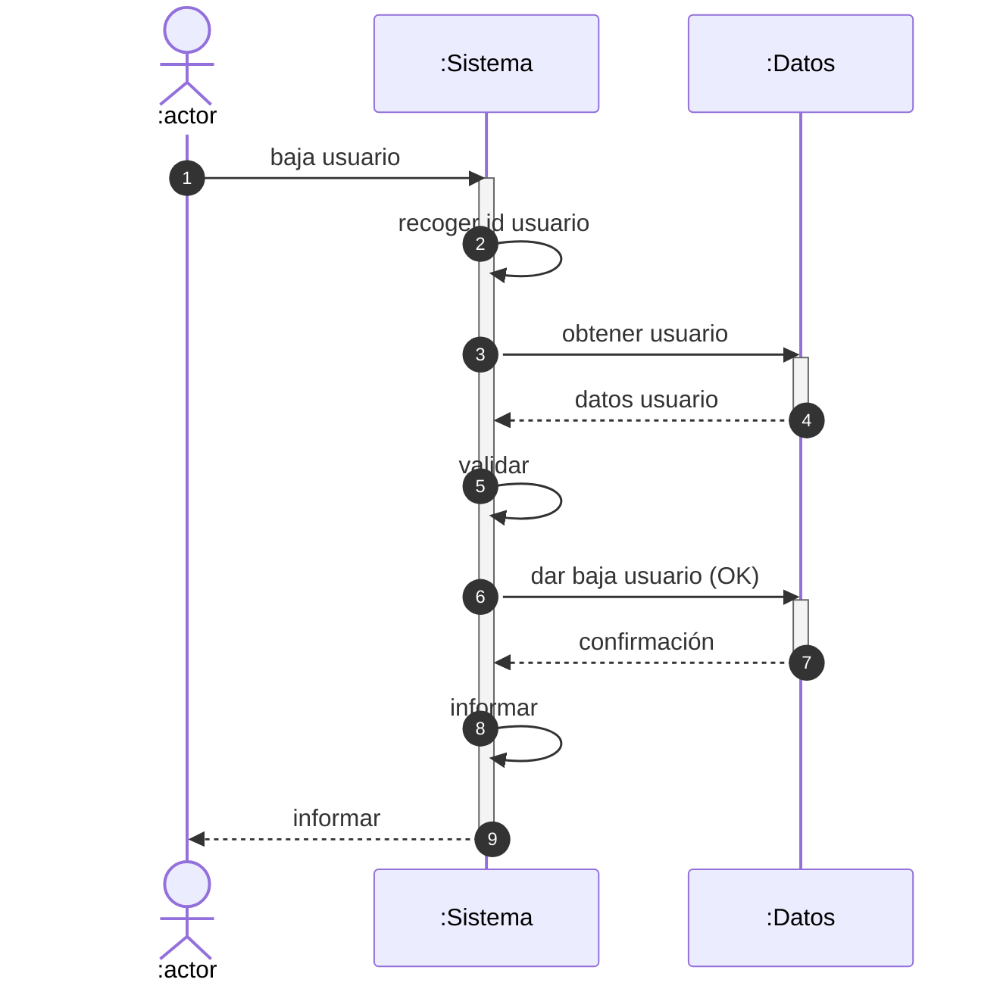
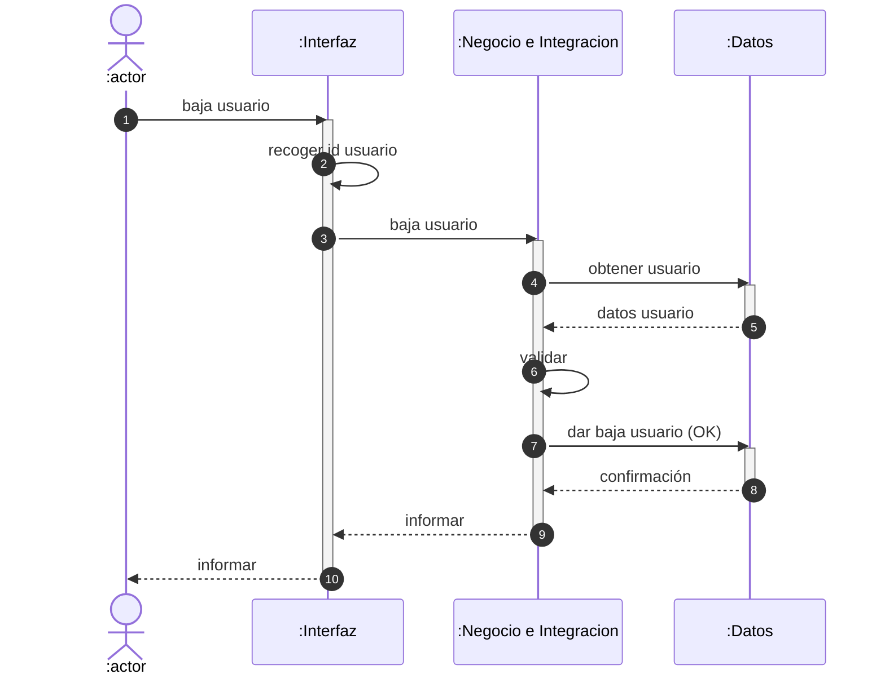
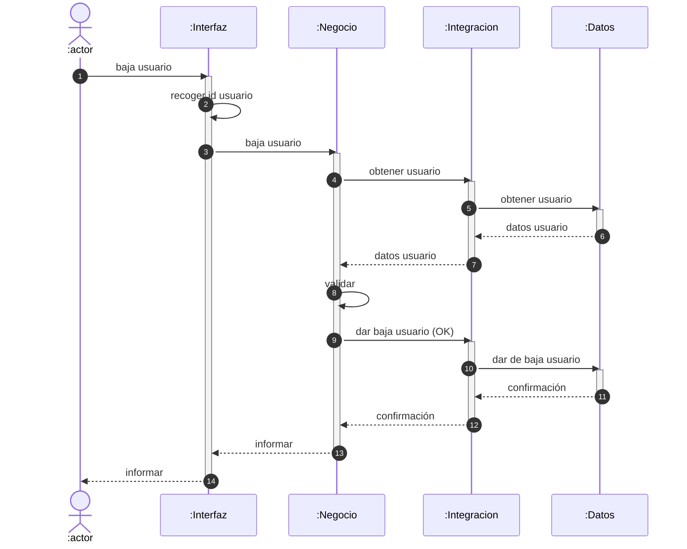

# Unidad 2: Arquitecturas Multicapa - Parte I

**Materia:** DAAS  
**Origen:** [[Unidad-2-P1.pdf]]  
**Tags:** #DAAS #Arquitectura #Multicapa #PatronesDeDiseño #SistemasDeInformacion #J2EE

---

## 1. Introducción al Diseño Arquitectónico

### Alcance y Enfoque de la Materia
Al diseñar sistemas de información, el objetivo central es definir una **organización arquitectónica sólida** y de alta calidad:
* **No nos ocuparemos** de los detalles de diseño a bajo nivel de componentes individuales dentro de cada capa (de eso se encargan disciplinas como *Interacción Persona-Computadora*, *Programación*, *Patrones de diseño de bajo nivel* o *Bases de datos*).
* **Nos ocuparemos** de dar un buen sistema de información desde el **punto de vista arquitectónico**.

> [!NOTE]
> **Definición de Arquitectura (IEEE Std 1471-2000):**  
> *"Es la organización fundamental de un sistema, expresado en sus componentes, sus relaciones entre ellos, y en el entorno y principios que guían su diseño y evolución."*

---

### Sistemas de Información y Aplicaciones Empresariales
Según la **ACM (Association for Computing Machinery)**, los sistemas de información abarcan:
1. Modelos y principios.
2. Gestión de bases de datos.
3. Almacenamiento y recuperación de información.
4. Aplicaciones de sistemas de información.
5. Interfaces y presentación de la información.

#### Características Clave de las Aplicaciones Empresariales
Las aplicaciones empresariales modernas presentan retos particulares:
* **Gran volumen de datos persistentes:** Requieren almacenamiento fiable a largo plazo.
* **Acceso concurrente masivo:** Múltiples usuarios y procesos operan sobre los mismos datos simultáneamente.
* **Gran cantidad de lógica de negocio:** Reglas complejas que modelan la operativa real del dominio.
* **Interfaces de usuario elaboradas:** Múltiples tipos de clientes con experiencias ricas.
* **Necesidad de integración heterogénea:** Deben conectarse con otras aplicaciones empresariales construidas con tecnologías y plataformas diversas.

Por ello, se estudian los **patrones de la arquitectura multicapa** (también denominados *patrones de arquitectura de aplicaciones empresariales*).

---

## 2. Fundamentos de los Patrones de Diseño

> [!NOTE]
> **Definición de Patrón (Christopher Alexander):**  
> *"Un patrón describe un problema que ocurre una y otra vez en nuestro entorno, así como la solución a ese problema de tal modo que se puede aplicar esta solución un millón de veces, sin hacer lo mismo dos veces."*

Aunque Alexander formuló esta definición en el campo de la arquitectura urbana y edilicia, aplica con total rigor al diseño de software orientado a objetos.

### Características de los Patrones de Diseño OO
* Son **soluciones simples y elegantes** a problemas específicos del diseño de software.
* Representan soluciones probadas que han ido evolucionando y madurando con el tiempo.
* **Qué NO consideran:**
  * Estructuras de datos concretas.
  * Diseños específicos de un dominio de negocio particular.
* **Qué son formalmente:** Son descripciones de **clases y objetos relacionados**, particularizados para resolver un problema de diseño general en un contexto determinado.

### Elementos que identifica cada patrón
1. **Clases e instancias participantes.**
2. **Roles y colaboraciones** entre dichas clases e instancias.
3. **Distribución de responsabilidades** dentro del sistema.

### Fuentes Principales de Patrones
* **GRASP** (*General Responsibility Assignment Software Patterns*), de Craig Larman.
* **GoF** (*Gang of Four* - Gamma, Helm, Johnson, Vlissides).
* **Core J2EE Patterns**, de Deepak Alur, John Crupi y Dan Malks.
* **PoEAA** (*Patterns of Enterprise Application Architecture*), de Martin Fowler.

---

## 3. Arquitectura de Una Capa (1-Tier / Monolito)

### Características
* **No divide** al sistema en capas de presentación, negocio e integración; todo el código convive en una única unidad lógica/física monolítica.

```
┌────────────────────────────────────────────────────────┐
│               Arquitectura de una capa                 │
│                                                        │
│  ┌──────────────────────────────────────────────────┐  │
│  │ Presentación (Interfaz / atención a clientes)    │  │
│  │                     +                            │  │
│  │ Negocio (Lógica y servicios del sistema)         │  │
│  │                     +                            │  │
│  │ Integración (Acceso a BD y sistemas externos)    │  │
│  └──────────────────────────────────────────────────┘  │
└────────────────────────────────────────────────────────┘
```

* **Clases del sistema:**
  `[ Sistema ] ───────> [ Datos ]`

### Comportamiento del Sistema (Caso: Baja de Usuario)



### Ventajas e Inconvenientes
* **Ventajas:**
  * Sencillez conceptual y de implementación en proyectos extremadamente pequeños.
* **Inconvenientes:**
  * **Acoplamiento absoluto:** No se puede modificar ni la interfaz de usuario, ni la lógica de negocio, ni la representación de datos sin afectar a las demás partes.
  * **Complicación fáctica:** A medida que el sistema crece, se vuelve inmanejable, frágil e imposible de mantener o evolucionar.

---

## 4. Arquitectura de Dos Capas (2-Tier / Cliente-Servidor)

### Características
* **Diferencia entre la capa de presentación y el resto del sistema**, pero **no diferencia la capa de negocio de la de integración**.
* La capa de presentación se comunica con el bloque de negocio/datos a través de una **Fachada (*Facade*)** intercambiando **Objetos de Transferencia (*Transfer Objects*)**.

```
┌────────────────────────────────────────────────────────┐
│                  Presentación                          │
└──────────────────────────┬─────────────────────────────┘
                           │ (Objetos de transferencia)
                    ┌──────┴──────┐
                    │   Fachada   │
┌───────────────────┴─────────────┴──────────────────────┐
│                Negocio e Integración                   │
│        (Lógica empresarial + acceso a datos)           │
└──────────────────────────┬─────────────────────────────┘
                           │
                    ┌──────┴──────┐
                    │    Datos    │
                    └─────────────┘
```

* **Clases del sistema:**
  `[ Interfaz ] ───────> [ Negocio e Integración ] ───────> [ Datos ]`

### Comportamiento del Sistema (Caso: Baja de Usuario)



### Ventajas e Inconvenientes
* **Ventajas:**
  * Permite realizar cambios en la interfaz de usuario o en el resto del sistema sin interferencias mutuas.
  * Simplicidad fáctica para aplicaciones medianas tradicionales.
* **Inconvenientes:**
  * Mayor complicación arquitectónica que la arquitectura de una capa.
  * **Falta de separación interna:** No se puede modificar la lógica del negocio o la representación/almacenamiento de datos sin interferencias mutuas.
* **Patrones relacionados:**
  * Suele emplearse el patrón **MVC (Modelo-Vista-Controlador)** en la capa superior.

---

## 5. Arquitectura Multicapa (N-Tier)

### Estructura Conceptual Base (3 Capas Lógicas)
Divide claramente las tres responsabilidades centrales:
1. **Capa de Presentación:** Encapsula toda la lógica de presentación (interfaz) necesaria para dar servicio a los clientes.
2. **Capa de Negocio:** Proporciona los servicios y la lógica funcional del sistema.
3. **Capa de Integración:** Responsable de la comunicación con los recursos (bases de datos) y sistemas externos.

---

### La Visión Real: Arquitectura de 5 Capas
En la práctica de sistemas empresariales, la arquitectura se compone de **cinco capas**, incorporando los extremos de la cadena:

```
┌────────────────────────────────────────────────────────┐
│                   1. Capa de Clientes                  │
│       (Dispositivos móviles, navegadores, APIs)        │
└──────────────────────────┬─────────────────────────────┘
                           │ (Canal / Protocolo)
┌──────────────────────────┴─────────────────────────────┐
│                 2. Capa de Presentación                │
│             (Vistas, controladores web)                │
└──────────────────────────┬─────────────────────────────┘
                           │ (Delegado / Objetos de transferencia)
┌──────────────────────────┴─────────────────────────────┐
│                   3. Capa de Negocio                   │
│        (Servicios de aplicación, lógica de dominio)    │
└──────────────────────────┬─────────────────────────────┘
                           │ (DAO / Objetos de transferencia)
┌──────────────────────────┴─────────────────────────────┐
│                 4. Capa de Integración                 │
│         (Data Access Objects, adaptadores, APIs)       │
└──────────────────────────┬─────────────────────────────┘
                           │ (Conexión / Driver)
┌──────────────────────────┴─────────────────────────────┐
│                   5. Capa de Recursos                  │
│          (Bases de datos relacionales, ERP, legacy)    │
└────────────────────────────────────────────────────────┘
```

#### Roles de las capas extremas:
* **Capa de Clientes:** Representa a todos los dispositivos, usuarios o aplicaciones cliente que acceden al sistema. Se sitúa por encima de la capa de presentación.
* **Capa de Recursos:** Contiene los datos del negocio y sistemas externos persistentes. Se sitúa por debajo de la capa de integración.

#### Intermediarios clave entre capas:
* **Delegado (*Business Delegate*):** Desacopla la capa de presentación de los servicios de negocio remotos/locales.
* **Data Access Object (DAO):** Abstrae y encapsula todos los accesos a la fuente de datos desde el negocio hacia la integración.
* **Objetos de Transferencia (*Transfer Objects / DTO*):** Transportan datos entre capas sin exponer lógica interna ni modelos acoplados.

---

### Clases y Secuencia del Sistema Multicapa

* **Relación de clases:**
  `[ Interfaz ] ───────> [ Negocio ] ───────> [ Integración ] ───────> [ Datos ]`



---

### Distinción Fundamental: Capas Lógicas vs. Capas Físicas (*Layers* vs. *Tiers*)

> [!IMPORTANT]
> * **Capas Lógicas (*Layers*):** Separación conceptual del código según sus responsabilidades (Presentación, Negocio, Integración).
> * **Capas Físicas (*Tiers*):** Distribución real del software en nodos o máquinas de hardware independientes.
> 
> *Ejemplo:* La capa lógica de presentación y la lógica de negocio **pueden residir en el mismo servidor físico** (ej. dentro de un mismo contenedor de servlets/Spring Boot) **o estar desplegadas en máquinas separadas** comunicadas por la red.

---

## 6. Ventajas e Inconvenientes de la Arquitectura Multicapa

### Ventajas Principales
* **Desacoplamiento total:** Se puede modificar cualquier capa sin afectar a las demás, siempre que se respete la interfaz/contrato.
* **Integración y reusabilidad:** Servicios y DAOs reutilizables por múltiples flujos y clientes.
* **Encapsulación y particionamiento:** Cada capa se concentra exclusivamente en su responsabilidad (*Separation of Concerns*).
* **Distribución y escalabilidad:** Posibilidad de escalar de forma independiente las capas que sufren mayor carga.
* **Mejora del rendimiento y fiabilidad:** Uso de balanceadores, clusters y tolerancia a fallos por capa.
* **Soporte para múltiples clientes:** Una misma capa de negocio e integración puede atender a clientes web, móviles y servicios externos.
* **Desarrollo independiente y rápido:** Equipos especializados pueden trabajar en paralelo sobre capas distintas.
* **Manejabilidad, empaquetamiento y configurabilidad:** Simplifica el mantenimiento evolutivo y el despliegue ordenado.

### Inconvenientes y Desafíos
* **Mayor complejidad arquitectónica:** Requiere un diseño inicial riguroso, más artefactos y mayor volumen de código fontal.
* **Posible pérdida de rendimiento (*Overhead*):** El salto de llamadas entre capas y la serialización de objetos a través de la red agregan latencia si la distribución física no está bien calculada.
* **Riesgos de seguridad:** Al existir más capas e interfaces expuestas, aumentan las posibles superficies de ataque y la complejidad para gestionar la autenticación y autorización end-to-end.
* **Gestión de componentes:** Mayor complejidad operativa en el despliegue, monitoreo y mantenimiento de los múltiples componentes distribuidos.

---

## 7. Mapa de Patrones por Capa (Avance a Partes II y III)

El catálogo de patrones empresariales distribuye las soluciones en las capas establecidas:

| Capa | Patrones Asociados |
| :--- | :--- |
| **Presentación** | • [[Parte 2/Front Controller\|Controlador Frontal (Front Controller)]]<br>• [[Parte 2/Patrón controlador de aplicación\|Controlador de Aplicación (Application Controller)]]<br>• MVC (Modelo-Vista-Controlador) |
| **Negocio** | • Objeto de Transferencia (*Transfer Object / DTO*)<br>• Servicio de Aplicación (*Application Service*)<br>• Delegado del Negocio (*Business Delegate*)<br>• Objeto del Negocio (*Business Object*) |
| **Integración** | • Data Access Object (*DAO*)<br>• Almacén del Dominio (*Domain Store*) |

---

## Enlaces Relacionados
* [[Parte 1/Arquitectura]]
* [[Parte 1/Patrón de diseño]]
* [[Parte 1/Arquitectura de una capa]]
* [[Parte 1/Arquitectura de dos capas]]
* [[Parte 1/Arquitectura multicapa]]
* Siguiente: `[[02 - Resumen - Unidad 2 - Arquitecturas Multicapa Parte II]]`
