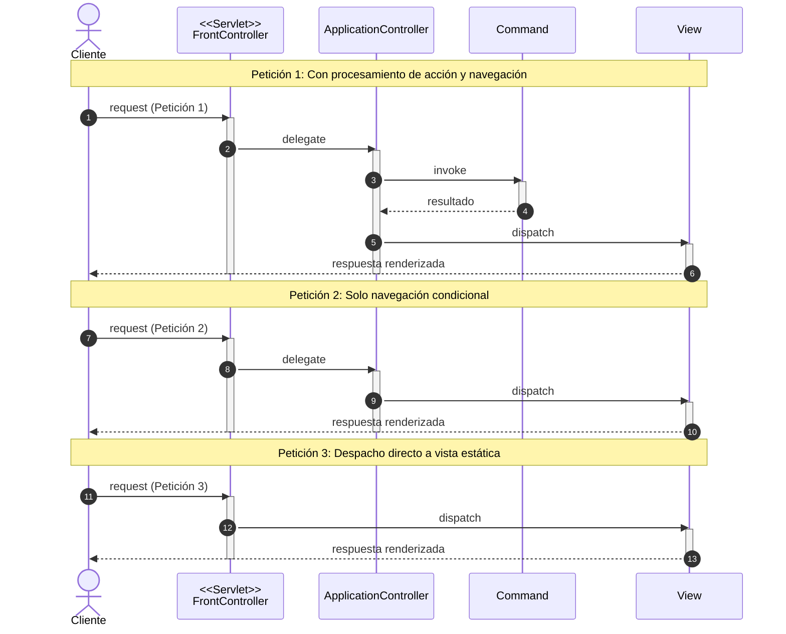
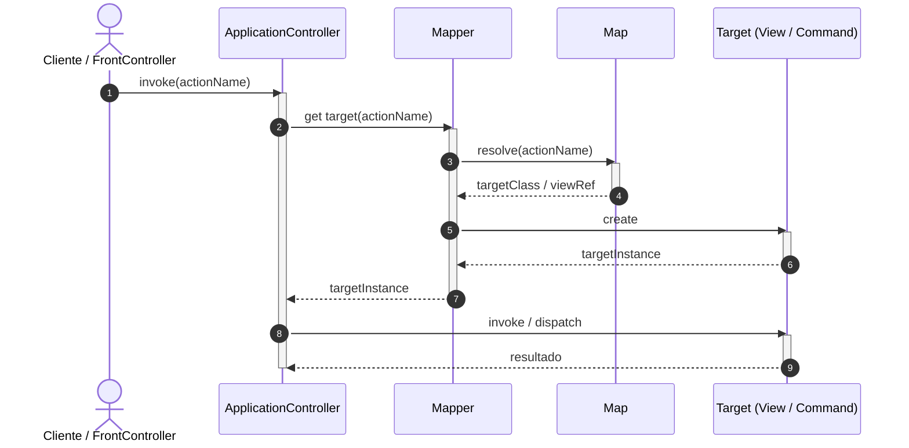
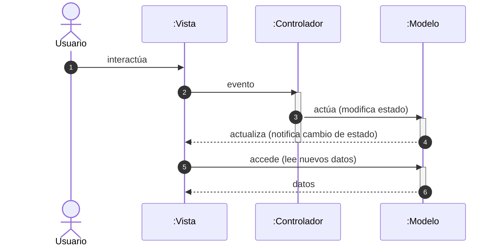
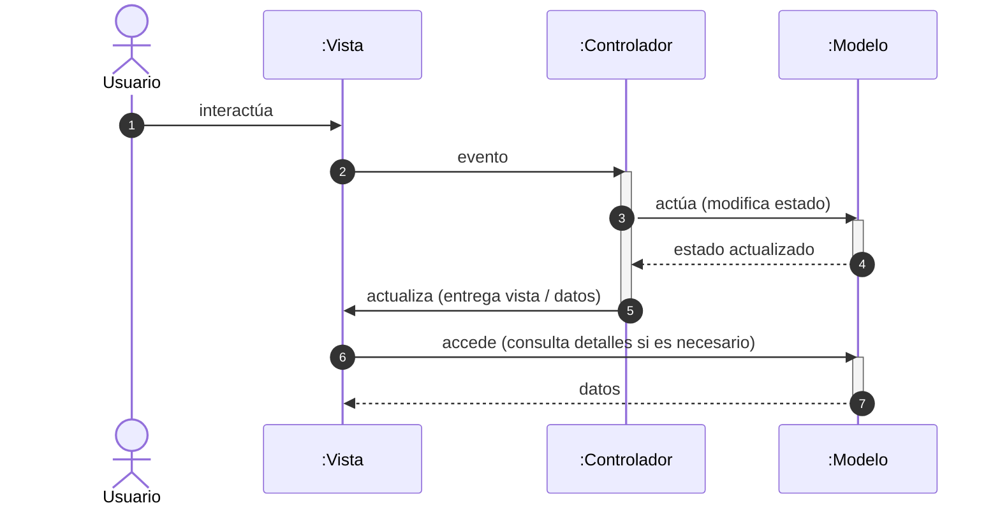
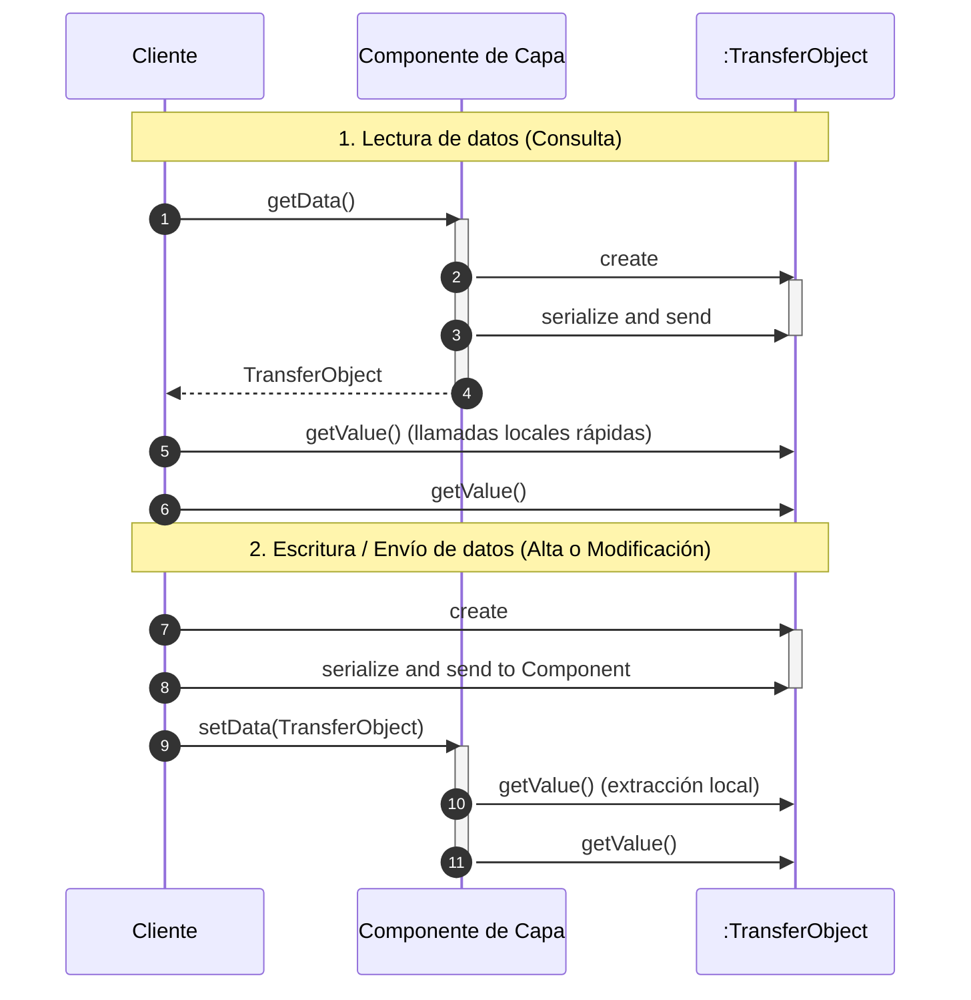
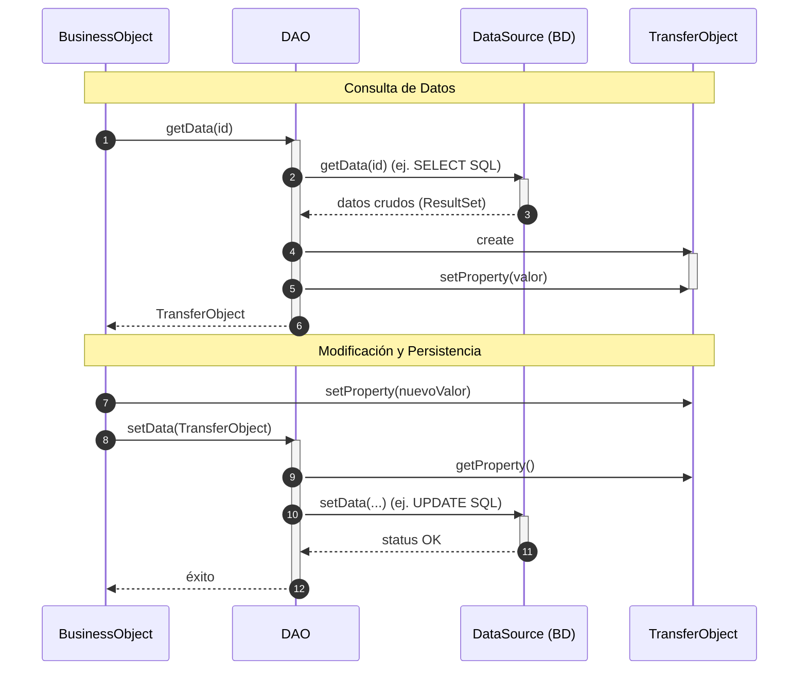

# Unidad 2: Arquitecturas Multicapa - Parte II (Patrones de Diseño)

**Materia:** DAAS  
**Origen:** [[Unidad-2-P2.pdf]]  
**Tags:** #DAAS #Arquitectura #Multicapa #PatronesDeDiseño #FrontController #ApplicationController #MVC #TransferObject #DAO #J2EE

---

## 1. Visión General de los Patrones por Capa

En esta segunda parte se profundiza en los patrones de diseño orientados a estructurar y desacoplar las capas de **Presentación**, **Negocio** e **Integración**:

```
┌────────────────────────────────────────────────────────┐
│                   Capa de Presentación                 │
│  • 1. Patrón Controlador Frontal (Front Controller)   │
│  • 2. Patrón Controlador de Aplicación (App Controller)│
│  • 3. Macro-Patrón MVC (Modelo-Vista-Controlador)      │
└──────────────────────────┬─────────────────────────────┘
                           │ (Transfer Objects)
┌──────────────────────────┴─────────────────────────────┐
│                     Capa de Negocio                    │
│  • 4. Patrón Transferencia (Transfer Object / DTO)     │
└──────────────────────────┬─────────────────────────────┘
                           │ (Transfer Objects)
┌──────────────────────────┴─────────────────────────────┐
│                   Capa de Integración                  │
│  • 5. Patrón Objeto de Acceso a Datos (DAO)            │
└────────────────────────────────────────────────────────┘
```

---

## 2. Patrón Controlador Frontal (*Front Controller*)

### Propósito
> **Proporciona un punto de acceso centralizado para el manejo de todas las peticiones que ingresan a la capa de presentación.**

### Motivación
En aplicaciones web sin un controlador centralizado, cada página o vista suele encargarse de recibir peticiones, autenticar al usuario y decidir la navegación, generando lógica repetida y desordenada. El patrón resuelve esto mediante:
* **Evitar lógica de control duplicada:** Centraliza la autenticación, autorización, validación de sesiones, internacionalización y logging.
* **Aplicar lógica común a distintas peticiones:** Un solo punto de intercepción antes de delegar a la lógica específica.
* **Separar procesamiento de la vista:** La vista solo renderiza; no decide qué procesar.
* **Punto de acceso centralizado y controlado:** Simplifica las políticas globales de seguridad y auditoría.

---

### Estructura e Interacción

El controlador frontal (habitualmente un `Servlet` o filtro central) recibe las peticiones HTTP y decide cómo manejarlas:



### Consecuencias
* **Ventajas:**
  * **Centraliza el control:** Políticas globales en un único punto.
  * **Mejora la gestión y mantenibilidad:** Menos puntos de entrada dispersos.
  * **Fomenta la reutilización de código:** Módulos de seguridad y auditoría reutilizables.
  * **Mejora la separación de roles:** Los diseñadores se concentran en las Vistas y los programadores en los controladores y comandos.
* **Inconvenientes:**
  * En aplicaciones de gran tamaño, el Front Controller puede volverse un **cuello de botella** o una clase sobrecargada si asume responsabilidades de navegación que deberían estar delegadas.

---

## 3. Patrón Controlador de Aplicación (*Application Controller*)

### Propósito
> **Centraliza y modulariza la gestión de acciones (*Commands*) y de vistas (*Views*), desacoplando la lógica de navegación de la infraestructura web.**

### Motivación y Cuándo Aplicarlo
Mientras que el *Front Controller* se encarga de recibir la petición HTTP física, el *Application Controller* se encarga de la lógica abstracta de aplicación:
1. **Reutilización:** Permite reutilizar el flujo de navegación y ejecución de acciones entre distintas interfaces o canales (web, móvil, consola).
2. **Extensibilidad incremental:** Facilita añadir nuevos casos de uso o vistas modificando mapas de configuración sin tocar código crítico.
3. **Independencia del contenedor web:** Al desacoplarse de clases como `HttpServletRequest` o `HttpServletResponse`, la lógica de flujo se puede someter a **pruebas unitarias automatizadas** fuera de un servidor web.

* **Debe aplicarse cuando:** Se desea centralizar la recuperación e invocación dinámica de componentes de procesamiento de peticiones (comandos) y la selección de vistas.

---

### Estructura de Clases

```
┌─────────────────────────────────┐
│             Client              │
│ (FrontController / Interceptor) │
└────────────────┬────────────────┘
                 │ delegates
                 ▼
┌─────────────────────────────────┐           resolves          ┌─────────────────┐
│      ApplicationController      │────────────────────────────>│     Mapper      │
└────────────────┬────────────────┘                             └────────┬────────┘
                 │ invokes / provides                                    │ uses
                 ▼                                                       ▼
┌─────────────────────────────────┐                             ┌─────────────────┐
│        <<Target>>               │                             │       Map       │
│  (Interfaz de procesamiento)    │                             └─────────────────┘
└────────┬───────────────┬────────┘
         │               │
┌────────┴───────┐ ┌─────┴────────┐
│     View       │ │   Command    │
└────────────────┘ └──────────────┘
```

* **Participantes:**
  * `ApplicationController`: Orquesta la resolución y ejecución de acciones y vistas.
  * `Mapper`: Consulta la estrategia de mapeo (archivo XML, anotaciones, base de datos).
  * `Map`: Estructura de pares clave-valor que asocia nombres de peticiones/eventos con clases ejecutoras o plantillas de vista.
  * `Target`: Abstracción común para `Command` (lógica a ejecutar) y `View` (recurso a mostrar).

### Interacción (Diagrama de Secuencia)



### Consecuencias
* **Ventajas:**
  * Alta modularidad y bajo acoplamiento.
  * Gran extensibilidad (abierto a añadir vistas/acciones sin recompilar el flujo central).
  * Testeabilidad superior al estar libre de dependencias HTTP.
* **Inconvenientes:**
  * Mayor nivel de indirección y cantidad de clases.
  * Curva de aprendizaje y posible sobreingeniería en sistemas con flujos muy simples.

---

## 4. Patrón Modelo-Vista-Controlador (MVC)

### Contexto y Evolución
En muchas arquitecturas prácticas, no se separan de manera estricta el *Front Controller* y el *Application Controller*, sino que se fusionan en un único **Controlador** que coordina todo el ciclo de interacción.
A esta organización integral se la denomina **Modelo-Vista-Controlador (MVC)**.

> [!NOTE]
> Formalmente, MVC es un **macro-patrón arquitectónico** (creado originalmente en Smalltalk-80). Aunque no nació en el catálogo J2EE, es el patrón por excelencia adoptado por los frameworks modernos de presentación (Spring MVC, JSF, Django, Ruby on Rails, Angular/React con adaptaciones).

---

### Componentes y Responsabilidades

| Componente | Responsabilidades Principales |
| :--- | :--- |
| **Modelo** | • Encapsula el estado de la aplicación y la lógica de dominio.<br>• Responde consultas sobre el estado.<br>• Expone la funcionalidad y reglas de negocio.<br>• Notifica cambios de estado a las vistas registradas. |
| **Vista** | • Renderiza la información del modelo al usuario.<br>• Solicita actualizaciones al modelo.<br>• Captura los gestos/eventos del usuario y los traslada al controlador.<br>• Permite al controlador seleccionar cuál es la vista visible. |
| **Controlador** | • Define el comportamiento global de la aplicación.<br>• Mapea las acciones del usuario hacia actualizaciones sobre el modelo.<br>• Selecciona y entrega las vistas correspondientes.<br>• Suele existir uno por cada caso de uso o funcionalidad. |

---

### Flujo de Interacción Global

```mermaid
flowchart TD
    subgraph UI ["Interacción con Usuario"]
        User((Usuario))
    end

    subgraph MVC ["Patrón MVC"]
        Vista["<b>VISTA</b><br/>• Muestra los modelos<br/>• Solicita actualizaciones<br/>• Captura gestos del usuario"]
        Controlador["<b>CONTROLADOR</b><br/>• Mapea acciones a negocio<br/>• Selecciona vistas<br/>• Define comportamiento"]
        Modelo["<b>MODELO</b><br/>• Encapsula el estado<br/>• Ejecuta funcionalidad<br/>• Notifica cambios"]
    end

    User -->|Gestos / Clics| Vista
    Vista -->|1. Envía gestos / eventos| Controlador
    Controlador -->|2. Cambio de estado / Ejecuta acción| Modelo
    Controlador -->|3. Selecciona vista a mostrar| Vista
    Modelo -.->|4. Notificación de cambio (Observer)| Vista
    Vista -->|5. Consulta de estado| Modelo
    Vista -->|Renderiza salida| User
```

---

### Las Dos Variantes de MVC: Modelo Activo vs. Modelo Pasivo

#### 1. Variante Modelo Activo (Desktop / Push)
* **Principio:** **El Modelo actualiza directamente a las Vistas** mediante el patrón *Observer*.
* Ocurre cuando el estado del modelo cambia de manera asíncrona o independiente de las acciones inmediatas del usuario (común en aplicaciones de escritorio, clientes ricos, dashboards en tiempo real con WebSockets).



#### 2. Variante Modelo Pasivo (Web Tradicional / Pull)
* **Principio:** **El Controlador es quien actualiza a las Vistas.**
* El modelo no guarda referencia ni conoce a las vistas. Típico del modelo petición/respuesta HTTP: el usuario envía una solicitud, el controlador actualiza el modelo, toma los datos y selecciona la vista que debe renderizarse.



### Consecuencias de MVC
* **Ventajas:**
  * **Modelo totalmente independiente** de la salida y de la tecnología de entrada.
  * **Múltiples vistas simultáneas** para un mismo modelo (ej. vista web HTML, endpoint REST en JSON, vista móvil, reporte PDF).
  * **Cambios independientes** en la interfaz y en la lógica funcional.
* **Inconvenientes:**
  * Incremento en la complejidad estructural y en el número de archivos.
  * Sobrecarga de comunicación en sistemas interactivos de grano fino si no se diseñan bien los eventos.

---

## 5. Patrón Transferencia (*Transfer Object / DTO*)

### Propósito
> **Independizar el intercambio de datos entre capas y reducir las llamadas remotas mediante la transferencia de estructuras de datos completas y autocontenidas.**
> *También conocido como:* **Transfer Object**, **Data Transfer Object (DTO)** o **Value Object**.

---

### Motivación y Problema que Resuelve
1. **Desacoplamiento de representación:** Si queremos que las capas sean independientes, ninguna capa debe conocer la representación interna de los datos de otra capa:
   * *Ejemplo:* Si la capa de integración accede a una base de datos relacional con tablas y columnas, la capa de presentación y de negocio **no deben acoplarse a filas, columnas ni tipos SQL**.
2. **Eliminación del problema "Chatty I/O":** Sin DTOs, si un cliente remoto necesita leer 10 atributos de un cliente (`nombre`, `dni`, `saldo`, etc.), tendría que hacer 10 llamadas de red separadas (`getNombre()`, `getDni()`). Con un *Transfer Object*, se hace **una única llamada que viaja serializada con todos los datos**.

---

### El concepto de POJO (*Plain Old Java Object*)
El *Transfer Object* se modela habitualmente como un **POJO**:
> **POJO:** Es una instancia de una clase Java simple que **no extiende ni implementa interfaces especiales de frameworks pesados**. Contiene únicamente atributos privados, constructores y métodos accesores (*getters* y *setters*), implementando habitualmente `Serializable`.

```
┌─────────────────────────────────┐
│             Client              │
└────────────────┬────────────────┘
                 │ accesses
                 ▼
┌─────────────────────────────────┐           creates / uses          ┌───────────────────────────┐
│           Component             │──────────────────────────────────>│      <<POJO>>             │
│ (Pres / Biz / Int Component)    │                                   │    TransferObject         │
└─────────────────────────────────┘                                   └───────────────────────────┘
```

---

### Flujo de Interacción: Lectura vs. Escritura



### Consecuencias
* **Ventajas:**
  * **Independiza completamente las capas:** Protege a los clientes de cambios en la estructura de persistencia o tablas.
  * **Optimización drástica de red:** Reduce el número de viajes de ida y vuelta (*round-trips*) por la red.
* **Inconvenientes:**
  * **Proliferación de clases:** Duplica estructuras de datos en forma de DTOs espejo.
  * **Sobrecarga de mapeo:** Requiere código o librerías de mapeo (ej. MapStruct, ModelMapper) para convertir entre entidades y objetos de transferencia.

---

## 6. Patrón Objeto de Acceso a Datos (*Data Access Object - DAO*)

### Propósito
> **Permite acceder a la capa de datos (o recursos externos en general), proporcionando a la capa de negocio representaciones orientadas a objetos desacopladas del almacenamiento físico subyacente.**
> *También conocido como:* **DAO** u **Objeto de Acceso a Datos**.

---

### Motivación
Los sistemas de información almacenan grandes volúmenes de datos en repositorios estructurados (bases de datos relacionales, XML, sistemas de archivos, ERPs, APIs externas).  
Manipular los datos directamente desde la lógica de negocio obliga a:
1. Conocer los **mecanismos de acceso técnico** (APIs de JDBC, sentencias SQL, controladores ODBC, llamadas de bajo nivel al SO).
2. Conocer la **representación física exacta** (nombres de columnas, tipos relacionales, formato binario, XML tags).

> [!IMPORTANT]
> **Principio de Diseño:**  
> Un cliente de la capa de negocio **debe ser completamente independiente de los mecanismos de almacenamiento y representación de los datos**.

* **Cuándo aplicarlo:**
  * Siempre que se desee **independizar la representación y acceso a los datos de su procesamiento**.
  * Permite sustituir o migrar la fuente de datos (ej. de MySQL a PostgreSQL o a un servicio Cloud) **sin modificar ni una sola línea de la lógica de negocio**. Solo se actualiza la capa de integración, que es mucho más ligera y localizada.

---

### Estructura de Clases

```
┌─────────────────────────────────┐
│         BusinessObject          │
│        (Lógica de negocio)      │
└────────────────┬────────────────┘
                 │ uses
                 ▼
┌─────────────────────────────────┐           encapsulates            ┌───────────────────────────┐
│        DataAccessObject         │──────────────────────────────────>│        DataSource         │
│             (DAO)               │                                   │ (BD, JDBC, XML, Archivos) │
└────────────────┬────────────────┘                                   └───────────────────────────┘
                 │ creates / uses
                 ▼
┌─────────────────────────────────┐
│         TransferObject          │
│             (DTO)               │
└─────────────────────────────────┘
```

---

### Interacción (Diagrama de Secuencia de Persistencia y Consulta)



---

### Regla Crítica: Tratamiento de Excepciones en el DAO

> [!CAUTION]
> **Gestión obligatoria de excepciones:**
> Es **fundamental que los DAOs capturen y traduzcan las excepciones técnicas** generadas al acceder a recursos externos (como `SQLException`, `IOException`).
> * Si un DAO dejara escapar una `SQLException` hacia la capa de negocio, rompería inmediatamente el principio de bajo acoplamiento (el negocio sabría que por detrás hay SQL).
> * El DAO debe atrapar la excepción técnica de bajo nivel y relanzar una **excepción propia de la aplicación** (ej. `DataAccessException`, `RegistroNoEncontradoException`).
> * De este modo, la capa de negocio sabrá con exactitud qué ha sucedido funcionalmente si ocurre un fallo, **sin acoplarse a la tecnología del motor de base de datos**.

---

### Consecuencias
* **Ventajas:**
  * **Independencia absoluta** del tratamiento de datos respecto a su acceso físico y estructura.
  * **Negocio protegido** frente a migraciones o cambios de esquema de base de datos.
  * **Facilita enormemente las pruebas unitarias (*Testing*):** Permite crear implementaciones falsas (*Mocks / Stubs*) del DAO para probar la lógica de negocio sin levantar una base de datos real.
* **Inconvenientes:**
  * Incrementa el número de clases e interfaces en la capa de integración.
  * Puede introducir código *boilerplate* (repetitivo) si no se emplean frameworks ORM modernos (como Spring Data JPA / Hibernate).

---

## 7. Tabla Comparativa Resumen: Patrones Parte II

| Patrón | Capa | Propósito Central | Intermediarios / Artefactos |
| :--- | :--- | :--- | :--- |
| **Front Controller** | Presentación | Centralizar el punto de entrada, seguridad y logging de peticiones | `<<Servlet>>`, `Command`, `View` |
| **Application Controller** | Presentación | Centralizar y modularizar la resolución dinámica de acciones y vistas | `Mapper`, `Map`, `Target` |
| **MVC** | Presentación / Arquitectónico | Desacoplar la interfaz del estado y las reglas de interacción | `Modelo`, `Vista`, `Controlador` (Variantes Activa y Pasiva) |
| **Transfer Object (DTO)** | Negocio / Inter-capa | Transportar conjuntos de datos en grano grueso entre capas sin acoplamiento | Clases `<<POJO>>`, `Serializable` |
| **Data Access Object (DAO)** | Integración | Abstraer y encapsular el acceso y persistencia a fuentes de datos | `DataSource`, `TransferObject`, excepciones de aplicación |

---

## Enlaces Relacionados
* Anterior: [[01 - Resumen - Unidad 2 - Parte I]]
* Siguiente: `[[03 - Resumen - Unidad 2 - Arquitecturas Multicapa Parte III]]`
* Patrones detallados existentes en la bóveda:
  * [[1 - Front Controller]]
  * [[2 - Patrón controlador de aplicación]]
  * [[Arquitectura multicapa]]
  * [[Patrón de diseño]]
