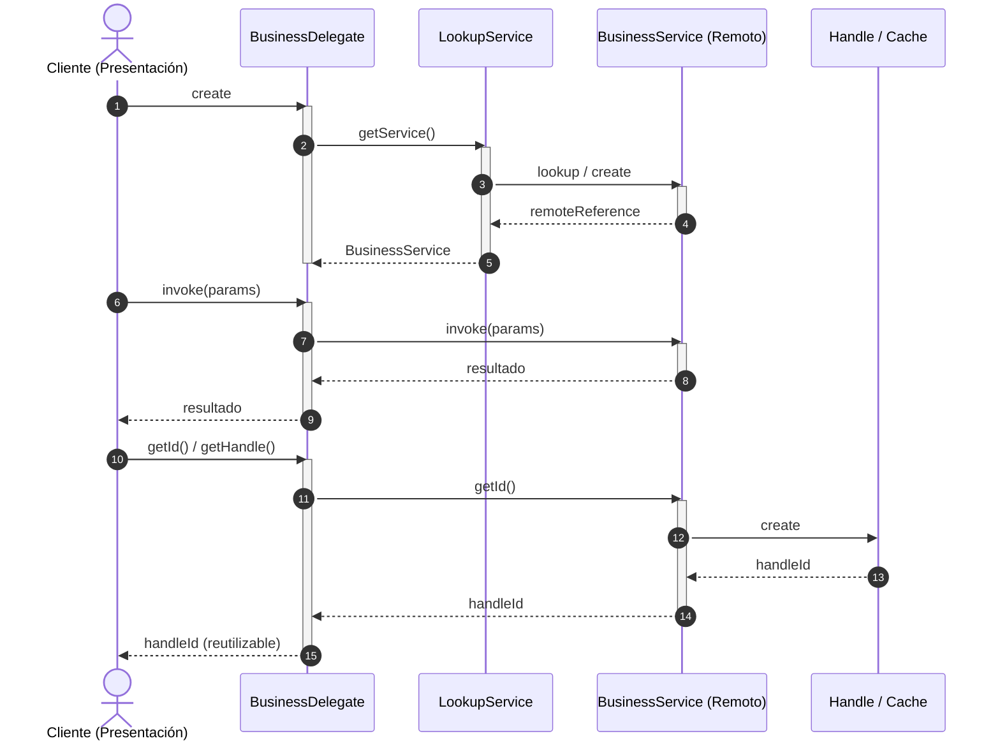
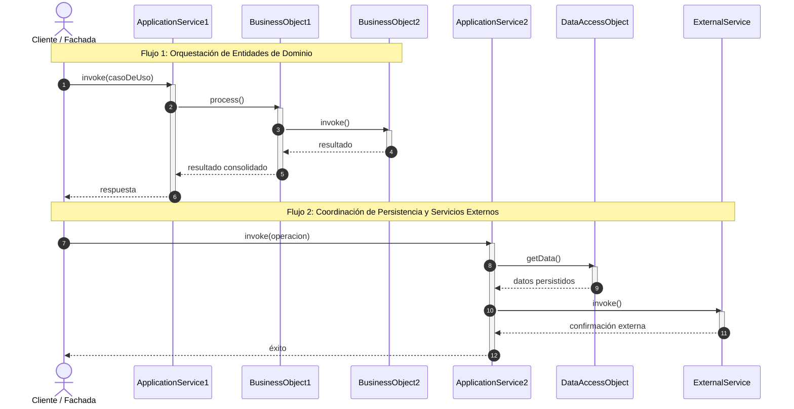
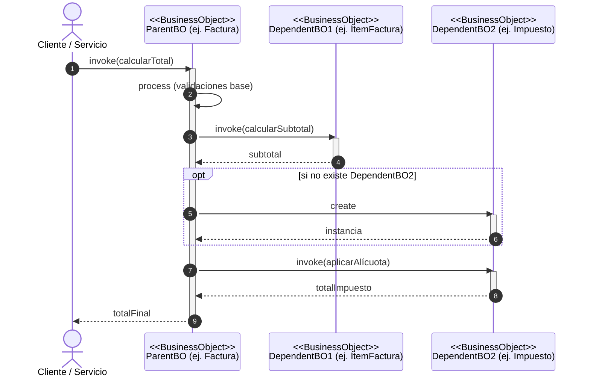
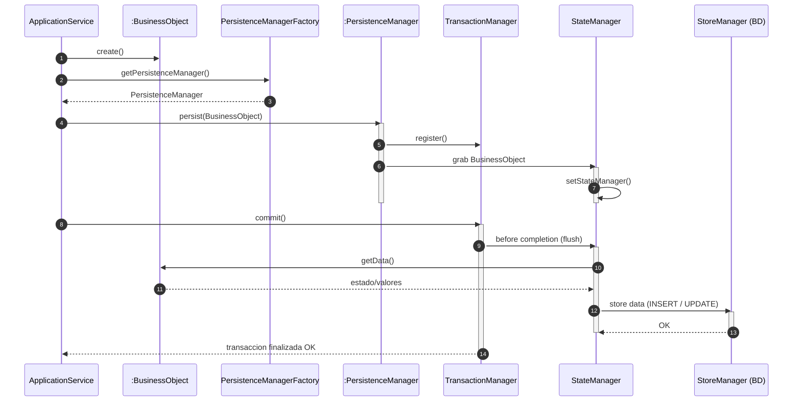
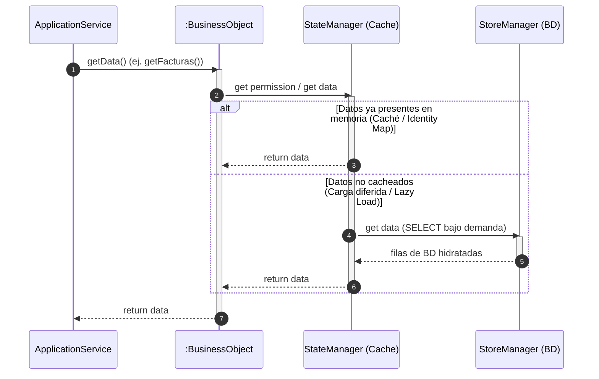

# Unidad 2: Arquitecturas Multicapa - Parte III (Patrones de Negocio y Persistencia Avanzada)

**Materia:** DAAS  
**Origen:** [[Unidad-2-P3.pdf]]  
**Tags:** #DAAS #Arquitectura #Multicapa #PatronesDeDiseño #BusinessDelegate #ApplicationService #BusinessObject #DomainStore #ORM #J2EE

---

## 1. Visión General de los Patrones de la Parte III

Esta tercera entrega concluye el catálogo de patrones de arquitectura multicapa, profundizando en la **Capa de Negocio** y en la **Capa de Integración/Persistencia Avanzada**:

```
┌────────────────────────────────────────────────────────┐
│                  Capa de Presentación                  │
│       (Controladores, Vistas, Clientes Web/Móvil)      │
└──────────────────────────┬─────────────────────────────┘
                           │ (Desacopla la red y localización)
                    ┌──────┴──────┐
                    │ 6. Delegado │ (Business Delegate)
                    └──────┬──────┘
┌──────────────────────────┴─────────────────────────────┐
│                    Capa de Negocio                     │
│                                                        │
│  ┌──────────────────────────────────────────────────┐  │
│  │ 7. Servicio de Aplicación (Application Service)  │  │
│  │    • Orquesta flujos y lógica transaccional      │  │
│  │    • Componentes SIN estado (Stateless)          │  │
│  └───────────────────────┬──────────────────────────┘  │
│                          │ coordina / invoca           │
│  ┌───────────────────────▼──────────────────────────┐  │
│  │ 8. Objeto del Negocio (Business Object)          │  │
│  │    • Entidades de dominio con estado y lógica    │  │
│  └───────────────────────┬──────────────────────────┘  │
└──────────────────────────┼─────────────────────────────┘
                           │ persiste / recupera
┌──────────────────────────┴─────────────────────────────┐
│                 Capa de Integración                    │
│                                                        │
│  ┌──────────────────────────────────────────────────┐  │
│  │ 9. Almacén del Dominio (Domain Store / ORM)      │  │
│  │    • Mapeo objeto-relacional transparente        │  │
│  │    • Transacciones, Lazy Loading e Identity Map  │  │
│  └──────────────────────────────────────────────────┘  │
└────────────────────────────────────────────────────────┘
```

---

## 2. Patrón Delegado del Negocio (*Business Delegate*)

### Propósito
> **Evita que los clientes (como la capa de presentación) tengan que lidiar directamente con la complejidad técnica y los detalles de acceso a componentes distribuidos en una aplicación multicapa.**
> *También conocido como:* **Business Delegate**.

---

### Motivación
Cuando la capa de negocio se despliega sobre componentes distribuidos o remotos (ej. EJBs en un servidor de aplicaciones, servicios RMI, o RPC), los clientes de presentación enfrentan problemas serios:
1. **Acoplamiento a la tecnología de red:** Deben conocer APIs complejas de búsqueda remota (como JNDI - *Java Naming and Directory Interface*), creación de contextos y manejo de conexiones remotas.
2. **Fragilidad frente a cambios:** Si la dirección de red del servicio, la interfaz remota o el protocolo cambian, todas las vistas y controladores se rompen.
3. **Pérdida de rendimiento:** Múltiples clientes haciendo búsquedas repetidas de servicios a través de la red saturan el servidor.

**Solución del Delegado:**  
Se sitúa del lado del cliente como un intermediario local. El cliente interactúa con el `BusinessDelegate` mediante una interfaz Java sencilla y transparente; el delegado se encarga de resolver la localización, la invocación remota, el reintento de fallos y el almacenamiento en caché.

---

### Estructura de Clases

```
┌─────────────────────────────────┐
│             Client              │
│     (Capa de presentación)      │
└────────────────┬────────────────┘
                 │ uses
                 ▼
┌─────────────────────────────────┐           uses            ┌───────────────────────────┐
│        BusinessDelegate         │──────────────────────────>│      BusinessService      │
└────────────────┬────────────────┘                           │ (Servicio remoto / EJB)   │
                 │ uses                                       └─────────────▲─────────────┘
                 ▼                                                          │ lookup / create
┌─────────────────────────────────┐                                         │
│          LookupService          │─────────────────────────────────────────┘
│    (Localizador de servicios)   │
└─────────────────────────────────┘
```

---

### Interacción (Diagrama de Secuencia)



### Consecuencias
* **Ventajas:**
  * **Oculta los detalles técnicos:** Oculta búsquedas JNDI, middleware, excepciones de red y serialización.
  * **Independiza capas:** La capa de presentación se mantiene totalmente agnóstica a si el negocio está en la misma JVM o en un clúster remoto.
  * **Capacidad de Caché:** Puede cachear referencias remotas y datos del negocio de solo lectura, mejorando drásticamente el rendimiento.
* **Inconvenientes:**
  * Introduce un nivel adicional de indirección y mantenimiento de clases delegadas.

---

## 3. Patrón Servicio de Aplicación (*Application Service*)

### Propósito
> **Centraliza y coordina la lógica de negocio del sistema, agrupando las funcionalidades relacionadas y orquestando las interacciones entre los objetos del negocio y los servicios de infraestructura.**
> *También conocido como:* **Application Service** (o capa de servicios).

---

### Motivación y Ubicación Arquitectónica
En una arquitectura multicapa rigurosa, la lógica de negocio debe situarse en un lugar específico:
* **No en los clientes/presentación:** Dejar reglas de negocio en controladores o vistas rompe la arquitectura multicapa y genera código duplicado e imposible de reutilizar por otros clientes.
* **No en la fachada:** Incluir lógica en la fachada (*Service Facade*) corrompe su propósito original (la fachada solo debe ser un punto unificado de entrada y enrutamiento, no un contenedor de reglas de dominio).
* **Por lo tanto:** La lógica transaccional y de orquestación se sitúa de forma centralizada en los **Servicios de Aplicación**.

---

### Cuándo Aplicarlo
1. Se desea representar una **lógica de negocio que actúe sobre múltiples servicios u objetos del negocio** de manera coordinada (ej. coordinar un cobro, un descuento y la actualización de stock en una compra).
2. Se necesita agrupar funcionalidades operativas afines bajo un mismo límite transaccional.
3. Se necesita encapsular lógica transaccional que no le pertenece naturalmente a una sola entidad del negocio.

---

### Estructura de Clases

```
┌─────────────────────────────────┐
│             Client              │
│ (ServiceFacade / POJO Helper)   │
└────────────────┬────────────────┘
                 │ accesses
                 ▼
┌─────────────────────────────────┐
│       ApplicationService        │
└────┬──────────────┬─────────────┴───┐
     │ invokes      │ invokes         │ invokes
     ▼              ▼                 ▼
┌───────────┐ ┌───────────┐     ┌───────────┐
│ Business  │ │DataAccess │     │  Service  │
│  Object   │ │  Object   │     │ (Externo) │
└───────────┘ └───────────┘     └───────────┘
```

---

### Interacción y Orquestación



---

### Nota Crítica: Naturaleza Stateless de los Servicios

> [!IMPORTANT]
> **Sin Estado (*Stateless*):**
> Los servicios de aplicación **no suelen tener atributos de estado**; esto los hace extremadamente ligeros, escalables horizontalmente y libres de condiciones de carrera (*thread-safe*).  
> 
> *La gran pregunta:* Si los servicios no tienen atributos... **¿dónde residen los datos y atributos del negocio junto con su comportamiento propio?**  
> *Respuesta:* En los **Objetos del Negocio (*Business Objects*)**.

---

### Consecuencias
* **Ventajas:**
  * **Centraliza la lógica de negocio:** Punto único de verdad para las reglas del sistema.
  * **Mejora la reusabilidad:** Reutilizado por clientes web, REST, tareas batch y colas de mensajes.
  * **Elimina la duplicación de código:** Lógica unificada y testeable de forma aislada.
  * **Simplifica las fachadas:** Las fachadas son meras delegadas hacia los servicios.
* **Inconvenientes:**
  * Añade un nivel más de indirección.

---

## 4. Patrón Objeto del Negocio (*Business Object*)

### Propósito
> **Representa la lógica de negocio y el modelo de dominio en términos puramente orientados a objetos, uniendo los datos (atributos) con los métodos que operan sobre ellos.**
> *También conocido como:* **Business Object** o **Entidad del Dominio**.

---

### Motivación: Del Modelo Anémico al Modelo Rico
* **Sistemas CRUD o con poca lógica:** Cuando la lógica es casi inexistente, las aplicaciones suelen permitir que los servicios accedan directamente al DAO (ej. `ServicioUsuarioImpl` invoca directamente `UsuarioDAO`).
* **Sistemas empresariales complejos:** Si sobre los datos existe una **gran cantidad de procesos computacionales y reglas de negocio**, estos procesos deben encapsularse dentro de un objeto que represente formalmente la entidad:
  * Evita el antipatrón de *Modelo Anémico* (donde las clases solo tienen getters/setters y la lógica está desparramada en servicios infinitos).
  * Promueve alta cohesión: el objeto que tiene los datos es quien sabe validar sus estados y aplicar sus reglas.

---

### Jerarquía e Interacción entre Objetos de Negocio

Los objetos del negocio suelen estructurarse en **relaciones padre-hijo** (*Aggregates / Aggregate Roots*):



### Consecuencias
* **Ventajas:**
  * **Enfoque OO genuino:** Aprovecha el polimorfismo, la herencia y la encapsulación.
  * **Centraliza el comportamiento del negocio:** Las reglas viven junto a los datos que modifican.
  * **Alta reusabilidad:** Reduce duplicaciones de validaciones idénticas en múltiples lugares.
* **Inconvenientes:**
  * **Objetos inflados (*Bloated Objects*):** Si no se divide con cuidado el dominio, pueden surgir clases gigantes ("God Classes") con excesivas responsabilidades.
  * **Desafío de Persistencia:** Al tener relaciones complejas, herencia y encapsulación, resulta muy difícil persistirlos directamente con sentencias SQL manuales (problema conocido como el *desfase objeto-relacional*).

---

## 5. Patrón Almacén del Dominio (*Domain Store / ORM*)

### Propósito
> **Separar por completo la persistencia física del modelo de objetos del dominio, permitiendo que los objetos de negocio sean persistidos, recuperados y gestionados sin acoplarlos a esquemas relacionales ni a APIs de base de datos.**
> *También conocido como:* **Domain Store** (concepto que agrupa los patrones de **Mapeo Objeto-Relacional / ORM**).

---

### El Fundamento de Martin Fowler
El patrón *Domain Store* sintetiza un conjunto de patrones avanzados de persistencia formulados por Martin Fowler en *PoEAA*:
$$\text{Domain Store} = \begin{cases}
\text{Unit of Work} & \text{(Gestor de transacciones y estados sucios)} \\
\text{Data Mapper} & \text{(Aislamiento entre BD y objetos)} \\
\text{Query Object} & \text{(Consultas orientadas a objetos, e.g. HQL/JPQL)} \\
\text{Identity Map} & \text{(Garantiza que un registro de BD tenga una única instancia en memoria)} \\
\text{Lazy Load} & \text{(Carga diferida bajo demanda de relaciones)} \\
\text{Table Data Gateway / Dependent Mapping} & \text{(Mapeo de jerarquías y dependencias)}
\end{cases}$$

> [!NOTE]
> **Persistencia de Atributos vs. Métodos:**  
> En la persistencia orientada a objetos, **lo único que se persiste son los valores que contienen los atributos** en un momento determinado (el estado del objeto), **no la funcionalidad** que proveen sus métodos.

---

### Motivación y Cuándo Aplicarlo
* Cuando se tiene un **modelo de dominio rico** con herencia, polimorfismo y complejas relaciones entre entidades, el uso de simples DTOs (*transfers*) o DAOs manuales se vuelve inmanejable.
* **Debe aplicarse cuando:**
  1. Se desea **omitir cualquier detalle de persistencia dentro de las clases de negocio** (permitiendo que sean POJOs puros).
  2. Se desea evitar el uso de los antiguos y pesados *EJBs de entidad* de J2EE.
  3. La aplicación debe ser capaz de ejecutarse en **contenedores web ligeros** (como Apache Tomcat) sin requerir servidores de aplicaciones completos y costosos.
  4. El modelo utiliza herencia y grafos de dependencias complejos.

---

### Opciones de Implementación
* **Construirlo a mano:** Altamente desaconsejado por su costo prohibitivo y extrema dificultad técnica.
* **Frameworks de persistencia (ORMs):** La vía estándar de la industria (ej. **Hibernate**, **JPA - Java Persistence API**, **EclipseLink**, **TopLink**).

---

### Estructura de Clases Interna del Almacén del Dominio

```
┌────────────────────────┐         creates         ┌─────────────────────────┐
│ PersistenceMgrFactory  │────────────────────────>│   PersistenceManager    │
└────────────────────────┘                         └────────────┬────────────┘
                                                                │ manages
                                ┌───────────────────────────────┼───────────────────────────────┐
                                │                               │                               │
                                ▼                               ▼                               ▼
                     ┌────────────────────┐          ┌────────────────────┐          ┌────────────────────┐
                     │ TransactionManager │          │    StateManager    │          │       Query        │
                     └────────────────────┘          └──────────┬─────────┘          └────────────────────┘
                                                                │ tracks state
                                                                ▼
                                                     ┌────────────────────┐
                                                     │   BusinessObject   │
                                                     │   (Persistable)    │
                                                     └──────────┬─────────┘
                                                                │ mapped by
                                                                ▼
                                                     ┌────────────────────┐
                                                     │    PersistMap      │
                                                     │  (Anotaciones/XML) │
                                                     └──────────┬─────────┘
                                                                │ interacts
                                                                ▼
                                                     ┌────────────────────┐
                                                     │    StoreManager    │
                                                     │ (<<DAO>> Drivers)  │
                                                     └──────────┬─────────┘
                                                                │ CRUD
                                                                ▼
                                                     ┌────────────────────┐
                                                     │    DataResource    │
                                                     │  (Base de Datos)   │
                                                     └────────────────────┘
```

* **Componentes clave:**
  * `PersistenceManager` (*EntityManager* en JPA / *Session* en Hibernate): Fachada principal para persistir, actualizar, borrar y buscar.
  * `StateManager`: Registra el ciclo de vida del objeto en memoria y detecta si está sucio (`isDirty()`) para sincronizarlo.
  * `TransactionManager`: Garantiza la atomicidad y control de confirmación (*commit/rollback*).
  * `PersistMap`: Metadatos de correspondencia entre campos/clases y columnas/tablas.
  * `StoreManager`: El componente interno que traduce operaciones a SQL y accede a la base de datos física.

---

### Flujo 1: Persistencia de un Objeto del Negocio (Commit y Flush)



---

### Flujo 2: Recuperación de Atributos bajo Demanda (*Lazy Loading / Caché*)



---

### Consecuencias
* **Ventajas:**
  * **Independencia absoluta:** El modelo de objetos no sabe nada sobre tablas relacionales ni sobre SQL.
  * **Construcción del grafo bajo demanda (*Lazy Loading*):** Las relaciones complejas se cargan en memoria solo cuando se navegan por código, ahorrando memoria y tiempo.
  * **Control de transacciones y estados:** Sincronización automática de cambios (*Dirty Checking*) sin escribir sentencias `UPDATE` manuales.
  * **Caché de primer nivel (*Identity Map*):** Evita lecturas duplicadas en la misma sesión/transacción.
* **Inconvenientes:**
  * Gran cantidad de objetos e infraestructura interna.
  * Elevada complejidad de configuración, ajuste de consultas y problemas de rendimiento potenciales si no se domina el framework (ej. el problema de las consultas *N+1* en Lazy Loading).

---

## 6. Cuadro Resumen Global de Patrones (Partes I, II y III)

| # | Patrón | Capa | Función Central en la Arquitectura |
| :---: | :--- | :--- | :--- |
| **1** | **Controlador Frontal (*Front Controller*)** | Presentación | Punto de acceso único para peticiones, seguridad y logging centralizado. |
| **2** | **Controlador de Aplicación (*App Controller*)** | Presentación | Modulariza y desacopla la resolución dinámica de comandos y navegación de vistas. |
| **3** | **Modelo-Vista-Controlador (*MVC*)** | Presentación | Macro-patrón que separa la interfaz gráfica del estado del modelo (Variantes Activa y Pasiva). |
| **4** | **Objeto de Transferencia (*Transfer Object / DTO*)** | Negocio / Inter-capa | Transporta datos en grano grueso entre capas minimizando llamadas de red (*POJO*). |
| **5** | **Objeto de Acceso a Datos (*DAO*)** | Integración | Abstrae y encapsula el acceso CRUD a la base de datos traduciendo excepciones técnicas. |
| **6** | **Delegado del Negocio (*Business Delegate*)** | Negocio (Lado Cliente) | Oculta la complejidad de conexión remota, localización (JNDI) y red hacia la capa de negocio. |
| **7** | **Servicio de Aplicación (*Application Service*)** | Negocio | Orquesta casos de uso y lógica transaccional de forma centralizada y *Stateless*. |
| **8** | **Objeto del Negocio (*Business Object*)** | Negocio | Entidad rica de dominio que encapsula atributos y lógica funcional con alta cohesión. |
| **9** | **Almacén del Dominio (*Domain Store / ORM*)** | Integración | Persistencia y recuperación transparente de grafos de objetos de dominio sin acoplamiento a SQL. |

---

## Enlaces Relacionados
* [[01 - Resumen - Unidad 2 - Parte I]]
* [[02 - Resumen - Unidad 2 - Parte II]]
* [[Arquitectura multicapa]]
* [[Patrón de diseño]]
* [[DAO (Data Access Object)]]
