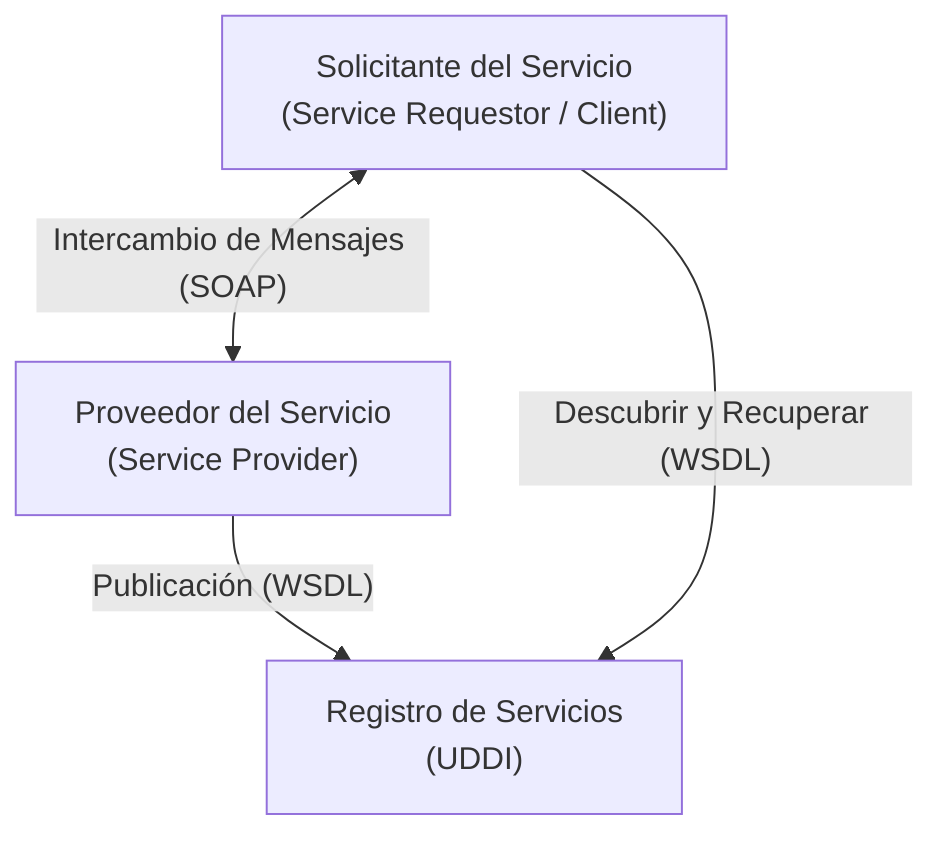
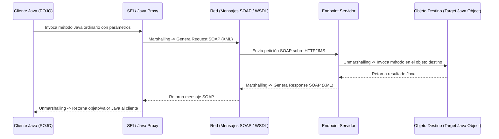

# Unidad 3: Arquitectura Orientada a Servicios (SOA) - Parte II

**Materia:** DAAS  
**Origen:** [[Unidad 3 - SOA Parte II.pdf]]  
**Tags:** #DAAS #Arquitectura #SOA #ServiciosWeb #SOAP #REST #WSDL #JAXWS #Java

---

## 1. Introducción a los Servicios Web (*Web Services*)

Los **servicios web** constituyen la base tecnológica por excelencia para la materialización de los principios de una arquitectura SOA, permitiendo la comunicación e integración entre plataformas y lenguajes heterogéneos sobre la infraestructura estándar de Internet.

### 1.1 Primera Generación de Servicios Web

La primera generación estandarizó el núcleo de publicación, descubrimiento e intercambio de mensajes mediante estándares abiertos:

* **WSDL (*Web Services Description Language*):** Especificación formal de la interfaz pública y el contrato del servicio en XML.
* **SOAP (*Simple Object Access Protocol*):** Protocolo estándar para el encapsulado e intercambio estructurado de mensajes XML.
* **UDDI (*Universal Description, Discovery and Integration*):** Registro y directorio global donde los proveedores publican sus servicios y los clientes los descubren.
* **WS-I Basic Profile:** Perfil promovido por la *Web Services Interoperability Organization* que establece pautas y restricciones sobre WSDL, SOAP y esquemas XML para garantizar una interoperabilidad real entre diferentes fabricantes (IBM, Microsoft, Sun/Oracle, etc.).

#### El Triángulo de Servicios Web (Primera Generación)



1. **Publicar (*Publish*):** El proveedor registra la descripción de su servicio (WSDL) en el registro UDDI.
2. **Descubrir (*Find / Discover*):** El solicitante consulta el registro para localizar un servicio que satisfaga su necesidad funcional y descarga su WSDL.
3. **Vincular e Invocar (*Bind & Invoke*):** El solicitante conforma los mensajes SOAP y se comunica directamente con el proveedor según lo pautado en el contrato.

---

### 1.2 Segunda Generación de Servicios Web (Extensiones WS-*)

Con la evolución hacia entornos empresariales de misión crítica, la primera generación se complementó con especificaciones avanzadas (la familia de estándares **WS-***):

* **WS-Security Specification and Frameworks:** Provee mecanismos de seguridad robustos a nivel de mensaje (independientes del transporte), incluyendo autenticación basada en tokens (SAML, Kerberos), integridad (*XML Signature*) y confidencialidad (*XML Encryption*).
* **WS-Addressing:** Estandariza la inclusión de información de enrutamiento y direccionamiento de red directamente dentro de los encabezados SOAP, desacoplando el direccionamiento del protocolo de transporte subyacente.
* **WS-ReliableMessaging:** Garantiza la entrega fiable y ordenada de mensajes de extremo a extremo entre aplicaciones, aun en presencia de caídas temporales de red o intermediarios.
* **WS-BPEL (*WS-Business Process Execution Language*):** Lenguaje estándar para la **orquestación** de procesos de negocio ejecutables mediante la composición coordinada de múltiples servicios web bajo un controlador central.
* **WS-CDL / WS-Choreography (*WS-Choreography Definition Language*):**
  > [!IMPORTANT]
  > Especificación del W3C que define procesos de modelo de negocio basados en XML para describir **protocolos de colaboración entre participantes de un servicio Web**. En este enfoque, los servicios actúan como **pares (*peers*)** en un esquema colaborativo (coreografía) sin un coordinador central, gestionando interacciones de larga duración y con múltiples estados.
* **WS-MetadataExchange (WS-MEX):** Protocolo para interrogar y obtener metadatos (como WSDL, políticas WS-Policy o esquemas XSD) directamente desde el endpoint de un servicio web mediante peticiones SOAP estándar.

---

## 2. Modelos de Implementación: REST vs. SOAP

En la actualidad conviven dos grandes corrientes para la implementación de servicios web:

| Criterio                    | Servicios Web REST                                                                                                 | Servicios Web SOAP                                                                        |
| :-------------------------- | :----------------------------------------------------------------------------------------------------------------- | :---------------------------------------------------------------------------------------- |
| **Nombre completo**         | **REpresentational State Transfer**                                                                                | **Simple Object Access Protocol**                                                         |
| **Naturaleza**              | **Estilo arquitectónico** basado en la arquitectura web                                                            | **Protocolo formal** de comunicación estandarizado                                        |
| **Formato del mensaje**     | Muy flexible: comúnmente JSON, XML o texto plano                                                                   | Estrictamente **XML** envuelto en un sobre (*Envelope*)                                   |
| **Contrato de interfaz**    | **No obligatorio** (autodescriptivo por URIs y HTTP; opcionalmente OpenAPI en lo que se especifica Swagger o WADL) | **WSDL estricto y obligatorio** (contrato formal fuertemente tipado)                      |
| **Protocolo de transporte** | Exclusivamente ligado a **HTTP / HTTPS**                                                                           | **Independiente del transporte:** HTTP, HTTPS, JMS, SMTP, FTP, TCP, etc.                  |
| **Operaciones permitidas**  | Métodos estándar del protocolo HTTP (`GET`, `POST`, `PUT`, `DELETE`)                                               | Operaciones arbitrarias de negocio definidas en el WSDL (`sumar`, `procesarPedido`, etc.) |
| **Acoplamiento**            | Bajo acoplamiento, orientado a recursos                                                                            | Medio / Alto (requiere compatibilidad estricta con el contrato WSDL)                      |

---

## 3. Servicios Web REST (*RESTful*)

El estilo **REST** se fundamenta en la tesis doctoral de **Roy Fielding** (año 2000), uno de los principales autores de la especificación original del protocolo HTTP.

```
Cliente REST ──[ HTTP GET /clientes/101 ]──► Servidor REST
             ◄──[ 200 OK + Payload XML/JSON ]──
```

### Principios Fundamentales de REST

1. **Sin Estado (*Stateless*):**
   > [!NOTE]
   > Cada petición realizada por el cliente al servidor debe contener **toda la información indispensable** para comprender y procesar dicha solicitud. El servidor no retiene ningún contexto ni estado de sesión entre peticiones; cada llamada es autocontenida.

2. **Interfaz Uniforme y Común:**
   Las interacciones se limitan de manera uniforme a los métodos estándar provistos por HTTP:
   * **`GET`:** Lectura / consulta de un recurso (idempotente y segura).
   * **`POST`:** Creación de un nuevo recurso o procesamiento de una acción no idempotente.
   * **`PUT`:** Actualización completa o reemplazo de un recurso existente (idempotente).
   * **`DELETE`:** Eliminación del recurso indicado (idempotente).

3. **Recursos identificados unívocamente mediante URIs:**
   * La arquitectura se estructura alrededor de **recursos**.
   * Cada **URI (*Uniform Resource Identifier*)** identifica unívocamente un recurso específico o colección de recursos en la red.
   > **Distinción URI vs. URL:**  
   > Una **URI** es el identificador abstracto y unívoco del recurso. La **URL (*Uniform Resource Locator*)** es un tipo particular de URI que añade el mecanismo de acceso o localización física concreta en la red, la cual puede variar con el tiempo o la topología de servidores.

4. **Manipulación a través de Representaciones:**
   Los clientes nunca manipulan directamente el almacenamiento del servidor, sino que intercambian **representaciones** del recurso (típicamente en formato XML, JSON o HTML).

---

## 4. Servicios Web SOAP

**SOAP** es un protocolo basado en XML diseñado para invocar de forma remota operaciones de negocio descritas a través de contratos **WSDL**.

```
┌────────────────────────────────────────────────────────┐
│                      Mensaje SOAP                      │
│                                                        │
│  ┌──────────────────────────────────────────────────┐  │
│  │ <SOAP-ENV:Envelope>                              │  │
│  │                                                  │  │
│  │   ┌──────────────────────────────────────────┐   │  │
│  │   │ <SOAP-ENV:Header> (Opcional)             │   │  │
│  │   │   • Seguridad (Tokens, Firmas)           │   │  │
│  │   │   • Enrutamiento (WS-Addressing)         │   │  │
│  │   └──────────────────────────────────────────┘   │  │
│  │                                                  │  │
│  │   ┌──────────────────────────────────────────┐   │  │
│  │   │ <SOAP-ENV:Body> (OBLIGATORIO)            │   │  │
│  │   │   • Nombre de la operación invocada      │   │  │
│  │   │   • Parámetros de entrada / salida       │   │  │
│  │   │   • Información de error (<Fault>)       │   │  │
│  │   └──────────────────────────────────────────┘   │  │
│  │                                                  │  │
│  │ </SOAP-ENV:Envelope>                             │  │
│  └──────────────────────────────────────────────────┘  │
│                                                        │
│  [ Adjuntos Binarios MIME ] (Opcional)                 │
└────────────────────────────────────────────────────────┘
```

### 4.1 Estructura Básica del Mensaje SOAP

* **`<Envelope>` (Sobre - Raíz Obligatoria):**  
  Elemento raíz de todo documento SOAP. Declara los espacios de nombres XML (*namespaces*) requeridos y define qué contiene el mensaje y cómo debe interpretarse.
* **`<Header>` (Encabezado - Opcional):**  
  Aunque no es obligatorio según la especificación básica, rara vez se omite en aplicaciones de negocio. Transporta metadatos y servicios de infraestructura ortogonales a la lógica de negocio (credenciales de seguridad, identificadores de transacción distribuida, directivas de enrutamiento).
* **`<Body>` (Cuerpo - Obligatorio):**  
  Contiene la carga útil (*payload*) destinada al receptor final: los datos de la llamada a la operación o los resultados devueltos. En caso de fallos, aloja el elemento `<Fault>`.
* **Adjuntos MIME (*MIME Attachments*):**  
  Permiten adjuntar documentos y archivos binarios pesados (imágenes, PDFs) fuera del XML para evitar el consumo de procesamiento derivado de la codificación en Base64.


---

### 4.2 Mecanismo de Invocación y Traducción en SOAP

Para que una aplicación escrita en un lenguaje (ej. Java) consuma un servicio SOAP (quizás implementado en .NET u otro entorno), se requiere una infraestructura de serialización/deserialización (*Marshalling / Unmarshalling*):



* **SEI (*Service Endpoint Interface*):** Interfaz Java que declara formalmente las operaciones del servicio web vistas desde el código fuente.
* **Java Proxy / Stub:** Objeto local que intercepta las llamadas locales y las transforma de forma transparente en peticiones SOAP.

---

### 4.3 Ejemplo de Mensajes SOAP

#### Petición SOAP (`Request`):
```xml
<env1:Envelope xmlns:env1="http://schemas.xmlsoap.org/soap/envelope/">
    <env1:Body>
        <getord:getOrdersDates xmlns:getord="http://www.example.com/oms/getorders">
            <getord:startDate>2005-11-19</getord:startDate>
            <getord:endDate>2005-11-22</getord:endDate>
        </getord:getOrdersDates>
    </env1:Body>
</env1:Envelope>
```

#### Respuesta SOAP (`Response`):
```xml
<env1:Envelope xmlns:env1="http://schemas.xmlsoap.org/soap/envelope/">
    <env1:Body>
        <getord:getOrdersDatesResponse xmlns:getord="http://www.example.com/oms/getorders">
            <Orders xmlns="http://www.example.com/oms"
                    xmlns:xsi="http://www.w3.org/2001/XMLSchema-instance"
                    xsi:schemaLocation="http://www.example.com/oms http://soabook.com/example/oms/orders.xsd">
                <Order>
                    <OrderKey>ENT1234567</OrderKey>
                    <OrderHeader>
                        <SALES_ORG>NE</SALES_ORG>
                        <PURCH_DATE>2005-11-20</PURCH_DATE>
                        <CUST_NO>ENT0072123</CUST_NO>
                        <PYMT_METH>PO</PYMT_METH>
                        <PURCH_ORD_NO>PO-72123-0007</PURCH_ORD_NO>
                        <WAR_DEL_DATE>2006-12-20</WAR_DEL_DATE>
                    </OrderHeader>
                </Order>
            </Orders>
        </getord:getOrdersDatesResponse>
    </env1:Body>
</env1:Envelope>
```

> [!NOTE]
> **Rol de los Esquemas XSD (*XML Schema Definition*):**  
> Un archivo XSD define la gramática formal, tipos de datos y relaciones permitidas dentro de los elementos XML del mensaje, garantizando que el documento recibido sea sintácticamente válido.

---

## 5. El Lenguaje WSDL (*Web Services Description Language*)

**WSDL** es el estándar XML promovido por el W3C para documentar y exponer el contrato formal de la interfaz pública de un servicio Web.

### 5.1 Principio de Diseño: Separación Abstracto / Concreto

WSDL desacopla completamente **qué** hace el servicio de **cómo** y **dónde** se accede:

```
┌──────────────────────────────────────────────────────────────┐
│                    NIVEL ABSTRACTO                           │
│  • <types>: Tipos de datos de negocio (esquemas XSD)         │
│  • <message>: Estructura de parámetros (entrada/salida)      │
│  • <portType>: Interfaz abstracta (operaciones)              │
└──────────────────────────────┬───────────────────────────────┘
                               │ Enlazado mediante <binding>
┌──────────────────────────────▼───────────────────────────────┐
│                    NIVEL CONCRETO                            │
│  • <binding>: Protocolo (SOAP) y codificación (document/rpc) │
│  • <port>: Dirección física de red (URL endpoint)            │
│  • <service>: Agrupación lógica de puertos                   │
└──────────────────────────────────────────────────────────────┘
```

---

### 5.2 Estructura y Elementos de un Documento WSDL

El documento WSDL se estructura bajo el elemento raíz `<definitions>`:

| Elemento WSDL | Nivel | Rol y Descripción |
| :--- | :---: | :--- |
| **`<definitions>`** | Raíz | Elemento raíz contenedor del documento WSDL; declara espacios de nombres y nombres de servicios. |
| **`<types>`** | Abstracto | Contenedor de las definiciones de tipos de datos de información intercambiada, especificadas mediante **XML Schema (XSD)**. |
| **`<message>`** | Abstracto | Caracteriza definiciones tipadas abstractas de los datos intercambiados en una petición o respuesta, referenciando tipos de `<types>`. |
| **`<portType>`** | Abstracto | Define el conjunto de operaciones abstractas soportadas. Equivale directamente a una **`interface`** en lenguajes orientados a objetos. Contiene elementos `<operation>`. |
| **`<binding>`** | Concreto | Especifica el protocolo de transporte concreto (ej. SOAP sobre HTTP) y el formato/estilo de codificación (`style="document"`, `use="literal"`) para un `portType`. |
| **`<service>`** | Concreto | Identifica el servicio web global. Modela una colección de puntos finales a través de elementos `<port>`. |
| **`<port>`** | Concreto | Proporciona el nombre y la dirección de red física (**URL**) donde reside el servicio (`<soap:address location="..."/>`), asociándolo a un `<binding>`. |

---

### 5.3 Ejemplo Completo de Contrato WSDL (`StockQuote`)

```xml
<definitions name="StockQuote"
             targetNamespace="http://example.com/stockquote.wsdl"
             xmlns:tns="http://example.com/stockquote.wsdl"
             xmlns:xsd1="http://example.com/stockquote.xsd"
             xmlns:soap="http://schemas.xmlsoap.org/wsdl/soap/"
             xmlns="http://schemas.xmlsoap.org/wsdl/">

    <!-- 1. DEFINICIÓN DE TIPOS (XSD) -->
    <types>
        <schema targetNamespace="http://example.com/stockquote.xsd"
                xmlns="http://www.w3.org/2000/10/XMLSchema">
            <element name="TradePriceRequest">
                <complexType>
                    <all>
                        <element name="tickerSymbol" type="string"/>
                    </all>
                </complexType>
            </element>
            <element name="TradePrice">
                <complexType>
                    <all>
                        <element name="price" type="float"/>
                    </all>
                </complexType>
            </element>
        </schema>
    </types>

    <!-- 2. MENSAJES ABSTRACTOS -->
    <message name="GetLastTradePriceInput">
        <part name="body" element="xsd1:TradePriceRequest"/>
    </message>
    <message name="GetLastTradePriceOutput">
        <part name="body" element="xsd1:TradePrice"/>
    </message>

    <!-- 3. INTERFAZ ABSTRACTA (PORTTYPE) -->
    <portType name="StockQuotePortType">
        <operation name="GetLastTradePrice">
            <input message="tns:GetLastTradePriceInput"/>
            <output message="tns:GetLastTradePriceOutput"/>
        </operation>
    </portType>

    <!-- 4. ENLACE CONCRETO AL PROTOCOLO (BINDING) -->
    <binding name="StockQuoteSoapBinding" type="tns:StockQuotePortType">
        <soap:binding style="document" transport="http://schemas.xmlsoap.org/soap/http"/>
        <operation name="GetLastTradePrice">
            <soap:operation soapAction="http://example.com/GetLastTradePrice"/>
            <input><soap:body use="literal"/></input>
            <output><soap:body use="literal"/></output>
        </operation>
    </binding>

    <!-- 5. ENDPOINT Y UBICACIÓN FÍSICA (SERVICE / PORT) -->
    <service name="StockQuoteService">
        <documentation>Servicio de cotización de acciones</documentation>
        <port name="StockQuotePort" binding="tns:StockQuoteSoapBinding">
            <soap:address location="http://example.com/stockquote"/>
        </port>
    </service>

</definitions>
```

---

## 6. Java Web Services: JAX-WS y JAXB

En el ecosistema Java (Java EE / Jakarta EE), la especificación principal para servicios web SOAP es **JAX-WS** (*Java API for XML Web Services*), que opera conjuntamente con **JAXB** (*Java Architecture for XML Binding*).

* **JAXB:** Realiza el mapeo automático y bidireccional entre clases de objetos Java y esquemas XML (XSD).
* **Anotaciones de Metadatos:** Permiten definir el servicio directamente en código Java; los servidores de aplicaciones y herramientas de compilación generan los archivos WSDL y esquemas XSD de forma automática.

---

### 6.1 Anotaciones Clave en el Lado Servidor

| Anotación Java | Propósito y Funcionamiento |
| :--- | :--- |
| **`@WebService`** | Marca una clase o interfaz Java como un servicio web. Atributos habituales: `name`, `targetNamespace`, `serviceName`, `portName`, `endpointInterface`. Cuando se aplica sobre una interfaz, define la **SEI (*Service Endpoint Interface*)**. |
| **`@WebMethod`** | Expone un método Java como una operación pública del servicio web. |
| **`@WebParam`** | Personaliza el mapeo del parámetro del método hacia los elementos del mensaje WSDL / esquema XML. |
| **`@WebResult`** | Especifica y personaliza el elemento XML generado para el valor de retorno del método. |
| **`@SOAPBinding`** | Especifica los detalles de codificación y estilo SOAP (ej. `style=SOAPBinding.Style.DOCUMENT`, `use=SOAPBinding.Use.LITERAL`). |

#### Ejemplo Servidor: Servicio de Suma

**1. Interfaz del Servicio (SEI):**
```java
package negocio.servicioAplicacion;

import javax.jws.WebService;

@WebService(name = "Suma", targetNamespace = "http://servicioAplicacion.negocio/")
public interface Suma {
    public TransferResultado sumar(TransferSuma ts);
}
```

**2. Objetos de Transferencia de Datos (DTOs / Transfers):**
```java
public class TransferSuma {
    private float x;
    private float y;

    // Getters y Setters
    public float getX() { return x; }
    public void setX(float x) { this.x = x; }
    public float getY() { return y; }
    public void setY(float y) { this.y = y; }
}

public class TransferResultado {
    private float resultado;

    // Getters y Setters
    public float getResultado() { return resultado; }
    public void setResultado(float resultado) { this.resultado = resultado; }
}
```

**3. Implementación del Servicio (SIB - Service Implementation Bean):**
```java
package negocio.servicioAplicacion;

import javax.jws.WebService;

@WebService(
    targetNamespace = "http://servicioAplicacion.negocio/",
    endpointInterface = "negocio.servicioAplicacion.Suma",
    portName = "SumaImplementacionPort",
    serviceName = "SumaImplementacionService"
)
public class SumaImplementacion implements Suma {

    @Override
    public TransferResultado sumar(TransferSuma ts) {
        TransferResultado res = new TransferResultado();
        res.setResultado(ts.getX() + ts.getY());
        return res;
    }
}
```

---

### 6.2 Consumo de Servicios en el Lado Cliente

En el cliente, las anotaciones y clases generadas (por herramientas como `wsimport`) reflejan el contrato WSDL para permitir invocaciones remotas transparentes:

* **`@WebServiceClient`:** Marca la clase cliente de fábrica que extiende de `javax.xml.ws.Service`. Contiene la referencia a la URL del WSDL (`wsdlLocation`).
* **`@RequestWrapper` / `@ResponseWrapper`:** Clases auxiliares para empaquetar y desempaquetar las peticiones y respuestas XML.

#### Ejemplo de Código Cliente en Java:

```java
import java.net.URL;
import javax.xml.namespace.QName;
import negocio.servicioAplicacion.*;

public final class Main {
    private static final QName SERVICE_NAME = new QName(
        "http://servicioAplicacion.negocio/", 
        "SumaImplementacionService"
    );

    public static void main(String[] args) throws Exception {
        // 1. Obtener la referencia al WSDL del servicio publicado
        URL wsdlURL = SumaImplementacionService.WSDL_LOCATION;

        // 2. Instanciar la clase de servicio (Service Factory)
        SumaImplementacionService ss = new SumaImplementacionService(wsdlURL, SERVICE_NAME);

        // 3. Obtener el Proxy que implementa la SEI localmente
        Suma port = ss.getSumaImplementacionPort();

        // 4. Preparar los datos de entrada
        TransferSuma ts = new TransferSuma();
        ts.setX(4.0f);
        ts.setY(3.0f);

        // 5. Invocar de forma remota y transparente la operación
        TransferResultado tr = port.sumar(ts);

        // 6. Procesar el resultado obtenido
        System.out.println("Resultado de la suma: " + tr.getResultado());
        System.exit(0);
    }
}
```

---

## 7. Síntesis y Mapa Conceptual

```
                                ARQUITECTURA SOA
                                       │
            ┌──────────────────────────┴──────────────────────────┐
            ▼                                                     ▼
    Servicios Web REST                                   Servicios Web SOAP
  • Estilo arquitectónico                              • Protocolo formal
  • Recursos identificados por URIs                    • Mensajes XML en <Envelope>
  • Operaciones HTTP (GET, POST, etc.)                 • Contrato público en WSDL
  • Sin Estado (Stateless)                             • Independiente del transporte
  • Cargas JSON / XML                                  • Petición / Respuesta RPC y Document
                                                                  │
                                            ┌─────────────────────┴─────────────────────┐
                                            ▼                                           ▼
                                       Contrato WSDL                            Implementación Java
                                 • <types> (Esquemas XSD)                    • JAX-WS + JAXB
                                 • <message> (Partes abstractas)             • @WebService, @WebMethod
                                 • <portType> (Interfaz/Operaciones)         • @WebParam, @WebResult
                                 • <binding> (Protocolo y formato)           • Cliente con Proxy/SEI
                                 • <port> + <service> (URL de acceso)        • Generación de stubs
```

---

## 8. Referencias Bibliográficas

* **Thomas Erl**, *SOA Principles of Service Design*, Prentice Hall, 2008.
* **Mark D. Hansen**, *SOA Using Java Web Services*, Prentice Hall, 2007.
* **B.V. Kumar, P. Narayan, T. Ng**, *Implementing SOA Using Java EE*, Addison-Wesley, 2010.
* **D. Alur, J. Crupi, D. Malks**, *Core J2EE Design Patterns: Best Practices and Design Strategies*, 2nd Edition, Prentice Hall, 2003.
* **Martin Fowler**, *Patterns of Enterprise Application Architecture*, Addison-Wesley, 2003.

---

## Enlaces y Notas Relacionadas
* [[01 - Resumen - Unidad 3 - SOA Parte I]]
* [[Servicios Web (Web Services)]]
* [[SOAP vs REST]]
* [[WSDL (Web Services Description Language)]]
* [[Java Web Services (JAX-WS y JAXB)]]
* [[Extensiones WS (Segunda Generación)]]
