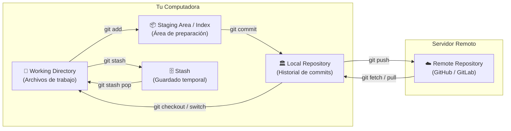
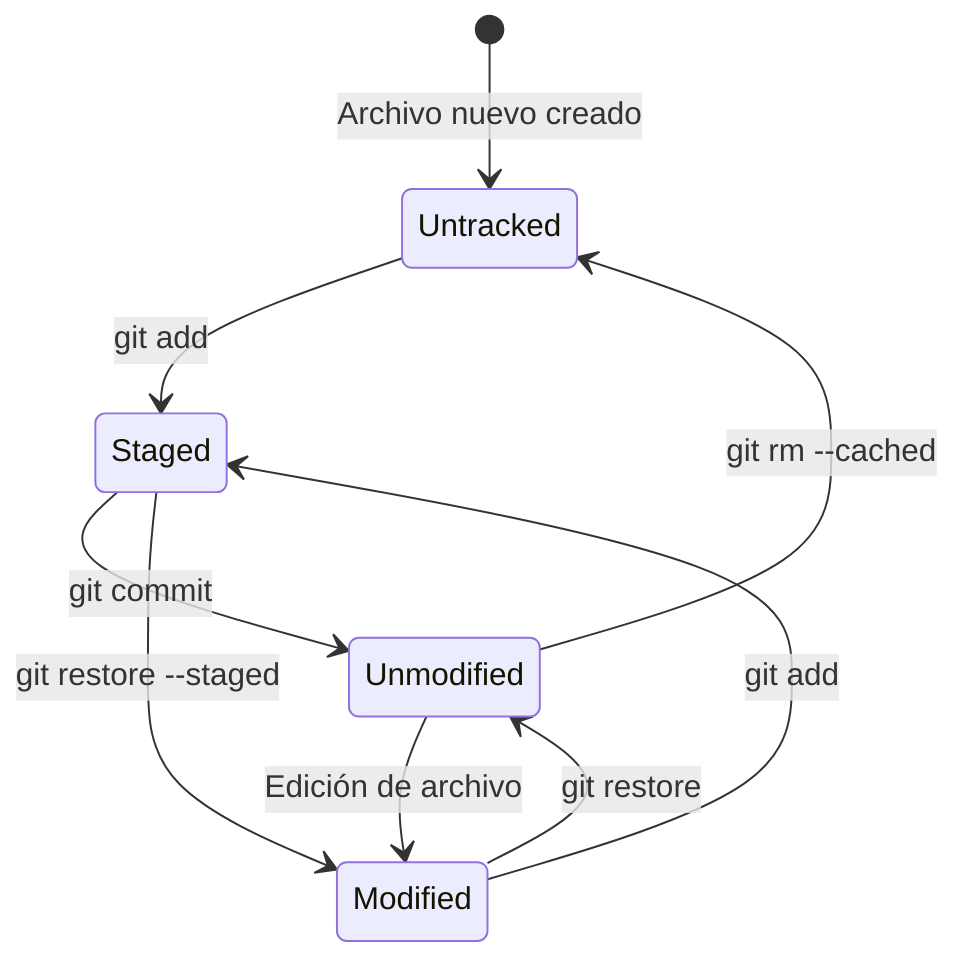

# Fundamentos y Configuración de Git

**Git** es un sistema de control de versiones distribuido (DVCS) de código abierto diseñado para manejar proyectos de cualquier tamaño con velocidad, eficiencia e integridad de datos.

---

## 1. Arquitectura y Áreas de Trabajo

A diferencia de los sistemas centralizados (como SVN), en Git cada desarrollador posee una copia local completa del historial del repositorio. Git gestiona los archivos a través de **tres áreas principales** (más una zona temporal):



### Las 3 Áreas Principales:
1. **Working Directory (Directorio de Trabajo):** Es el árbol de archivos visible en tu sistema de archivos donde editas, creas y borras código.
2. **Staging Area / Index (Área de Preparación):** Un archivo intermedio (en `.git/index`) que almacena una captura exacta de los cambios que formarán parte del **próximo commit**. Permite armar commits atómicos y organizados.
3. **Local Repository (Repositorio Local):** La base de datos orientada a objetos (ubicada en `.git/`) que contiene el historial completo de commits, ramas, etiquetas y metadatos.

---

## 2. Estados de un Archivo en Git

Dentro de tu directorio de trabajo, los archivos pueden encontrarse en los siguientes estados:



- **Untracked (Sin seguimiento):** Archivos que existen en el directorio de trabajo pero no forman parte del repositorio ni del staging area.
- **Unmodified (Sin modificaciones):** El archivo está en el repositorio y no ha sufrido cambios respecto al último commit (`HEAD`).
- **Modified (Modificado):** Has modificado el archivo en tu directorio de trabajo, pero aún no lo has preparado para el commit.
- **Staged (Preparado):** El archivo modificado ha sido agregado al Staging Area con `git add` y está listo para ser guardado en el próximo commit.

---

## 3. Configuración Inicial (`git config`)

Git permite configurar variables a tres niveles de alcance (*scopes*):
- `--system`: Aplica a todos los usuarios del sistema operativo (`/etc/gitconfig`).
- `--global`: Aplica al usuario actual del SO (`~/.gitconfig` o `%USERPROFILE%\.gitconfig`).
- `--local`: Aplica únicamente al repositorio actual (`.git/config`).

### Configuración de Identidad y Editor

```bash
# 1. Configurar nombre y correo electrónico (OBLIGATORIO)
git config --global user.name "Tu Nombre"
git config --global user.email "tu_email@ejemplo.com"

# 2. Configurar la rama principal por defecto como 'main'
git config --global init.defaultBranch main

# 3. Configurar el editor de texto por defecto (ej. VS Code)
git config --global core.editor "code --wait"

# 4. Manejo de saltos de línea (CRLF en Windows vs LF en Linux/macOS)
# En Windows (convierte CRLF al commitear a LF, y LF a CRLF al hacer checkout):
git config --global core.autocrlf true
# En Linux / macOS:
git config --global core.autocrlf input
```

### Verificación de Configuración

```bash
# Listar todas las variables configuradas
git config --list --show-origin

# Consultar un valor específico
git config user.name
git config user.email
```

### Aliases Útiles Recomendados

Los aliases permiten acortar comandos largos y mejorar tu productividad:

```bash
# Log visual y compacto en árbol
git config --global alias.lg "log --graph --oneline --decorate --all"

# Status abreviado
git config --global alias.s "status -s"

# Deshacer último commit manteniendo cambios
git config --global alias.uncommit "reset --soft HEAD~1"
```

---

## 4. Inicialización y Clonación de Repositorios

### A. Crear un repositorio desde cero (`git init`)
Para convertir una carpeta existente en un repositorio de Git:

```bash
cd /ruta/a/tu/proyecto

# Inicializa la carpeta oculta .git
git init

# (Opcional) Renombrar rama inicial a main si no está por defecto
git branch -M main
```

### B. Clonar un repositorio existente (`git clone`)
Para descargar un repositorio completo junto con todo su historial desde GitHub/GitLab:

```bash
# Clonar vía HTTPS
git clone https://github.com/usuario/repositorio.git

# Clonar vía SSH
git clone git@github.com:usuario/repositorio.git

# Clonar dentro de una carpeta con nombre personalizado
git clone https://github.com/usuario/repositorio.git mi-carpeta-local
```

---

## 5. El archivo `.gitignore`

El archivo `.gitignore` le indica a Git qué archivos, carpetas o extensiones **nunca** deben rastrearse ni incluirse en los commits (por ejemplo: dependencias, variables de entorno con contraseñas, ejecutables, logs, carpetas de IDE).

> [!IMPORTANT]
> El archivo `.gitignore` debe ubicarse en la raíz del repositorio y debe ser añadido al control de versiones (`git add .gitignore` y `git commit`).

### Sintaxis y Patrones Comunes:

```gitignore
# 1. Comentarios inician con #
# 2. Ignorar archivos por nombre exacto
.env
.env.local
config.private.json

# 3. Ignorar carpetas completas (terminan con /)
node_modules/
dist/
build/
__pycache__/
.venv/
.idea/
.vscode/

# 4. Ignorar por extensiones de archivo (uso de comodín *)
*.log
*.tmp
*.pyc
*.exe

# 5. Excepciones con el signo de exclamación (!)
!importante.log

# 6. Ignorar en subdirectorios profundos
**/temp/
```

> [!TIP]
> **¿Qué hacer si un archivo ya estaba en seguimiento antes de agregarlo al `.gitignore`?**  
> Git no dejará de rastrearlo automáticamente. Debes quitarlo del Staging/Índice sin borrarlo de tu disco:
> ```bash
> git rm --cached <nombre_archivo>
> # O para una carpeta completa:
> git rm -r --cached <nombre_carpeta>
> git commit -m "chore: dejar de rastrear archivos ignorados"
> ```

---

## 6. Navegación entre Notas

- Siguiente nota: **[[02 - Flujo Básico (Commit, Push, Pull)]]**
- Volver al índice general: **[[Index|Índice de Git]]**
