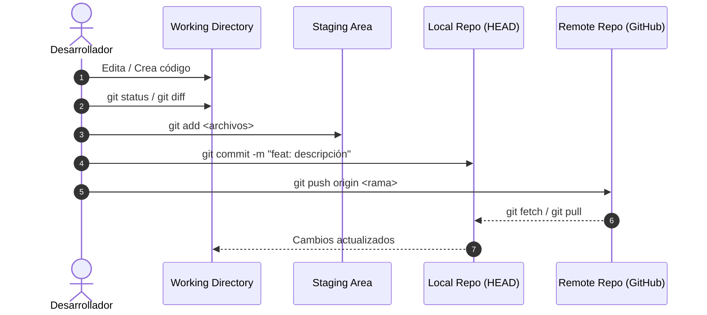
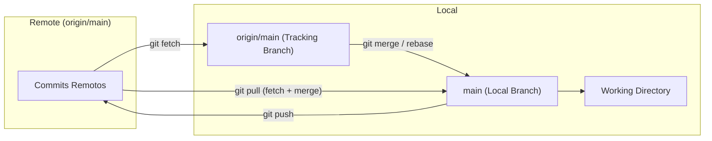

# Flujo de Trabajo Básico (Commit, Push, Pull)

El flujo diario de trabajo en Git consiste en verificar el estado de los cambios, prepararlos (*stage*), empaquetarlos en un commit con un mensaje descriptivo y sincronizarlos con el repositorio remoto.



---

## 1. Inspección de Cambios (`git status` y `git diff`)

Antes de preparar cambios, siempre es buena práctica revisar qué ha sido modificado.

```bash
# Ver el estado actual del árbol de trabajo y del staging area
git status

# Ver el estado resumido y compacto
git status -s

# Ver las diferencias exactas línea por línea (Working Directory vs Staging Area)
git diff

# Ver diferencias de los archivos ya preparados (Staging Area vs último Commit)
git diff --staged
# (Equivalente)
git diff --cached
```

---

## 2. Preparar Cambios (`git add`)

El comando `git add` traslada los cambios del Working Directory al Staging Area.

```bash
# Agregar un archivo específico
git add index.html

# Agregar múltiples archivos específicos
git add styles.css script.js

# Agregar todos los cambios (modificados, nuevos y eliminados) en el directorio actual
git add .

# Agregar todos los cambios de todo el repositorio
git add -A

# Preparación interactiva por fragmentos (Hunks) - ¡Muy recomendado!
# Te permite elegir qué partes específicas de un archivo incluir en el commit
git add -p archivo.js
```

---

## 3. Crear Commits (`git commit`)

Un **commit** es una instantánea (*snapshot*) inmutable del proyecto en un momento dado, firmada por un autor con fecha, hash único (SHA-1) y un mensaje descriptivo.

```bash
# Crear commit con mensaje en una sola línea
git commit -m "feat: implementar autenticación con JWT"

# Crear commit con título y descripción detallada
git commit -m "feat: implementar autenticación con JWT" -m "- Agregado middleware de validación\n- Creados endpoints de login y register\n- Manejo de tokens expirados"

# Preparar archivos modificados ya rastreados y commitear en un solo paso (no incluye untracked)
git commit -am "fix: corregir cálculo de totales en checkout"

# Modificar / corregir el ÚLTIMO commit (cambiar mensaje o agregar archivos olvidados)
# 1. Agregas el archivo olvidado: git add archivo_olvidado.py
# 2. Enmiendas el commit sin crear uno nuevo:
git commit --amend --no-edit
# O para cambiar el mensaje del último commit:
git commit --amend -m "feat: nuevo mensaje corregido"
```

> [!CAUTION]
> **Nunca hagas `git commit --amend` en commits que ya fueron enviados (*pushed*) a una rama pública compartida**, ya que modifica el hash del commit y generará inconsistencias a tus compañeros de equipo.

---

## 4. Buenas Prácticas: Conventional Commits

Adoptar un estándar de mensajes de commit mejora drásticamente la legibilidad y permite automatizar changelogs y versiones semánticas (*SemVer*).
[Conventional Commits](https://www.conventionalcommits.org/en/v1.0.0/)

Practicas de midudev
[Buenas prácticas para escribir commits en Git | midudev](https://midu.dev/buenas-practicas-escribir-commits-git/)
### Estructura:
`<tipo>(<ámbito opcional>): <descripción corta y clara en imperativo>`

| Tipo | Propósito | Ejemplo |
| :--- | :--- | :--- |
| `feat` | Una nueva funcionalidad para el usuario | `feat(auth): agregar soporte para login con Google` |
| `fix` | Corrección de un bug o error | `fix(cart): solucionar error al eliminar último producto` |
| `docs` | Cambios únicamente en la documentación | `docs: actualizar instrucciones de instalación en README` |
| `style` | Formato, espacios, puntos y comas (no cambia la lógica del código) | `style: formatear código con prettier` |
| `refactor` | Refactorización de código (ni arregla bugs ni añade features) | `refactor: optimizar consulta SQL en listado de usuarios` |
| `test` | Añadir o corregir pruebas unitarias/integración | `test: agregar pruebas para endpoint de pagos` |
| `chore` | Tareas de mantenimiento, actualización de dependencias, scripts | `chore: actualizar dependencias en package.json` |
| `perf` | Mejoras de rendimiento | `perf: implementar memoización en renderizado de tabla` |

---

## 5. Historial de Commits (`git log`)

Git ofrece múltiples opciones para examinar el historial del proyecto:

```bash
# Historial completo estándar
git log

# Historial resumido en una línea por commit
git log --oneline

# Historial gráfico con ramas y etiquetas (Muy visual)
git log --graph --oneline --all --decorate

# Ver los últimos N commits
git log -n 5 --oneline

# Ver los cambios de código reales introducidos en cada commit (Patch)
git log -p -n 2

# Ver estadísticas de archivos modificados, agregados y borrados
git log --stat

# Filtrar commits por autor o fecha
git log --author="Juan Perez"
git log --since="2 weeks ago"
```

---

## 6. Repositorios Remotos y Sincronización

Un repositorio remoto es una versión de tu proyecto alojada en la red (GitHub, GitLab, Bitbucket, Azure DevOps).

### Gestión de Remotos (`git remote`)

```bash
# Listar repositorios remotos configurados y sus URLs
git remote -v

# Vincular un repositorio remoto con el alias 'origin'
git remote add origin https://github.com/usuario/mi-repositorio.git

# Cambiar la URL de un remoto existente
git remote set-url origin https://github.com/usuario/nuevo-repo.git

# Eliminar un remoto
git remote remove origin
```

---

## 7. Enviar y Recibir Cambios (`git push`, `git fetch`, `git pull`)



### A. Enviar Cambios (`git push`)

```bash
# Primer push: enviar rama local y establecer seguimiento (upstream tracking)
git push -u origin main

# Pushes posteriores (en la misma rama con upstream configurado):
git push

# Enviar una rama específica al remoto
git push origin feature/login

# Eliminar una rama remota
git push origin --delete feature/login
```

### B. Descargar sin fusionar (`git fetch`)
`git fetch` descarga todos los commits, ramas y etiquetas del servidor remoto hacia tu copia local de seguimiento (`origin/rama`), **sin modificar tu Working Directory ni alterar tus archivos**. Es una operación 100% segura para inspeccionar qué hay de nuevo.

```bash
# Descargar cambios de todos los remotos
git fetch --all

# Ver qué cambios entrantes hay respecto a tu rama local
git log HEAD..origin/main --oneline
```

### C. Descargar y fusionar (`git pull`)
`git pull` es la combinación de dos operaciones automáticas: `git fetch` seguido de `git merge` (o `git rebase`).

```bash
# Descargar y fusionar en tu rama activa
git pull

# Buena práctica: Descargar aplicando Rebase en lugar de Merge
# (Evita commits vacíos de merge "Merge branch 'main' of...")
git pull --rebase
```

> [!TIP]
> **Configuración global recomendada:**  
> Puedes hacer que `git pull` siempre use `--rebase` por defecto:
> ```bash
> git config --global pull.rebase true
> ```

---

## 8. Navegación entre Notas

- Nota anterior: **[[01 - Fundamentos y Configuración]]**
- Siguiente nota: **[[03 - Ramas y Fusiones (Branch, Merge y Squash)]]**
- Volver al índice general: **[[Index|Índice de Git]]**
