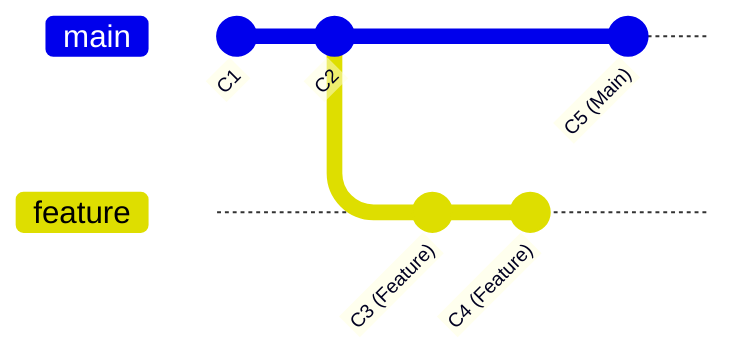
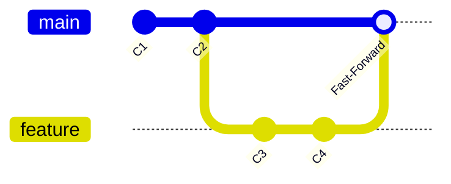
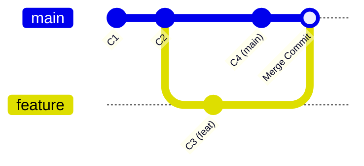
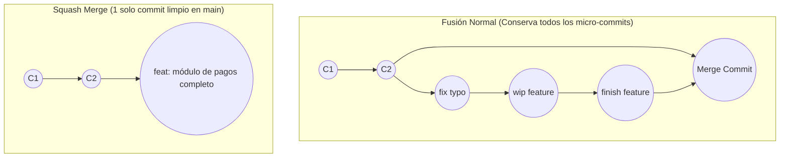
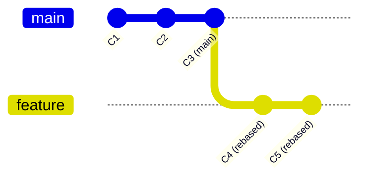

# Ramas y Fusiones (Branch, Merge y Squash)

Las **ramas (*branches*)** son punteros móviles y ligeros hacia commits específicos. Permiten desarrollar funcionalidades, corregir errores o experimentar en paralelo sin afectar la rama principal de producción (`main` o `master`).

---

## 1. Gestión de Ramas



### Comandos de Creación, Cambio y Eliminación

```bash
# Listar ramas locales (* indica la rama activa)
git branch

# Listar ramas locales y remotas
git branch -a

# Crear una nueva rama sin cambiar a ella
git branch feature/autenticacion

# Cambiar a una rama existente (sintaxis moderna recomendada)
git switch feature/autenticacion
# (Sintaxis clásica)
git checkout feature/autenticacion

# Crear una nueva rama Y cambiarse a ella de inmediato (1 solo paso)
git switch -c feature/nueva-vista
# (Sintaxis clásica)
git checkout -b feature/nueva-vista

# Renombrar la rama actual
git branch -m feature/nuevo-nombre

# Eliminar una rama local ya fusionada (seguro)
git branch -d feature/autenticacion

# Forzar la eliminación de una rama local (incluso con cambios sin fusionar)
git branch -D feature/experimento-fallido

# Eliminar una rama remota en GitHub
git push origin --delete feature/autenticacion
```

---

## 2. Estrategias de Fusión (Merge)

Cuando finalizas el trabajo en una rama, necesitas incorporar esos cambios a la rama principal (usualmente `main`). Existen tres estrategias principales:

### A. Fast-Forward Merge (Avance Rápido)
Ocurre automáticamente cuando la rama principal no ha tenido nuevos commits desde que se creó la rama secundaria. Git simplemente mueve el puntero de `main` hacia adelante.



```bash
git switch main
git merge feature/mi-rama
```

### B. 3-Way Merge con Merge Commit (`--no-ff`)
Ocurre cuando tanto `main` como la rama secundaria tienen commits nuevos e independientes. Git calcula un commit de fusión común que une ambas historias.



```bash
git switch main
# Fusión estándar (crea un commit de merge si hay divergencia)
git merge feature/mi-rama

# Forzar siempre la creación de un commit de merge explícito
git merge --no-ff feature/mi-rama -m "merge: fusionar feature/mi-rama en main"
```

---

## 3. Merge Squash (`git merge --squash`)

> [!IMPORTANT]
> **¿Qué es un Merge Squash?**  
> Es una técnica que toma **todos los commits individuales de una rama secundaria** y los condensa (*aplasta*) en **un único cambio en el Staging Area** de la rama destino. No genera historial de commits intermedios (como "arreglando typo", "wip", "test commit") en `main`.

### Comparativa Visual: Merge Normal vs. Squash Merge



### Paso a Paso para Hacer un Merge Squash:

```bash
# 1. Cambiarse a la rama principal (destino)
git switch main

# 2. Asegurarse de tener la última versión de main
git pull origin main

# 3. Ejecutar el merge con la bandera --squash
# Esto aplica todos los cambios en el Staging Area pero NO crea el commit automáticamente
git merge --squash feature/modulo-pagos

# 4. Verificar qué archivos quedaron preparados en el Staging Area
git status

# 5. Crear el único commit definitivo con un mensaje claro y descriptivo
git commit -m "feat(pagos): integrar pasarela de pagos con MercadoPago y Stripe"

# 6. Enviar el commit limpio al repositorio remoto
git push origin main

# 7. (Opcional pero recomendado) Eliminar la rama secundaria local y remota
git branch -D feature/modulo-pagos
git push origin --delete feature/modulo-pagos
```

> [!TIP]
> **Ventajas del Squash Merge:**
> - Mantiene el árbol de `main` 100% lineal y legible.
> - Facilita revertir una funcionalidad completa con un solo `git revert <hash>`.
> - Evita ensuciar el historial compartido con commits de prueba o experimentación temporal.

---

## 4. Rebase (`git rebase`)

El comando `git rebase` reescribe el historial trasladando la base de tu rama actual al último commit de otra rama.



```bash
# Estando en tu rama feature:
git switch feature/login

# Traer los cambios de main colocándolos por debajo de tus commits
git rebase main
```

### Tabla Comparativa: Merge vs. Rebase vs. Squash

| Criterio | `git merge` | `git rebase` | `git merge --squash` |
| :--- | :--- | :--- | :--- |
| **Historial resultante** | No lineal (árbol con bifurcaciones) | Totalmente lineal | Totalmente lineal |
| **Conserva commits originales** | Sí, todos los commits intactos | Sí, pero les cambia el hash SHA-1 | No, los compacta en 1 solo commit |
| **Genera commit de merge** | Sí (salvo que sea Fast-Forward) | No | No (creas un commit regular) |
| **Riesgo de reescribir historia** | Nulo (operación no destructiva) | Alto si se usa en ramas públicas | Nulo en la rama principal |
| **Caso de uso ideal** | Integrar ramas de larga duración | Actualizar una feature rama antes de un PR | Fusionar Pull Requests / Features completadas |

> [!WARNING]
> **La Regla de Oro del Rebase:**  
> **NUNCA** hagas rebase sobre ramas públicas o compartidas (como `main` o ramas en las que otros compañeros estén trabajando). Solo haz rebase en tus ramas locales privadas antes de publicarlas.

---

## 5. Rebase Interactivo (`git rebase -i`)

Permite editar, reordenar, combinar (*squash*) o eliminar commits locales antes de enviarlos al remoto.

```bash
# Modificar los últimos 3 commits
git rebase -i HEAD~3
```

Se abrirá tu editor con una lista de comandos:
- `pick`: Mantener el commit tal cual.
- `reword`: Mantener el commit pero cambiar el mensaje.
- `squash` (o `s`): Combinar el commit con el anterior.
- `drop` (o `d`): Eliminar el commit por completo.

---

## 6. Navegación entre Notas

- Nota anterior: **[[02 - Flujo Básico (Commit, Push, Pull)]]**
- Siguiente nota: **[[04 - Resolución de Conflictos]]**
- Volver al índice general: **[[Index|Índice de Git]]**
