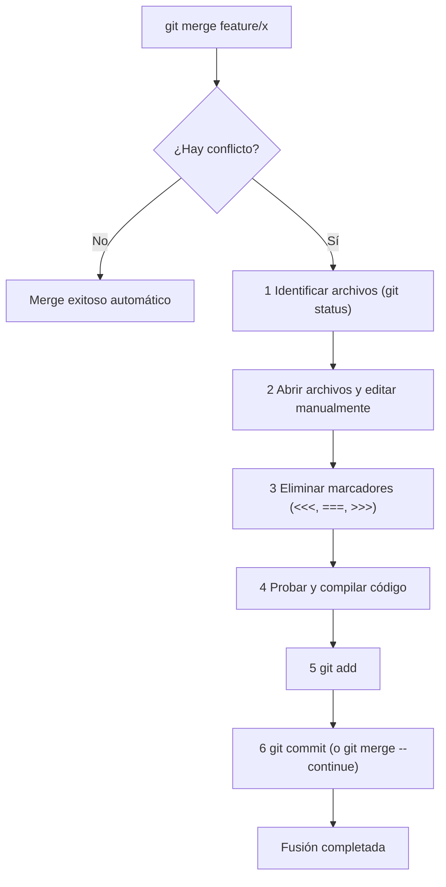

# Resolución de Conflictos en Git

Un **conflicto de fusión (*merge conflict*)** ocurre cuando Git no puede determinar automáticamente qué cambios conservar porque dos ramas modificaron las **mismas líneas de un mismo archivo** de manera diferente, o cuando una rama eliminó un archivo que la otra rama modificó.

---

## 1. Anatomía de un Conflicto

Cuando Git detecta un conflicto, detiene el proceso de fusión y añade **marcadores de conflicto** directamente dentro del archivo afectado:

```text
<<<<<<< HEAD (Current Change - Tu rama actual)
const API_URL = "https://api.produccion.com/v1";
=======
const API_URL = "https://api.staging.empresa.org/v2";
>>>>>>> feature/nueva-api (Incoming Change - Rama que estás fusionando)
```

### Explicación de los Marcadores:
- `<<<<<<< HEAD`: Indica el inicio del bloque con el código que existe en la **rama donde estás parado** (ej. `main`).
- `=======`: Línea divisoria central que separa ambas versiones.
- `>>>>>>> <nombre_rama>`: Indica el final del bloque con el código que proviene de la **rama entrante**.

---

## 2. Paso a Paso: Resolver Conflictos en un Merge



### Paso 1: Identificar los archivos en conflicto
```bash
git status
```
Los archivos problemáticos aparecerán bajo la sección:
`Unmerged paths: (both modified: src/config.js)`

---

### Paso 2: Editar y elegir la versión correcta
Abre el archivo en tu editor de código (por ejemplo, **VS Code**) y toma una decisión:

1. **Aceptar cambio actual (*Accept Current Change*):** Conserva solo lo que estaba en `HEAD`.
2. **Aceptar cambio entrante (*Accept Incoming Change*):** Conserva solo lo que venía de la otra rama.
3. **Aceptar ambos cambios (*Accept Both Changes*):** Conserva ambas secciones.
4. **Combinación manual:** Reescribe la sección de código integrando la lógica de ambas partes y **borra manualmente todos los caracteres `<<<<<<<`, `=======` y `>>>>>>>`**.

---

### Paso 3: Marcar el conflicto como resuelto
Una vez que el archivo no tiene marcadores y el código funciona correctamente:

```bash
# Agregar el archivo resuelto al Staging Area
git add src/config.js

# Si fueron varios archivos resueltos:
git add .
```

---

### Paso 4: Finalizar la fusión
```bash
# Crear el commit de resolución
git commit -m "fix(merge): resolver conflictos en configuración de API"

# O simplemente ejecutar:
git merge --continue
```

---

### ¿Cómo cancelar y volver atrás si algo sale mal?
Si te confundes o prefieres abortar la fusión y dejar el repositorio exactamente como estaba antes de iniciar el merge:

```bash
git merge --abort
```

---

## 3. Conflictos durante un Rebase (`git rebase`)

Durante un rebase, los conflictos se resuelven **commit por commit** a medida que Git reproduce cada cambio.

```bash
# Iniciar rebase
git switch feature/login
git rebase main

# Si se detiene por conflicto:
# 1. Editas los archivos y eliminas los marcadores.
# 2. Agregas al staging:
git add archivo_resuelto.js

# 3. Continuar con el siguiente commit del rebase:
git rebase --continue

# (Opcional) Saltar el commit conflictivo actual:
git rebase --skip

# (En caso de emergencia) Abortar todo el rebase y volver al estado original:
git rebase --abort
```

> [!CAUTION]
> Durante un rebase en conflicto, **NO ejecutes `git commit`**. Usa siempre `git rebase --continue` una vez agregados los archivos resueltos con `git add`.

---

## 4. Herramientas Visuales de Resolución

### A. Editor de Fusión de VS Code (3-Way Merge Editor)
1. Al abrir un archivo en conflicto en VS Code, verás botones rápidos arriba de los marcadores:
   - `Accept Current` | `Accept Incoming` | `Accept Both` | `Compare Changes`
2. En la esquina inferior derecha aparece el botón **"Resolve in Merge Editor"**, que abre una vista de 3 paneles:
   - **Izquierda:** Tu versión local (`Current`).
   - **Derecha:** La versión entrante (`Incoming`).
   - **Abajo:** El resultado final que se guardará (`Result`).

### B. Usar `git mergetool`
Git permite invocar una herramienta gráfica externa configurada en tu sistema (como KDiff3, Meld, P4Merge o VS Code):

```bash
# Abrir la herramienta visual configurada
git mergetool
```

---

## 5. Buenas Prácticas para Minimizar Conflictos

> [!TIP]
> Los conflictos son normales en el desarrollo colaborativo, pero seguir estas reglas reduce su frecuencia al mínimo:
> 
> 1. **Ramas cortas y focalizadas:** Evita ramas que vivan semanas abiertas. Crea ramas pequeñas (*Feature Branches*) de 1 a 3 días de duración.
> 2. **Sincronización frecuente:** Haz `git pull` o `git fetch` diario desde `main` hacia tu rama local para integrar los cambios de tus compañeros temprano.
> 3. **Commits atómicos:** Si modificas 50 archivos en un solo commit, la probabilidad de conflicto se dispara. Haz commits pequeños por cada tarea puntual.
> 4. **Evitar formateadores masivos en medio de features:** No reformatees todo el proyecto (ej. Prettier / ESLint / Black) en la misma rama donde estás programando una funcionalidad nueva.
> 5. **Comunicación con el equipo:** Si vas a modificar archivos troncales de configuración o arquitectura, avisa a tus compañeros antes de empezar.

---

## 6. Navegación entre Notas

- Nota anterior: **[[03 - Ramas y Fusiones (Branch, Merge y Squash)]]**
- Siguiente nota: **[[05 - Operaciones Avanzadas y Deshacer Cambios]]**
- Volver al índice general: **[[Index|Índice de Git]]**
