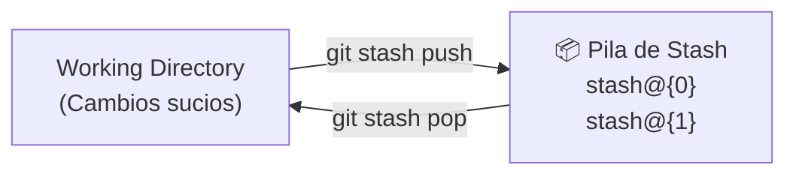
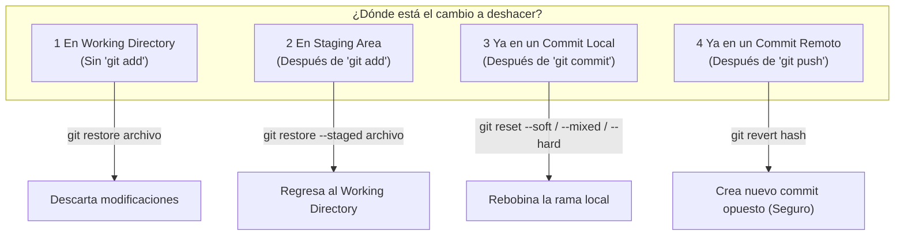
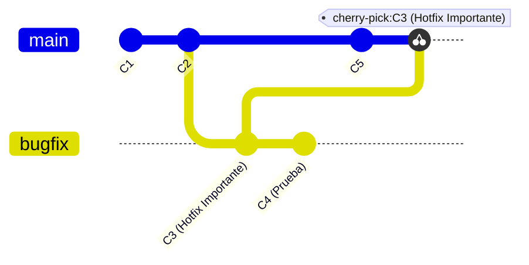

# Operaciones Avanzadas y Deshacer Cambios

En el desarrollo diario es común cometer errores, necesitar cambiar de contexto a mitad de una tarea o querer trasladar commits específicos entre ramas. Git ofrece un conjunto robusto de herramientas para controlar y recuperar el historial.

---

## 1. Guardado Temporal: El Stash (`git stash`)

El **Stash** es un área de almacenamiento temporal (*pila LIFO*) donde puedes guardar los cambios no commiteados de tu Working Directory y Staging Area para dejar tu espacio de trabajo completamente limpio.



### Comandos de Stash:

```bash
# Guardar cambios actuales con un mensaje descriptivo
git stash push -m "WIP: formulario de registro a medio terminar"
# (Sintaxis rápida sin mensaje)
git stash

# Guardar cambios INCLUYENDO archivos sin seguimiento (Untracked)
git stash -u

# Ver la lista de stashes guardados
git stash list

# Recuperar el último stash guardado Y eliminarlo de la lista
git stash pop

# Recuperar el último stash pero MANTENERLO en la lista
git stash apply

# Aplicar un stash específico de la lista
git stash apply stash@{2}

# Ver qué cambios contiene un stash sin aplicarlo
git stash show -p stash@{0}

# Eliminar un stash específico de la lista
git stash drop stash@{0}

# Borrar todos los stashes de la lista
git stash clear
```

---

## 2. Cómo Deshacer Cambios en Cada Nivel

Git permite revertir cambios dependiendo del estado en el que se encuentren:



### A. Deshacer cambios en el Working Directory (Antes de `git add`)
```bash
# Descartar las modificaciones de un archivo específico
git restore src/App.js
# (Sintaxis clásica)
git checkout -- src/App.js

# Descartar todas las modificaciones de todos los archivos rastreados
git restore .

# Eliminar archivos nuevos no rastreados (Untracked)
git clean -fd
```

### B. Deshacer cambios en el Staging Area (Después de `git add`)
```bash
# Quitar un archivo del Staging Area (vuelve a estar solo modificado en disco)
git restore --staged src/App.js
# (Sintaxis clásica)
git reset HEAD src/App.js
```

### C. Revertir commits ya publicados (`git revert`)
`git revert` es la forma **segura y no destructiva** de deshacer un commit que ya fue enviado con `git push`. En lugar de borrar la historia, genera un **nuevo commit que aplica exactamente los cambios inversos**.

```bash
# Crear commit que anula los cambios del commit indicado
git revert 4a8b12c

# Revertir sin crear commit inmediato (para revisar antes)
git revert -n 4a8b12c
```

---

## 3. Rebobinar Commits Locales: `git reset`

> [!CAUTION]
> Usa `git reset` **exclusivamente en commits locales que NO hayas enviado al servidor remoto**.

`git reset` mueve el puntero de la rama actual hacia un commit anterior. Cuenta con 3 modos:

| Modo | ¿Mueve HEAD? | ¿Conserva cambios en Staging? | ¿Conserva cambios en Working Dir? | Peligro de pérdida de datos |
| :--- | :---: | :---: | :---: | :---: |
| `--soft` | ✅ Sí | ✅ Sí | ✅ Sí | 🟢 Ninguno (Ideal para reempaquetar commits) |
| `--mixed` *(defecto)* | ✅ Sí | ❌ No | ✅ Sí | 🟡 Bajo (Los cambios quedan en el código sin preparar) |
| `--hard` | ✅ Sí | ❌ No | ❌ No | 🔴 **ALTO (Borra todo cambio en el código)** |

```bash
# 1. Soft: Deshace el último commit pero deja todos tus archivos preparados en Staging
git reset --soft HEAD~1

# 2. Mixed: Deshace el último commit y deja los archivos modificados en tu disco
git reset HEAD~1

# 3. Hard: ¡PELIGRO! Borra por completo el commit y todos los cambios de código
git reset --hard HEAD~1

# Resetear la rama local al estado exacto del repositorio remoto
git reset --hard origin/main
```

---

## 4. Cherry-Pick: Aplicar Commits Selectivos (`git cherry-pick`)

`git cherry-pick` permite elegir **un commit específico** de cualquier rama y aplicarlo directamente sobre tu rama actual sin necesidad de fusionar toda la rama.



```bash
# Estando en la rama de destino (ej. main o release):
git switch main

# Aplicar el commit deseado por su hash
git cherry-pick 7f9a3c2

# Aplicar un rango de commits
git cherry-pick 7f9a3c2..9e2d1f0
```

---

## 5. El Salvavidas de Git: `git reflog`

> [!TIP]
> **¿Hiciste un `git reset --hard` por error o perdiste un commit al borrar una rama?**  
> `git reflog` registra **cada movimiento del puntero HEAD** en tu máquina local durante los últimos 30-90 días. ¡Casi nada se pierde de verdad en Git!

```bash
# 1. Ver el historial completo de acciones locales
git reflog
```

Ejemplo de salida de `git reflog`:
```text
e4b1029 HEAD@{0}: reset: moving to HEAD~1
a8f9021 HEAD@{1}: commit: feat: módulo de checkout completado
c3d4e5f HEAD@{2}: switch: moving from main to feature/checkout
```

```bash
# 2. Recuperar el estado exacto donde estaba el commit antes del error
git reset --hard HEAD@{1}
# O crear una nueva rama a partir de ese commit rescatado:
git switch -c rama-recuperada a8f9021
```

---

## 6. Modelos de Ramificación (Git Workflows)

### A. GitHub Flow (Recomendado para la mayoría de proyectos ágiles)
1. La rama `main` siempre es estable y lista para producción.
2. Cada nueva tarea se crea en una rama descriptiva (`feature/nueva-funcionalidad`, `fix/login-bug`).
3. Se abren **Pull Requests (PR)** para revisión de código y pruebas automatizadas (CI/CD).
4. Se fusiona a `main` (usualmente mediante **Squash and Merge**) y se despliega inmediatamente.

### B. Git Flow (Proyectos con versiones formales y releases planificados)
- Ramas principales permanentes: `main` (producción) y `develop` (desarrollo).
- Ramas temporales: `feature/*`, `release/*`, `hotfix/*`.

---

## 7. Navegación entre Notas

- Nota anterior: **[[04 - Resolución de Conflictos]]**
- Guía rápida y comandos: **[[06 - Guía Rápida de Comandos (Cheat Sheet)]]**
- Volver al índice general: **[[Index|Índice de Git]]**
