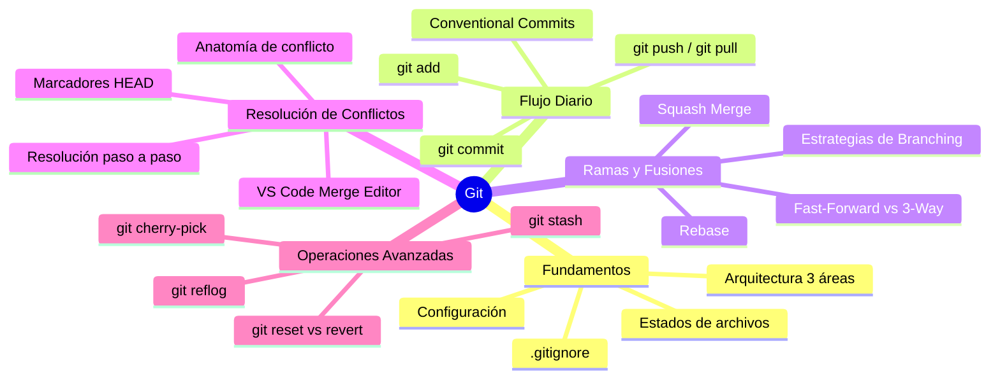

# Índice de Git & Control de Versiones

Bienvenido a la guía completa y estructurada de **Git y Control de Versiones**. Esta carpeta contiene apuntes teóricos, comandos prácticos, diagramas de flujo y casos de uso organizados paso a paso.

Documentación: [Git - git Documentation](https://git-scm.com/docs/git)

---

## ☁️ ¿Qué es GitHub y en qué se diferencia de Git?

**GitHub** es una plataforma basada en la nube que permite alojar repositorios remotos de Git, colaborar en equipo, gestionar proyectos de software y automatizar procesos de desarrollo.

> [!NOTE]
> **Diferencia Clave:**
> - **Git** es la **herramienta de software local** (el motor de control de versiones instalado en tu terminal que gestiona archivos, ramas y commits).
> - **GitHub** es el **servicio en la nube** donde subes tus repositorios locales (`git push`) para compartirlos con el mundo, colaborar en equipo y tener copias de seguridad.

### Principales Funcionalidades de GitHub:
- 🌐 **Alojamiento de Repositorios Remotos:** Acceso y sincronización desde cualquier equipo mediante HTTPS o SSH.
- 🔀 **Pull Requests (PR):** Flujo para proponer cambios, realizar revisión de código (*Code Review*), comentar líneas y aprobar fusiones.
- 📋 **Issues y Projects:** Gestión de incidencias, seguimiento de errores y tableros visuales Kanban.
- 🤖 **GitHub Actions:** Automatización de flujos de Integración y Despliegue Continuo (CI/CD) para pruebas y compilación automática en cada `push`.
- 🍴 **Forks & Open Source:** Posibilidad de clonar proyectos públicos ajenos para colaborar mediante *pull requests*.

---

## 🗺️ Mapa de Contenidos (MOC)



---

## 📚 Notas y Módulos

### 1. [[01 - Fundamentos y Configuración]]
- ¿Qué es Git y arquitectura de las 3 áreas de trabajo (Working Directory, Staging Area, Local Repository).
- Ciclo de vida y estados de un archivo (*Untracked, Unmodified, Modified, Staged*).
- Configuración de identidad, aliases útiles y manejo de saltos de línea (CRLF/LF).
- Inicialización (`git init`), clonación (`git clone`) y sintaxis del archivo `.gitignore`.

### 2. [[02 - Flujo Básico (Commit, Push, Pull)]]
- Inspección de cambios con `git status` y `git diff`.
- Preparación selectiva e interactiva con `git add` y `git add -p`.
- Creación de commits, enmiendas (`git commit --amend`) y estándar **Conventional Commits** (`feat`, `fix`, `docs`, etc.).
- Historial gráfico con `git log`.
- Gestión de repositorios remotos (`git remote`), envíos (`git push`) y sincronización limpia (`git fetch` y `git pull --rebase`).

### 3. [[03 - Ramas y Fusiones (Branch, Merge y Squash)]]
- Creación, cambio y eliminación de ramas (`git switch`, `git branch`).
- Estrategias de fusión: Fast-Forward, 3-Way Merge (`--no-ff`).
- **Merge Squash (`git merge --squash`)**: guía paso a paso para consolidar múltiples commits en uno solo.
- Rebase (`git rebase`), la regla de oro y rebase interactivo (`git rebase -i`).

### 4. [[04 - Resolución de Conflictos]]
- Causas de conflictos y anatomía de marcadores (`<<<<<<< HEAD`, `=======`, `>>>>>>>`).
- Paso a paso para resolver conflictos en fusiones y en rebases (`git merge --continue`, `git rebase --continue`).
- Cómo abortar operaciones de forma segura (`git merge --abort`, `git rebase --abort`).
- Herramientas visuales y buenas prácticas para prevenir colisiones en equipo.

### 5. [[05 - Operaciones Avanzadas y Deshacer Cambios]]
- Guardado temporal de trabajo en la pila con `git stash` (`pop`, `apply`, `list`).
- Cómo deshacer cambios en cada etapa: `git restore`, `git restore --staged`, `git revert`, y los 3 modos de `git reset` (`--soft`, `--mixed`, `--hard`).
- Selección de commits con `git cherry-pick`.
- Rescate de commits perdidos o resets erróneos con `git reflog`.
- Modelos de trabajo: GitHub Flow vs Git Flow.

### 6. [[06 - Guía Rápida de Comandos (Cheat Sheet)]]
- Tabla consolidada de referencia rápida con todos los comandos agrupados por tarea.

---

## ⚡ Flujos de Trabajo Más Frecuentes

### ¿Cómo subir un nuevo cambio a GitHub?
```bash
git status
git add .
git commit -m "feat(auth): implementar formulario de login"
git push
```

### ¿Cómo hacer un Merge Squash de una rama a main?
```bash
git switch main
git pull origin main
git merge --squash feature/mi-funcionalidad
git commit -m "feat: funcionalidad completa integrada"
git push origin main
```

### ¿Cómo actualizar tu rama local con los últimos cambios de main?
```bash
git switch feature/mi-rama
git fetch origin
git rebase origin/main
```

### ¿Cómo guardar cambios temporalmente mientras se realiza otra cosa entre ramas?

```bash
# guarda cambios en una memoria temporal(pila)
git stash 

#Para guardar cambios untracked
git stash -u

# Luego aplicar los cambios guardados
git stash pop
```

### ¿Cómo subir una rama creada localmente?
```bash
git push -u origin feature/capa-persistencia
```
### ¿Cómo revertir los cambios e ir al último commit?
>[!CAUTION]
> - Deshacer todos los cambios locales y revierte el entorno de trabajo al estado exacto del último commit  guardado en la rama actual.
>   El segundo elimina los archivos creados sin rastrear

```bash
git reset --hard HEAD
git clean -fd
```

---

## 🏠 Navegación Global
- Volver a la portada: **[[Index|Índice Principal de la Facultad]]**
