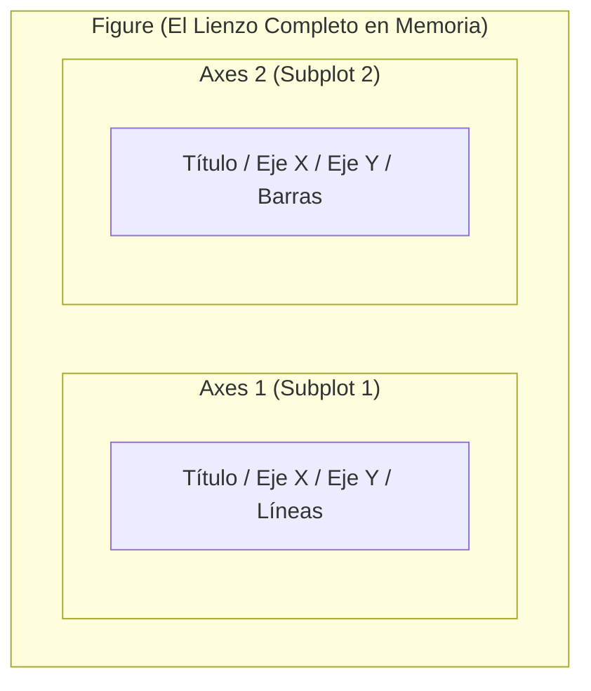

# Matplotlib: Creación y Personalización de Gráficos 2D

> **Ubicación:** [[Librerias index|Librerías]] / Aplicaciones de Bases de Datos II y Data Mining  
> **Librerías relacionadas:** [[Seaborn]] • [[Pandas]] • [[NumPy]] • [[Preprocesamiento de datos]]

---

## Objetos importantes

Matplotlib opera bajo una arquitectura jerárquica. Toda visualización profesional debe utilizar el enfoque **Orientado a Objetos (OO)** mediante `Figure` y `Axes`:



### 1. `Figure`
- **Qué representa:** La ventana o lienzo global que contiene todos los subgráficos, títulos globales y leyendas.
- **Para qué sirve:** Configurar el tamaño físico (`figsize`), resolución (`dpi`) y guardar la imagen en disco (`savefig`).

### 2. `Axes`
- **Qué representa:** El gráfico individual (el área rectangular delimitada con escala numérica en ejes $X$ e $Y$). Una `Figure` puede contener uno o varios `Axes`.
- **Para qué sirve:** Dibujar los datos (`plot`, `scatter`, `bar`, `hist`) y definir títulos, etiquetas, cuadrículas y límites.
- **Ejemplo mínimo (Enfoque Orientado a Objetos):**
  ```python
  import matplotlib.pyplot as plt

  # Crear lienzo (fig) y gráfico individual (ax)
  fig, ax = plt.subplots(figsize=(6, 3))
  ax.plot([1, 2, 3, 4], [10, 20, 25, 30], color="navy", label="Métricas")
  ax.set_title("Evolución Temporal")
  ax.legend()
  plt.show()
  ```

> [!TIP]
> **Regla de oro:** Evita usar la sintaxis de estado tipo MATLAB (`plt.plot()`, `plt.title()`). Usa siempre el enfoque orientado a objetos: `fig, ax = plt.subplots()` seguido de `ax.metodo()`. Permite controlar múltiples gráficos sin ambigüedades.

---

## Mapa de intenciones

| Quiero... | Uso | Ejemplo |
|---|---|---|
| **1. Crear lienzo y submallas** | | |
| Crear figura con 1 gráfico | `plt.subplots()` | `fig, ax = plt.subplots(figsize=(8, 4))` |
| Crear matriz de $N \times M$ subgráficos | `plt.subplots(nrows, ncols)` | `fig, axs = plt.subplots(1, 2, figsize=(10, 4))` |
| **2. Trazar tipos de gráficos** | | |
| Gráfico de líneas (series temporales, curvas de error) | `ax.plot()` | `ax.plot(epocas, perdida, color="red", lw=2)` |
| Gráfico de dispersión (relación entre dos variables) | `ax.scatter()` | `ax.scatter(x, y, alpha=0.6, c=etiquetas)` |
| Gráfico de barras verticales | `ax.bar()` | `ax.bar(categorias, valores, color="steelblue")` |
| Gráfico de barras horizontales | `ax.barh()` | `ax.barh(categorias, valores)` |
| Histograma de frecuencias | `ax.hist()` | `ax.hist(datos, bins=20, edgecolor="black")` |
| Diagrama de caja y bigotes (outliers) | `ax.boxplot()` | `ax.boxplot(datos)` |
| **3. Personalizar y rotular** | | |
| Fijar título, etiquetas X e Y a la vez | `ax.set()` | `ax.set(title="Título", xlabel="X", ylabel="Y")` |
| Mostrar cuadrícula de lectura | `ax.grid()` | `ax.grid(True, linestyle="--", alpha=0.7)` |
| Mostrar leyenda de datos | `ax.legend()` | `ax.legend(loc="upper right")` |
| Delimitar rangos visibles de los ejes | `ax.set_xlim()`, `ax.set_ylim()` | `ax.set_ylim(0, 100)` |
| Título global para toda la figura | `fig.suptitle()` | `fig.suptitle("Reporte de Minería de Datos")` |
| Dibujar línea horizontal o vertical de referencia | `ax.axhline()`, `ax.axvline()` | `ax.axhline(y=0.5, color="gray", linestyle="--")` |
| **4. Ajustar y exportar** | | |
| Ajustar márgenes para que no se corten etiquetas | `plt.tight_layout()` | `plt.tight_layout()` |
| Guardar figura en imagen de alta resolución | `plt.savefig()` | `plt.savefig("grafico.png", dpi=300, bbox_inches="tight")` |
| Mostrar en pantalla | `plt.show()` | `plt.show()` |
| Cerrar figura para liberar memoria RAM | `plt.close()` | `plt.close(fig)` |

---

## Operaciones importantes por intención

### `plt.subplots()`

**¿Qué quiero hacer?**  
Inicializar la figura base y la cuadrícula de ejes donde se trazarán los gráficos.

**¿A qué pertenece?**  
⚙️ **Función del módulo** `matplotlib.pyplot`.

**Sintaxis básica:**
```python
fig, ax = plt.subplots(nrows=1, ncols=1, figsize=(largura, altura))
```

**Ejemplo realista:**
```python
# Crear dos gráficos lado a lado: uno para dispersión y otro para distribución
fig, (ax1, ax2) = plt.subplots(nrows=1, ncols=2, figsize=(12, 4))
ax1.scatter(df["edad"], df["saldo"])
ax2.hist(df["saldo"], bins=15)
plt.tight_layout()
```

**Resultado / qué hace:**  
Retorna una tupla `(Figure, Axes)` o un arreglo de objetos `Axes` si hay múltiples filas/columnas.

**Relacionado:**  
`fig.add_subplot()`.

---

### `ax.plot()`

**¿Qué quiero hacer?**  
Trazar líneas o curvas continuas (evolución de métricas, pérdida de entrenamiento por época, o series de tiempo).

**¿A qué pertenece?**  
🏷️ **Método de objeto** `Axes`.

**Sintaxis básica:**
```python
ax.plot(x, y, color=None, linestyle='-', linewidth=1.5, label=None)
```

**Ejemplo realista:**
```python
# Monitoreo de curva de error de un algoritmo
ax.plot(epocas, loss_train, color="blue", linestyle="-", label="Entrenamiento")
ax.plot(epocas, loss_val, color="red", linestyle="--", label="Validación")
ax.legend()
```

**Resultado / qué hace:**  
Conecta los puntos $(x_i, y_i)$ con segmentos de línea contiguos en el plano.

**Relacionado:**  
`ax.scatter()`.

---

### `ax.scatter()`

**¿Qué quiero hacer?**  
Trazar puntos individuales en el plano sin unirlos, permitiendo colorear cada punto por su clase o grupo de clustering.

**¿A qué pertenece?**  
🏷️ **Método de objeto** `Axes`.

**Sintaxis básica:**
```python
ax.scatter(x, y, s=tamano, c=color, alpha=opacidad, cmap=paleta)
```

**Ejemplo realista:**
```python
# Visualizar clusters generados por K-Means en 2 dimensiones
scatter = ax.scatter(X[:, 0], X[:, 1], c=clusters, cmap="viridis", alpha=0.7, s=40)
fig.colorbar(scatter, ax=ax, label="Cluster ID")
```

**Resultado / qué hace:**  
Dibuja nubes de puntos cartesianas. Es el gráfico fundamental para evaluar agrupamientos y separabilidad en minería de datos.

**Relacionado:**  
`ax.plot()`.

---

### `ax.bar()` / `ax.barh()`

**¿Qué quiero hacer?**  
Representar valores numéricos asociados a categorías discretas (ej. importancia de variables calculada por un árbol de decisión).

**¿A qué pertenece?**  
🏷️ **Método de objeto** `Axes`.

**Sintaxis básica:**
```python
ax.bar(x, height, width=0.8, color=None)
ax.barh(y, width, height=0.8, color=None) # Horizontal
```

**Ejemplo realista:**
```python
# Gráfico horizontal de importancia de atributos para fácil lectura
atributos = ["saldo", "edad", "ingresos", "moras_previas"]
importancias = [0.45, 0.25, 0.20, 0.10]
ax.barh(atributos, importancias, color="teal")
ax.set_xlabel("Importancia Relativa")
```

**Resultado / qué hace:**  
Genera barras rectangulares proporcionales al valor indicado.

**Relacionado:**  
`ax.hist()`.

---

### `ax.hist()`

**¿Qué quiero hacer?**  
Dividir una variable continua en intervalos (*bins*) y contar cuántas observaciones caen en cada intervalo.

**¿A qué pertenece?**  
🏷️ **Método de objeto** `Axes`.

**Sintaxis básica:**
```python
ax.hist(x, bins=10, density=False, color=None, edgecolor=None)
```

**Ejemplo realista:**
```python
# Inspeccionar distribución empírica de una variable con bordes marcados
ax.hist(df["ingresos"], bins=20, color="skyblue", edgecolor="navy")
ax.set(title="Distribución de Ingresos", xlabel="Monto ($)", ylabel="Frecuencia")
```

**Resultado / qué hace:**  
Calcula los rangos y dibuja las barras adyacentes de frecuencia.

**Relacionado:**  
`ax.bar()`, `sns.histplot()`.

---

### `ax.set()` / Métodos de Rotulación

**¿Qué quiero hacer?**  
Establecer de forma consolidada o individual títulos, etiquetas de ejes y límites numéricos.

**¿A qué pertenece?**  
🏷️ **Método de objeto** `Axes`.

**Sintaxis básica:**
```python
ax.set(title="...", xlabel="...", ylabel="...", xlim=(min, max), ylim=(min, max))
```

**Ejemplo realista:**
```python
ax.set(
    title="Evaluación de Modelo Predictivo",
    xlabel="Tasa de Falsos Positivos (FPR)",
    ylabel="Tasa de Verdaderos Positivos (TPR)",
    xlim=(0.0, 1.0),
    ylim=(0.0, 1.05)
)
```

**Resultado / qué hace:**  
Configura las propiedades visuales del eje en una sola línea compacta.

**Relacionado:**  
`ax.set_title()`, `ax.set_xlabel()`.

---

### `plt.savefig()`

**¿Qué quiero hacer?**  
Exportar la visualización a un archivo de imagen en disco para incluir en informes o reportes finales.

**¿A qué pertenece?**  
⚙️ **Función del módulo** `matplotlib.pyplot`.

**Sintaxis básica:**
```python
plt.savefig(fname, dpi=300, bbox_inches='tight')
```

**Ejemplo realista:**
```python
# Guardar gráfico con alta resolución y sin recortar leyendas externas
plt.savefig("reporte_clustering.png", dpi=300, bbox_inches="tight")
```

**Resultado / qué hace:**  
Renderiza la figura completa en formatos como PNG, PDF o SVG. Usar `bbox_inches='tight'` evita que los textos de los ejes queden cortados.

**Relacionado:**  
`plt.show()`, `plt.close()`.

---

## Diferencias importantes

### 1. Interfaz OO (`ax.plot`) vs Interfaz de Estado (`plt.plot`)

| Característica | Enfoque Orientado a Objetos (Recomendado) | Enfoque de Estado (MATLAB style) |
|---|---|---|
| **Sintaxis** | `fig, ax = plt.subplots(); ax.plot()` | `plt.plot()` |
| **Control** | Explícito sobre cada gráfico individual | Opera a ciegas sobre el "último gráfico activo" |
| **Múltiples subplots** | Claro y escalable (`ax1.plot()`, `ax2.plot()`) | Propenso a errores de asignación |
| **Uso en funciones** | Permite pasar `ax` como argumento | Depende de variables de estado global |

### 2. `Figure` vs `Axes`
- **`Figure`:** El contenedor exterior completo (la "hoja de papel").
- **`Axes`:** El gráfico real con coordenadas matemáticas $X$ e $Y$ montado sobre la hoja. Una `Figure` puede tener 1, 2, 4 o más `Axes`.

### 3. `plt.close()` vs `plt.clf()`
- **`plt.clf()`:** Limpia el contenido de la figura actual pero la mantiene abierta en memoria.
- **`plt.close()`:** Cierra y destruye completamente la figura liberando la memoria RAM asignada (indispensable al generar cientos de gráficos en bucles).

---

## Ejemplo completo

El siguiente script crea un panel comparativo de **monitoreo de entrenamiento de un modelo de Minería de Datos** (Función de Pérdida vs. Métrica de Precisión) utilizando dos subplots sincronizados:

```python
import matplotlib.pyplot as plt
import numpy as np

# 1. Simular métricas de entrenamiento a lo largo de 10 épocas
epocas = np.arange(1, 11)
loss_train = [0.85, 0.60, 0.45, 0.35, 0.28, 0.22, 0.18, 0.15, 0.13, 0.11]
loss_val   = [0.88, 0.65, 0.50, 0.42, 0.38, 0.35, 0.34, 0.35, 0.37, 0.39] # Muestra overfitting al final
acc_train  = [0.60, 0.72, 0.80, 0.85, 0.89, 0.92, 0.94, 0.96, 0.97, 0.98]
acc_val    = [0.58, 0.70, 0.78, 0.82, 0.84, 0.85, 0.85, 0.84, 0.83, 0.82]

# 2. Inicializar figura con 2 subplots horizontales
fig, (ax_loss, ax_acc) = plt.subplots(nrows=1, ncols=2, figsize=(12, 4))

# 3. Subplot 1: Curvas de Pérdida (Loss)
ax_loss.plot(epocas, loss_train, color="royalblue", marker="o", lw=2, label="Train Loss")
ax_loss.plot(epocas, loss_val, color="crimson", marker="s", linestyle="--", lw=2, label="Val Loss")
ax_loss.set(title="Evolución de la Función de Pérdida", xlabel="Época", ylabel="Loss")
ax_loss.grid(True, linestyle=":", alpha=0.6)
ax_loss.legend()

# 4. Subplot 2: Curvas de Precisión (Accuracy)
ax_acc.plot(epocas, acc_train, color="forestgreen", marker="o", lw=2, label="Train Acc")
ax_acc.plot(epocas, acc_val, color="darkorange", marker="s", linestyle="--", lw=2, label="Val Acc")
ax_acc.set(title="Evolución de la Exactitud (Accuracy)", xlabel="Época", ylabel="Accuracy", ylim=(0.5, 1.0))
ax_acc.grid(True, linestyle=":", alpha=0.6)
ax_acc.legend(loc="lower right")

# 5. Ajuste general y visualización
fig.suptitle("Diagnóstico de Entrenamiento: Detección de Sobreajuste (Overfitting)", fontsize=13)
plt.tight_layout()
plt.show()
```

### Explicación del flujo:

1. **Inicialización (`plt.subplots`):**
   - **Qué hacemos:** Declaramos la estructura multipanel $(1, 2)$ asignando los ejes a variables semánticas (`ax_loss`, `ax_acc`).
   - **Por qué:** Permite configurar cada gráfico de forma aislada y limpia sin colisiones de estado.
   - **Objeto manipulado:** `Figure` y tupla de dos objetos `Axes`.
   - **Resultado:** Lienzo estructurado listo para graficar.

2. **Graficación de curvas (`ax.plot`):**
   - **Qué hacemos:** Trazamos métricas de entrenamiento vs validación con colores y marcadores diferenciados.
   - **Por qué:** Visualizar si el error de validación sube mientras el de entrenamiento baja, síntoma inequívoco de sobreajuste.
   - **Objeto manipulado:** Coordenadas de los `Axes`.
   - **Resultado:** Curvas trazadas con leyendas asociadas.

3. **Rotulación y cuadrícula (`set` y `grid`):**
   - **Qué hacemos:** Definimos títulos, escalas mínimas/máximas y líneas guía.
   - **Por qué:** Facilitar la lectura cuantitativa precisa para informes de laboratorio de Bases de Datos II.
   - **Objeto manipulado:** Metadatos visuales de los `Axes`.
   - **Resultado:** Gráficos autoexplicativos y profesionales.

4. **Consolidación (`tight_layout`):**
   - **Qué hacemos:** Calculamos automáticamente los espaciados de los bordes.
   - **Por qué:** Evitar que los títulos de los ejes se superpongan entre gráficos contiguos.
   - **Objeto manipulado:** `Figure` global.
   - **Resultado:** Imagen final limpia lista para exportar o presentar.

---

## Cheat Sheet

| Necesito... | Uso |
|---|---|
| Crear figura y eje | `fig, ax = plt.subplots(figsize=(8, 4))` |
| Matriz de 2 gráficos en 1 fila | `fig, (ax1, ax2) = plt.subplots(1, 2)` |
| Gráfico de líneas | `ax.plot(x, y, color="blue", lw=2)` |
| Gráfico de dispersión | `ax.scatter(x, y, c=clases, alpha=0.6)` |
| Gráfico de barras verticales | `ax.bar(categorias, valores)` |
| Gráfico de barras horizontales | `ax.barh(categorias, valores)` |
| Histograma | `ax.hist(datos, bins=20)` |
| Título y etiquetas de ejes | `ax.set(title="T", xlabel="X", ylabel="Y")` |
| Cuadrícula de fondo | `ax.grid(True, linestyle="--")` |
| Mostrar leyenda | `ax.legend()` |
| Línea horizontal de referencia | `ax.axhline(y=0.5, color="gray", ls="--")` |
| Ajustar márgenes sin solapes | `plt.tight_layout()` |
| Guardar imagen en PNG | `plt.savefig("grafico.png", dpi=300, bbox_inches="tight")` |
| Cerrar figura para liberar RAM | `plt.close(fig)` |

---

## 🧭 Navegación entre Notas

- 📂 **Índice del módulo:** [[Librerias index|Librerías de Python]]
- 📊 **Visualización estadística de alto nivel:** [[Seaborn]]
- 🐼 **Estructuras de datos:** [[Pandas]]
- 🔢 **Cálculo numérico:** [[NumPy]]
- 🤖 **Modelos de Machine Learning:** [[Scikit-Learn]]
