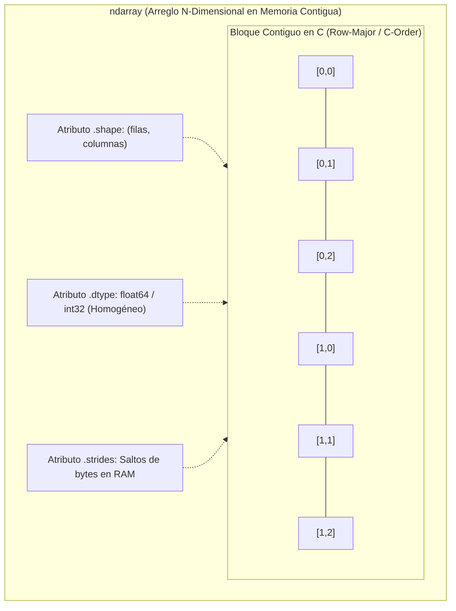
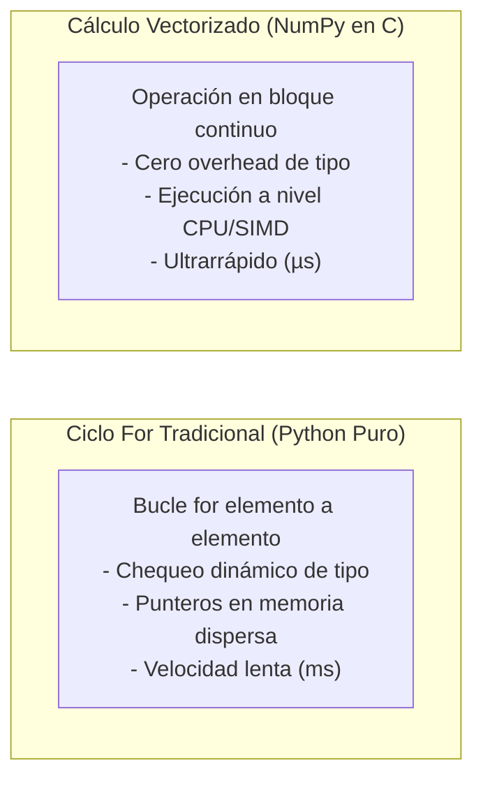

# NumPy: Computación Numérica y Manipulación de Matrices

> **Ubicación:** [[Librerias index|Librerías]] / Aplicaciones de Bases de Datos II y Data Mining  
> **Librerías relacionadas:** [[Pandas]] • [[Preprocesamiento de datos]] • [[Matplotlib]] • [[Seaborn]] • [[Scikit-Learn]]

---

## Objetos importantes

En NumPy, todo el cómputo de alto rendimiento se estructura alrededor de un único objeto fundamental: el **`ndarray`** (*N-dimensional array*).



### 1. `ndarray` (*N-dimensional array*)
- **Qué representa:** Un bloque de memoria contiguo, de tamaño fijo y tipado **estrictamente homogéneo**, que permite almacenar vectores (1D), matrices (2D) o tensores ($N$D).
- **Para qué sirve:** Es la base computacional de todo el ecosistema de ciencia de datos. Los algoritmos de [[Scikit-Learn]] esperan matrices de características de entrada en formato `ndarray`.
- **Ejemplo mínimo:**
  ```python
  import numpy as np

  # Matriz 2D de 2 filas y 3 columnas
  matriz = np.array([[1.5, 2.0, 3.2], [4.1, 5.0, 6.7]], dtype=np.float64)
  print(matriz)
  print("Dimensiones:", matriz.shape)
  ```

> [!NOTE]
> **Homogeneidad obligatoria:** A diferencia de las listas de Python (que guardan punteros a objetos dispersos en memoria), todos los elementos de un `ndarray` ocupan exactamente los mismos bytes en memoria contigua. Esto permite ejecutar instrucciones vectorizadas directas del procesador (SIMD).

### 2. `dtype` (Tipos de datos escalares)
- **Qué representa:** La especificación exacta del tamaño en bits y formato de los números almacenados.
- **Para qué sirve:** Optimizar el consumo de memoria RAM y evitar conversiones lentas. Los más frecuentes en Data Mining son:
  - `np.float64` / `np.float32`: Variables continuas, pesos de modelos, distancias euclidianas.
  - `np.int64` / `np.int32`: Conteos discretos, identificadores numéricos.
  - `np.bool_`: Máscaras booleanas de filtrado.
  - `np.nan`: Valor flotante especial para representar datos faltantes (*Not a Number*).

### 3. Atributos estructurales clave
- `arr.shape`: Tupla con la cantidad de elementos en cada dimensión (ej. `(1000, 20)` = 1000 filas y 20 atributos). **No lleva paréntesis**.
- `arr.ndim`: Cantidad de dimensiones o ejes (1 para vectores, 2 para matrices).
- `arr.size`: Cantidad total de elementos escalares ($filas \times columnas$).
- `arr.T`: Transpuesta de la matriz (intercambia filas por columnas).

---

## El Paradigma de Vectorización y Broadcasting

En minería de datos, **los bucles `for` tradicionales de Python son inaceptables** para transformar grandes volúmenes de datos. NumPy introduce la **vectorización** y las reglas de **Broadcasting**:



> [!TIP]
> **Broadcasting:** Permite operar entre arreglos de diferentes dimensiones sin duplicar memoria. Si sumas una matriz de `(1000, 4)` y un vector de `(4,)`, NumPy "estira" virtualmente el vector a lo largo de las 1000 filas instantáneamente en memoria.

---

## Mapa de intenciones

| Quiero... | Uso | Ejemplo |
|---|---|---|
| **1. Crear arreglos** | | |
| Crear un arreglo a partir de una lista/tupla | `np.array()` | `arr = np.array([1, 2, 3])` |
| Crear matriz llena de ceros | `np.zeros()` | `ceros = np.zeros((100, 5))` |
| Crear matriz llena de unos | `np.ones()` | `unos = np.ones((10, 2))` |
| Crear secuencia numérica entera regular | `np.arange()` | `rango = np.arange(0, 100, 5)` |
| Crear números espaciados uniformemente en un intervalo | `np.linspace()` | `puntos = np.linspace(0.0, 1.0, 50)` |
| Generar matriz con datos aleatorios normales (Gaussianos) | `np.random.normal()` | `datos = np.random.normal(loc=0, scale=1, size=(500, 3))` |
| Fijar la semilla de aleatoriedad para reproducibilidad | `np.random.seed()` | `np.random.seed(42)` |
| **2. Inspeccionar arreglos** | | |
| Consultar dimensiones (filas, columnas) | `arr.shape` | `n_filas, n_cols = matriz.shape` |
| Consultar el tipo de dato en memoria | `arr.dtype` | `print(matriz.dtype)` |
| Cantidad total de elementos | `arr.size` | `total = matriz.size` |
| **3. Seleccionar e Indexar** | | |
| Rebanar filas y columnas por posición (*slicing*) | `arr[f_inicio:f_fin, c_inicio:c_fin]` | `sub = arr[0:10, 1:4]` |
| Filtrar con máscara lógica booleana | `arr[condicion]` | `mayores = arr[arr > 0]` |
| Obtener coordenadas donde se cumple una condición | `np.where()` | `indices = np.where(arr < 0)` |
| Asignar valores condicionalmente (If-Else vectorizado) | `np.where(cond, si_true, si_false)` | `arr_limpio = np.where(arr < 0, 0, arr)` |
| **4. Modificar formas y dimensiones** | | |
| Cambiar la estructura sin alterar datos | `arr.reshape()` | `matriz = arr.reshape((100, 10))` |
| Aplanar matriz $N$D a vector 1D | `arr.flatten()` / `arr.ravel()` | `vector = matriz.ravel()` |
| Agregar un eje nuevo de dimensión (ej. para Scikit-Learn) | `np.expand_dims()` o `arr[:, np.newaxis]` | `X_2d = X_1d[:, np.newaxis]` |
| Eliminar dimensiones de longitud 1 | `np.squeeze()` | `vector = np.squeeze(arr_1col)` |
| Transponer matriz (invertir ejes) | `arr.T` | `matriz_t = matriz.T` |
| **5. Operaciones matemáticas y vectorización** | | |
| Multiplicación elemento a elemento | Operador `*` | `c = a * b` |
| Producto matricial / Producto punto (Álgebra Lineal) | Operador `@` o `np.dot()` | `y_pred = X @ pesos` |
| Funciones matemáticas universales (*ufuncs*) | `np.exp()`, `np.log()`, `np.sqrt()`, `np.abs()` | `log_ingresos = np.log1p(ingresos)` |
| Redondear valores a $N$ decimales | `np.round()` | `redondeado = np.round(arr, 2)` |
| **6. Estadística y agregaciones** | | |
| Calcular la media aritmética | `np.mean()` | `media_cols = np.mean(matriz, axis=0)` |
| Calcular la mediana (resistente a outliers) | `np.median()` | `mediana = np.median(arr)` |
| Calcular desviación estándar y varianza | `np.std()`, `np.var()` | `std_cols = np.std(matriz, axis=0)` |
| Encontrar valor mínimo y máximo | `np.min()`, `np.max()` | `min_val, max_val = np.min(arr), np.max(arr)` |
| Encontrar la posición del valor máximo/mínimo | `np.argmax()`, `np.argmin()` | `clase_predicha = np.argmax(probabilidades, axis=1)` |
| Calcular percentiles y cuartiles (IQR) | `np.percentile()` | `q25, q75 = np.percentile(arr, [25, 75])` |
| Sumar elementos a lo largo de un eje | `np.sum()` | `suma_total = np.sum(matriz, axis=0)` |
| **7. Limpieza y valores faltantes** | | |
| Detectar valores faltantes NaN | `np.isnan()` | `mascara_nulos = np.isnan(arr)` |
| Reemplazar valores NaN por una constante o media | `np.nan_to_num()` | `arr_sin_nan = np.nan_to_num(arr, nan=0.0)` |
| Calcular estadísticas ignorando valores NaN | `np.nanmean()`, `np.nanmedian()` | `media_sin_nan = np.nanmean(arr)` |
| **8. Combinar y dividir matrices** | | |
| Apilar matrices verticalmente (por filas) | `np.vstack()` | `X_total = np.vstack([X_train, X_test])` |
| Apilar matrices horizontalmente (por columnas) | `np.hstack()` | `X_con_bias = np.hstack([np.ones((n, 1)), X])` |
| Concatenar a lo largo de un eje específico | `np.concatenate()` | `unido = np.concatenate([a, b], axis=0)` |

---

## Operaciones importantes por intención

### `np.array()`

**¿Qué quiero hacer?**  
Crear un arreglo multidimensional homogéneo a partir de estructuras de datos estándar de Python (listas, tuplas o listas anidadas).

**¿A qué pertenece?**  
⚙️ **Función del módulo** `numpy`.

**Sintaxis básica:**
```python
arr = np.array(object, dtype=None, copy=True)
```

**Ejemplo realista:**
```python
# Convertir lista de atributos de clientes en matriz flotante para entrenamiento
atributos_clientes = np.array([
    [25, 55000.0, 1],
    [34, 72000.0, 0],
    [42, 61000.0, 1]
], dtype=np.float32)
```

**Resultado / qué hace:**  
Reserva un bloque contiguo en RAM y mapea todos los elementos al tipo indicado (`dtype`). Si los datos mezclan enteros y flotantes, NumPy promoverá todos automáticamente a flotante.

**Relacionado:**  
`np.zeros()`, `np.ones()`.

---

### `np.zeros()` / `np.ones()`

**¿Qué quiero hacer?**  
Inicializar arreglos predimensionados llenos de ceros o unos para acumular resultados, reservar memoria para matrices de coeficientes o agregar términos independientes (*bias*).

**¿A qué pertenece?**  
⚙️ **Función del módulo** `numpy`.

**Sintaxis básica:**
```python
np.zeros(shape, dtype=float)
np.ones(shape, dtype=float)
```

**Ejemplo realista:**
```python
# Inicializar vector de pesos iniciales para un modelo lineal (w0, w1, w2)
pesos = np.zeros(shape=5, dtype=np.float64)

# Crear vector de bias (1s) para agregar como primera columna a una matriz X
n_muestras = 500
columna_bias = np.ones((n_muestras, 1))
```

**Resultado / qué hace:**  
Retorna un `ndarray` con la forma solicitada sin necesidad de bucles.

**Relacionado:**  
`np.zeros_like()`, `np.full()`.

---

### `np.arange()` / `np.linspace()`

**¿Qué quiero hacer?**  
Generar secuencias numéricas continuas o discretas (para ejes temporales, índices o umbrales de hiperparámetros en minería).

**¿A qué pertenece?**  
⚙️ **Función del módulo** `numpy`.

**Sintaxis básica:**
```python
# Por paso definido (step):
np.arange(start, stop, step)

# Por cantidad fija de puntos uniformes:
np.linspace(start, stop, num=50)
```

**Ejemplo realista:**
```python
# Valores de hiperparámetro lambda para regularización Ridge
lambdas = np.linspace(0.01, 10.0, num=100)

# Índices de batches para validación cruzada
indices_kfold = np.arange(0, 1000, 100)
```

**Resultado / qué hace:**  
`arange` excluye el límite `stop` (como `range` nativo de Python). `linspace` **incluye ambos extremos** y garantiza exactamente la cantidad de puntos solicitada en `num`.

**Relacionado:**  
`np.logspace()`.

---

### `np.random.normal()` / `np.random.seed()`

**¿Qué quiero hacer?**  
Generar muestras aleatorias a partir de una distribución normal Gaussiana $\mathcal{N}(\mu, \sigma)$ y fijar la semilla para que los experimentos sean reproducibles.

**¿A qué pertenece?**  
⚙️ **Función del módulo** `numpy.random`.

**Sintaxis básica:**
```python
np.random.seed(seed)
np.random.normal(loc=0.0, scale=1.0, size=None)
```

**Ejemplo realista:**
```python
# Fijar semilla para reproducibilidad en trabajos de ABD II
np.random.seed(42)

# Simular 1000 observaciones con edad media 35 y desvío estándar 8
edades_simuladas = np.random.normal(loc=35, scale=8, size=1000)
```

**Resultado / qué hace:**  
Crea arreglos con datos aleatorios siguiendo la distribución indicada.

> [!IMPORTANT]
> En Minería de Datos y Machine Learning, **fijar la semilla con `seed` es obligatorio** para garantizar que los resultados de partición y modelado no varíen entre ejecuciones sucesivas.

**Relacionado:**  
`np.random.randint()`, `np.random.choice()`.

---

### `arr.shape`

**¿Qué quiero hacer?**  
Inspeccionar la forma dimensional de una matriz para verificar compatibilidad antes de operaciones algebraicas o antes de ingresar los datos a algoritmos predictivos.

**¿A qué pertenece?**  
📊 **Atributo** de un objeto `ndarray`.

**Sintaxis básica:**
```python
arr.shape
```

**Ejemplo realista:**
```python
filas, columnas = matriz_datos.shape
print(f"La matriz X contiene {filas} instancias y {columnas} atributos predictivos.")
```

**Resultado / qué hace:**  
Devuelve una tupla de enteros `(n_filas, n_columnas)`. Al ser un atributo nativo, **no lleva paréntesis**.

**Relacionado:**  
`arr.ndim`, `arr.size`.

---

### `arr.reshape()`

**¿Qué quiero hacer?**  
Reorganizar los datos de un arreglo en una forma dimensional distinta sin copiar los datos en memoria física (alterando únicamente los metadatos de lectura).

**¿A qué pertenece?**  
🏷️ **Método de objeto** `ndarray` (y función `np.reshape()`).

**Sintaxis básica:**
```python
arr.reshape(newshape)
```

**Ejemplo realista:**
```python
# Scikit-Learn exige matrices 2D (N, 1) para variables predictoras, no vectores 1D (N,)
vector_x = np.array([10, 20, 30, 40, 50]) # shape: (5,)
matriz_X = vector_x.reshape(-1, 1)        # shape: (5, 1)
```

**Resultado / qué hace:**  
Retorna una **vista** del arreglo con las nuevas dimensiones. Usar `-1` en una dimensión le indica a NumPy que calcule automáticamente ese eje en base al tamaño total restante.

> [!WARNING]
> La cantidad total de elementos ($filas \times columnas$) debe coincidir exactamente con el tamaño original del arreglo; de lo contrario lanzará un `ValueError: cannot reshape array`.

**Relacionado:**  
`arr.ravel()`, `arr.flatten()`.

---

### Indexación Booleana `arr[condicion]`

**¿Qué quiero hacer?**  
Extraer o filtrar los elementos que verifiquen una o varias reglas lógicas vectorizadas sin iterar manualmente.

**¿A qué pertenece?**  
🔍 **Operador de indexación** sobre `ndarray`.

**Sintaxis básica:**
```python
arr[mascara_booleana]
```

**Ejemplo realista:**
```python
# Filtrar ingresos sospechosos que superen 3 desvíos estándar de la media
media = np.mean(ingresos)
desvio = np.std(ingresos)
outliers = ingresos[np.abs(ingresos - media) > 3 * desvio]
```

**Resultado / qué hace:**  
Retorna un arreglo unidimensional con los elementos correspondientes a los índices donde la máscara es `True`. Al combinar condiciones, se deben usar operadores bit a bit (`&`, `|`, `~`) y paréntesis obligatorios.

**Relacionado:**  
`np.where()`, `np.isin()`.

---

### `np.where()`

**¿Qué quiero hacer?**  
Aplicar lógica condicional vectorizada del tipo *IF-THEN-ELSE* para transformar valores, limpiar ruido o aislar anomalías numéricas.

**¿A qué pertenece?**  
⚙️ **Función del módulo** `numpy`.

**Sintaxis básica:**
```python
np.where(condicion, valor_si_true, valor_si_false)
```

**Ejemplo realista:**
```python
# Imputar valores negativos de saldo a cero, conservando los positivos
saldos_limpios = np.where(saldos < 0, 0.0, saldos)

# Asignar etiqueta binaria (1 = Alto riesgo, 0 = Normal)
etiquetas_riesgo = np.where(morosidad > 90, 1, 0)
```

**Resultado / qué hace:**  
Evalúa la condición elemento a elemento a nivel C de forma ultrarrápida. Si se omite `valor_si_true` y `valor_si_false`, retorna las tuplas de índices donde la condición es `True`.

**Relacionado:**  
`np.select()`, `np.clip()`.

---

### `np.mean()` / `np.median()` / `np.std()`

**¿Qué quiero hacer?**  
Calcular estadísticas univariadas sobre todo el arreglo o de forma independiente a lo largo de cada atributo (columnas) o registro (filas).

**¿A qué pertenece?**  
⚙️ **Función del módulo** `numpy` (y métodos `.mean()`, `.std()`).

**Sintaxis básica:**
```python
np.mean(a, axis=None)
np.median(a, axis=None)
np.std(a, axis=None)
```

**Ejemplo realista:**
```python
# Calcular la media de cada variable por separado (colapso por columnas: axis=0)
medias_atributos = np.mean(matriz_X, axis=0)

# Calcular desvío estándar de cada variable
desvios_atributos = np.std(matriz_X, axis=0)
```

**Resultado / qué hace:**  
Calcula la métrica correspondiente. Con `axis=0` procesa verticalmente (calculando una métrica por columna). Con `axis=1` procesa horizontalmente (una por fila).

> [!NOTE]
> **Comprensión del parámetro `axis`:**  
> - `axis=0`: Opera a lo largo de las filas $\rightarrow$ Colapsa las filas y retorna un vector con el resultado de **cada columna**.  
> - `axis=1`: Opera a lo largo de las columnas $\rightarrow$ Colapsa las columnas y retorna un vector con el resultado de **cada fila**.

**Relacionado:**  
`np.var()`, `np.nanmean()`.

---

### `np.percentile()` / `np.quantile()`

**¿Qué quiero hacer?**  
Calcular cuantiles y percentiles para construir el rango intercuartílico ($IQR = Q_3 - Q_1$) y definir los límites de corte para detección y tratamiento de valores atípicos (*outliers*).

**¿A qué pertenece?**  
⚙️ **Función del módulo** `numpy`.

**Sintaxis básica:**
```python
np.percentile(a, q, axis=None)
```

**Ejemplo realista:**
```python
# Calcular cuartil 1 (25%) y cuartil 3 (75%)
q25, q75 = np.percentile(datos_salario, [25, 75])
iqr = q75 - q25

# Límites clásicos de Tukey para Minería de Datos
limite_inferior = q25 - 1.5 * iqr
limite_superior = q75 + 1.5 * iqr
outliers = datos_salario[(datos_salario < limite_inferior) | (datos_salario > limite_superior)]
```

**Resultado / qué hace:**  
Calcula el valor en el cual se acumula el porcentaje $q$ de observaciones de la muestra ordenada.

**Relacionado:**  
`np.median()`, `np.quantile()`.

---

### `arr.argmax()` / `arr.argmin()`

**¿Qué quiero hacer?**  
Identificar el índice o posición donde ocurre el valor más alto o más bajo de un arreglo (por ejemplo, la clase con mayor probabilidad predicha por un clasificador).

**¿A qué pertenece?**  
🏷️ **Método de objeto** `ndarray` (y función `np.argmax()`).

**Sintaxis básica:**
```python
arr.argmax(axis=None)
```

**Ejemplo realista:**
```python
# Matriz de probabilidades predichas por un modelo para 3 clases (0, 1, 2)
probabilidades = np.array([
    [0.10, 0.75, 0.15], # Mayor en columna 1
    [0.85, 0.05, 0.10]  # Mayor en columna 0
])
clases_predichas = probabilidades.argmax(axis=1) # Resultado: array([1, 0])
```

**Resultado / qué hace:**  
Retorna un arreglo de enteros con las posiciones de los valores máximos a lo largo del eje indicado.

**Relacionado:**  
`np.max()`, `np.argsort()`.

---

### `np.isnan()`

**¿Qué quiero hacer?**  
Detectar y aislar la presencia de valores faltantes (`NaN`) en matrices numéricas para impedir la propagación de errores en cálculos matriciales.

**¿A qué pertenece?**  
⚙️ **Función del módulo** `numpy`.

**Sintaxis básica:**
```python
np.isnan(x)
```

**Ejemplo realista:**
```python
# Contar cantidad de NaNs presentes en una matriz
cantidad_nulos = np.isnan(matriz_datos).sum()

# Imputar NaNs con la mediana calculada ignorando nulos (nanmedian)
mediana = np.nanmedian(matriz_datos)
matriz_datos[np.isnan(matriz_datos)] = mediana
```

**Resultado / qué hace:**  
Retorna una matriz booleana del mismo tamaño con `True` donde hay faltantes.

> [!WARNING]
> En IEEE-754 / Python, `np.nan == np.nan` evalúa como **`False`**. Jamás intentes buscar nulos con `arr == np.nan`; debes utilizar obligatoriamente `np.isnan(arr)`.

**Relacionado:**  
`np.nan_to_num()`, `np.isinf()`.

---

### Producto Matricial (Operador `@` / `np.dot()`)

**¿Qué quiero hacer?**  
Ejecutar multiplicaciones matriciales algebraicas indispensables para modelos lineales, proyecciones de reducción de dimensionalidad (PCA) o cálculo de distancias.

**¿A qué pertenece?**  
🔍 **Operador de sintaxis** `@` (y función `np.dot()`).

**Sintaxis básica:**
```python
C = A @ B
```

**Ejemplo realista:**
```python
# Predicción de regresión lineal multivariada: y_pred = X @ w
X = np.array([[1.0, 20.0], [1.0, 35.0], [1.0, 50.0]]) # 3 muestras, 2 atributos
pesos = np.array([2.5, 0.8])                          # Vector de 2 coeficientes

predicciones = X @ pesos # Resultado dimensional: (3, 2) @ (2,) -> (3,)
```

**Resultado / qué hace:**  
Realiza la suma de productos fila por columna del álgebra matricial clásica. Requiere que la cantidad de columnas de $A$ sea idéntica a la cantidad de filas de $B$.

**Relacionado:**  
`np.matmul()`, `arr.T`.

---

### `np.vstack()` / `np.hstack()`

**¿Qué quiero hacer?**  
Unir o apilar matrices verticalmente (añadir más registros/filas) u horizontalmente (añadir más columnas/atributos).

**¿A qué pertenece?**  
⚙️ **Función del módulo** `numpy`.

**Sintaxis básica:**
```python
np.vstack((a1, a2)) # Vertical (filas)
np.hstack((a1, a2)) # Horizontal (columnas)
```

**Ejemplo realista:**
```python
# Combinar características numéricas con columna calculada de ratios
matriz_base = np.array([[1, 2], [3, 4]])
columna_extra = np.array([[10], [20]])

matriz_expandida = np.hstack([matriz_base, columna_extra])
```

**Resultado / qué hace:**  
Concatena bloques de memoria creando un nuevo `ndarray`.

**Relacionado:**  
`np.concatenate()`.

---

## Diferencias importantes

### 1. `A * B` (Hadamard) vs `A @ B` (Álgebra Lineal)

| Operación | Operador | Comportamiento | Requisito de forma |
|---|---|---|---|
| **Multiplicación Elemento a Elemento** | `A * B` | Multiplica cada celda $(i,j)$ por la celda correspondiente | Ambas matrices deben tener la misma forma o admitir *broadcasting* |
| **Producto Matricial Real** | `A @ B` o `np.dot()` | Producto algebraico estándar (fila $\times$ columna) | Las columnas de $A$ deben coincidir con las filas de $B$ |

### 2. Vistas (*Views*) vs Copias (*Copies*)
- **`arr[0:5]` (Rebanado/Slice):** En NumPy, el slicing **no copia datos**, sino que crea una **vista** que apunta al mismo bloque de memoria subyacente. Si modificas `sub = arr[0:5]`, ¡también se modificará `arr` original!
- **`arr.copy()`:** Duplica físicamente los datos en una nueva dirección de memoria RAM. Modificar la copia no afecta al arreglo original.

### 3. Arreglo 1D `(N,)` vs Matriz Columna 2D `(N, 1)`
- `arr = np.array([1, 2, 3])` tiene forma `(3,)` (vector plano sin dimensión de columna).
- `arr = np.array([[1], [2], [3]])` tiene forma `(3, 1)` (matriz 2D de 3 filas y 1 columna).
- **Impacto en Data Mining:** Las librerías de modelado como [[Scikit-Learn]] rechazarán vectores `(N,)` como entrada para matrices de entrenamiento $X$, arrojando error. Siempre se debe transformar con `.reshape(-1, 1)`.

### 4. `np.mean(axis=0)` vs `np.mean(axis=1)`
- `axis=0`: Colapsa las filas (avanza verticalmente). Retorna la media de **cada atributo (columna)**.
- `axis=1`: Colapsa las columnas (avanza horizontalmente). Retorna la media de **cada registro (fila)**.

### 5. Comparación con `NaN`
- `x == np.nan` siempre retorna `False`, incluso si `x` es `NaN`.
- Para evaluar datos faltantes siempre se debe emplear `np.isnan(x)`.

---

## Ejemplo completo

El siguiente script implementa un pipeline matemático de **estandarización (*Z-Score Normalization*) y detección de outliers multivariados** puramente vectorizado en NumPy:

```python
import numpy as np

# 1. Fijar semilla y generar matriz sintética de datos (100 muestras, 3 atributos)
np.random.seed(42)
X_raw = np.random.normal(loc=[50, 100, 10], scale=[10, 20, 2], size=(100, 3))

# 2. Inyectar artificialmente ruido y datos faltantes
X_raw[5, 1] = np.nan       # Faltante
X_raw[10, 0] = 500.0       # Outlier extremo

# 3. Imputación de faltantes mediante la mediana por columna
medias_cols = np.nanmedian(X_raw, axis=0)
indices_nan = np.where(np.isnan(X_raw))
X_imputado = X_raw.copy()
X_imputado[indices_nan] = np.take(medias_cols, indices_nan[1])

# 4. Detección y filtrado de outliers mediante límites IQR (Tukey) sobre la columna 0
q25, q75 = np.percentile(X_imputado[:, 0], [25, 75])
iqr = q75 - q25
limite_sup = q75 + 1.5 * iqr
limite_inf = q25 - 1.5 * iqr

mascara_validos = (X_imputado[:, 0] >= limite_inf) & (X_imputado[:, 0] <= limite_sup)
X_limpio = X_imputado[mascara_validos]

# 5. Estandarización Z-Score Vectorizada: Z = (X - mu) / sigma
mu = np.mean(X_limpio, axis=0)
sigma = np.std(X_limpio, axis=0)
X_escalado = (X_limpio - mu) / sigma

# 6. Cálculo de la Matriz de Covarianza empírica: Cov = (Z.T @ Z) / (N - 1)
n_muestras = X_escalado.shape[0]
matriz_covarianza = (X_escalado.T @ X_escalado) / (n_muestras - 1)

print("--- Dimensiones originales vs limpias ---")
print(f"Original: {X_raw.shape} | Depurado: {X_limpio.shape}")
print("\n--- Media y Desvío del dataset normalizado ---")
print("Medias (deben ser ~0):", np.round(np.mean(X_escalado, axis=0), 2))
print("Desvíos (deben ser ~1):", np.round(np.std(X_escalado, axis=0), 2))
print("\n--- Matriz de Covarianza / Correlación ---")
print(np.round(matriz_covarianza, 3))
```

### Explicación detallada del flujo:

1. **Generación y simulación (`np.random.normal`):**
   - **Qué hacemos:** Creamos una matriz base $\mathcal{N}(\mu, \sigma)$ con dimensiones $(100, 3)$.
   - **Por qué:** Simular una matriz de datos reales de minería con escalas muy dispares entre variables.
   - **Objeto manipulado:** `X_raw` (`ndarray` 2D).
   - **Resultado:** Matriz de números reales contiguos en memoria.

2. **Imputación por mediana (`np.nanmedian` + `np.where`):**
   - **Qué hacemos:** Calculamos la mediana de cada variable ignorando nulos y sustituimos las posiciones afectadas.
   - **Por qué:** Preservar la totalidad de filas sin distorsionar la tendencia central de los datos.
   - **Objeto manipulado:** `X_imputado` (`ndarray`).
   - **Resultado:** Matriz 100% libre de valores `NaN`.

3. **Filtrado de outliers por IQR (`np.percentile` + máscara booleana):**
   - **Qué hacemos:** Determinamos los percentiles 25 y 75 para calcular el umbral de Tukey y filtrar la fila con el valor anómalo 500.0.
   - **Por qué:** Evitar que los valores atípicos inflen desmedidamente la media y el desvío estándar.
   - **Objeto manipulado:** Columna 0 evaluada mediante indexación booleana.
   - **Resultado:** Eliminación del registro corrupto (de 100 a 99 filas).

4. **Estandarización Z-Score (`Broadcasting` y Operaciones Vectorizadas):**
   - **Qué hacemos:** Restamos el vector de medias `(3,)` a la matriz `(99, 3)` y dividimos por el vector de desvíos `(3,)`.
   - **Por qué:** El *broadcasting* alinea automáticamente las dimensiones ejecutando el escalado en un solo paso en C.
   - **Objeto manipulado:** Matriz `X_escalado`.
   - **Resultado:** Datos normalizados con media 0 y varianza 1, listos para algoritmos de clustering o PCA.

5. **Álgebra matricial (`@` y `.T`):**
   - **Qué hacemos:** Multiplicamos la matriz transpuesta por la matriz estandarizada.
   - **Por qué:** El producto matricial $Z^T Z$ calcula de forma compacta la matriz de covarianza de todos los pares de atributos.
   - **Objeto manipulado:** Producto de dos `ndarray`.
   - **Resultado:** Matriz cuadrada de correlaciones simétrica $(3, 3)$.

---

## Cheat Sheet

| Necesito... | Uso |
|---|---|
| Crear arreglo desde lista | `arr = np.array([1, 2, 3])` |
| Matriz de ceros de $N \times M$ | `np.zeros((N, M))` |
| Matriz de unos de $N \times M$ | `np.ones((N, M))` |
| Secuencia de valores con paso fijo | `np.arange(inicio, fin, paso)` |
| Puntos uniformemente espaciados | `np.linspace(inicio, fin, cantidad)` |
| Consultar dimensiones | `arr.shape` (sin paréntesis) |
| Cambiar forma sin copiar | `arr.reshape(filas, cols)` |
| Convertir vector 1D a columna 2D | `vector[:, np.newaxis]` o `vector.reshape(-1, 1)` |
| Filtrar elementos por condición | `arr[arr > 0]` |
| Condicional If-Else vectorizado | `np.where(cond, val_si, val_no)` |
| Media por columnas | `np.mean(matriz, axis=0)` |
| Desvío estándar por columnas | `np.std(matriz, axis=0)` |
| Mediana ignorando nulos | `np.nanmedian(arr)` |
| Detectar celdas NaN | `np.isnan(arr)` |
| Rellenar NaNs con cero | `np.nan_to_num(arr, nan=0.0)` |
| Percentiles / Cuartiles | `np.percentile(arr, [25, 75])` |
| Posición del valor máximo | `arr.argmax(axis=1)` |
| Producto matricial real | `A @ B` |
| Transponer matriz | `arr.T` |
| Apilar matrices verticalmente | `np.vstack([a, b])` |
| Apilar matrices horizontalmente | `np.hstack([a, b])` |

---

## 🧭 Navegación entre Notas

- 📂 **Índice del módulo:** [[Librerias index|Librerías de Python]]
- 🐼 **Manipulación de tablas y series:** [[Pandas]]
- 🧹 **Técnicas de preparación:** [[Preprocesamiento de datos]]
- 📊 **Visualización de datos:** [[Matplotlib]] • [[Seaborn]]
- 🤖 **Modelos de Machine Learning:** [[Scikit-Learn]]
