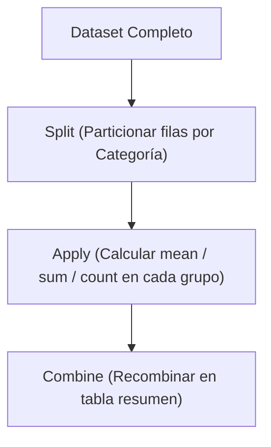

# Pandas: Manipulación y Análisis de Datos Tabulares

> **Ubicación:** [[Librerias index|Librerías]] / Aplicaciones de Bases de Datos II y Data Mining  
> **Librerías relacionadas:** [[NumPy]] • [[Preprocesamiento de datos]] • [[Matplotlib]] • [[Seaborn]] • [[Scikit-Learn]]

---

## Objetos importantes

En pandas todo el flujo de trabajo gira en torno a dos estructuras de datos principales alineadas por un `Index`:

### 1. `Series`
- **Qué representa:** Un arreglo unidimensional homogéneo (columna única) donde cada elemento tiene asociada una etiqueta denominada **Index**. Internamente almacena los datos en un array contiguo de [[NumPy]].
- **Para qué sirve:** Representar variables individuales, vectores de características, columnas extraídas de una tabla o el resultado de una función de agregación.
- **Ejemplo mínimo:**
  ```python
  import pandas as pd

  edades = pd.Series([23, 45, 31, 22], name="edad")
  print(edades)
  ```

> [!NOTE]
> Una `Series` es homogénea: todos sus elementos comparten el mismo tipo de dato (`dtype`). Si mezclas números y texto, pandas forzará el tipo a `object` (punteros a objetos Python), perdiendo optimizaciones de memoria y velocidad.

### 2. `DataFrame`
- **Qué representa:** Una estructura bidimensional de datos tabulares (filas y columnas), análoga a una tabla relacional de SQL o una planilla de cálculo. Está compuesta por una colección ordenada de columnas `Series` que comparten un mismo `Index` de filas.
- **Para qué sirve:** Es el contenedor principal para cargar, transformar, limpiar y analizar datasets completos en Data Mining.
- **Ejemplo mínimo:**
  ```python
  import pandas as pd

  datos = {
      "cliente_id": [101, 102, 103],
      "edad": [25, 34, 42],
      "ingresos": [55000.0, 72000.0, 61000.0]
  }
  df = pd.DataFrame(datos)
  print(df)
  ```

### 3. `Index` (Componente de soporte)
- **Qué representa:** Una secuencia inmutable de etiquetas que identifica unívocamente a cada fila (o nombre de columna).
- **Para qué sirve:** Permite búsquedas directas en tiempo constante $\mathcal{O}(1)$, alineación automática de datos al operar entre distintas series y operaciones de unión (*joins*).

> [!TIP]
> **Alineación automática por índice:** Si sumas dos `Series` que tienen índices en distinto orden o con elementos faltantes, pandas alinea primero por etiqueta antes de sumar, rellenando con `NaN` los índices que no coincidan en ambos lados.

---

## Mapa de intenciones

| Quiero... | Uso | Ejemplo |
|---|---|---|
| **1. Cargar / obtener datos** | | |
| Cargar datos desde un archivo CSV | `pd.read_csv()` | `df = pd.read_csv("clientes.csv")` |
| Cargar desde una tabla/consulta SQL | `pd.read_sql()` | `df = pd.read_sql("SELECT * FROM ventas", conexion)` |
| Cargar datos desde un archivo Excel | `pd.read_excel()` | `df = pd.read_excel("datos.xlsx", sheet_name="Hoja1")` |
| **2. Inspeccionar y explorar datos** | | |
| Ver las primeras $N$ filas | `df.head()` | `df.head(5)` |
| Ver las últimas $N$ filas | `df.tail()` | `df.tail(5)` |
| Ver dimensiones (filas, columnas) | `df.shape` | `filas, cols = df.shape` |
| Ver tipos de datos, uso de memoria y no-nulos | `df.info()` | `df.info()` |
| Ver estadísticas descriptivas numéricas | `df.describe()` | `df.describe()` |
| Ver nombres de las columnas | `df.columns` | `lista_cols = df.columns.tolist()` |
| Contar frecuencias de valores en una columna | `s.value_counts()` | `df["categoria"].value_counts(dropna=False)` |
| **3. Seleccionar datos** | | |
| Seleccionar una columna como `Series` | `df['col']` | `edad = df["edad"]` |
| Seleccionar múltiples columnas como `DataFrame` | `df[['col1', 'col2']]` | `sub_df = df[["edad", "ingresos"]]` |
| Acceder por nombres de etiqueta (filas y cols) | `df.loc[]` | `df.loc[0:10, ["edad", "ingresos"]]` |
| Acceder por posiciones numéricas enteras | `df.iloc[]` | `df.iloc[0:5, 0:2]` |
| **4. Filtrar datos** | | |
| Filtrar filas por una condición lógica | `df[condicion]` | `df[df["edad"] >= 18]` |
| Filtrar por múltiples condiciones (AND / OR) | `df[(cond1) & (cond2)]` | `df[(df["edad"] > 25) & (df["ingresos"] < 50000)]` |
| Filtrar si un valor está en una lista | `s.isin()` | `df[df["ciudad"].isin(["Rosario", "Córdoba"])]` |
| Filtrar por expresión textual | `df.query()` | `df.query("edad > 25 and ingresos < 50000")` |
| **5. Ordenar datos** | | |
| Ordenar por los valores de una o más columnas | `df.sort_values()` | `df.sort_values(by="ingresos", ascending=False)` |
| Ordenar por las etiquetas del índice | `df.sort_index()` | `df.sort_index()` |
| **6. Limpiar y tratar valores faltantes** | | |
| Detectar celdas con valores faltantes | `df.isna()` o `df.isnull()` | `df.isna().sum()` |
| Eliminar filas con valores nulos | `df.dropna()` | `df.dropna(subset=["edad"])` |
| Imputar / rellenar valores faltantes | `df.fillna()` | `df["edad"] = df["edad"].fillna(df["edad"].median())` |
| Detectar y eliminar filas duplicadas | `df.drop_duplicates()` | `df.drop_duplicates(subset=["cliente_id"])` |
| Eliminar columnas o filas irrelevantes | `df.drop()` | `df.drop(columns=["columna_inutil"])` |
| Renombrar columnas | `df.rename()` | `df.rename(columns={"antiguo": "nuevo"})` |
| **7. Transformar y modificar datos** | | |
| Convertir el tipo de dato de una columna | `s.astype()` | `df["edad"] = df["edad"].astype(int)` |
| Convertir cadenas a fechas | `pd.to_datetime()` | `df["fecha"] = pd.to_datetime(df["fecha"])` |
| Aplicar una función elemento a elemento o fila a fila | `s.apply()` / `df.apply()` | `df["edad_cat"] = df["edad"].apply(lambda x: "Adulto" if x >= 18 else "Menor")` |
| Discretizar variable continua en intervalos (bins) | `pd.cut()` | `df["rango_edad"] = pd.cut(df["edad"], bins=[0, 18, 65, 100])` |
| Crear variables dummy (One-Hot Encoding) | `pd.get_dummies()` | `pd.get_dummies(df, columns=["genero"])` |
| **8. Agrupar y resumir** | | |
| Agrupar por categorías y calcular media/suma | `df.groupby()` | `df.groupby("sucursal")["ingresos"].mean()` |
| Calcular múltiples agregaciones por grupo | `df.groupby().agg()` | `df.groupby("sucursal").agg({"ingresos": ["mean", "max"], "edad": "median"})` |
| Crear tablas de contingencia / pivote | `df.pivot_table()` | `df.pivot_table(values="monto", index="sucursal", columns="medio_pago", aggfunc="sum")` |
| **9. Combinar datasets** | | |
| Unir DataFrames por clave común (tipo SQL Join) | `pd.merge()` | `pd.merge(df_ventas, df_clientes, on="cliente_id", how="left")` |
| Concatenar filas o columnas estructuralmente | `pd.concat()` | `pd.concat([df_2023, df_2024], axis=0, ignore_index=True)` |
| **10. Exportar datos** | | |
| Guardar resultado a un archivo CSV | `df.to_csv()` | `df.to_csv("datos_procesados.csv", index=False)` |

---

## Operaciones importantes por intención

### `pd.read_csv()`

**¿Qué quiero hacer?**  
Cargar un archivo de texto plano delimitado (comas, puntos y comas, tabs) en un `DataFrame` de pandas.

**¿A qué pertenece?**  
⚙️ **Función del módulo** `pandas`.

**Sintaxis básica:**
```python
df = pd.read_csv(filepath_or_buffer, sep=',', header=0, na_values=None, usecols=None)
```

**Ejemplo realista:**
```python
df_clientes = pd.read_csv(
    "dataset_banco.csv", 
    sep=";", 
    na_values=["?", "NA", "SIN_DATO", "null"],
    usecols=["id", "edad", "saldo", "categoria"]
)
```

**Resultado / qué hace:**  
Lee el archivo del disco y retorna un nuevo `DataFrame`. Traduce automáticamente los valores centinelas de texto indicados en `na_values` al valor `NaN` estándar de NumPy.

> [!TIP]
> Si el archivo es muy pesado, usa `usecols` para cargar únicamente las columnas que vas a analizar. Esto ahorra hasta un 80% de memoria RAM.

**Relacionado:**  
`pd.read_sql()`, `df.to_csv()`.

---

### `df.head()` / `df.tail()`

**¿Qué quiero hacer?**  
Visualizar rápidamente una pequeña muestra de las filas iniciales o finales para verificar que los datos se leyeron correctamente, los delimitadores funcionaron y los encabezados están alineados.

**¿A qué pertenece?**  
🏷️ **Método de objeto** `DataFrame` o `Series`.

**Sintaxis básica:**
```python
df.head(n=5)
df.tail(n=5)
```

**Ejemplo realista:**
```python
# Inspeccionar las primeras 3 filas
print(df_clientes.head(3))
```

**Resultado / qué hace:**  
Retorna un nuevo `DataFrame` con las primeras o últimas $N$ filas (por defecto 5) sin alterar el dataset original.

**Relacionado:**  
`df.info()`, `df.sample()`.

---

### `df.info()`

**¿Qué quiero hacer?**  
Obtener un diagnóstico técnico estructural del dataset: cantidad total de filas, columnas, nombres de atributos, recuento de no-nulos y tipos de datos asignados en memoria.

**¿A qué pertenece?**  
🏷️ **Método de objeto** `DataFrame`.

**Sintaxis básica:**
```python
df.info()
```

**Ejemplo realista:**
```python
df_clientes.info()
```

**Resultado / qué hace:**  
Imprime en consola el resumen. Es la herramienta principal para detectar de un solo vistazo:
1. Columnas con valores faltantes (`Non-Null Count` menor al total de filas).
2. Columnas numéricas erróneamente detectadas como `object` (texto) debido a caracteres no numéricos sucios.

> [!IMPORTANT]
> Si una columna numérica aparece con tipo `object`, cualquier cálculo matemático posterior fallará o se comportará como concatenación de cadenas.

**Relacionado:**  
`df.dtypes`, `df.isna().sum()`.

---

### `df.describe()`

**¿Qué quiero hacer?**  
Generar un resumen univariado de estadística descriptiva (conteo, media, desviación estándar, mínimo, cuartiles 25%, 50%, 75% y máximo) para conocer escalas y distribuciones.

**¿A qué pertenece?**  
🏷️ **Método de objeto** `DataFrame` o `Series`.

**Sintaxis básica:**
```python
df.describe(include=None)
```

**Ejemplo realista:**
```python
# Resumen numérico general
print(df_clientes.describe())

# Resumen de variables categóricas
print(df_clientes.describe(include=["object", "category"]))
```

**Resultado / qué hace:**  
Retorna un `DataFrame` con las métricas calculadas. En **Data Mining** es el paso inicial para detectar anomalías u outliers evidentes:
- Si `min` en una edad es negativo o `max` es 300.
- Si la media y la mediana (50%) difieren notablemente, lo que evidencia asimetría en la distribución.

**Relacionado:**  
`s.value_counts()`, `df.mean()`, `df.median()`.

---

### `df.shape`

**¿Qué quiero hacer?**  
Conocer la dimensionalidad exacta del dataset (número de filas versus número de columnas).

**¿A qué pertenece?**  
📊 **Atributo** de un objeto `DataFrame` o `Series`.

**Sintaxis básica:**
```python
df.shape
```

**Ejemplo realista:**
```python
filas, columnas = df_clientes.shape
print(f"El dataset contiene {filas} instancias y {columnas} atributos.")
```

**Resultado / qué hace:**  
Retorna una tupla de Python `(n_filas, n_columnas)`. Al ser una propiedad intrínseca, **no lleva paréntesis**.

**Relacionado:**  
`len(df)`, `df.columns`.

---

### `df.loc[]` / `df.iloc[]`

**¿Qué quiero hacer?**  
Acceder, seleccionar o asignar valores a un subconjunto específico de filas y columnas, diferenciando explícitamente entre etiquetas de negocio (`loc`) y posiciones físicas enteras (`iloc`).

**¿A qué pertenece?**  
🎯 **Atributo Indizador (*Indexer*)** de `DataFrame` o `Series`.

**Sintaxis básica:**
```python
# Por etiquetas / nombres de columnas:
df.loc[filas_labels, columnas_labels]

# Por índice numérico posicional (0 a n-1):
df.iloc[filas_indices, columnas_indices]
```

**Ejemplo realista:**
```python
# Obtener filas con etiqueta de índice 0 a 10 y sólo las columnas 'edad' y 'saldo'
sub_loc = df_clientes.loc[0:10, ["edad", "saldo"]]

# Obtener las primeras 5 filas y las primeras 2 columnas por posición
sub_iloc = df_clientes.iloc[0:5, 0:2]
```

**Resultado / qué hace:**  
Retorna una `Series` o un `DataFrame`. Permite además modificar celdas de forma segura evitando la advertencia `SettingWithCopyWarning`.

> [!WARNING]
> **Diferencia crítica en el rebanado (*slicing*):**  
> - `df.loc[0:5]` **INCLUYE** el extremo 5 (filas 0, 1, 2, 3, 4 y 5) porque trabaja con nombres de etiqueta.  
> - `df.iloc[0:5]` **EXCLUYE** el extremo 5 (filas 0, 1, 2, 3 y 4) siguiendo la convención estándar de Python/NumPy.

**Relacionado:**  
`df[]`, `df.at[]`, `df.iat[]`.

---

### `df[condicion]` (Indexación Booleana)

**¿Qué quiero hacer?**  
Filtrar registros del dataset que cumplan una o más condiciones lógicas simultáneas o disyuntivas.

**¿A qué pertenece?**  
🔍 **Operador de indexación** sobre `DataFrame`.

**Sintaxis básica:**
```python
df[mascara_booleana]
```

**Ejemplo realista:**
```python
# Clientes mayores de 30 años con saldo positivo
filtro = (df_clientes["edad"] > 30) & (df_clientes["saldo"] > 0)
clientes_activos = df_clientes[filtro]
```

**Resultado / qué hace:**  
Evalúa la expresión fila por fila y retorna un nuevo `DataFrame` conteniendo únicamente las filas donde la máscara da `True`.

> [!IMPORTANT]
> En pandas **NO se pueden usar** las palabras reservadas `and`, `or` ni `not` para filtrar columnas vectorizadas. Se deben usar obligatoriamente los operadores bit a bit:
> - `&` para **AND**
> - `|` para **OR**
> - `~` para **NOT**  
> Además, cada condición individual **debe estar encerrada entre paréntesis** `()` debido a la precedencia de operadores en Python.

**Relacionado:**  
`df.query()`, `s.isin()`.

---

### `df.sort_values()`

**¿Qué quiero hacer?**  
Ordenar el dataset de forma ascendente o descendente según el contenido de una o más columnas.

**¿A qué pertenece?**  
🏷️ **Método de objeto** `DataFrame` o `Series`.

**Sintaxis básica:**
```python
df.sort_values(by=columnas, ascending=True)
```

**Ejemplo realista:**
```python
# Ordenar clientes por categoría alfabética y por saldo de mayor a menor
df_ordenado = df_clientes.sort_values(
    by=["categoria", "saldo"], 
    ascending=[True, False]
)
```

**Resultado / qué hace:**  
Retorna una copia del `DataFrame` con las filas reordenadas, manteniendo el `Index` original de cada observación.

**Relacionado:**  
`df.sort_index()`.

---

### `df.isna()` / `df.isnull()`

**¿Qué quiero hacer?**  
Detectar la presencia, volumen y distribución de valores faltantes (`NaN`, `None`) en el dataset para planificar la estrategia de [[Preprocesamiento de datos]].

**¿A qué pertenece?**  
🏷️ **Método de objeto** `DataFrame` o `Series`.

**Sintaxis básica:**
```python
df.isna()
```

**Ejemplo realista:**
```python
# Recuento absoluto de nulos por variable
nulos_por_col = df_clientes.isna().sum()

# Porcentaje de nulos por variable (fundamental para decidir si imputar o descartar)
pct_nulos = (df_clientes.isna().sum() / len(df_clientes)) * 100
print(pct_nulos)
```

**Resultado / qué hace:**  
Genera una máscara booleana del mismo tamaño donde cada celda es `True` si contiene un valor nulo. Combinado con `.sum()` suma los `True` verticalmente.

**Relacionado:**  
`df.dropna()`, `df.fillna()`, `df.notna()`.

---

### `df.dropna()`

**¿Qué quiero hacer?**  
Eliminar filas o columnas que posean valores nulos siguiendo una política definida.

**¿A qué pertenece?**  
🏷️ **Método de objeto** `DataFrame`.

**Sintaxis básica:**
```python
df.dropna(axis=0, how='any', subset=None)
```

**Ejemplo realista:**
```python
# Eliminar registros sólo si falta el dato en la columna crítica 'edad'
df_limpio = df_clientes.dropna(subset=["edad"])

# Eliminar columnas completas que tengan al menos un nulo
# df_sin_cols_nulas = df_clientes.dropna(axis=1)
```

**Resultado / qué hace:**  
Retorna un nuevo `DataFrame` sin las filas/columnas afectadas.

> [!TIP]
> Usa casi siempre el argumento `subset=["col1", "col2"]`. Si llamas a `df.dropna()` sin parámetros, eliminarás cualquier fila que tenga un solo nulo en cualquier columna secundaria, reduciendo drásticamente el tamaño del dataset de forma innecesaria.

**Relacionado:**  
`df.fillna()`, `df.isna()`.

---

### `df.fillna()`

**¿Qué quiero hacer?**  
Imputar valores faltantes reemplazando `NaN` por una constante de negocio o una medida de tendencia central (media, mediana, moda).

**¿A qué pertenece?**  
🏷️ **Método de objeto** `DataFrame` o `Series`.

**Sintaxis básica:**
```python
s.fillna(value=None)
```

**Ejemplo realista:**
```python
# Imputar edad con la mediana para evitar la distorsión de outliers
mediana_edad = df_clientes["edad"].median()
df_clientes["edad"] = df_clientes["edad"].fillna(mediana_edad)

# Imputar atributo categórico con una etiqueta explícita
df_clientes["categoria"] = df_clientes["categoria"].fillna("Sin_Dato")
```

**Resultado / qué hace:**  
Sustituye los valores `NaN` conservando la totalidad de los registros para el posterior modelado predictivo.

> [!IMPORTANT]
> **Data Leakage en Data Mining:** Al preparar datos para Machine Learning con [[Scikit-Learn]], la media o mediana utilizada para imputar debe calcularse **únicamente** sobre el conjunto de entrenamiento (*train*), y luego aplicarse sobre el conjunto de prueba (*test*).

**Relacionado:**  
`df.dropna()`, `df.interpolate()`.

---

### `df.drop_duplicates()`

**¿Qué quiero hacer?**  
Identificar y eliminar registros idénticos o que repitan identificadores únicos por fallas de ingesta.

**¿A qué pertenece?**  
🏷️ **Método de objeto** `DataFrame`.

**Sintaxis básica:**
```python
df.drop_duplicates(subset=None, keep='first')
```

**Ejemplo realista:**
```python
# Eliminar filas con cliente_id repetido conservando el primer registro leído
df_sin_duplicados = df_clientes.drop_duplicates(subset=["cliente_id"], keep="first")
```

**Resultado / qué hace:**  
Retorna un `DataFrame` depurado sin las filas duplicadas.

**Relacionado:**  
`df.duplicated()`.

---

### `df.drop()`

**¿Qué quiero hacer?**  
Eliminar una o más columnas (o filas por índice) que no aporten información útil, identificadores irrelevantes o atributos redundantes.

**¿A qué pertenece?**  
🏷️ **Método de objeto** `DataFrame`.

**Sintaxis básica:**
```python
df.drop(labels=None, axis=0, columns=None)
```

**Ejemplo realista:**
```python
# Eliminar atributos no predictivos para Data Mining
df_modelo = df_clientes.drop(columns=["cliente_id", "nombre_completo", "observaciones"])
```

**Resultado / qué hace:**  
Retorna un nuevo `DataFrame` sin las columnas indicadas. Usar la sintaxis explícita `columns=[...]` es más legible que manipular `axis=1`.

**Relacionado:**  
`del df['col']`, `df.pop()`.

---

### `s.astype()`

**¿Qué quiero hacer?**  
Castear o convertir explícitamente el tipo de dato de una columna (`int`, `float`, `category`, `bool`, `str`).

**¿A qué pertenece?**  
🏷️ **Método de objeto** `Series` o `DataFrame`.

**Sintaxis básica:**
```python
s.astype(dtype)
```

**Ejemplo realista:**
```python
# Convertir edad a entero e ingresos a float32 para optimizar memoria
df_clientes["edad"] = df_clientes["edad"].astype(int)
df_clientes["categoria"] = df_clientes["categoria"].astype("category")
```

**Resultado / qué hace:**  
Retorna la columna convertida al tipo solicitado. Convertir variables cualitativas de baja cardinalidad a tipo `category` reduce drásticamente el consumo de RAM.

> [!WARNING]
> Si una columna contiene valores `NaN`, convertirla a `int` estándar arrojará un error `ValueError: Cannot convert non-finite values (NA or inf) to integer`. Debes imputar primero los nulos o usar el tipo anulable de pandas `Int64` (con mayúscula).

**Relacionado:**  
`pd.to_numeric()`, `pd.to_datetime()`.

---

### `s.apply()` / `df.apply()`

**¿Qué quiero hacer?**  
Aplicar una función personalizada elemento por elemento o fila por fila cuando la transformación requiere condicionales complejos y no existe una operación vectorizada directa.

**¿A qué pertenece?**  
🏷️ **Método de objeto** `Series` o `DataFrame`.

**Sintaxis básica:**
```python
s.apply(func)
df.apply(func, axis=1) # axis=1 para pasar la fila completa como Series
```

**Ejemplo realista:**
```python
def categorizar_riesgo(saldo):
    if saldo < 0:
        return "Alto"
    elif saldo < 10000:
        return "Medio"
    return "Bajo"

df_clientes["nivel_riesgo"] = df_clientes["saldo"].apply(categorizar_riesgo)
```

**Resultado / qué hace:**  
Ejecuta la función suministrada y devuelve una nueva `Series`.

> [!TIP]
> **Regla de oro de rendimiento:** Siempre prefiere operaciones vectorizadas de [[NumPy]] o pandas (`np.where()`, `pd.cut()`) antes de recurrir a `.apply()`. `apply` ejecuta un ciclo iterativo en Python puro y es significativamente más lento sobre datasets con cientos de miles de filas.

**Relacionado:**  
`pd.cut()`, `np.select()`, `df.map()`.

---

### `df.groupby()`

**¿Qué quiero hacer?**  
Dividir las observaciones en grupos según una o más variables discretas, aplicar funciones de resumen o agregación estadística sobre cada grupo y combinar los resultados en una tabla final (**Split-Apply-Combine**).



**¿A qué pertenece?**  
🏷️ **Método de objeto** `DataFrame`.

**Sintaxis básica:**
```python
df.groupby(by=columnas)
```

**Ejemplo realista:**
```python
resumen_ventas = df_clientes.groupby("categoria").agg(
    total_clientes=("cliente_id", "count"),
    saldo_promedio=("saldo", "mean"),
    saldo_maximo=("saldo", "max")
).reset_index()
print(resumen_ventas)
```

**Resultado / qué hace:**  
Genera un objeto `DataFrameGroupBy`. Al encadenarle `.agg()`, calcula las métricas solicitadas agrupadas y retorna un `DataFrame` consolidado. Usar `.reset_index()` al final devuelve la variable de agrupación como columna normal en vez de dejarla como índice.

**Relacionado:**  
`df.pivot_table()`, `s.value_counts()`.

---

### `pd.merge()`

**¿Qué quiero hacer?**  
Combinar dos DataFrames horizontalmente basándose en una o más columnas clave en común, de manera idéntica a las cláusulas `JOIN` de SQL y el Álgebra Relacional.

**¿A qué pertenece?**  
⚙️ **Función del módulo** `pandas` (y método `df.merge()`).

**Sintaxis básica:**
```python
pd.merge(left, right, how='inner', on=None, left_on=None, right_on=None)
```

**Ejemplo realista:**
```python
# Unir ventas con clientes conservando todos los clientes (LEFT JOIN)
df_completo = pd.merge(
    df_clientes, 
    df_transacciones, 
    on="cliente_id", 
    how="left"
)
```

**Resultado / qué hace:**  
Retorna un nuevo `DataFrame` con las columnas de ambas fuentes unificadas por coincidencia de claves.

| Parámetro `how` | Equivalente SQL | Comportamiento |
|---|---|---|
| `'inner'` | `INNER JOIN` | Solo filas donde la clave está en ambas tablas (por defecto) |
| `'left'` | `LEFT OUTER JOIN` | Todas las filas de la tabla izquierda; nulos si no hay coincidencia |
| `'right'` | `RIGHT OUTER JOIN` | Todas las filas de la tabla derecha |
| `'outer'` | `FULL OUTER JOIN` | Todas las filas de ambas tablas; completa faltantes con `NaN` |

**Relacionado:**  
`pd.concat()`, `df.join()`.

---

### `pd.concat()`

**¿Qué quiero hacer?**  
Apilar datasets estructuralmente: uno debajo del otro (verticalmente por filas) o uno al lado del otro (horizontalmente por columnas).

**¿A qué pertenece?**  
⚙️ **Función del módulo** `pandas`.

**Sintaxis básica:**
```python
pd.concat(objs, axis=0, ignore_index=False)
```

**Ejemplo realista:**
```python
# Apilar lotes de datos de dos trimestres con idénticas columnas
df_anual = pd.concat([df_q1, df_q2], axis=0, ignore_index=True)
```

**Resultado / qué hace:**  
Retorna un `DataFrame` fusionado. Usar `ignore_index=True` es fundamental al apilar filas (`axis=0`) para reindexar de $0$ a $N-1$ y evitar números de fila duplicados.

**Relacionado:**  
`pd.merge()`.

---

### `df.to_csv()`

**¿Qué quiero hacer?**  
Persistir el `DataFrame` procesado en un archivo CSV en disco para posterior modelado en [[Scikit-Learn]] o consumo en reportes.

**¿A qué pertenece?**  
🏷️ **Método de objeto** `DataFrame`.

**Sintaxis básica:**
```python
df.to_csv(path_or_buf, sep=',', index=True)
```

**Ejemplo realista:**
```python
df_clientes.to_csv("datos_limpios.csv", sep=";", index=False)
```

**Resultado / qué hace:**  
Escribe los datos en disco con el separador configurado.

> [!IMPORTANT]
> Configura **siempre** `index=False`. Si lo omites, pandas guardará una columna anónima inicial con los números de fila (`0, 1, 2...`), ensuciando el CSV al volverlo a cargar en el futuro.

**Relacionado:**  
`pd.read_csv()`, `df.to_excel()`.

---

## Diferencias importantes

### 1. `df.loc[]` vs `df.iloc[]`

| Característica | `df.loc[]` | `df.iloc[]` |
|---|---|---|
| **Criterio de acceso** | Por **etiqueta / nombre** de fila y columna | Por **posición entera** ($0$ a $n-1$) |
| **Límite superior del slice** | **INCLUSIVO** (`loc[0:2]` incluye el 2) | **EXCLUSIVO** (`iloc[0:2]` toma 0 y 1) |
| **Tipos admitidos** | Nombres de columnas (`['edad']`), booleanos | Números enteros de posición física |
| **Uso habitual** | Filtrado por condiciones y selección por nombre | Rebanado posicional tipo matrices de NumPy |

### 2. `df['col']` vs `df[['col']]`
- `df['col']` (corchete simple): Extrae una única columna y retorna un objeto unidimensional **`Series`**.
- `df[['col']]` (doble corchete / lista de columnas): Extrae una o más columnas y retorna siempre un **`DataFrame`** bidimensional, incluso si la lista posee un único elemento.

### 3. `pd.merge()` vs `pd.concat()`
- `pd.merge()`: Cruce **relacional lógico**. Busca coincidencias en valores de una columna clave compartida (como un `JOIN` de base de datos relacional).
- `pd.concat()`: Pegado **físico estructural**. Apila bloques rectangulares de datos uno debajo de otro (`axis=0`) o uno al lado del otro (`axis=1`) sin importar si comparten identificadores.

### 4. `df.dropna()` vs `df.fillna()`
- `df.dropna()`: **Estrategia destructiva de depuración**. Elimina registros enteros que contengan valores nulos, reduciendo el tamaño muestral ($N$).
- `df.fillna()`: **Estrategia conservativa de imputación**. Conserva todas las observaciones estimando los valores ausentes mediante medidas estadísticas (mediana, media, moda o constantes).

### 5. Vectorización directa vs `df.apply()`
- **Operaciones vectorizadas** (`df['a'] * 2` o `np.log(df['saldo'])`): Se procesan a través de bucles optimizados en C compilado dentro de [[NumPy]]. Son órdenes de magnitud más rápidas y consumen menor CPU.
- **`df.apply()`**: Ejecuta una función mediante un ciclo en el intérprete de Python estándar para cada fila. Debe usarse únicamente cuando la lógica dependa de múltiples ramificaciones condicionales no vectorizables.

### 6. Modificación `inplace=True` vs Reasignación
- Muchos métodos admiten `inplace=True` (ej. `df.dropna(inplace=True)`), pero la documentación moderna de pandas desaconseja fuertemente su uso debido a que genera ambigüedades con copias internas y vistas de memoria.
- **Práctica recomendada:** Utilizar siempre reasignación explícita:  
  `df = df.dropna()`

### 7. Función del módulo vs Método de objeto vs Atributo
- **Función del módulo** (`pd.read_csv()`, `pd.merge()`): Invocada directamente desde `pd.` para crear o combinar estructuras desde el exterior.
- **Método de objeto** (`df.info()`, `df.describe()`): Invocado sobre una instancia (`df.` o `s.`) con paréntesis `()` para ejecutar cómputos o transformaciones sobre ella.
- **Atributo** (`df.shape`, `df.columns`, `df.dtypes`): Propiedad descriptiva ya calculada del objeto; **no lleva paréntesis**.

---

## Ejemplo completo

El siguiente script simula un pipeline realista de **limpieza, tratamiento de faltantes, ingeniería de atributos y resumen** en Data Mining:

```python
import pandas as pd
import numpy as np

# 1. Carga simulada de datos con duplicados, faltantes y anomalías
raw_data = {
    "cliente_id": [101, 102, 103, 104, 104, 105],
    "edad": [25, np.nan, 45, 33, 33, 150], # Faltante (np.nan) y outlier (150)
    "ingresos": [50000.0, 75000.0, 60000.0, 80000.0, 80000.0, 45000.0],
    "categoria": ["Minorista", "Mayorista", "Minorista", "Corporativo", "Corporativo", "Minorista"]
}
df = pd.DataFrame(raw_data)

# 2. Eliminación de registros duplicados
df = df.drop_duplicates(subset=["cliente_id"])

# 3. Filtrado de Outliers (eliminar edades biológicamente imposibles para el dominio)
df = df[df["edad"].isna() | (df["edad"] <= 100)]

# 4. Imputación de faltantes mediante la mediana (robusta frente a asimetrías)
mediana_edad = df["edad"].median()
df["edad"] = df["edad"].fillna(mediana_edad)

# 5. Corrección y casteo de tipos de datos
df["edad"] = df["edad"].astype(int)

# 6. Feature Engineering: Creación de ratio relativo de ingresos por edad
df["ratio_ingreso_edad"] = (df["ingresos"] / df["edad"]).round(2)

# 7. Agregación estadística por categoría de cliente (Split-Apply-Combine)
resumen_segmentos = df.groupby("categoria").agg(
    total_clientes=("cliente_id", "count"),
    ingreso_promedio=("ingresos", "mean"),
    edad_promedio=("edad", "mean")
).reset_index()

# 8. Ordenar resumen por ingreso promedio descendente
resumen_segmentos = resumen_segmentos.sort_values(by="ingreso_promedio", ascending=False)

print("--- DataFrame Procesado ---")
print(df)
print("\n--- Resumen por Segmentos de Clientes ---")
print(resumen_segmentos)
```

### Explicación detallada del flujo:

1. **Eliminación de duplicados (`drop_duplicates`):**
   - **Qué hacemos:** Descartamos las filas donde se repita el `cliente_id`.
   - **Por qué:** En minería de datos los registros repetidos sesgan las probabilidades previas y distorsionan los modelos.
   - **Objeto manipulado:** `df` (`DataFrame`).
   - **Resultado:** Se descarta la segunda aparición del cliente 104.

2. **Filtrado de outliers (`df[condicion]`):**
   - **Qué hacemos:** Aplicamos una máscara booleana que conserva valores menores o iguales a 100 años o nulos aún por imputar.
   - **Por qué:** Una edad de 150 años es un error grosero de captura que alteraría gravemente la media muestral.
   - **Objeto manipulado:** `df` (`DataFrame`) evaluado con indexación booleana.
   - **Resultado:** Se elimina el registro inconsistente sin perder filas con datos nulos legítimos.

3. **Imputación de faltantes (`fillna` con `median`):**
   - **Qué hacemos:** Rellenamos el valor faltante de edad con la mediana calculada del conjunto limpio.
   - **Por qué:** La mediana es insensible a sesgos extremos y permite conservar la fila del cliente 102 sin perder su valor de ingreso disponible.
   - **Objeto manipulado:** Columna `df["edad"]` (`Series`).
   - **Resultado:** La columna queda 100% libre de valores `NaN`.

4. **Transformación e Ingeniería de Atributos (`astype` y vectorización):**
   - **Qué hacemos:** Convertimos `edad` a entero (`int`) y calculamos vectorialmente `ingresos / edad`.
   - **Por qué:** La edad es conceptualmente una variable discreta, y los ratios normalizados facilitan la detección de patrones en algoritmos de clustering.
   - **Objeto manipulado:** Columnas de tipo `Series`.
   - **Resultado:** Nueva columna continua calculada instantáneamente sin ciclos iterativos de Python.

5. **Agrupación y resumen estadístico (`groupby` + `agg` + `sort_values`):**
   - **Qué hacemos:** Particionamos por categoría, calculamos conteo, media de ingresos y media de edad, y ordenamos el resultado.
   - **Por qué:** Condensar grandes volúmenes de transacciones en indicadores estratégicos para responder consultas de negocio en Bases de Datos II.
   - **Objeto manipulado:** Objeto intermedio agrupado consolidado a un nuevo `DataFrame`.
   - **Resultado:** Una tabla resumen lista para su visualización gráfica en [[Matplotlib]] o exportación.

---

## Cheat Sheet

| Necesito... | Uso |
|---|---|
| Cargar archivo CSV | `df = pd.read_csv("archivo.csv")` |
| Ver primeros registros | `df.head()` |
| Ver tipos y recuento de no nulos | `df.info()` |
| Ver estadísticas descriptivas básicas | `df.describe()` |
| Conocer cantidad de filas y columnas | `df.shape` (sin paréntesis) |
| Extraer una columna como Serie | `df["col"]` |
| Extraer columnas como DataFrame | `df[["col1", "col2"]]` |
| Seleccionar por etiqueta | `df.loc[filas_nom, cols_nom]` |
| Seleccionar por posición numérica | `df.iloc[filas_num, cols_num]` |
| Filtrar filas por condición lógica | `df[(df["a"] > 0) & (df["b"] == "X")]` |
| Contar nulos por columna | `df.isna().sum()` |
| Borrar filas con nulos en una columna | `df.dropna(subset=["col"])` |
| Imputar nulos con la mediana | `df["col"] = df["col"].fillna(df["col"].median())` |
| Borrar registros duplicados | `df.drop_duplicates(subset=["id"])` |
| Eliminar columnas irrelevantes | `df.drop(columns=["col1", "col2"])` |
| Cambiar tipo de dato de una columna | `df["col"] = df["col"].astype(int)` |
| Ordenar por valor de una columna | `df.sort_values(by="col", ascending=False)` |
| Agrupar y calcular promedio | `df.groupby("cat")["val"].mean()` |
| Múltiples métricas por grupo | `df.groupby("cat").agg({"val": ["mean", "sum"]})` |
| Unir dos tablas por clave (Join) | `pd.merge(df1, df2, on="id", how="inner")` |
| Apilar dos tablas verticalmente | `pd.concat([df1, df2], axis=0, ignore_index=True)` |
| Guardar a archivo CSV limpio | `df.to_csv("salida.csv", index=False)` |

---

## 🧭 Navegación entre Notas

- 📂 **Índice del módulo:** [[Librerias index|Librerías de Python]]
- 🔢 **Computación numérica base:** [[NumPy]]
- 🧹 **Técnicas de preparación:** [[Preprocesamiento de datos]]
- 📊 **Visualización de datos:** [[Matplotlib]] • [[Seaborn]]
- 🤖 **Modelos de Machine Learning:** [[Scikit-Learn]]
