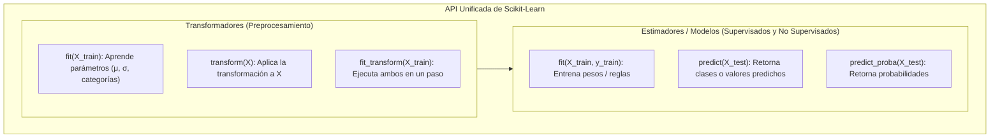

# Scikit-Learn: Modelado y Algoritmos de Machine Learning

> **Ubicación:** [[Librerias index|Librerías]] / Aplicaciones de Bases de Datos II y Data Mining  
> **Librerías relacionadas:** [[Pandas]] • [[NumPy]] • [[Preprocesamiento de datos]] • [[Matplotlib]] • [[Seaborn]]

---

## Objetos importantes

Scikit-Learn implementa una de las APIs más consistentes y elegantes de la computación. Todo el ciclo de vida de modelado se basa en tres tipos de interfaces:



### 1. `Estimator` (Estimador / Modelo)
- **Qué representa:** Cualquier objeto que aprende patrones a partir de datos mediante el método `.fit()`.
- **Ejemplos:** `DecisionTreeClassifier`, `RandomForestClassifier`, `KMeans`, `LinearRegression`.

### 2. `Transformer` (Transformador de Datos)
- **Qué representa:** Algoritmos de preprocesamiento, escalado o codificación que transforman la matriz $X$.
- **Métodos clave:** `.fit()` (aprende la media/desvío/categorías), `.transform()` (aplica la fórmula), `.fit_transform()` (ambos a la vez).
- **Ejemplos:** `StandardScaler`, `MinMaxScaler`, `OneHotEncoder`, `SimpleImputer`.

### 3. `Pipeline`
- **Qué representa:** Un contenedor secuencial que encadena transformadores previos con un estimador final.
- **Para qué sirve:** **Prevenir fuga de datos (*Data Leakage*)**, garantizando que el preprocesamiento se ajuste únicamente sobre el conjunto de entrenamiento.

---

## Mapa de intenciones

| Quiero... | Uso | Ejemplo |
|---|---|---|
| **1. Particionar datos** | | |
| Dividir datos en entrenamiento y prueba | `train_test_split()` | `X_tr, X_te, y_tr, y_te = train_test_split(X, y, test_size=0.2, random_state=42, stratify=y)` |
| **2. Preprocesamiento y escalado** | | |
| Imputar datos faltantes con mediana/media | `SimpleImputer()` | `imputer = SimpleImputer(strategy="median")` |
| Estandarización Z-Score (media 0, varianza 1) | `StandardScaler()` | `scaler = StandardScaler()` |
| Escalado Min-Max acotado al rango $[0, 1]$ | `MinMaxScaler()` | `scaler = MinMaxScaler(feature_range=(0, 1))` |
| Codificar variables categóricas en columnas dummy | `OneHotEncoder()` | `ohe = OneHotEncoder(sparse_output=False, handle_unknown="ignore")` |
| **3. Modelos de clasificación supervisada** | | |
| Árbol de decisión interpretable | `DecisionTreeClassifier()` | `clf = DecisionTreeClassifier(max_depth=4, criterion="gini")` |
| Bosque aleatorio (ensamble robusto) | `RandomForestClassifier()` | `clf = RandomForestClassifier(n_estimators=100, random_state=42)` |
| Regresión logística binaria/multinomial | `LogisticRegression()` | `clf = LogisticRegression(max_iter=1000)` |
| **4. Modelos de regresión continua** | | |
| Regresión lineal por mínimos cuadrados | `LinearRegression()` | `reg = LinearRegression()` |
| Bosque aleatorio para regresión | `RandomForestRegressor()` | `reg = RandomForestRegressor(n_estimators=100)` |
| **5. Algoritmos de clustering (No supervisado)** | | |
| Agrupamiento particional por $K$ centroides | `KMeans()` | `kmeans = KMeans(n_clusters=3, random_state=42, n_init=10)` |
| Agrupamiento basado en densidad (outliers = -1) | `DBSCAN()` | `dbscan = DBSCAN(eps=0.5, min_samples=5)` |
| **6. Reducción de dimensionalidad** | | |
| Análisis de Componentes Principales | `PCA()` | `pca = PCA(n_components=2)` |
| **7. Métricas de evaluación** | | |
| Exactitud general de clasificación | `accuracy_score()` | `acc = accuracy_score(y_true, y_pred)` |
| Matriz de confusión completa | `confusion_matrix()` | `cm = confusion_matrix(y_true, y_pred)` |
| Reporte exhaustivo (Precision, Recall, F1-Score) | `classification_report()` | `print(classification_report(y_true, y_pred))` |
| Error cuadrático medio para regresión | `mean_squared_error()` | `mse = mean_squared_error(y_true, y_pred)` |
| Coeficiente Silhouette para validar clustering | `silhouette_score()` | `score = silhouette_score(X, clusters)` |
| **8. Pipelines y Validación Cruzada** | | |
| Encadenar preprocesamiento + modelo | `Pipeline()` | `pipe = Pipeline([("scaler", StandardScaler()), ("rf", RandomForestClassifier())])` |
| Validación cruzada de $K$ pliegues (K-Fold) | `cross_val_score()` | `scores = cross_val_score(pipe, X, y, cv=5, scoring="f1_macro")` |
| Búsqueda exhaustiva de hiperparámetros | `GridSearchCV()` | `grid = GridSearchCV(model, param_grid, cv=5)` |

---

## Operaciones importantes por intención

### `train_test_split()`

**¿Qué quiero hacer?**  
Particionar la matriz de atributos $X$ y el vector objetivo $y$ en subconjuntos disjuntos para entrenamiento y evaluación.

**¿A qué pertenece?**  
⚙️ **Función del módulo** `sklearn.model_selection`.

**Sintaxis básica:**
```python
X_train, X_test, y_train, y_test = train_test_split(X, y, test_size=0.2, random_state=None, stratify=None)
```

**Ejemplo realista:**
```python
# Particionar con 80% train / 20% test manteniendo la proporción de clases (stratify)
X_train, X_test, y_train, y_test = train_test_split(
    X, y, 
    test_size=0.20, 
    random_state=42, 
    stratify=y
)
```

**Resultado / qué hace:**  
Separa los registros sin solapamientos. Usar `stratify=y` es indispensable en clasificación cuando hay clases desbalanceadas para que la proporción se mantenga idéntica en ambos conjuntos.

**Relacionado:**  
`KFold()`, `StratifiedKFold()`.

---

### `StandardScaler()`

**¿Qué quiero hacer?**  
Estandarizar variables numéricas restando la media y dividiendo por el desvío estándar ($z = \frac{x - \mu}{\sigma}$), logrando media 0 y varianza 1.

**¿A qué pertenece?**  
🏷️ **Clase / Transformador** de `sklearn.preprocessing`.

**Sintaxis básica:**
```python
scaler = StandardScaler()
X_train_scaled = scaler.fit_transform(X_train)
X_test_scaled  = scaler.transform(X_test)
```

**Ejemplo realista:**
```python
scaler = StandardScaler()
# 1. Aprende mu y sigma en TRAIN y transforma
X_tr_norm = scaler.fit_transform(X_train)
# 2. Transforma TEST usando los mismos mu y sigma aprendidos (¡NO fit!)
X_te_norm = scaler.transform(X_test)
```

**Resultado / qué hace:**  
Evita que atributos con escalas numéricas enormes dominen sobre variables de rangos pequeños en algoritmos sensibles a distancias (K-Means, KNN, Regresión Logística).

> [!IMPORTANT]
> **Data Leakage:** Jamás ejecutes `fit` o `fit_transform` sobre el conjunto de test. El conjunto de prueba debe tratarse como datos nuevos del mundo real; solo se aplica `.transform()`.

**Relacionado:**  
`MinMaxScaler()`, `RobustScaler()`.

---

### `model.fit()` / `model.predict()` / `model.predict_proba()`

**¿Qué quiero hacer?**  
Ajustar los parámetros internos del modelo a partir del conjunto de entrenamiento (`fit`), y generar predicciones sobre observaciones nuevas (`predict`).

**¿A qué pertenece?**  
🏷️ **Métodos de objeto** de cualquier Estimador supervisado de Scikit-Learn.

**Sintaxis básica:**
```python
model.fit(X_train, y_train)
y_pred  = model.predict(X_test)
y_proba = model.predict_proba(X_test)
```

**Ejemplo realista:**
```python
# Entrenar un Random Forest
rf = RandomForestClassifier(n_estimators=100, max_depth=5, random_state=42)
rf.fit(X_train, y_train)

# Inferencia
y_pred = rf.predict(X_test)             # Retorna: array([0, 1, 0, ...])
y_prob = rf.predict_proba(X_test)[:, 1] # Probabilidad de pertenecer a clase 1
```

**Resultado / qué hace:**  
`fit` optimiza los coeficientes matemáticos o estructura de árboles. `predict` devuelve la clase final por umbral estándar (0.5), mientras que `predict_proba` entrega la distribución de certezas.

**Relacionado:**  
`model.score()`.

---

### `KMeans()`

**¿Qué quiero hacer?**  
Descubrir agrupamientos naturales no supervisados en los datos particionando el espacio en $K$ clusters representados por centroides.

**¿A qué pertenece?**  
🏷️ **Clase / Estimador No Supervisado** de `sklearn.cluster`.

**Sintaxis básica:**
```python
kmeans = KMeans(n_clusters=8, n_init=10, random_state=None)
clusters = kmeans.fit_predict(X)
```

**Ejemplo realista:**
```python
# Segmentación de clientes en 3 perfiles de consumo
kmeans = KMeans(n_clusters=3, random_state=42, n_init=10)
etiquetas_cluster = kmeans.fit_predict(X_escalado)
centroides = kmeans.cluster_centers_
```

**Resultado / qué hace:**  
Asigna a cada observación un identificador numérico de cluster (`0, 1, ..., k-1`) minimizando la inercia (suma de distancias al cuadrado dentro de cada grupo). Requiere datos previamente escalados con `StandardScaler`.

**Relacionado:**  
`DBSCAN()`, `silhouette_score()`.

---

### `PCA()`

**¿Qué quiero hacer?**  
Reducir la cantidad de variables continuas correlacionadas proyectando los datos en un nuevo sistema ortogonal de Componentes Principales que retienen la mayor varianza posible.

**¿A qué pertenece?**  
🏷️ **Clase / Transformador** de `sklearn.decomposition`.

**Sintaxis básica:**
```python
pca = PCA(n_components=None)
X_pca = pca.fit_transform(X_scaled)
```

**Ejemplo realista:**
```python
# Reducir 20 atributos a 2 componentes para poder visualizar el dataset en Matplotlib
pca = PCA(n_components=2)
X_2d = pca.fit_transform(X_escalado)
print("Varianza explicada acumulada:", pca.explained_variance_ratio_.sum())
```

**Resultado / qué hace:**  
Comprime la dimensionalidad mitigando la "maldición de la dimensionalidad" y permitiendo graficar nubes de puntos de datasets multivariados.

**Relacionado:**  
`TSNE()`.

---

### `Pipeline()`

**¿Qué quiero hacer?**  
Encapsular en un único objeto todo el flujo de trabajo (imputación + escalado + modelo) para ejecutar entrenamiento y predicción de forma atómica y libre de errores metodológicos.

**¿A qué pertenece?**  
⚙️ **Clase** de `sklearn.pipeline`.

**Sintaxis básica:**
```python
pipe = Pipeline([("paso1", Transformador()), ("paso2", Modelo())])
```

**Ejemplo realista:**
```python
pipeline_clasificacion = Pipeline([
    ("imputer", SimpleImputer(strategy="median")),
    ("scaler", StandardScaler()),
    ("clasificador", RandomForestClassifier(n_estimators=100, random_state=42))
])

# Ejecuta automáticamente: fit_transform en imputer -> fit_transform en scaler -> fit en rf
pipeline_clasificacion.fit(X_train, y_train)

# Ejecuta automáticamente: transform en imputer -> transform en scaler -> predict en rf
y_pred = pipeline_clasificacion.predict(X_test)
```

**Resultado / qué hace:**  
Evita la fuga de información entre train y test, simplifica el código a una sola llamada `.fit()` y `.predict()`, y permite optimizar hiperparámetros de todo el pipeline simultáneamente con `GridSearchCV`.

**Relacionado:**  
`make_pipeline()`, `ColumnTransformer()`.

---

### `confusion_matrix()` / `classification_report()`

**¿Qué quiero hacer?**  
Evaluar exhaustivamente el desempeño de un clasificador analizando aciertos, falsos positivos (Tipo I) y falsos negativos (Tipo II).

**¿A qué pertenece?**  
⚙️ **Funciones del módulo** `sklearn.metrics`.

**Sintaxis básica:**
```python
cm = confusion_matrix(y_true, y_pred)
report = classification_report(y_true, y_pred)
```

**Ejemplo realista:**
```python
# Matriz de confusión y reporte de métricas
cm = confusion_matrix(y_test, y_pred)
print("Matriz de Confusión:\n", cm)
print("\nReporte de Clasificación:\n", classification_report(y_test, y_pred, target_names=["No Moroso", "Moroso"]))
```

**Resultado / qué hace:**  
La matriz de confusión expone $VN, FP, FN, VP$. El reporte calcula automáticamente **Precision** (calidad de lo predicho positivo), **Recall/Sensibilidad** (capacidad de capturar los positivos reales) y **F1-Score** (media armónica).

**Relacionado:**  
`accuracy_score()`, `roc_auc_score()`.

---

## Diferencias importantes

### 1. `fit()` vs `transform()` vs `fit_transform()` vs `predict()`

| Método | A qué tipo de objeto pertenece | Qué hace exactamente | Cuándo se usa |
|---|---|---|---|
| **`fit(X)`** | Transformadores y Estimadores | **Aprende** los parámetros ($\mu, \sigma$, reglas del árbol) | Solo sobre **`X_train`** |
| **`transform(X)`** | Solo Transformadores | **Aplica** la fórmula aprendida sobre la matriz | En **`X_train`** y **`X_test`** |
| **`fit_transform(X)`** | Solo Transformadores | Aprende y transforma en un solo paso optimizado | Atajo solo para **`X_train`** |
| **`predict(X)`** | Solo Modelos / Estimadores | Realiza la **inferencia / predicción** de clases o números | En **`X_test`** o datos nuevos |

### 2. Algoritmos Supervisados vs No Supervisados
- **Supervisados (`clf.fit(X, y)`):** Requieren obligatoriamente la matriz de entrada $X$ y el vector de etiquetas objetivo $y$ (ej. predecir si un cliente abandonará el banco).
- **No Supervisados (`cluster.fit(X)`):** Solo reciben la matriz $X$; no existe variable objetivo $y$. El algoritmo busca patrones geométricos intrínsecos por sí mismo (ej. K-Means, DBSCAN, PCA).

### 3. `predict()` vs `predict_proba()`
- `predict()`: Devuelve etiquetas discretas directas (`[0, 1, 1, 0]`). Asume corte rígido en probabilidad 0.5.
- `predict_proba()`: Devuelve una matriz de probabilidades continuas `(N, 2)` (ej. `[0.25, 0.75]`). Permite ajustar el umbral de decisión de negocio para reducir falsos negativos.

---

## Ejemplo completo

El siguiente script entrena y evalúa un **modelo de clasificación con Pipeline completo** para predecir mora en clientes bancarios:

```python
import numpy as np
import pandas as pd
from sklearn.model_selection import train_test_split
from sklearn.pipeline import Pipeline
from sklearn.impute import SimpleImputer
from sklearn.preprocessing import StandardScaler
from sklearn.ensemble import RandomForestClassifier
from sklearn.metrics import classification_report, confusion_matrix

# 1. Simulación de dataset de minería de datos con nulos y escalas dispares
np.random.seed(42)
n_muestras = 500
X = pd.DataFrame({
    "edad": np.random.normal(40, 10, n_muestras),
    "ingresos": np.random.normal(65000, 20000, n_muestras),
    "saldo": np.random.normal(5000, 3000, n_muestras)
})
# Simular variable target binaria (0 = Al día, 1 = Moroso)
y = np.where((X["ingresos"] < 50000) & (X["saldo"] < 4000), 1, 0)

# Inyectar algunos valores nulos para requerir imputación
X.loc[10:15, "edad"] = np.nan

# 2. Partición estratificada en Train (80%) y Test (20%)
X_train, X_test, y_train, y_test = train_test_split(
    X, y, test_size=0.20, random_state=42, stratify=y
)

# 3. Ensamblado del Pipeline (Imputación -> Escalado -> Clasificador)
pipeline_mora = Pipeline([
    ("imputer", SimpleImputer(strategy="median")),
    ("scaler", StandardScaler()),
    ("clasificador", RandomForestClassifier(n_estimators=100, max_depth=4, random_state=42))
])

# 4. Entrenamiento del Pipeline completo (Aprende solo de train)
pipeline_mora.fit(X_train, y_train)

# 5. Inferencia sobre el conjunto de test
y_pred = pipeline_mora.predict(X_test)

# 6. Evaluación de desempeño
print("--- Matriz de Confusión ---")
print(confusion_matrix(y_test, y_pred))
print("\n--- Reporte de Clasificación ---")
print(classification_report(y_test, y_pred, target_names=["Al día", "Moroso"]))
```

### Explicación del flujo:

1. **Partición de datos (`train_test_split`):**
   - **Qué hacemos:** Dividimos el dataset reservando el 20% para prueba con estratificación.
   - **Por qué:** Asegurar que el modelo sea evaluado sobre observaciones nunca vistas conservando la tasa de morosidad original.
   - **Objeto manipulado:** DataFrames de Pandas y arrays de NumPy.
   - **Resultado:** Cuatro conjuntos disjuntos (`X_train`, `X_test`, `y_train`, `y_test`).

2. **Ensamblado del Pipeline (`Pipeline`):**
   - **Qué hacemos:** Encapsulamos la mediana del imputador, la normalización y el Random Forest.
   - **Por qué:** Evita calcular estadísticas sobre los datos de test, previniendo fugas de información (*Data Leakage*).
   - **Objeto manipulado:** Objeto `Pipeline`.
   - **Resultado:** Flujo unificado y reproducible.

3. **Ajuste y Predicción (`fit` y `predict`):**
   - **Qué hacemos:** Invocamos `.fit()` en entrenamiento y `.predict()` en test.
   - **Por qué:** El pipeline procesa internamente todas las transformaciones de escala de forma automática antes de clasificar.
   - **Objeto manipulado:** Pipeline entrenado.
   - **Resultado:** Vector de predicciones discretas `y_pred`.

4. **Diagnóstico métrico (`confusion_matrix` y `classification_report`):**
   - **Qué hacemos:** Calculamos matrices de aciertos/errores y métricas ponderadas.
   - **Por qué:** El porcentaje simple de acierto (*Accuracy*) oculta errores graves en clases minoritarias; el F1-Score y Recall dan la imagen real.
   - **Objeto manipulado:** Vectores `y_test` y `y_pred`.
   - **Resultado:** Diagnóstico técnico para aprobar o descartar el modelo en Bases de Datos II.

---

## Cheat Sheet

| Necesito... | Uso |
|---|---|
| Partición 80/20 estratificada | `train_test_split(X, y, test_size=0.2, stratify=y, random_state=42)` |
| Imputar nulos con mediana | `SimpleImputer(strategy="median").fit_transform(X_train)` |
| Escalar variables con Z-Score | `StandardScaler().fit_transform(X_train)` |
| Escalar a rango $[0, 1]$ | `MinMaxScaler().fit_transform(X_train)` |
| Variables dummy (One-Hot) | `OneHotEncoder(sparse_output=False).fit_transform(X_cat)` |
| Entrenar modelo | `model.fit(X_train, y_train)` |
| Predecir clases | `y_pred = model.predict(X_test)` |
| Predecir probabilidades | `y_prob = model.predict_proba(X_test)[:, 1]` |
| Agrupamiento K-Means | `KMeans(n_clusters=3, n_init=10).fit_predict(X_scaled)` |
| Reducción dimensional PCA | `PCA(n_components=2).fit_transform(X_scaled)` |
| Ensamblar flujo seguro | `Pipeline([("scaler", StandardScaler()), ("rf", RandomForestClassifier())])` |
| Matriz de confusión | `confusion_matrix(y_true, y_pred)` |
| Reporte Precision / Recall / F1 | `classification_report(y_true, y_pred)` |
| Validación cruzada 5-folds | `cross_val_score(model, X, y, cv=5, scoring="f1")` |

---

## 🧭 Navegación entre Notas

- 📂 **Índice del módulo:** [[Librerias index|Librerías de Python]]
- 🐼 **Preparación de tablas:** [[Pandas]]
- 🔢 **Operaciones numéricas:** [[NumPy]]
- 🧹 **Técnicas de preparación:** [[Preprocesamiento de datos]]
- 📊 **Visualización de resultados:** [[Seaborn]] • [[Matplotlib]]
