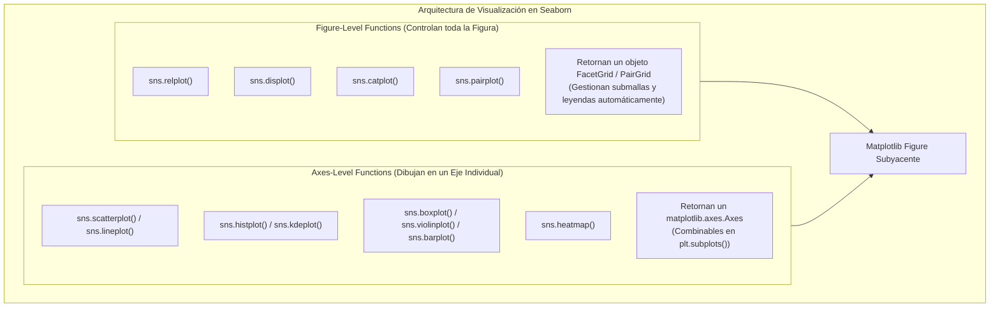

# Seaborn: Visualización Estadística de Datos

> **Ubicación:** [[Librerias index|Librerías]] / Aplicaciones de Bases de Datos II y Data Mining  
> **Librerías relacionadas:** [[Pandas]] • [[NumPy]] • [[Matplotlib]] • [[Preprocesamiento de datos]] • [[Scikit-Learn]]

---

## Objetos importantes

Seaborn es una librería de visualización estadística construida directamente sobre [[Matplotlib]] y fuertemente integrada con los `DataFrame` de [[Pandas]]. Su arquitectura se basa en una distinción fundamental entre dos tipos de objetos y funciones:



### 1. `matplotlib.axes.Axes` (Funciones *Axes-Level*)
- **Qué representa:** Un gráfico individual dentro de una figura (un par de ejes $X$ e $Y$).
- **Para qué sirve:** Cuando necesitas ubicar gráficos de Seaborn dentro de una grilla compleja armada con `plt.subplots()`.
- **Ejemplo mínimo:**
  ```python
  import seaborn as sns
  import matplotlib.pyplot as plt

  fig, ax = plt.subplots(figsize=(6, 4))
  sns.boxplot(x="categoria", y="saldo", data=df, ax=ax)
  ax.set_title("Distribución de Saldos")
  plt.show()
  ```

### 2. `FacetGrid` (Funciones *Figure-Level*)
- **Qué representa:** Un lienzo multipanel que estructura automáticamente una matriz de subgráficos particionados por los valores de variables categóricas (`col=` o `row=`).
- **Para qué sirve:** Análisis multivariado visual rápido sin escribir bucles `for` para crear subplots.
- **Ejemplo mínimo:**
  ```python
  import seaborn as sns
  import matplotlib.pyplot as plt

  # Crea automáticamente un gráfico por cada sucursal alineados en columnas
  g = sns.catplot(data=df, x="edad", y="saldo", col="sucursal", kind="box")
  plt.show()
  ```

### 3. `PairGrid` (Matriz de Dispersión Cruzada)
- **Qué representa:** Una matriz de subgráficos donde cada fila y columna representa una variable numérica del dataset.
- **Para qué sirve:** Evaluar correlaciones y separabilidad de clases simultáneamente entre todos los atributos de un dataset antes de entrenar modelos de Machine Learning.

---

## Mapa de intenciones

| Quiero... | Uso | Ejemplo |
|---|---|---|
| **1. Analizar distribuciones univariadas** | | |
| Histograma de frecuencias continuas o discretas | `sns.histplot()` | `sns.histplot(data=df, x="edad", kde=True)` |
| Curva de densidad de probabilidad suavizada | `sns.kdeplot()` | `sns.kdeplot(data=df, x="ingresos", hue="categoria")` |
| Función de distribución acumulada empírica | `sns.ecdfplot()` | `sns.ecdfplot(data=df, x="saldo")` |
| **2. Comparar variables continuas vs categóricas** | | |
| Diagrama de caja y bigotes para detectar outliers | `sns.boxplot()` | `sns.boxplot(data=df, x="categoria", y="ingresos")` |
| Diagrama de violín (caja + forma de densidad) | `sns.violinplot()` | `sns.violinplot(data=df, x="segmento", y="edad")` |
| Conteo de ocurrencias por categoría (balance de clases) | `sns.countplot()` | `sns.countplot(data=df, x="moroso")` |
| Promedio o métrica agregada con intervalo de confianza | `sns.barplot()` | `sns.barplot(data=df, x="sucursal", y="ventas", estimator="mean")` |
| Dispersión categórica punto por punto | `sns.stripplot()` | `sns.stripplot(data=df, x="canal", y="monto", jitter=True)` |
| **3. Analizar relaciones numéricas continuas** | | |
| Gráfico de dispersión 2D con codificación por color | `sns.scatterplot()` | `sns.scatterplot(data=df, x="edad", y="ingresos", hue="clase")` |
| Serie temporal o relación continua secuencial | `sns.lineplot()` | `sns.lineplot(data=df, x="mes", y="ventas")` |
| Dispersión con ajuste de recta de regresión lineal | `sns.regplot()` | `sns.regplot(data=df, x="gasto_publicidad", y="ventas")` |
| **4. Análisis multivariado y correlaciones** | | |
| Mapa de calor de matriz de correlación o confusión | `sns.heatmap()` | `sns.heatmap(df.corr(), annot=True, cmap="coolwarm")` |
| Matriz cruzada de todas las variables numéricas | `sns.pairplot()` | `sns.pairplot(df, hue="clase_objetivo")` |
| Dispersión bivariada con distribuciones marginales | `sns.jointplot()` | `sns.jointplot(data=df, x="edad", y="saldo", kind="hex")` |
| **5. Segmentar por subgráficos en rejilla** | | |
| Crear submallas para gráficos categóricos | `sns.catplot()` | `sns.catplot(data=df, x="tipo", y="monto", col="ciudad", kind="box")` |
| Crear submallas para gráficos relacionales | `sns.relplot()` | `sns.relplot(data=df, x="x", y="y", col="grupo", kind="scatter")` |
| **6. Estilos y apariencia global** | | |
| Establecer tema y escala tipográfica global | `sns.set_theme()` | `sns.set_theme(style="whitegrid", context="paper")` |
| Eliminar bordes superiores y derechos redundantes | `sns.despine()` | `sns.despine()` |

---

## Operaciones importantes por intención

### `sns.histplot()`

**¿Qué quiero hacer?**  
Visualizar la distribución de frecuencias de una variable numérica continua o discreta, evaluando asimetrías (*skewness*) y superponiendo opcionalmente la curva de densidad KDE.

**¿A qué pertenece?**  
⚙️ **Función de módulo** (*Axes-level*).

**Sintaxis básica:**
```python
sns.histplot(data=None, x=None, y=None, hue=None, bins='auto', kde=False, ax=None)
```

**Ejemplo realista:**
```python
# Histograma de edades particionado por clientes morosos con curva KDE
sns.histplot(
    data=df_clientes, 
    x="edad", 
    hue="moroso", 
    kde=True, 
    bins=25, 
    palette="Set2"
)
```

**Resultado / qué hace:**  
Dibuja barras agrupadas en intervalos (*bins*). Permite verificar rápidamente si la variable se aproxima a una distribución normal Gaussiana o presenta sesgos a la derecha o izquierda.

**Relacionado:**  
`sns.kdeplot()`, `sns.displot()`.

---

### `sns.boxplot()`

**¿Qué quiero hacer?**  
Analizar la dispersión, la mediana (Q2) y el rango intercuartílico ($IQR$), e **identificar visualmente los valores atípicos (*outliers*)** que caen más allá de $1.5 \times IQR$.

**¿A qué pertenece?**  
⚙️ **Función de módulo** (*Axes-level*).

**Sintaxis básica:**
```python
sns.boxplot(data=None, x=None, y=None, hue=None, ax=None)
```

**Ejemplo realista:**
```python
# Comparar distribución de ingresos según nivel de estudios
sns.boxplot(
    data=df_clientes, 
    x="nivel_estudios", 
    y="ingresos", 
    palette="Blues"
)
```

**Resultado / qué hace:**  
Traza la caja ($Q_1$ a $Q_3$), la línea de la mediana y los "bigotes" de Tukey. Los puntos individuales que quedan por fuera de los bigotes son candidatos directos a tratamiento de outliers en Data Mining.

> [!TIP]
> Si inviertes los ejes (`y="categoria"`, `x="ingresos"`), obtendrás un boxplot horizontal, ideal cuando los nombres de las categorías son largos y se solaparían en el eje X.

**Relacionado:**  
`sns.violinplot()`, `sns.catplot()`.

---

### `sns.violinplot()`

**¿Qué quiero hacer?**  
Combinar las propiedades estadísticas de un `boxplot` con la silueta de densidad de probabilidad (*KDE*) a ambos lados para detectar distribuciones multimodales (con varios picos) que el boxplot oculta.

**¿A qué pertenece?**  
⚙️ **Función de módulo** (*Axes-level*).

**Sintaxis básica:**
```python
sns.violinplot(data=None, x=None, y=None, hue=None, split=False)
```

**Ejemplo realista:**
```python
# Distribución de saldo según género, dividiendo el violín a la mitad
sns.violinplot(
    data=df_clientes, 
    x="segmento", 
    y="saldo", 
    hue="genero", 
    split=True, 
    inner="quart"
)
```

**Resultado / qué hace:**  
Muestra un perfil simétrico donde el ancho del violín indica la probabilidad de encontrar observaciones en ese rango de valores. Con `split=True` compara dos categorías en un único cuerpo.

**Relacionado:**  
`sns.boxplot()`.

---

### `sns.countplot()`

**¿Qué quiero hacer?**  
Contar la cantidad de registros por cada categoría para **detectar desbalance de clases** en variables objetivo de clasificación (ej. 95% clientes que pagan vs 5% morosos).

**¿A qué pertenece?**  
⚙️ **Función de módulo** (*Axes-level*).

**Sintaxis básica:**
```python
sns.countplot(data=None, x=None, y=None, hue=None)
```

**Ejemplo realista:**
```python
# Inspeccionar el balance de la variable target en minería de datos
sns.countplot(data=df_banco, x="abandono_servicio", palette="pastel")
```

**Resultado / qué hace:**  
Calcula automáticamente las frecuencias absolutas sin necesidad de llamar a `.value_counts()` previamente en Pandas.

> [!IMPORTANT]
> Un gráfico desbalanceado en `countplot` advierte que no se debe usar la métrica *Accuracy* directamente en Machine Learning, requiriendo técnicas como submuestreo, sobremuestreo o métricas F1 / AUC-ROC.

**Relacionado:**  
`sns.barplot()`, `s.value_counts()`.

---

### `sns.barplot()`

**¿Qué quiero hacer?**  
Visualizar el valor medio de una variable numérica agrupada por categorías, mostrando además barras de error con los intervalos de confianza del 95% calculados por *bootstrapping*.

**¿A qué pertenece?**  
⚙️ **Función de módulo** (*Axes-level*).

**Sintaxis básica:**
```python
sns.barplot(data=None, x=None, y=None, hue=None, estimator="mean", errorbar="ci")
```

**Ejemplo realista:**
```python
# Monto de compra promedio por canal de venta
sns.barplot(
    data=df_ventas, 
    x="canal_venta", 
    y="monto", 
    estimator="mean", 
    errorbar=("ci", 95)
)
```

**Resultado / qué hace:**  
La altura de la barra representa la métrica del estimador (`mean`, `median`, etc.) y la línea negra en el extremo indica la incertidumbre estadística de la estimación.

**Relacionado:**  
`sns.countplot()`, `df.groupby()`.

---

### `sns.scatterplot()`

**¿Qué quiero hacer?**  
Analizar la relación y dispersión entre dos variables continuas, pudiendo incorporar una tercera variable mediante el color (`hue`) y una cuarta mediante el tamaño del punto (`size`).

**¿A qué pertenece?**  
⚙️ **Función de módulo** (*Axes-level*).

**Sintaxis básica:**
```python
sns.scatterplot(data=None, x=None, y=None, hue=None, size=None, style=None)
```

**Ejemplo realista:**
```python
# Relación Edad vs Saldo coloreado por Clase de Riesgo y tamaño por Cantidad de Créditos
sns.scatterplot(
    data=df_clientes, 
    x="edad", 
    y="saldo", 
    hue="clase_riesgo", 
    size="cant_creditos", 
    alpha=0.7, 
    palette="viridis"
)
```

**Resultado / qué hace:**  
Mapea cada fila como un punto cartesiano $(x, y)$. Es fundamental en minería para detectar agrupamientos naturales (*clusters*), linealidad o valores extremos bivariados.

**Relacionado:**  
`sns.regplot()`, `sns.pairplot()`.

---

### `sns.heatmap()`

**¿Qué quiero hacer?**  
Visualizar matrices numéricas bidimensionales codificando sus valores en una escala de colores, especialmente útil para **matrices de correlación** y **matrices de confusión** de clasificadores.

**¿A qué pertenece?**  
⚙️ **Función de módulo** (*Axes-level*).

**Sintaxis básica:**
```python
sns.heatmap(data, annot=False, cmap=None, vmin=None, vmax=None, fmt='.2f')
```

**Ejemplo realista:**
```python
# Matriz de correlación de Pearson entre variables predictoras numéricas
matriz_corr = df_clientes[["edad", "ingresos", "saldo", "score_crediticio"]].corr()

sns.heatmap(
    matriz_corr, 
    annot=True,         # Muestra el número dentro de cada celda
    cmap="coolwarm",    # Azul para -1, Blanco para 0, Rojo para +1
    vmin=-1, vmax=1,    # Fija los límites de la escala
    fmt=".2f", 
    linewidths=0.5
)
```

**Resultado / qué hace:**  
Crea una grilla térmica con barra de color lateral. En Data Mining permite detectar **multicolinealidad** (atributos con correlación $> 0.85$ que aportan información redundante y deben eliminarse).

> [!WARNING]
> La entrada de `sns.heatmap` debe ser una **matriz numérica 2D**, como el resultado de `df.corr()`, `pd.crosstab()`, `confusion_matrix()` o una tabla pivotada con `df.pivot_table()`. No le pases un DataFrame con texto sin transformar.

**Relacionado:**  
`df.corr()`, `df.pivot_table()`.

---

### `sns.pairplot()`

**¿Qué quiero hacer?**  
Generar una matriz completa de gráficos que cruza todos los pares de variables numéricas entre sí (diagramas de dispersión fuera de la diagonal y distribuciones univariadas en la diagonal principal).

**¿A qué pertenece?**  
⚙️ **Función de módulo** (*Figure-level*, retorna un `PairGrid`).

**Sintaxis básica:**
```python
sns.pairplot(data, hue=None, vars=None, diag_kind='auto', corner=False)
```

**Ejemplo realista:**
```python
# Evaluar qué atributos separan mejor a los clientes morosos de los no morosos
sns.pairplot(
    data=df_clientes[["edad", "ingresos", "saldo", "moroso"]], 
    hue="moroso", 
    corner=True, # Dibuja solo el triángulo inferior evitando gráficos duplicados
    palette="Set1"
)
```

**Resultado / qué hace:**  
Genera una figura completa con múltiples subplots. Si en algún cruce de variables las clases no se solapan, ese par de atributos es un predictor de altísimo valor para modelos de clasificación.

> [!TIP]
> Usa el argumento `corner=True` para evitar duplicación simétrica en la matriz, reduciendo a la mitad el tiempo de renderizado en datasets con muchas columnas.

**Relacionado:**  
`sns.jointplot()`.

---

### `sns.catplot()`

**¿Qué quiero hacer?**  
Acceder a cualquier tipo de gráfico categórico (`box`, `violin`, `bar`, `count`, `strip`) estructurando automáticamente una submalla en columnas o filas según variables de negocio adicionales.

**¿A qué pertenece?**  
⚙️ **Función de módulo** (*Figure-level*, retorna un `FacetGrid`).

**Sintaxis básica:**
```python
sns.catplot(data=None, x=None, y=None, hue=None, col=None, row=None, kind='strip')
```

**Ejemplo realista:**
```python
# Grilla de boxplots de saldo vs segmento, separando por sucursal en columnas
sns.catplot(
    data=df_clientes, 
    x="segmento", 
    y="saldo", 
    col="sucursal", 
    kind="box", 
    palette="muted"
)
```

**Resultado / qué hace:**  
Crea una figura multipanel sin necesidad de declarar subplots manualmente con Matplotlib.

**Relacionado:**  
`sns.relplot()`, `sns.displot()`.

---

### `sns.set_theme()`

**¿Qué quiero hacer?**  
Establecer estilos estéticos globales para todos los gráficos del notebook o script (fondo cuadriculado, tamaño de fuentes, paleta de colores por defecto).

**¿A qué pertenece?**  
⚙️ **Función del módulo** `seaborn`.

**Sintaxis básica:**
```python
sns.set_theme(style="darkgrid", palette="deep", font_scale=1.0)
```

**Ejemplo realista:**
```python
# Configuración recomendada para reportes académicos de facultad
sns.set_theme(
    style="whitegrid",   # Fondo blanco con líneas grises suaves
    font_scale=1.1,      # Texto un 10% más grande para lectura clara
    palette="tab10"
)
```

**Resultado / qué hace:**  
Aplica los parámetros de configuración a la sesión actual de Matplotlib.

**Relacionado:**  
`sns.despine()`, `sns.color_palette()`.

---

## Diferencias importantes

### 1. Figure-Level (`catplot`, `relplot`) vs Axes-Level (`boxplot`, `scatterplot`)

| Característica | Funciones Axes-Level | Funciones Figure-Level |
|---|---|---|
| **Ejemplos** | `sns.boxplot`, `sns.histplot`, `sns.heatmap` | `sns.catplot`, `sns.displot`, `sns.relplot` |
| **Objeto retornado** | `matplotlib.axes.Axes` | `sns.FacetGrid` |
| **Integración con subplots** | Fácil (`ax=ax[0]`) | No se pueden incrustar en un `ax` existente |
| **Facetado (`col=`, `row=`)** | No admitido | Nativo y automático |
| **Cambio de título** | `ax.set_title("...")` | `g.fig.suptitle("...")` o `g.set_titles("...")` |

### 2. `sns.histplot()` vs `sns.kdeplot()`
- `sns.histplot()`: Representación empírica discreta mediante barras de conteo agrupadas en intervalos (*bins*). Muestra las frecuencias reales de los datos.
- `sns.kdeplot()`: Estimación de densidad mediante núcleos continuos suavizados. No muestra conteos discretos, sino una función continua normalizada cuya área total bajo la curva suma 1.

### 3. `sns.countplot()` vs `sns.barplot()`
- `sns.countplot()`: **Cuenta frecuencias de filas**. No recibe parámetro `y` (o `x`); simplemente cuenta cuántas veces aparece cada categoría.
- `sns.barplot()`: **Calcula una métrica de resumen** (por defecto la media) de una variable numérica `y` agrupada por una variable categórica `x`.

### 4. Seaborn vs Matplotlib puro
- **Matplotlib:** Es una librería de bajo nivel donde cada elemento (eje, marca, etiqueta, línea) debe configurarse manualmente. Requiere preparar y agrupar los datos previamente.
- **Seaborn:** Es una capa de alto nivel orientada a estadística. Acepta DataFrames directamente en formato *tidy/long*, realiza agregaciones internas, calcula intervalos de confianza y codifica dimensiones complejas usando `hue`, `size` y `style`.

---

## Ejemplo completo

El siguiente script ejecuta un flujo completo de **Análisis Exploratorio de Datos (EDA)** para detectar anomalías, multicolinealidad y separabilidad de clases en un dataset de clientes:

```python
import seaborn as sns
import matplotlib.pyplot as plt
import pandas as pd
import numpy as np

# 1. Configurar tema estético profesional
sns.set_theme(style="whitegrid", font_scale=1.05)

# 2. Generar dataset sintético para demostración de EDA
np.random.seed(42)
n = 300
df_ejemplo = pd.DataFrame({
    "edad": np.random.normal(40, 12, n).astype(int),
    "ingresos": np.random.normal(60000, 15000, n),
    "score_crediticio": np.random.normal(650, 50, n),
    "segmento": np.random.choice(["Minorista", "Mayorista", "Corporativo"], n),
    "riesgo": np.random.choice(["Bajo", "Alto"], n, p=[0.75, 0.25])
})

# Inyectar outliers evidentes para detección visual
df_ejemplo.loc[5, "ingresos"] = 180000.0

# 3. Paso 1: Detección visual de Outliers por categoría con Boxplot
plt.figure(figsize=(8, 4))
sns.boxplot(data=df_ejemplo, x="segmento", y="ingresos", hue="riesgo", palette="Set2")
plt.title("Inspección de Outliers en Ingresos según Segmento y Riesgo")
sns.despine()
plt.show()

# 4. Paso 2: Análisis de Multicolinealidad con Matriz de Correlación
plt.figure(figsize=(6, 5))
matriz_corr = df_ejemplo[["edad", "ingresos", "score_crediticio"]].corr()
sns.heatmap(matriz_corr, annot=True, cmap="vlag", vmin=-1, vmax=1, fmt=".2f", cbar_kws={'label': 'Coeficiente de Pearson'})
plt.title("Matriz de Correlación de Atributos Numéricos")
plt.show()

# 5. Paso 3: Análisis de Separabilidad Multivariada con Pairplot
grid = sns.pairplot(
    data=df_ejemplo[["edad", "ingresos", "score_crediticio", "riesgo"]], 
    hue="riesgo", 
    palette="Dark2", 
    corner=True
)
grid.fig.suptitle("Matriz de Dispersión Cruzada por Nivel de Riesgo", y=1.02)
plt.show()
```

### Explicación detallada del flujo:

1. **Configuración de entorno (`set_theme`):**
   - **Qué hacemos:** Fijamos la plantilla `whitegrid` con escala adecuada.
   - **Por qué:** Garantiza fondos legibles y consistencia visual en todas las figuras sin repetir configuraciones manuales.
   - **Objeto manipulado:** Configuración global del módulo `seaborn`.
   - **Resultado:** Aspecto visual limpio para reportes académicos.

2. **Detección univariada/bivariada de outliers (`sns.boxplot`):**
   - **Qué hacemos:** Graficamos la distribución de `ingresos` segmentada por canal y clase de riesgo.
   - **Por qué:** Identificar rápidamente si existen valores atípicos que requieran ser tratados en la etapa de [[Preprocesamiento de datos]].
   - **Objeto manipulado:** `df_ejemplo` mapeado sobre un `Axes`.
   - **Resultado:** Puntos aislados visibles por encima del bigote superior que alertan sobre el valor anómalo inyectado.

3. **Diagnóstico de multicolinealidad (`sns.heatmap`):**
   - **Qué hacemos:** Calculamos `df.corr()` y la proyectamos en un mapa térmico centrado en cero (`cmap="vlag"`).
   - **Por qué:** Detectar si hay variables redundantes que deban descartarse antes del entrenamiento en [[Scikit-Learn]].
   - **Objeto manipulado:** Matriz numérica bidimensional $(3, 3)$.
   - **Resultado:** Mapa con coeficientes numéricos claros dentro de cada celda.

4. **Evaluación de separabilidad de clases (`sns.pairplot`):**
   - **Qué hacemos:** Trazamos todas las combinaciones bivariadas simultáneamente coloreando por la variable objetivo `riesgo`.
   - **Por qué:** Verificar qué combinaciones de atributos permiten discriminar visualmente la clase de riesgo para elegir la familia de clasificadores adecuada.
   - **Objeto manipulado:** `PairGrid` completo de Seaborn.
   - **Resultado:** Cuadrícula triangular con distribuciones en la diagonal y nubes de puntos fuera de ella.

---

## Cheat Sheet

| Necesito... | Uso |
|---|---|
| Histograma de frecuencias | `sns.histplot(data=df, x="col", kde=True)` |
| Curva de densidad suave | `sns.kdeplot(data=df, x="col", hue="grupo")` |
| Detectar outliers por grupo | `sns.boxplot(data=df, x="cat", y="num")` |
| Caja + forma de densidad | `sns.violinplot(data=df, x="cat", y="num")` |
| Contar filas por categoría | `sns.countplot(data=df, x="cat")` |
| Promedio por categoría con barras de error | `sns.barplot(data=df, x="cat", y="num")` |
| Dispersión de dos variables continuas | `sns.scatterplot(data=df, x="x", y="y", hue="clase")` |
| Dispersión con recta de regresión | `sns.regplot(data=df, x="x", y="y")` |
| Matriz de correlación térmica | `sns.heatmap(df.corr(), annot=True, cmap="coolwarm")` |
| Cruce de todas las variables numéricas | `sns.pairplot(df, hue="clase", corner=True)` |
| Submalla de gráficos en columnas | `sns.catplot(data=df, x="x", y="y", col="grupo", kind="box")` |
| Cambiar tema visual general | `sns.set_theme(style="whitegrid")` |
| Quitar bordes redundantes | `sns.despine()` |

---

## 🧭 Navegación entre Notas

- 📂 **Índice del módulo:** [[Librerias index|Librerías de Python]]
- 🐼 **Manipulación de tablas:** [[Pandas]]
- 🔢 **Computación matricial:** [[NumPy]]
- 📈 **Visualización base:** [[Matplotlib]]
- 🤖 **Modelos de Machine Learning:** [[Scikit-Learn]]
