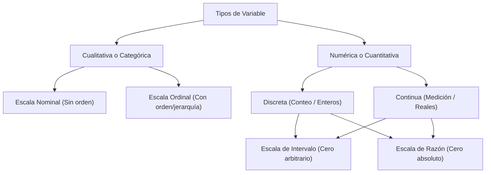
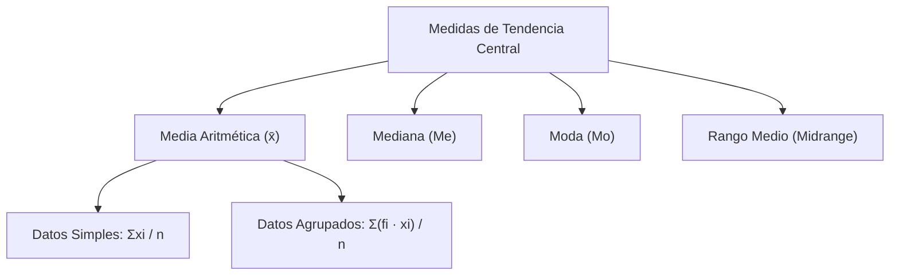
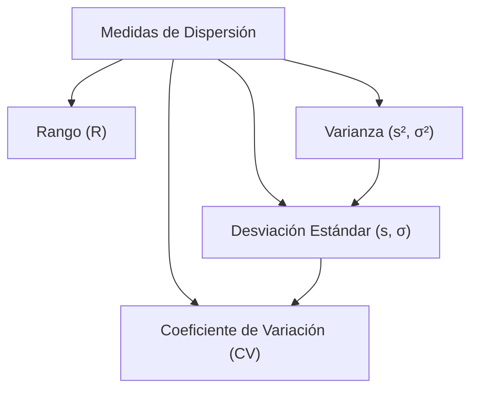

# Conceptos Fundamentales de Estadística Descriptiva

La estadística descriptiva proporciona métodos numéricos y gráficos para resumir, organizar y caracterizar la información contenida en un conjunto de datos. Las dos dimensiones fundamentales de análisis univariado son las **medidas de tendencia central** (dónde se concentran los datos) y las **medidas de dispersión** (cuán esparcidos están respecto al centro).

---

## 1. Conceptos Fundamentales, Población, Muestra y Variables



---

### 1.1 Unidad Experimental (o de Observación)
Es cada uno de los **elementos mínimos, personas, objetos, transacciones o entidades indivisibles** que componen la población o muestra, sobre los cuales se realiza la observación o medición de una o más características.

- *Ejemplos:* Un estudiante de la facultad, un servidor web en un clúster, un paquete de red transmitido, un producto en una línea de montaje.

---

### 1.2 Población y Muestra

- **Población ($N$):** Conjunto total, exhaustivo y bien delimitado de todas las unidades experimentales que comparten una característica común de interés.
  - **Parámetro:** Valor numérico constante que describe una propiedad de toda la población (ej. media poblacional $\mu$, desviación estándar poblacional $\sigma$, proporción poblacional $P$).
- **Muestra ($n$):** Subconjunto representativo y aleatorio seleccionado a partir de la población ($n \le N$).
  - **Estadístico (o Estimador):** Valor numérico variable calculado a partir de los datos muestrales para aproximar o inferir el parámetro poblacional correspondiente (ej. media muestral $\bar{x}$, desviación estándar muestral $s$, proporción muestral $\hat{p}$).

> [!NOTE]
> **Censo vs. Muestreo:**
> - Si $n < N$: Se realiza un **muestreo** (análisis muestral e inferencia estadística).
> - Si $n = N$: Se realiza un **censo** (se mide al $100\%$ de la población, no existe error muestral).

---

### 1.3 Variable Estadística
Es cualquier **característica, cualidad, rasgo o propiedad observable** de las unidades experimentales que puede adoptar dos o más valores o modalidades distintas entre los elementos analizados.

---

### 1.4 Clasificación de las Variables y Escalas de Medición

Las variables se clasifican según su **naturaleza** y el **nivel o escala de medición** con el que se registran:

#### A. Variables Cualitativas (o Categóricas)
Representan cualidades, atributos, categorías o estados no numéricos.

1. **Escala Nominal:**
   - Las categorías son puramente descriptivas y **no poseen ningún orden intrínseco, jerarquía o secuencia lógica**.
   - *Ejemplos:* Estado civil, género, sistema operativo (`Linux`, `Windows`, `macOS`), tipo de tarjeta (`Débito`, `Crédito`), color de ojos.

2. **Escala Ordinal:**
   - Las categorías poseen un **orden natural, secuencia o jerarquía definida**, pero la distancia numérica entre niveles contiguos no es medible cuantitativamente.
   - *Ejemplos:* Nivel de estudios (`Primario`, `Secundario`, `Universitario`, `Posgrado`), nivel de satisfacción (`Muy Malo`, `Regular`, `Bueno`, `Excelente`), prioridad de un ticket (`Baja`, `Media`, `Alta`, `Crítica`), rango militar.

---

#### B. Variables Cuantitativas (o Numéricas)
Expresan cantidades numéricas medibles sobre las que tienen sentido realizar operaciones aritméticas.

1. **Por su naturaleza matemática:**
   - **Discretas:** Surgen de procesos de **conteo**. Adoptan valores numéricos aislados, finitos o numerables (generalmente enteros $\mathbb{Z}_{\ge 0}$). No admiten valores intermedios entre dos enteros consecutivos.
     - *Ejemplos:* Número de fallos en un servidor ($0, 1, 2\dots$), materias aprobadas, cantidad de hijos, número de peticiones HTTP en un segundo.
   - **Continuas:** Surgen de procesos de **medición**. Pueden tomar **cualquier valor real ($\mathbb{R}$)** dentro de un intervalo continuo, admitiendo infinitos valores intermedios según la precisión del instrumento.
     - *Ejemplos:* Tiempo de respuesta de una API ($124.52\text{ ms}$), temperatura ambiente, peso, estatura, consumo de memoria RAM ($4.25\text{ GB}$).

2. **Por su escala de medición:**
   - **Escala de Intervalo:**
     - El **cero es relativo, convencional o arbitrario** (el valor $0$ **no representa la ausencia total** de la característica medida).
     - *Ejemplo clásico:* Temperatura en grados Celsius ($0^\circ\text{C}$ no significa ausencia de calor, sino el punto de congelación del agua a 1 atm; $20^\circ\text{C}$ no es "el doble de calor" que $10^\circ\text{C}$). Fechas de calendario, nivel de coeficiente intelectual (IQ).
   - **Escala de Razón (o Proporción):**
     - El **cero es absoluto, natural y verdadero** (el valor $0$ representa la **ausencia total o nulidad** de la magnitud física).
     - *Ejemplos:* Tiempo transcurrido ($0\text{ s}$ es ausencia total de tiempo; $20\text{ s}$ es exactamente el doble de $10\text{ s}$), distancia en metros, salario en pesos, masa en kilogramos, ancho de banda en Mbps.

---

## 2. Medidas de Tendencia Central

Las medidas de tendencia central o de posición central indican el valor alrededor del cual tienden a agruparse los datos.



---

### 2.1 Media Aritmética ($\bar{x}, \mu$)

Es el promedio numérico de los datos. Representa el centro de gravedad o punto de equilibrio de la distribución.

#### A. Datos Simples (No Agrupados)


| Para una muestra (n)<br>$x_1, x_2, \dots, x_n$ | $$\bar{x} = \frac{1}{n} \sum_{i=1}^{n} x_i $$ |
| ---------------------------------------------- | --------------------------------------------- |
| Para una población (N)                         | $$\mu = \frac{1}{N} \sum_{i=1}^{N} x_i$$      |

#### B. Datos Agrupados (Intervalos de Clase)
Cuando los datos se encuentran en una tabla de frecuencias con $k$ clases:
- En datos discretos: $x_i$ es el valor puntual de la variable.
- En datos continuos agrupados en intervalos: $x_i$ es la **marca de clase** (punto medio de cada intervalo: $x_i$ ).

$$\bar{x} = \frac{\sum_{i=1}^{k} f_i \cdot x_i}{n} $$

Donde:
- $f_i$: Frecuencia absoluta de la clase $i$.
- $n = \sum f_i$: Tamaño total de la muestra.

> [!NOTE]
> **Propiedades y Limitaciones de la Media:**
> - **Propiedad algebraica central:** La suma de las desviaciones respecto a la media es siempre cero: $\sum (x_i - \bar{x}) = 0$.
> - **Sensibilidad a valores atípicos (outliers):** Es fuertemente afectada por valores extremos o distribuciones muy asimétricas.

---

### 2.2 Mediana ($\text{Me}$ o $\tilde{x}$)

Es el valor que ocupa la **posición central** de un conjunto de datos una vez que han sido **ordenados de menor a mayor**. Divide a la distribución en dos partes iguales ($50\%$ de los datos por debajo y $50\%$ por encima).

#### A. Datos Simples
1. Se ordenan los datos: $x_{(1)} \le x_{(2)} \le \dots \le x_{(n)}$.
2. Se evalúa el tamaño $n$:
   - **Si $n$ es impar:** La mediana es el valor en la posición $\frac{n+1}{2}$:
     $$\text{Me} = x_{\left(\frac{n+1}{2}\right)}$$
   - **Si $n$ es par**: habrá dos medianas entonces será su promedio (posiciones $\frac{n}{2}$ y $\frac{n}{2} + 1$):
     $$\text{Me} = \frac{x_{\left(\frac{n}{2}\right)} + x_{\left(\frac{n}{2} + 1\right)}}{2}$$


> [!TIP]
> **Ventaja de la Mediana:** Es una medida **robusta**, no se ve distorsionada por valores extremos ni sesgos en las colas.

---

### 2.3 Moda ($\text{Mo}$ o $\hat{x}$)

Es el valor o categoría que aparece con **mayor frecuencia** (el más repetido).

#### A. Tipos de Distribución según la Moda
- **Amodal:** Todos los valores tienen la misma frecuencia (no hay moda).
- **Unimodal:** Existe un único valor con la frecuencia máxima.
- **Bimodal / Multimodal:** Existen dos o más valores que comparten la frecuencia máxima más alta.

---

### 2.4 Rango Medio (Midrange)

Es el punto medio entre el valor mínimo y el valor máximo del conjunto de datos.

$$\text{Rango Medio} = \frac{x_{\min} + x_{\max}}{2}$$

- **Ventajas:** Extremadamente fácil y rápido de calcular. Para el caso de una distribución simétrica
- **Desventajas:** Es la medida de tendencia central más inestable y sensible a valores atípicos, ya que depende exclusivamente de los dos valores más extremos del conjunto.

---

## 3. Medidas de Dispersión (Variabilidad)

Las medidas de dispersión es el **grado de variación, separación o esparcimiento** de los datos respecto a una medida central (generalmente la media). Indican cuán representativa es la media aritmética.



---

### 3.1 Rango (Recorrido o Amplitud)

Es la diferencia numérica entre el valor máximo y el valor mínimo observado.

$$R = x_{\max} - x_{\min}$$

- **Limitación:** Solo toma en cuenta los dos valores extremos, ignorando por completo la estructura y concentración de los datos intermedios.

---

### 3.2 Varianza ($\sigma^2, s^2$)

Mide el promedio de las desviaciones al cuadrado de cada dato respecto a su media aritmética.


| Varianza Poblacional ($\sigma^2$)<br>Para una población completa de tamaño $N$:                                                                                                   | <br>$$\sigma^2 = \frac{1}{N} \sum_{i=1}^{N} (x_i - \mu)^2$$        |
| --------------------------------------------------------------------------------------------------------------------------------------------------------------------------------- | ------------------------------------------------------------------ |
| **Varianza Muestral ($s^2$)**<br>Para una muestra de tamaño $n$. Se divide por $n - 1$ (**corrección de Bessel**) para obtener un estimador insesgado de la varianza poblacional: | <br><br>$$s^2 = \frac{1}{n - 1} \sum_{i=1}^{n} (x_i - \bar{x})^2$$ |
> [!NOTE]
Dificulta medir en unidades puesto que esta al cuadrado, por eso se suele utilizar la $\sigma$

---

### 3.3 Desviación Estándar ($\sigma, s$)

Es la **raíz cuadrada positiva** de la varianza. Expresa la dispersión en las **mismas unidades de medida originales** que la variable analizada.

| - **Poblacional:** | $$\sigma = \sqrt{\sigma^2} = \sqrt{\frac{1}{N} \sum_{i=1}^{N} (x_i - \mu)^2}$$ |
| ------------------ | ------------------------------------------------------------------------------ |
| - **Muestral:**    | $$s = \sqrt{s^2} = \sqrt{\frac{1}{n - 1} \sum_{i=1}^{n} (x_i - \bar{x})^2}$$   |
![[Pasted image 20260831113435.png]]
#### Interpretación Práctica:
- Un valor de $s$ cercano a $0$ indica que los datos están fuertemente agrupados alrededor de la media (alta precisión/homogeneidad).
- Un valor de $s$ grande indica gran dispersión e heterogeneidad en las mediciones.

---

### 3.4 Coeficiente de Variación ($CV$)

Es una medida de **dispersión relativa** que expresa la desviación estándar como porcentaje de la media aritmética. Es un número **adimensional** (sin unidades).

| - **Muestral:**    | $$CV = \frac{s}{\bar{x}} \times 100\%$$  |
| ------------------ | ---------------------------------------- |
| - **Poblacional:** | $$CV = \frac{\sigma}{\mu} \times 100\%$$ |
#### ¿Para qué se utiliza el Coeficiente de Variación?
1. **Comparar la dispersión de variables con distintas unidades de medida:**
   - *Ejemplo:* ¿Qué es más variable en un grupo de servidores: el uso de CPU en $\%$ ($s = 12\%$) o el consumo de memoria en GB ($s = 4\text{ GB}$)? El $CV$ permite compararlos directamente.
2. **Comparar la dispersión de variables con órdenes de magnitud muy dispares:**
   - *Ejemplo:* Comparar la variabilidad del salario de operarios ($\bar{x} = \$1.000$, $s = \$100 \implies CV = 10\%$) frente al de ejecutivos ($\bar{x} = \$50.000$, $s = \$2.500 \implies CV = 5\%$). Aunque $\$2.500 > \$100$, el grupo de ejecutivos es relativamente más homogéneo.

#### Criterio General de Interpretación del $CV$:
| Rango de $CV$ | Nivel de Variabilidad | Grado de Homogeneidad | Representatividad de la Media ($\bar{x}$) |
| :---: | :---: | :---: | :---: |
| **$0\% \le CV \le 10\%$** | Muy Baja | Muy homogéneo | Excelente |
| **$10\% < CV \le 25\%$** | Moderada | Moderadamente homogéneo | Buena |
| **$25\% < CV \le 50\%$** | Alta | Heterogéneo | Regular / Baja |
| **$CV > 50\%$** | Muy Alta | Muy heterogéneo / Disperso | Muy pobre (usar Mediana) |

---

## 4. Ejemplo Numérico Integrador Completo

### Conjunto de Datos (Muestra Simple)
Tiempos de ejecución en segundos de $n = 9$ ejecuciones de un algoritmo de ordenamiento:

$$\{ 12, 14, 15, 15, 16, 18, 19, 21, 50 \}$$

*Nótese que $50$ actúa como valor atípico (outlier).*

---

### Paso a Paso de Cálculos:

1. **Media Aritmética ($\bar{x}$):**
   $$\sum x_i = 12 + 14 + 15 + 15 + 16 + 18 + 19 + 21 + 50 = 180$$
   $$\bar{x} = \frac{180}{9} = 20.00\text{ s}$$

2. **Mediana ($\text{Me}$):**
   $n = 9$ (impar). La posición central es $\frac{9+1}{2} = 5$.
   $$\text{Me} = x_{(5)} = 16.00\text{ s}$$
   *(La mediana $16\text{ s}$ no se vio arrastrada por el outlier $50\text{ s}$, a diferencia de la media $20\text{ s}$).*

3. **Moda ($\text{Mo}$):**
   El valor que más se repite es $15$ ($f = 2$).
   $$\text{Mo} = 15.00\text{ s}$$

4. **Rango Medio:**
   $$\text{Rango Medio} = \frac{12 + 50}{2} = \frac{62}{2} = 31.00\text{ s}$$

5. **Rango ($R$):**
   $$R = x_{\max} - x_{\min} = 50 - 12 = 38.00\text{ s}$$

6. **Varianza Muestral ($s^2$):**
   Tabla de desvíos cuadráticos $(x_i - \bar{x})^2$ con $\bar{x} = 20$:
   - $(12-20)^2 = 64$
   - $(14-20)^2 = 36$
   - $(15-20)^2 = 25$
   - $(15-20)^2 = 25$
   - $(16-20)^2 = 16$
   - $(18-20)^2 = 4$
   - $(19-20)^2 = 1$
   - $(21-20)^2 = 1$
   - $(50-20)^2 = 900$
   
   $$\sum (x_i - 20)^2 = 64 + 36 + 25 + 25 + 16 + 4 + 1 + 1 + 900 = 1072$$
   $$s^2 = \frac{1072}{9 - 1} = \frac{1072}{8} = 134.00\text{ s}^2$$

7. **Desviación Estándar Muestral ($s$):**
   $$s = \sqrt{134} \approx 11.58\text{ s}$$

8. **Coeficiente de Variación ($CV$):**
   $$CV = \frac{11.58}{20.00} \times 100\% = 57.90\%$$
   *Interpretación:* $CV > 50\%$ evidencia alta dispersión y heterogeneidad causada por el outlier; la mediana ($16\text{ s}$) es preferible sobre la media ($20\text{ s}$) como medida central representativa.

---

## 5. Implementación en Python

```python
import numpy as np
import pandas as pd

datos = [12, 14, 15, 15, 16, 18, 19, 21, 50]
s = pd.Series(datos)

# Medidas de Tendencia Central
media = s.mean()
mediana = s.median()
moda = s.mode().tolist()
rango_medio = (s.min() + s.max()) / 2

# Medidas de Dispersión
rango = s.max() - s.min()
varianza_muestral = s.var(ddof=1)
desv_estandar_muestral = s.std(ddof=1)
coef_variacion = (desv_estandar_muestral / media) * 100

print("=== Medidas de Tendencia Central ===")
print(f"Media Aritmética : {media:.2f}")
print(f"Mediana          : {mediana:.2f}")
print(f"Moda             : {moda}")
print(f"Rango Medio      : {rango_medio:.2f}")

print("\n=== Medidas de Dispersión ===")
print(f"Rango            : {rango:.2f}")
print(f"Varianza (s²)    : {varianza_muestral:.2f}")
print(f"Desv. Estándar(s): {desv_estandar_muestral:.2f}")
print(f"Coef. Variación  : {coef_variacion:.2f}%")
```

---

## 🔗 Temas Relacionados

- **[[Medidas de Forma|Medidas de Forma, Curtosis y Teorema de Chebyshev]]**: Asimetría de Pearson y Fisher, exceso de curtosis y cota de Chebyshev.
- **[[Materias/Probabilidad y Estadistica/Estadística/Estadística Descriptiva/Distribución de Frecuencias|Distribución de Frecuencias y Tablas de Contingencia]]**: Tablas univariadas, acumuladas y análisis bivariado.
- **[[Materias/Probabilidad y Estadistica/Estadística/Estadística Descriptiva/Graficas|Gráficas Estadísticas]]**: Representaciones visuales (histogramas, boxplots, ojivas).
