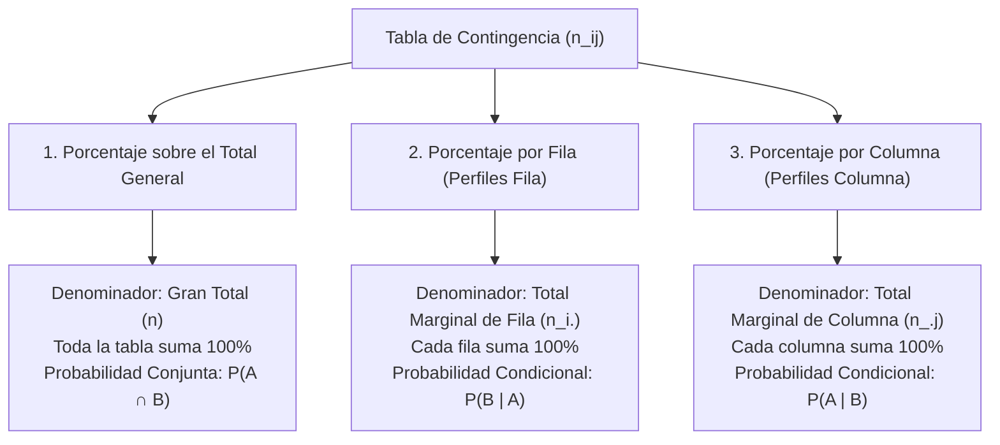

# Distribución de Frecuencias y Tablas de Contingencia

La **distribución de frecuencias** y las **tablas de contingencia** son herramientas fundamentales de la **estadística descriptiva** para organizar, resumir, visualizar y analizar conjuntos de datos univariados y bivariados, permitiendo identificar patrones, concentraciones y relaciones de dependencia.

---

## 1. Distribución de Frecuencias Univariadas

Una **tabla de frecuencias** agrupa un conjunto de observaciones en clases o categorías mutuamente excluyentes y exhaustivas, indicando el número y proporción de elementos en cada una.

### 1.1 Tipos de Frecuencias Simples

Dada una muestra de tamaño $n$ con $k$ valores o clases distintas $x_1, x_2, \dots, x_k$:

1. **Frecuencia Absoluta ($f_i$ o $n_i$):**
   Es el número de veces que se repite el valor o categoría $x_i$ en el conjunto de datos.
   
   $$\sum_{i=1}^{k} f_i = f_1 + f_2 + \dots + f_k = n$$

2. **Frecuencia Relativa ($h_i$ o $f_{r_i}$):**
   Es la proporción de observaciones que corresponden al valor $x_i$ respecto al total de la muestra. Permite comparar muestras de distinto tamaño ($n$).
   
   $$h_i = \frac{f_i}{n}, \quad 0 \le h_i \le 1$$
   $$\sum_{i=1}^{k} h_i = 1$$

3. **Frecuencia Relativa Porcentual ($h_i\%$ o $p_i$):**
   Es la frecuencia relativa expresada en términos porcentuales.
   
   $$h_i\% = h_i \times 100\% = \frac{f_i}{n} \times 100\%$$
   $$\sum_{i=1}^{k} h_i\% = 100\%$$

---

### 1.2 Tipos de Frecuencias Acumuladas

Las frecuencias acumuladas cuantifican el total de observaciones que son **menores o iguales** a un determinado valor o límite superior de clase ($X \le x_i$).

> [!IMPORTANT]
> **Condición de aplicación:** Las frecuencias acumuladas **solo tienen sentido para variables cuantitativas** (discretas y continuas) y variables cualitativas **ordinales**, donde los valores poseen un orden jerárquico natural. **No aplican a variables cualitativas nominales** (ej. estado civil, color de ojos).

1. **Frecuencia Absoluta Acumulada ($F_i$ o $N_i$):**
   Suma sucesiva de las frecuencias absolutas desde la primera clase hasta la clase $i$-ésima:
   
   $$F_i = \sum_{j=1}^{i} f_j = f_1 + f_2 + \dots + f_i$$
   
   - Primer valor: $F_1 = f_1$
   - Último valor: $F_k = n$
   - Relación de recurrencia: $F_i = F_{i-1} + f_i$

2. **Frecuencia Relativa Acumulada ($H_i$):**
   Proporción acumulada de observaciones hasta la categoría $i$:
   
   $$H_i = \sum_{j=1}^{i} h_j = \frac{F_i}{n}$$
   
   - Primer valor: $H_1 = h_1$
   - Último valor: $H_k = 1.0$

3. **Frecuencia Relativa Porcentual Acumulada ($H_i\%$ o $P_i$):**
   Porcentaje acumulado de observaciones hasta la categoría $i$:
   
   $$H_i\% = H_i \times 100\% = \frac{F_i}{n} \times 100\%$$
   
   - Primer valor: $H_1\% = h_1\%$
   - Último valor: $H_k\% = 100\%$

---

## 2. Ejemplos Prácticos y Contraste

Para apreciar las diferencias analíticas, se presentan dos casos: uno con **variable cuantitativa discreta (valores puntuales sin agrupar)** y otro con **variable cuantitativa continua (agrupada en intervalos de clase)**.

---

### Ejemplo 1: Variable Cuantitativa Discreta (Sin Agrupar)

**Contexto:** Se releva la cantidad de servidores caídos por día durante $n = 40$ días de monitoreo en un centro de cómputos.

- Valores observados ($x_i$): $0, 1, 2, 3, 4$ fallos.

#### Tabla de Distribución de Frecuencias

| Fallos por día ($x_i$) | Frec. Absoluta ($f_i$) | Frec. Relativa ($h_i$) | Frec. Relativa % ($h_i\%$) | Frec. Abs. Acumulada ($F_i$) | Frec. Rel. Acumulada ($H_i$) | Frec. Rel. % Acumulada ($H_i\%$) |
| :---: | :---: | :---: | :---: | :---: | :---: | :---: |
| **0** | $14$ | $0.350$ | $35.0\%$ | $14$ | $0.350$ | $35.0\%$ |
| **1** | $12$ | $0.300$ | $30.0\%$ | $26$ | $0.650$ | $65.0\%$ |
| **2** | $8$ | $0.200$ | $20.0\%$ | $34$ | $0.850$ | $85.0\%$ |
| **3** | $4$ | $0.100$ | $10.0\%$ | $38$ | $0.950$ | $95.0\%$ |
| **4** | $2$ | $0.050$ | $5.0\%$ | $40$ | $1.000$ | $100.0\%$ |
| **Total** | **$n = 40$** | **$1.000$** | **$100.0\%$** | — | — | — |

#### Interpretación de Resultados:
- **Puntual ($f_2 = 8, h_2\% = 20\%$):** En $8$ días (el $20\%$ del tiempo) ocurrieron **exactamente 2** fallos.
- **Acumulada ($F_2 = 34, H_2\% = 85\%$):** En $34$ de los $40$ días (el $85\%$ del tiempo) ocurrieron **a lo sumo 2** fallos ($X \le 2$).
- **Complemento ($1 - H_2 = 15\%$):** En el $15\%$ de los días ocurrieron **más de 2** fallos ($X > 2$, es decir, 3 o 4 fallos).

---

### Ejemplo 2: Variable Cuantitativa Continua (Agrupada en Intervalos)

**Contexto:** Tiempo de respuesta (en milisegundos) de $n = 50$ peticiones HTTP a un microservicio.

- Rango de valores: $100\text{ ms}$ a $350\text{ ms}$.
- Se definen $k = 5$ intervalos de amplitud constante $c = 50\text{ ms}$.
- **Marca de clase ($x_i$):** Punto medio del intervalo $x_i = \frac{L_{\text{inf}} + L_{\text{sup}}}{2}$.

#### Tabla de Distribución de Frecuencias Agrupadas

| Intervalo de Tiempo ($[L_i, L_{i+1})$ ms) | Marca de Clase ($x_i$) | $f_i$ | $h_i$ | $h_i\%$ | $F_i$ | $H_i$ | $H_i\%$ |
| :---: | :---: | :---: | :---: | :---: | :---: | :---: | :---: |
| $[100, 150)$ | $125$ | $8$ | $0.160$ | $16.0\%$ | $8$ | $0.160$ | $16.0\%$ |
| $[150, 200)$ | $175$ | $15$ | $0.300$ | $30.0\%$ | $23$ | $0.460$ | $46.0\%$ |
| $[200, 250)$ | $225$ | $17$ | $0.340$ | $34.0\%$ | $40$ | $0.800$ | $80.0\%$ |
| $[250, 300)$ | $275$ | $7$ | $0.140$ | $14.0\%$ | $47$ | $0.940$ | $94.0\%$ |
| $[300, 350]$ | $325$ | $3$ | $0.060$ | $6.0\%$ | $50$ | $1.000$ | $100.0\%$ |
| **Total** | — | **$n = 50$** | **$1.000$** | **$100.0\%$** | — | — | — |

#### Interpretación de Resultados:
- **Puntual de intervalo ($f_3 = 17, h_3\% = 34\%$):** $17$ peticiones ($34\%$) tardaron entre $200\text{ ms}$ y menos de $250\text{ ms}$.
- **Acumulada ($F_3 = 40, H_3\% = 80\%$):** $40$ de las $50$ peticiones ($80\%$) tardaron **menos de $250\text{ ms}$** ($X < 250$).
- **Latencia crítica:** Solo el $6\%$ de las peticiones superó los $300\text{ ms}$.

---

### 2.1 Cuadro de Contraste y Comparación

| Dimensión de Análisis | Ejemplo 1: Discreta No Agrupada | Ejemplo 2: Continua Agrupada en Intervalos |
| :--- | :--- | :--- |
| **Tipo de variable** | Cuantitativa Discreta (conteos enteros). | Cuantitativa Continua (medición de tiempo). |
| **Identificación del valor** | Cada fila es un valor puntual exacto ($x_i = 0, 1, 2\dots$). | Cada fila es un rango $[L_i, L_{i+1})$ representado por su marca de clase $x_i$. |
| **Pérdida de información** | **Nula**: Se conoce el valor exacto de cada elemento. | **Parcial**: Se sabe cuántos datos caen en el intervalo, pero se pierde el valor exacto individual. |
| **Interpretación de $F_i$** | Cantidad de elementos con valor $\le x_i$. | Cantidad de elementos con valor menor al límite superior del intervalo ($< L_{i+1}$). |
| **Gráficos recomendados** | Diagrama de bastones, barras verticales. | Histograma (área proporcional), Polígono de frecuencias, Ojiva (acumulada). |

---

## 3. Tablas de Contingencia (Tablas Cruzadas / Tablas de Doble Entrada)

Una **tabla de contingencia** es una matriz bidimensional utilizada para clasificar simultáneamente a un grupo de individuos u observaciones según **dos variables cualitativas o categóricas** ($X$ e $Y$). Permite estudiar la relación, asociación o independencia estadística entre ambas variables.

### 3.1 Estructura y Notación

Consideremos una variable $X$ con $r$ filas (categorías $A_1, A_2, \dots, A_r$) y una variable $Y$ con $c$ columnas (categorías $B_1, B_2, \dots, B_c$):

```
                       Variable Y (Columnas)
               |   B_1   |   B_2   | ... |   B_c   | Total Fila (Marginal X)
 -------------+---------+---------+-----+---------+------------------------
   A_1        |  n_11   |  n_12   | ... |  n_1c   | n_1. = Σ n_1j
   A_2        |  n_21   |  n_22   | ... |  n_2c   | n_2. = Σ n_2j
   ...        |  ...    |  ...    | ... |  ...    | ...
   A_r        |  n_r1   |  n_r2   | ... |  n_rc   | n_r. = Σ n_rj
 -------------+---------+---------+-----+---------+------------------------
 Total Col.   |  n_.1   |  n_.2   | ... |  n_.c   | n = ΣΣ n_ij (Gran Total)
 (Marginal Y) | Σ n_i1  | Σ n_i2  |     | Σ n_ic  |
```

- **$n_{ij}$ (Frecuencia conjunta):** Número de observaciones que presentan simultáneamente la categoría $A_i$ de $X$ y la categoría $B_j$ de $Y$.
- **$n_{i\cdot}$ (Total marginal de la fila $i$):** Número total de observaciones en la categoría $A_i$, sumando todas las columnas: $n_{i\cdot} = \sum_{j=1}^{c} n_{ij}$.
- **$n_{\cdot j}$ (Total marginal de la columna $j$):** Número total de observaciones en la categoría $B_j$, sumando todas las filas: $n_{\cdot j} = \sum_{i=1}^{r} n_{ij}$.
- **$n$ (Gran total de la muestra):** $n = \sum_{i=1}^{r} \sum_{j=1}^{c} n_{ij} = \sum_{i=1}^{r} n_{i\cdot} = \sum_{j=1}^{c} n_{\cdot j}$.

---

### 3.2 Los Tres Tipos de Porcentajes en Tablas de Contingencia

El cálculo de proporciones relativas en una tabla de contingencia responde a **tres preguntas analíticas totalmente distintas**:



#### 1. Porcentajes sobre el Total General ($n$)
Calcula la proporción de cada celda respecto a la totalidad de la muestra observada.

$$\% \text{ Total}_{ij} = \frac{n_{ij}}{n} \times 100\%$$

- **Suma:** La suma de todas las celdas interiores es $100\%$.
- **Interpretación:** Equivale a la **probabilidad conjunta** $P(X = A_i \cap Y = B_j)$.

#### 2. Porcentajes por Fila (Distribución Condicional de $Y$ dado $X$)
Calcula el peso relativo de cada columna **dentro de una fila específica**.

$$\% \text{ Fila}_{ij} = \frac{n_{ij}}{n_{i\cdot}} \times 100\%$$

- **Suma:** Cada fila horizontal suma individualmente $100\%$.
- **Interpretación:** Equivale a la **probabilidad condicional** $P(Y = B_j \mid X = A_i)$ ("Dado que el individuo pertenece al grupo de la fila $A_i$, ¿qué probabilidad tiene de pertenecer a la columna $B_j$?").

#### 3. Porcentajes por Columna (Distribución Condicional de $X$ dado $Y$)
Calcula el peso relativo de cada fila **dentro de una columna específica**.

$$\% \text{ Columna}_{ij} = \frac{n_{ij}}{n_{\cdot j}} \times 100\%$$

- **Suma:** Cada columna vertical suma individualmente $100\%$.
- **Interpretación:** Equivale a la **probabilidad condicional** $P(X = A_i \mid Y = B_j)$ ("Dado que el individuo pertenece al grupo de la columna $B_j$, ¿qué probabilidad tiene de provenir de la fila $A_i$?").

---

## 4. Ejemplo Práctico Integral de Tabla de Contingencia

**Caso de Estudio:** Se analiza una muestra de $n = 200$ usuarios de una plataforma de streaming, cruzando dos variables:
- **Variable $X$ (Filas):** Tipo de Suscripción (`Estándar`, `Premium`).
- **Variable $Y$ (Columnas):** Nivel de Uso Semanal (`Bajo (<5h)`, `Medio (5-15h)`, `Alto (>15h)`).

---

### Paso 1: Tabla de Frecuencias Absolutas ($n_{ij}$)

| Tipo de Suscripción ($X$) | Bajo ($<5\text{h}$) | Medio ($5-15\text{h}$) | Alto ($>15\text{h}$) | Total Fila ($n_{i\cdot}$) |
| :--- | :---: | :---: | :---: | :---: |
| **Estándar** | $50$ | $60$ | $10$ | **$120$** |
| **Premium** | $10$ | $30$ | $40$ | **$80$** |
| **Total Columna ($n_{\cdot j}$)** | **$60$** | **$90$** | **$50$** | **$n = 200$** |

---

### Paso 2: Tabla de Porcentajes sobre el Total General ($\% \text{ Total}$)

Se divide cada celda y cada marginal por $n = 200$ y se multiplica por $100\%$:

| Tipo de Suscripción ($X$) | Bajo ($<5\text{h}$) | Medio ($5-15\text{h}$) | Alto ($>15\text{h}$) | Total Fila |
| :--- | :---: | :---: | :---: | :---: |
| **Estándar** | $\frac{50}{200} = 25.0\%$ | $\frac{60}{200} = 30.0\%$ | $\frac{10}{200} = 5.0\%$ | **$60.0\%$** |
| **Premium** | $\frac{10}{200} = 5.0\%$ | $\frac{30}{200} = 15.0\%$ | $\frac{40}{200} = 20.0\%$ | **$40.0\%$** |
| **Total Columna** | **$30.0\%$** | **$45.0\%$** | **$25.0\%$** | **$100.0\%$** |

> [!NOTE]
> **Lectura:**
> - El **$20\%$** del total de encuestados son usuarios *Premium con uso Alto*.
> - El **$60\%$** del total de encuestados posee el plan *Estándar*.
> - El **$25\%$** del total de encuestados tiene un *uso Alto* de la plataforma.

---

### Paso 3: Tabla de Porcentajes por Fila ($\% \text{ Fila}$ - Perfiles Fila)

Se divide cada celda por el total de su respectiva fila:
- Fila Estándar: dividida por $n_{1\cdot} = 120$.
- Fila Premium: dividida por $n_{2\cdot} = 80$.

| Tipo de Suscripción ($X$) | Bajo ($<5\text{h}$) | Medio ($5-15\text{h}$) | Alto ($>15\text{h}$) | Total Fila |
| :--- | :---: | :---: | :---: | :---: |
| **Estándar** | $\frac{50}{120} \approx 41.67\%$ | $\frac{60}{120} = 50.00\%$ | $\frac{10}{120} \approx 8.33\%$ | **$100.0\%$** |
| **Premium** | $\frac{10}{80} = 12.50\%$ | $\frac{30}{80} = 37.50\%$ | $\frac{40}{80} = 50.00\%$ | **$100.0\%$** |
| **Total Global (Marginal $Y$)** | **$30.00\%$** | **$45.00\%$** | **$25.00\%$** | **$100.0\%$** |

> [!TIP]
> **Lectura Analítica (Comparación entre planes):**
> - De los usuarios **Estándar**, solo el **$8.33\%$** tiene uso alto, mientras que el **$41.67\%$** tiene uso bajo.
> - De los usuarios **Premium**, el **$50.00\%$** tiene uso alto y solo el **$12.50\%$** tiene uso bajo.
> - **Conclusión:** Existe una clara relación entre tener suscripción Premium y un mayor tiempo de uso de la plataforma.

---

### Paso 4: Tabla de Porcentajes por Columna ($\% \text{ Columna}$ - Perfiles Columna)

Se divide cada celda por el total de su respectiva columna:
- Columna Bajo: dividida por $n_{\cdot 1} = 60$.
- Columna Medio: dividida por $n_{\cdot 2} = 90$.
- Columna Alto: dividida por $n_{\cdot 3} = 50$.

| Tipo de Suscripción ($X$) | Bajo ($<5\text{h}$) | Medio ($5-15\text{h}$) | Alto ($>15\text{h}$) | Total Global (Marginal $X$) |
| :--- | :---: | :---: | :---: | :---: |
| **Estándar** | $\frac{50}{60} \approx 83.33\%$ | $\frac{60}{90} \approx 66.67\%$ | $\frac{10}{50} = 20.00\%$ | **$60.00\%$** |
| **Premium** | $\frac{10}{60} \approx 16.67\%$ | $\frac{30}{90} \approx 33.33\%$ | $\frac{40}{50} = 80.00\%$ | **$40.00\%$** |
| **Total Columna** | **$100.0\%$** | **$100.0\%$** | **$100.0\%$** | **$100.0\%$** |

> [!TIP]
> **Lectura Analítica (Origen de cada grupo de uso):**
> - Entre los usuarios de **uso Bajo**, el **$83.33\%$** tiene suscripción Estándar.
> - Entre los usuarios de **uso Alto**, el **$80.00\%$** proviene de la suscripción Premium.
