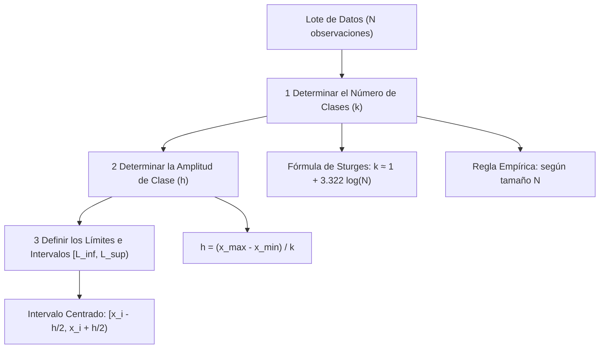
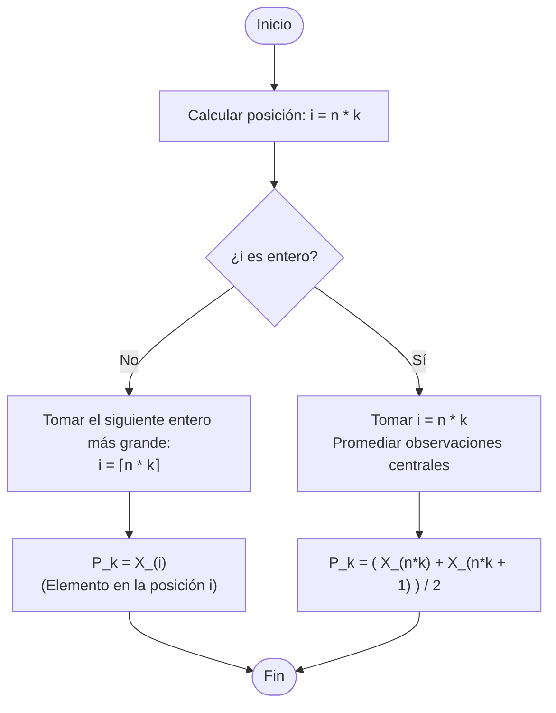

# Organización y Resumen de Datos Agrupados

Apunte elaborado a partir del material de cátedra de **Probabilidad y Estadística (FI-UNJu - Ing. Esp. Octavio Daniel Coro)**.

---

## 1. Justificación del Agrupamiento de Datos

En el procesamiento de datos univariados:
- **Datos Categóricos o Numéricos Discretos con pocos valores:** Se organizan directamente en tablas de frecuencias simples (sin agrupar).
- **Datos Numéricos Agrupados en Clases:** Conviene agrupar las observaciones en **clases o categorías** cuando:
  1. La variable es **cuantitativa continua** (toma infinitos valores en un intervalo real).
  2. La variable es **cuantitativa discreta con un rango amplio de valores posibles**.

> [!NOTE]
> **Objetivo del Agrupamiento:** Condensar la información y permitir una lectura visual e interpretativa clara de la distribución sin distorsionar su estructura subyacente.

---

## 2. Metodología para la Construcción de Intervalos de Clase

Para construir rigurosamente una tabla de frecuencias agrupadas se siguen tres etapas:



---

### 2.1 Paso 1: Determinación de la Cantidad de Clases ($k$)

Existen dos criterios orientativos principales:

#### A. Fórmula de Sturges
Si $N$ es el tamaño del conjunto de datos, se busca el número de intervalos $k$ que satisfaga la relación de potencias binomiales:

$$N \approx 2^{k-1}$$

Aplicando logaritmo en base 10:

$$k \approx 1 + \frac{\log_{10} N}{\log_{10} 2} \approx 1 + 3.322 \log_{10} N$$

$$k \approx 1 + 3.322 \log_{10} N$$
$$ 1 + 3.322 \log_{10} 768 = 10.59 \approx 11$$
*Regla:* Se redondea $k$ al entero más próximo.

#### B. Regla Empírica Orientativa
| Número de Observaciones ($N$) | Número de Clases Recomendadas ($k$) |
| :---: | :---: |
| **Menos de 25** | $5$ o $6$ clases |
| **$25$ a $50$** | $7$ a $14$ clases |
| **Más de $50$** | $15$ a $20$ clases |

---

### 2.2 Paso 2: Determinación de la Amplitud ($h$ o $c$) de cada Clase

La amplitud constante $h$ de cada intervalo se obtiene dividiendo el rango total por el número de clases elegidas:

$$h = \frac{\text{RANGO}}{k} = \frac{x_{\text{máximo}} - x_{\text{mínimo}}}{k}$$

*Nota:* Si el valor resultante no es exacto o cómodo para la lectura, se redondea hacia arriba a un valor con decimales convenientes.

---

### 2.3 Paso 3: Definición Formal de Intervalos y Marcas de Clase

Cada clase o categoría se define formalmente como un intervalo centrado en su **marca de clase ($x_i$)**:

$$\left[ x_i - \frac{h}{2}, \; x_i + \frac{h}{2} \right)$$

Donde:
- **Marca de clase ($x_i$ o $m_i$):** Es el **punto medio** del intervalo. Actúa como el valor numérico representativo de todos los datos que caen en esa clase:
  $$x_i = \frac{L_{\text{inf}} + L_{\text{sup}}}{2}$$
- **Límite inferior:** $L_{\text{inf}} = x_i - \frac{h}{2}$ (límite cerrado $[$, se incluye en el intervalo).
- **Límite superior:** $L_{\text{sup}} = x_i + \frac{h}{2}$ (límite abierto $)$, no se incluye, va hasta "menos de").
- **Criterio de pertenencia:** Un dato $v_j$ pertenece a la clase $i$ si y solo si:
  $$x_i - \frac{h}{2} \le v_j < x_i + \frac{h}{2}$$

---

### 2.4 Caso de Estudio de Cátedra: Contenido de Nicotina en 40 Cigarrillos

**Datos observados ($N = 40$ mediciones en mg):**
```
1.09, 1.92, 2.31, 1.79, 2.28, 1.74, 1.47, 1.97, 0.85, 1.24, 1.58, 2.03, 1.70, 2.17, 2.55, 2.11, 1.86, 1.90, 1.68
1.51, 1.64, 0.72, 1.69, 1.85, 1.82, 1.79, 2.46, 1.88, 2.08, 1.67, 1.37, 1.93, 1.40, 1.64, 2.09, 1.75, 1.63, 2.37
1.75, 1.69
```

1. **Valores extremos:** $x_{\min} = 0.72\text{ mg}$, $x_{\max} = 2.55\text{ mg}$.
2. **Cálculo de clases con Sturges:**
   $$k \approx 1 + 3.322 \log_{10}(40) = 1 + 3.322(1.602) \approx 6.322 \implies \mathbf{k = 7 \text{ clases}}$$
3. **Cálculo de la amplitud ($h$):**
   $$h = \frac{2.55 - 0.72}{7} = \frac{1.83}{7} \approx 0.261 \implies \mathbf{h \approx 0.30\text{ mg}}$$

#### Tabla de Distribución de Frecuencias Resultante:

| Contenido de Nicotina ($[L_i, L_{i+1})$ mg) | Marca de Clase ($x_i$) | N° Cigarrillos ($f_i$) | Proporción ($h_i = f_i/N$) | Porcentaje ($h_i\%$) |
| :---: | :---: | :---: | :---: | :---: |
| $[0.60, 0.90)$ | $0.75$ | $2$ | $0.050$ | $5.00\%$ |
| $[0.90, 1.20)$ | $1.05$ | $1$ | $0.025$ | $2.50\%$ |
| $[1.20, 1.50)$ | $1.35$ | $4$ | $0.100$ | $10.00\%$ |
| $[1.50, 1.80)$ | $1.65$ | $15$ | $0.375$ | $37.50\%$ |
| $[1.80, 2.10)$ | $1.95$ | $11$ | $0.275$ | $27.50\%$ |
| $[2.10, 2.40)$ | $2.25$ | $5$ | $0.125$ | $12.50\%$ |
| $[2.40, 2.70)$ | $2.55$ | $2$ | $0.050$ | $5.00\%$ |
| **Total** | — | **$N = 40$** | **$1.000$** | **$100.00\%$** |

---

## 3. Representaciones Gráficas de Datos Agrupados

### 3.1 Histograma (Karl Pearson)

Es un gráfico formado por una sucesión de rectángulos adyacentes:
- **Eje horizontal ($X$):** Representa los intervalos de clase (la base de cada rectángulo coincide con la amplitud del intervalo).
- **Eje vertical ($Y$):** Representa la frecuencia absoluta ($f_i$), relativa ($h_i$) o porcentual ($h_i\%$).
- **Principio de área:** La altura de cada barra se determina de modo que el **área del rectángulo sea proporcional a la frecuencia** de la clase.

#### Formas Típicas de Histogramas y sus Interpretaciones:
1. **Simétrica / Acampanada:** Típica en procesos de fabricación bajo control y mediciones estándar (ej. alturas de estudiantes, longitudes de piezas).
2. **Asimétrica Positiva (Sesgada a la derecha):** Frecuente en variables económicas (renta familiar, salarios, facturación, consumo de electricidad) y en fiabilidad técnica (tiempos entre averías, accidentes, colas de espera).
3. **Bimodal / Multimodal:** Ocurre cuando la muestra proviene de una **mezcla de dos o más poblaciones distintas** (ej. mezclar piezas de dos turnos de producción o dos proveedores diferentes).
4. **Truncada:** Presenta un corte abrupto en una de sus colas; ocurre típicamente tras un proceso de **control de calidad** donde se descartan piezas fuera de los límites de tolerancia $A$ y $B$.

---

### 3.2 Histograma con Intervalos de Distinto Ancho (Histograma de Densidad)

Cuando los datos presentan colas muy extendidas con valores dispersos, utilizar intervalos de igual ancho obligaría a crear muchas clases vacías ($f_i = 0$). En tales casos se emplean **intervalos de amplitudes desiguales**.

#### Fórmula de la Altura del Rectángulo (Escala de Densidad):
Para no distorsionar la representación visual, la altura de cada barra no es la frecuencia directa, sino la **densidad de frecuencia**:

$$\text{Densidad}_i = \text{Altura del Rectángulo} = \frac{\text{Frecuencia Relativa de la Clase } (h_i)}{\text{Ancho del Intervalo de Clase } (c_i)} = \frac{f_i / N}{c_i}$$

> [!IMPORTANT]
> **Propiedad Fundamental del Histograma de Densidad:**
> El **área total sumada de todos los rectángulos es exactamente igual a 1** (o $100\%$ si se usa frecuencia porcentual):
> 
> $$\text{Área Total} = \sum_{i=1}^{k} (\text{Base}_i \times \text{Altura}_i) = \sum_{i=1}^{k} \left( c_i \times \frac{h_i}{c_i} \right) = \sum_{i=1}^{k} h_i = 1.0$$

---

#### Caso de Cátedra: Ciclos de Tensión a la Ruptura ($N = 100$ muestras de hilo)

| Intervalo de Clase ($[L_i, L_{i+1})$) | Ancho ($c_i$) | Frecuencia ($f_i$) | Frecuencia Relativa ($h_i$) | Densidad ($\text{Altura} = h_i / c_i$) |
| :---: | :---: | :---: | :---: | :---: |
| $[0, 50)$ | $50$ | $8$ | $0.08$ | $\frac{0.08}{50} = \mathbf{0.0016}$ |
| $[50, 100)$ | $50$ | $13$ | $0.13$ | $\frac{0.13}{50} = \mathbf{0.0026}$ |
| $[100, 150)$ | $50$ | $11$ | $0.11$ | $\frac{0.11}{50} = \mathbf{0.0022}$ |
| $[150, 200)$ | $50$ | $21$ | $0.21$ | $\frac{0.21}{50} = \mathbf{0.0042}$ |
| $[200, 300)$ | $\mathbf{100}$ | $26$ | $0.26$ | $\frac{0.26}{100} = \mathbf{0.0026}$ |
| $[300, 400)$ | $\mathbf{100}$ | $12$ | $0.12$ | $\frac{0.12}{100} = \mathbf{0.0012}$ |
| $[400, 500)$ | $\mathbf{100}$ | $4$ | $0.04$ | $\frac{0.04}{100} = \mathbf{0.0004}$ |
| $[500, 600)$ | $\mathbf{100}$ | $3$ | $0.03$ | $\frac{0.03}{100} = \mathbf{0.0003}$ |
| $[600, 900)$ | $\mathbf{300}$ | $2$ | $0.02$ | $\frac{0.02}{300} \approx \mathbf{0.0001}$ |
| **Total** | — | **$100$** | **$1.00$** | — |

---


---

### 3.4 Distribuciones Acumuladas y Ojiva ("Menor que")

Para construir una ojiva o tabla de frecuencias acumuladas:
1. Se añade una clase previa con límite inferior inicial y porcentaje acumulado $0\%$.
2. Se evalúa el porcentaje de datos que son **estrictamente menores que el límite superior** de cada clase.
3. Se grafican los puntos $(L_{\text{sup}}, \% \text{ Acumulado})$ y se unen de forma creciente monótona hasta alcanzar el $100\%$.

#### Tabla de Nicotina en formato "Menor que":
| Contenido de Nicotina      | Porcentaje Acumulado de Cigarrillos |
| :------------------------- | :---------------------------------: |
| Menor que $0.60\text{ mg}$ |               $0.0\%$               |
| Menor que $0.90\text{ mg}$ |               $5.0\%$               |
| Menor que $1.20\text{ mg}$ |               $7.5\%$               |
| Menor que $1.50\text{ mg}$ |              $17.5\%$               |
| Menor que $1.80\text{ mg}$ |              $55.0\%$               |
| Menor que $2.10\text{ mg}$ |              $82.5\%$               |
| Menor que $2.40\text{ mg}$ |              $95.0\%$               |
| Menor que $2.70\text{ mg}$ |              $100.0\%$              |

---

### 3.5 Diagrama de Pareto (Principio 80/20)

Es una herramienta de control de calidad que combina un **gráfico de barras (frecuencia relativa %)** con un **gráfico de líneas (frecuencia % acumulada)**.

#### Pasos para su Construcción:
1. Organizar los datos en una tabla de distribución de frecuencias categórica.
2. **Ordenar las categorías de mayor a menor frecuencia absoluta** (orden descendente).
3. Calcular la frecuencia relativa porcentual ($h_i\%$) y la frecuencia acumulada ($H_i\%$).
4. Graficar en barras la frecuencia porcentual individual.
5. Superponer la línea de porcentaje acumulado sobre un eje secundario.
6. **Interpretación 80/20:** Identificar las primeras 2 a 4 categorías ("los pocos vitales") que concentran entre el **$70\%$ y el $80\%$ del impacto total**.

#### Caso de Cátedra: Causas de Reclamos de Clientes
| Causa del Reclamo | Frecuencia Relativa % | Frecuencia % Acumulada |
| :--- | :---: | :---: |
| **Calidad del Trabajo** | $49.60\%$ | $49.60\%$ |
| **Calidad Atención al Cliente** | $17.00\%$ | $66.60\%$ |
| **Plazos de Entrega** | $15.80\%$ | $\mathbf{82.40\%}$ |
| **Precio** | $10.40\%$ | $92.80\%$ |
| **Producto** | $3.80\%$ | $96.60\%$ |
| **Otros** | $3.40\%$ | $100.00\%$ |

> [!TIP]
> **Conclusión de Pareto:** Resolviendo únicamente las 3 primeras causas (Calidad de trabajo, Atención y Plazos), se soluciona más del **$82\%$ de los reclamos totales**.

---

## 4. Cálculo de Deciles, Cuartiles y Percentiles (Algoritmo de Cátedra)

### 4.1 Definición Formal
El **$100k$-ésimo percentil ($P_k$)** es el valor tal que:
- Al menos el **$100k\%$** de las observaciones son $\le P_k$.
- Al menos el **$100(1-k)\%$** de las observaciones son $\ge P_k$.
- *Casos particulares:* Cuartiles ($k = 0.25, 0.50, 0.75$), Deciles ($k = 0.1, 0.2\dots, 0.9$).

---

### 4.2 Diagrama de Flujo del Algoritmo Oficial

Dado un conjunto de datos **ordenado de menor a mayor** $X_{(1)}, X_{(2)}, \dots, X_{(n)}$:



---

### 4.3 Método Práctico para el Cálculo de Cuartiles ($Q_1, Q_2, Q_3$)

1. **Ordenar la muestra:** $X_{(1)} \le X_{(2)} \le \dots \le X_{(n)}$.
2. **Cálculo de $Q_1$ (Primer Cuartil):**
   - Se calcula la posición:
     $$i = \frac{\left\lfloor \frac{n+1}{2} \right\rfloor + 1}{2}$$
   - Si $i$ es entero $\implies Q_1 = X_{(i)}$.
   - Si $i$ es decimal $\implies Q_1 = \frac{X_{(i)} + X_{(i+1)}}{2}$.
3. **Cálculo de $Q_2$ (Segundo Cuartil / Mediana $\tilde{X}$):**
   $$\tilde{X} = \begin{cases} X_{\left(\frac{n+1}{2}\right)} & \text{si } n \text{ es impar} \\ \frac{X_{\left(\frac{n}{2}\right)} + X_{\left(\frac{n}{2}+1\right)}}{2} & \text{si } n \text{ es par} \end{cases}$$
4. **Cálculo de $Q_3$ (Tercer Cuartil):**
   - Se calcula como el valor en la misma posición $i$ de $Q_1$, pero **contando en sentido inverso desde el último dato hacia atrás**.

> [!WARNING]
> **Importante:** No confundir el valor del índice de **posición ($i$)** con el valor numérico del dato observado **$X_i$**.

---

### 4.4 Ejemplo de Cátedra: Estaturas de 60 Personas

**Muestra ordenada ($n = 60$ estaturas en cm):**
```
161, 161, 162, 162, 165, 165, 165, 165, 165, 165, 166, 166, 168, 168, 169
169, 169, 169, 169, 169, 170, 170, 170, 170, 170, 170, 170, 171, 171, 171
171, 171, 171, 171, 171, 172, 172, 172, 172, 172, 172, 172, 175, 175, 175
175, 176, 176, 177, 177, 178, 180, 180, 181, 181, 185, 185, 185, 189, 189
```

- **Cálculo de $Q_2$ (Mediana):**
  $$i = \frac{60 + 1}{2} = 30.5 \implies Q_2 = \frac{X_{(30)} + X_{(31)}}{2} = \frac{171 + 171}{2} = \mathbf{171\text{ cm}}$$

- **Cálculo de $Q_1$:**
  $$i = \frac{\left\lfloor \frac{60+1}{2} \right\rfloor + 1}{2} = \frac{30 + 1}{2} = 15.5 \implies Q_1 = \frac{X_{(15)} + X_{(16)}}{2} = \frac{169 + 169}{2} = \mathbf{169\text{ cm}}$$

- **Cálculo de $Q_3$:**
  Promedio de las posiciones $15$ y $16$ contando desde el final ($X_{(45)}$ y $X_{(46)}$):
  $$Q_3 = \frac{175 + 175}{2} = \mathbf{175\text{ cm}}$$

---

## 5. Implementación en Python

```python
import numpy as np
import pandas as pd
import matplotlib.pyplot as plt

# 1. Regla de Sturges y construcción de intervalos
datos = np.array([
    1.09, 1.92, 2.31, 1.79, 2.28, 1.74, 1.47, 1.97, 0.85, 1.24, 
    1.58, 2.03, 1.70, 2.17, 2.55, 2.11, 1.86, 1.90, 1.68, 1.51, 
    1.64, 0.72, 1.69, 1.85, 1.82, 1.79, 2.46, 1.88, 2.08, 1.67, 
    1.37, 1.93, 1.40, 1.64, 2.09, 1.75, 1.63, 2.37, 1.75, 1.69
])
N = len(datos)

# Sturges
k = int(np.round(1 + 3.322 * np.log10(N)))
rango = datos.max() - datos.min()
h = np.round(rango / k, 2)

print(f"Tamaño muestra N : {N}")
print(f"Clases (Sturges) : k = {k}")
print(f"Amplitud de clase: h = {h}")

# 2. Algoritmo de Cátedra para Percentiles
def percentil_catedra(data, k_pct):
    data_ord = np.sort(data)
    n = len(data_ord)
    pos = n * k_pct
    if pos.is_integer():
        idx = int(pos)
        return (data_ord[idx - 1] + data_ord[idx]) / 2.0
    else:
        idx = int(np.ceil(pos))
        return data_ord[idx - 1]

print("\n=== Cuartiles según algoritmo de cátedra ===")
print(f"Q1 (P_0.25): {percentil_catedra(datos, 0.25):.2f}")
print(f"Q2 (Mediana): {percentil_catedra(datos, 0.50):.2f}")
print(f"Q3 (P_0.75): {percentil_catedra(datos, 0.75):.2f}")
```

---

## 🔗 Temas Relacionados

- **[[Materias/Probabilidad y Estadistica/Estadística/Estadística Descriptiva/Distribución de Frecuencias|Distribución de Frecuencias y Tablas de Contingencia]]**: Conceptos de frecuencias absolutas, relativas y acumuladas.
- **[[Materias/Probabilidad y Estadistica/Estadística/Estadística Descriptiva/Conceptos|Conceptos y Medidas de Tendencia Central y Dispersión]]**: Fórmulas de media, mediana, moda, varianza y desviación estándar.
- **[[Materias/Probabilidad y Estadistica/Estadística/Estadística Descriptiva/Graficas|Gráficas Estadísticas]]**: Representaciones visuales adicionales.
