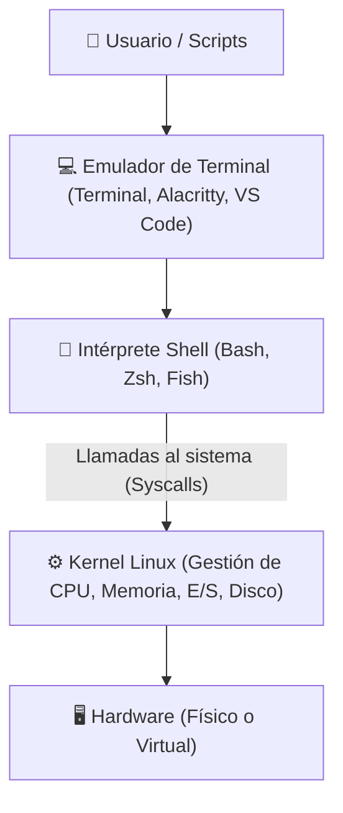

# Bash (Bourne Again Shell)

**Bash** (*Bourne Again Shell*) es el intérprete de comandos (*shell*) y lenguaje de scripting predeterminado en la inmensa mayoría de las distribuciones de GNU/Linux y entornos UNIX (incluido WSL en Windows y versiones previas de macOS). Fue desarrollado por Brian Fox para el proyecto GNU en 1989 como un reemplazo libre y mejorado del clásico Bourne Shell (`sh`).

---

## 1. ¿Qué es una Shell y cómo se comunica con el Sistema Operativo?

La **Shell** actúa como una interfaz o capa intermedia entre el usuario (o programas de usuario) y el **Kernel** (núcleo del sistema operativo).

### Funciones Principales de Bash:
1. **Modo Interactivo (CLI):** Lee comandos escritos por el usuario en la línea de comandos, los analiza sintácticamente (*parsing*), los ejecuta y devuelve los resultados estándar o de error.
2. **Modo No Interactivo (Scripting):** Ejecuta secuencias de comandos almacenadas en archivos de texto (`.sh`), permitiendo automatizar tareas de administración, despliegues, procesamiento por lotes y pruebas.
3. **Control de Flujos y Entorno:** Administra variables de entorno, tuberías (*pipes*), redirecciones de entrada/salida y el ciclo de vida de los procesos.

---

## 2. Características Fundamentales de Bash

- **Compatibilidad POSIX:** Totalmente compatible con los estándares de scripting del Bourne Shell tradicional (`sh`).
- **Autocompletado Inteligente:** Uso de la tecla `Tab` para autocompletar nombres de archivos, comandos y rutas.
- **Historial de Comandos:** Navegación por comandos anteriores con las flechas `↑`/`↓` y búsqueda inversa con `Ctrl + R`.
- **Expansión y Sustitución:** Soporta expansión de llaves (`{1..10}`), comodines (*globbing* como `*.txt`), sustitución de comandos (`$(date)`) y operaciones aritméticas (`$((2 + 2))`).
- **Control de Trabajos (*Job Control*):** Capacidad de enviar procesos a segundo plano (`&`), pausarlos (`Ctrl + Z`) y reanudarlos (`fg` / `bg`).

---

## 3. Atajos de Teclado Esenciales en la Terminal

| Atajo | Acción |
| :--- | :--- |
| **`Tab`** | Autocompletar comando o nombre de archivo/carpeta |
| **`Tab + Tab`** | Mostrar todas las opciones posibles de autocompletado |
| **`Ctrl + C`** | Enviar señal `SIGINT` (interrumpe y cancela el comando en ejecución) |
| **`Ctrl + Z`** | Enviar señal `SIGTSTP` (pausa el proceso y lo manda a segundo plano) |
| **`Ctrl + L`** | Limpiar la pantalla de la terminal (equivalente a `clear`) |
| **`Ctrl + R`** | Búsqueda interactiva en el historial de comandos pasados |
| **`Ctrl + A`** | Mover el cursor al **inicio** de la línea |
| **`Ctrl + E`** | Mover el cursor al **final** de la línea |
| **`Ctrl + U`** | Borrar desde el cursor hasta el inicio de la línea |
| **`Ctrl + K`** | Borrar desde el cursor hasta el final de la línea |
| **`Ctrl + W`** | Borrar la palabra anterior al cursor |
| **`Ctrl + D`** | Cerrar la sesión actual de la terminal (equivalente a `exit`) |

---

## 📚 Índice Temático de Notas de Bash

A continuación se organizan los apuntes y comandos agrupados por su temática específica:

### 📁 [[Navegación y Archivos]]
- Sistema de archivos jerárquico de Linux y rutas absolutas vs relativas.
- Comandos de navegación e inspección: `pwd`, `cd`, `ls` (con parámetros), `tree`.
- Creación, copia, movimiento y eliminación: `mkdir -p`, `touch`, `cp -r`, `mv`, `rm -rf`.
- Búsqueda avanzada de archivos con `find` y enlaces simbólicos/duros (`ln -s`).

### 📝 [[Procesamiento de Texto]]
- Visualización: `cat`, `tac`, `head`, `tail` (y monitoreo en vivo con `tail -f`), paginadores `less`/`more`.
- Filtrado y búsqueda por patrones: `grep` (recursivo, insensible, invertido y regex).
- Estadísticas y ordenamiento: `wc`, `sort`, `uniq`, `cut`, `tr`.
- Manipulación avanzada con expresiones regulares: editores de flujo `sed` y lenguaje `awk`.
- Editores de terminal: `nano` y `vim`.

### 🔒 [[Permisos y Usuarios]]
- Estructura de permisos en Linux: Propietario (*User*), Grupo (*Group*), Otros (*Others*).
- Modos de lectura (`r`), escritura (`w`) y ejecución (`x`).
- Notación numérica/octal (`chmod 755`, `chmod 644`) y notación simbólica (`chmod +x`).
- Gestión de propiedad: `chown`, `chgrp`, `umask`.
- Elevación de privilegios e identidad: `sudo`, `su`, `whoami`, `id`, `passwd`.

### ⚙️ [[Procesos y Monitoreo]]
- Ciclo de vida y estados de un proceso (PID, PPID).
- Monitoreo en tiempo real y listados: `ps aux`, `top`, `htop`.
- Señales y terminación de programas: `kill` (`-9`, `-15`), `killall`, `pkill`.
- Gestión de trabajos en segundo plano: `&`, `jobs`, `fg`, `bg`, `nohup`.
- Control de servicios con `systemctl` y uso de recursos del sistema: `df -h`, `du -sh`, `free -h`, `uptime`.

### 🔀 [[Redirecciones y Tuberías]]
- Canales estándar: Entrada estándar (`stdin`), Salida estándar (`stdout`) y Error estándar (`stderr`).
- Operadores de redirección: `>`, `>>`, `<`, `2>`, `2>&1`, `&>`, `/dev/null`.
- Encadenamiento de comandos con Tuberías (*Pipes* `|`).
- Variables de entorno (`$PATH`, `$HOME`, `$USER`, `$SHELL`), comando `export` y creación de `alias`.

### 📜 [[Shell Scripting]]
- Anatomía de un script en Bash y el Shebang (`#!/bin/bash`).
- Variables, sustitución de comandos `$(...)` y operaciones aritméticas `$((...))`.
- Argumentos y parámetros posicionales (`$1`, `$@`, `$#`, `$?`).
- Estructuras de control de flujo: condicionales `if / elif / else` y bucles `for` y `while`.
- Definición de funciones modulares y buenas prácticas de automatización.

### ⚡ [[Comandos Frecuentes]]
- Hoja de trucos (*Cheat Sheet*) consolidada con los comandos más usados en el día a día.

---

## 🧭 Navegación Global
- Volver a la materia: **[[Materias/SOII/WSL|Sistemas Operativos II]]**
- Volver al panel principal: **[[Index|Índice de la Facultad]]**
