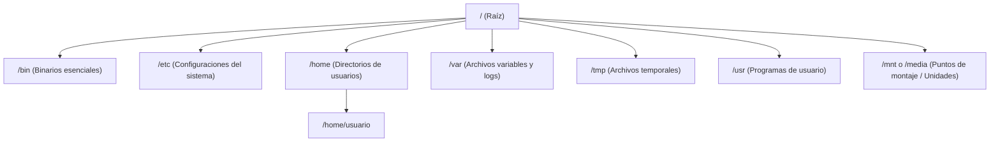

# Navegación y Gestión de Archivos y Directorios

En Linux y sistemas tipo UNIX, todo el almacenamiento se organiza bajo un único árbol jerárquico que comienza en la raíz (**`/`**). A diferencia de Windows, no existen letras de unidad como `C:` o `D:`.



---

## 1. Rutas Absolutas vs. Rutas Relativas

- **Ruta Absoluta:** Comienza siempre desde la raíz `/` y especifica el camino completo sin importar en qué carpeta te encuentres.
  - *Ejemplo:* `/home/usuario/Documentos/Facultad/apuntes.txt`
- **Ruta Relativa:** Comienza desde el directorio de trabajo actual.
  - `.` representa el directorio actual.
  - `..` representa el directorio padre (un nivel arriba).
  - `~` representa el directorio personal del usuario (*home*).
  - *Ejemplo:* `../WSL.md`

---

## 2. Navegación e Inspección de Directorios

### `pwd` (Print Working Directory)
Muestra la ruta absoluta del directorio donde estás posicionado.
```bash
pwd
# Salida: /home/usuario/Facultad
```

### `cd` (Change Directory)
Permite moverse entre diferentes directorios del sistema.
```bash
# Ir a una ruta específica
cd /var/log

# Ir al directorio personal (Home) del usuario
cd ~
# o simplemente:
cd

# Subir un nivel al directorio padre
cd ..

# Subir dos niveles
cd ../..

# Volver al directorio anterior en el que estabas
cd -
```

### `ls` (List)
Lista el contenido (archivos y subdirectorios) de una carpeta.
```bash
# Listado simple
ls

# Listado largo y detallado (permisos, propietario, tamaño, fecha de modificación)
ls -l

# Listar TODOS los archivos, incluyendo los ocultos (que inician con .)
ls -a

# Listado detallado con tamaños legibles por humanos (KB, MB, GB)
ls -lh

# Ordenar por fecha de modificación (los más recientes primero)
ls -lt

# Listado recursivo (muestra todo el árbol de subdirectorios)
ls -R

# Combinación más utilizada en el día a día:
ls -lah
```

### `tree` (Árbol visual de directorios)
Muestra la estructura de carpetas de forma gráfica en árbol.
```bash
# Ver árbol completo del directorio actual
tree

# Limitar la profundidad a 2 niveles
tree -L 2

# Mostrar solo directorios (ocultar archivos)
tree -d
```

---

## 3. Creación y Edición Básica de Archivos

### `mkdir` (Make Directory)
Crea uno o varios directorios nuevos.
```bash
# Crear una carpeta
mkdir proyectos
# Crear varias carpetas
mkdir carpeta1 carpeta2 carpeta3
# Crear varias carpetas en rango dinamico
mkdir carpeta{1...5} # carpeta1 carpeta2 ... carpeta5
# Crear una carpeta con subcarpetas
mkdir -p proyecto/{css, html, js}

# Crear una jerarquía completa de carpetas anidadas de un solo paso (-p = parents)
mkdir -p Facultad/SOII/BASH

```

### `touch`
Crea archivos vacíos o actualiza la fecha/hora de modificación si el archivo ya existe.
```bash
# Crear un archivo vacío
touch notas.txt

# Crear múltiples archivos a la vez
touch script1.sh script2.sh config.json


```
### `echo` 
Imprime texto en pantalla y edición muy básica de archivos 
```bash
echo "Hola mundo"
# Imprime sin salgo de linea
# whoami: imprime el nombre del usuario del SO
echo -n "Hola" ; whoami

# Comando sustitución
echo "Usuario: $(whoami)"

# Sobrescribir o crear desde cero:
echo "Texto nuevo" > archivo.txt
    
# Añadir texto al final (sin borrar lo anterior):    
echo "Otra línea más" >> archivo.txt
```
---

## 4. Copiar, Mover y Eliminar

### `cp` (Copy)
Copia archivos y directorios de un origen a un destino.
```bash
# Copiar un archivo a otro nombre o ubicación
cp archivo.txt copia_archivo.txt
cp archivo.txt /tmp/

# Copiar una CARPETA completa de forma recursiva (-r / -R)
cp -r carpeta_origen/ carpeta_destino/

# Copiar preservando permisos, fechas y atributos (-p)
cp -rp carpeta_origen/ backup_carpeta/

# Modo interactivo (-i): pide confirmación antes de sobrescribir
cp -i archivo.txt destino.txt
```

### `mv` (Move / Rename)
Mueve archivos/directorios de ubicación o los renombra.
```bash
# Renombrar un archivo
mv nombre_viejo.txt nombre_nuevo.txt

# Mover un archivo a otra carpeta
mv reporte.pdf ~/Documentos/

# Mover y renombrar al mismo tiempo
mv temp.txt /var/log/app_final.log
```

### `rm` (Remove)
Elimina archivos y directorios de forma permanente (no van a la papelera).

> [!CAUTION]
> El comando `rm` en Linux no tiene marcha atrás ni papelera de reciclaje. Úsalo con extrema precaución.

```bash
# Eliminar un archivo
rm archivo.txt

# Eliminar múltiples archivos
rm archivo1.txt archivo2.txt

# Eliminar una carpeta y TODO su contenido recursivamente (-r)
rm -r carpeta_a_borrar/

# Forzar eliminación sin pedir confirmación (-f = force)
rm -rf carpeta_a_borrar/

# Modo interactivo (-i): pregunta confirmación para cada archivo
rm -i *.log
```

---

## 5. Búsqueda de Archivos: `find`

El comando `find` busca archivos y directorios en tiempo real en función de criterios como nombre, tipo, tamaño o fecha. Para la guía exhaustiva con todas las pruebas, operadores lógicos y acciones avanzadas, consulta el **[[find|Manual Completo y de Referencia de GNU Find]]**.

```bash
# Buscar archivos por nombre exacto en el directorio actual y subcarpetas
find . -name "index.html"

# Buscar sin distinguir mayúsculas de minúsculas (-iname)
find . -iname "*.pdf"

# Buscar solo directorios (-type d)
find /home/usuario -type d -name "proyectos"

# Buscar solo archivos (-type f) mayores a 100 MB
find /var/log -type f -size +100M

# Buscar archivos modificados en los últimos 7 días
find . -type f -mtime -7

# Buscar y ejecutar una acción (ej. borrar todos los archivos temporales .tmp)
find . -name "*.tmp" -exec rm -f {} +
```

---

## 6. Enlaces: Duros vs. Simbólicos (`ln`)

Los enlaces son referencias a archivos en el sistema de archivos:

```bash
# Crear un enlace simbólico (Soft link / Acceso directo) -> Recomendado
ln -s /ruta/al/archivo_original.sh enlace_acceso_directo.sh

# Crear un enlace duro (Hard link) -> Mismo inodo en disco
ln archivo_original.txt enlace_duro.txt
```

| Tipo | ¿Qué es? | Si se borra el original... |
| :--- | :--- | :--- |
| **Simbólico (`ln -s`)** | Puntero a la ruta del archivo original. | El enlace queda roto (*broken symlink*). |
| **Duro (`ln`)** | Puntero directo al bloque de datos (inodo) en disco. | Los datos siguen existiendo accesibles desde el enlace. |

---

## 🧭 Navegación entre Notas

- Siguiente nota: **[[Procesamiento de Texto]]**
- Volver al índice general de BASH: **[[Index|Índice de BASH]]**
