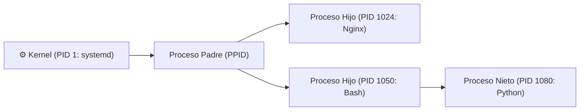

# Procesos, Servicios y Monitoreo del Sistema

Un **proceso** es cualquier programa o comando en ejecución en el sistema. Cada proceso posee un identificador numérico único llamado **PID (*Process ID*)**, un proceso padre (**PPID**) y recursos asignados (CPU, memoria RAM y descriptores de archivo).

---

## 1. Inspección de Procesos



### `ps` (Process Status)
Muestra una instantánea estática de los procesos actuales.

```bash
# Ver todos los procesos del sistema con detalles completos (Estilo BSD - El más usado)
ps aux

# Salida típica de ps aux:
# USER       PID  %CPU %MEM    VSZ   RSS TTY      STAT START   TIME COMMAND
# root         1   0.0  0.1 168920 12040 ?        Ss   07:00   0:01 /sbin/init
# juan      1420   1.5  2.4 892300 95400 pts/0    S+   07:15   0:05 python app.py

# Ver formato estándar UNIX con PPID (proceso padre)
ps -ef

# Filtrar procesos específicos combinando con grep
ps aux | grep "nginx"
```

### `top` y `htop` (Monitores interactivos en tiempo real)
Permiten observar el consumo de CPU y memoria actualizado segundo a segundo.

```bash
# Monitor estándar integrado
top

# Monitor interactivo visual mejorado con barras de colores y uso de mouse
htop
```
- **Atajos útiles dentro de `top` / `htop`:**
  - `q`: Salir.
  - `k`: Matar un proceso indicando su PID.
  - `M` / `P`: Ordenar por uso de Memoria o de CPU.

---

## 2. Terminar Procesos: Señales y `kill`

Para detener o forzar el cierre de un proceso se le envían **señales del sistema**:

| Señal | Número | Nombre | Efecto |
| :---: | :---: | :---: | :--- |
| **SIGTERM** | `15` *(defecto)* | Terminación elegante | Solicita al programa que guarde estado, libere recursos y se cierre limpiamente. |
| **SIGKILL** | `9` | Forzar muerte inmediata | El Kernel destruye el proceso al instante. No puede ser interceptado ni ignorado. |
| **SIGHUP** | `1` | Recarga de configuración | Informa al proceso que relea sus archivos de configuración sin reiniciarse. |

```bash
# Enviar señal de cierre elegante (SIGTERM 15) por su PID
kill 1420

# Forzar el cierre inmediato e irreversible (SIGKILL 9)
kill -9 1420

# Matar todos los procesos que coincidan con un nombre exacto
killall node

# Matar procesos buscando por expresión o coincidencia parcial de nombre
pkill -f "python.*server"
```

---

## 3. Control de Trabajos en Segundo Plano (*Job Control*)

Permite ejecutar comandos largos sin bloquear la terminal.

```bash
# 1. Ejecutar un comando directamente en segundo plano (añadir & al final)
python backup_grande.py &
# Salida: [1] 5432 (Job ID 1, PID 5432)

# 2. Ver la lista de trabajos en segundo plano en la terminal actual
jobs -l

# 3. Pausar un comando que está corriendo en primer plano
# Presiona: Ctrl + Z

# 4. Reanudar el trabajo pausado en SEGUNDO plano
bg %1

# 5. Traer el trabajo de vuelta a PRIMER plano
fg %1

# 6. Ejecutar un proceso inmune a desconexiones (si cierras la terminal o SSH sigue vivo)
nohup python app.py > salida.log 2>&1 &
```

---

## 4. Gestión de Servicios del Sistema: `systemctl`

En distribuciones modernas basadas en **systemd** (Ubuntu, Debian, RedHat, Arch):

```bash
# Ver el estado de un servicio (si está activo, caído, logs recientes)
systemctl status nginx

# Iniciar o detener un servicio
sudo systemctl start docker
sudo systemctl stop docker

# Reiniciar un servicio
sudo systemctl restart postgresql

# Recargar configuración sin cortar conexiones activas
sudo systemctl reload nginx

# Habilitar un servicio para que inicie automáticamente al encender el equipo
sudo systemctl enable docker

# Deshabilitar inicio automático
sudo systemctl disable docker
```

---

## 5. Monitoreo de Almacenamiento y Recursos de Hardware

### `df` (Disk Free - Espacio en particiones)
```bash
# Ver uso de disco en todas las particiones en formato legible (GB, MB)
df -h
```

### `du` (Disk Usage - Tamaño de carpetas y archivos)
```bash
# Ver tamaño total de la carpeta actual y de cada elemento dentro
du -sh *

# Ver las 10 carpetas o archivos que más pesan
du -ah . | sort -rh | head -n 10
```

### `free` (Memoria RAM y Swap)
```bash
# Ver consumo de RAM y memoria de intercambio (Swap)
free -h
```

### `uptime` (Tiempo de actividad y Carga)
```bash
# Muestra cuánto tiempo lleva encendido el sistema y el promedio de carga (Load Average a 1, 5 y 15 min)
uptime
```

---

## 🧭 Navegación entre Notas

- Nota anterior: **[[Permisos y Usuarios]]**
- Siguiente nota: **[[Redirecciones y Tuberías]]**
- Volver al índice general de BASH: **[[Index|Índice de BASH]]**
