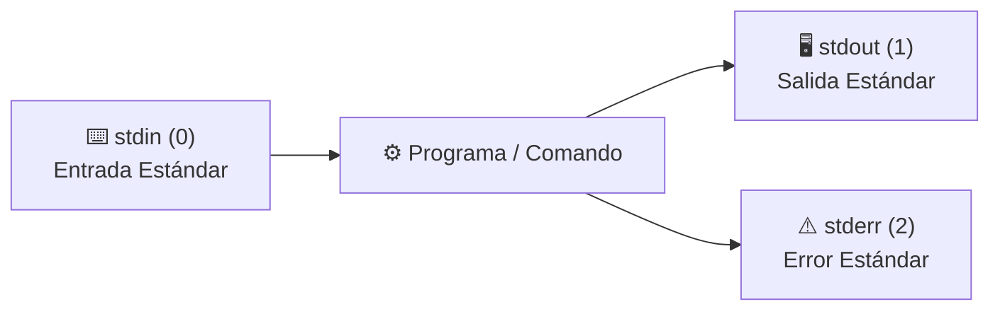

# Redirecciones, Tuberías (Pipes) y Variables

Uno de los principios de diseño más influyentes de UNIX es:  
> *"Escribe programas que hagan una sola cosa y la hagan bien. Escribe programas que trabajen juntos. Escribe programas que manejen flujos de texto, porque esa es una interfaz universal."*

En Bash, esto se logra mediante **los canales estándar, las redirecciones y las tuberías (*pipes*)**.

---

## 1. Los Tres Canales Estándar (Descriptores de Archivo)

Cada comando ejecutado en Bash dispone de tres flujos de datos abiertos por defecto:



| Descriptor | Nombre | Canal | Origen / Destino por defecto |
| :---: | :--- | :---: | :--- |
| **`0`** | `stdin` | Entrada estándar | El teclado |
| **`1`** | `stdout` | Salida estándar | La pantalla de la terminal |
| **`2`** | `stderr` | Error estándar | La pantalla de la terminal (mensajes de fallo) |

---

## 2. Operadores de Redirección

Permiten desviar la entrada o salida de un programa hacia o desde un archivo en disco.

```bash
# 1. Sobreescribir salida estándar a un archivo (>)
# Si el archivo existe, borra su contenido anterior
ls -la > listado.txt

# 2. Añadir/Adjuntar salida estándar al final del archivo (>>)
# Conserva lo que ya estaba escrito
echo "Nueva línea de registro" >> app.log

# 3. Redirigir la entrada estándar desde un archivo (<)
sort < lista_desordenada.txt

# 4. Redirigir únicamente los errores (2>)
# Guarda solo los mensajes de error en un log separado
python script.py 2> errores.log

# 5. Redirigir tanto stdout como stderr al mismo archivo (&> o 2>&1)
./despliegue.sh &> salida_completa.log
# (Sintaxis clásica equivalente)
./despliegue.sh > salida_completa.log 2>&1

# 6. Silenciar completamente la salida enviándola al "agujero negro" (/dev/null)
rm -rf temp/ > /dev/null 2>&1
```

---

## 3. Tuberías (*Pipes* `|`): Conexión entre Comandos

El operador de tubería (**`|`**) conecta la **salida estándar (`stdout`)** del comando de la izquierda directamente con la **entrada estándar (`stdin`)** del comando de la derecha.


### Ejemplos Prácticos de Tuberías:

```bash
# Filtra las columnas con ERROR, corta por la segunda columna de cada registro, las ordena alfabeticamente y las guarda en error.txt
grep "ERROR"  datos/servidores.log | cut -d " " -f 2 | sort -u > soluciones/ips_con_error.txt

# Contar cuántos archivos hay en una carpeta
ls -1 | wc -l

# Buscar si un paquete específico está instalado
dpkg -l | grep -i "python"

# Ver los 5 procesos que más memoria consumen
ps aux --sort=-%mem | head -n 6

# Inspeccionar la salida de un comando largo cómodamente con paginador
dmesg | less
```

### El comando `tee` (Bifurcador de salida)
Permite enviar la salida a la pantalla **y simultáneamente** guardarla en un archivo:
```bash
# Muestra el resultado en terminal y lo guarda en salida.txt
echo "Compilación exitosa" | tee salida.txt

# Añadir al final (-a = append) con permisos de superusuario
echo "deb http://repo.ejemplo.com/ stable main" | sudo tee -a /etc/apt/sources.list
```

---

## 4. Variables de Entorno y del Sistema

Las variables almacenan valores globales a los que pueden acceder la shell y todos sus programas secundarios.

### Variables Comunes Predefinidas:

| Variable | Descripción | Ejemplo de valor |
| :--- | :--- | :--- |
| **`$HOME`** | Ruta del directorio personal del usuario | `/home/juan` |
| **`$USER`** | Nombre del usuario logueado | `juan` |
| **`$SHELL`** | Intérprete de shell en uso | `/bin/bash` |
| **`$PWD`** | Directorio actual de trabajo | `/home/juan/proyectos` |
| **`$PATH`** | Lista de directorios donde el sistema busca ejecutables | `/usr/local/bin:/usr/bin:/bin` |
| **`$?`** | Código de salida del último comando (`0` = éxito) | `0` |

### Definir y Exportar Variables:

```bash
# 1. Variable local (solo vive en la sesión actual de la terminal)
MI_VARIABLE="Hola Mundo"
echo $MI_VARIABLE

# 2. Exportar variable (hacerla disponible para todos los subprocesos y scripts)
export DB_HOST="localhost"
export PORT=3000

# 3. Agregar un directorio personalizado al $PATH
export PATH="$HOME/mi-software/bin:$PATH"
```

---

## 5. Aliases y Configuración Permanente (`~/.bashrc`)

Los **aliases** son atajos para no tener que escribir comandos largos repetidamente.

```bash
# Crear un alias temporal en la sesión actual
alias ll="ls -lah --color=auto"
alias gs="git status"
alias update="sudo apt update && sudo apt upgrade -y"
```

### Hacer configuraciones permanentes:
Para que las variables exportadas y los aliases persistan al reiniciar o abrir una nueva terminal, agrégalos al archivo **`~/.bashrc`**:

```bash
# 1. Abrir archivo de configuración personal
nano ~/.bashrc

# 2. Agregar tus aliases al final del archivo:
alias ll="ls -lah"
alias cls="clear"

# 3. Aplicar los cambios inmediatamente sin cerrar la terminal
source ~/.bashrc
```

---

## 🧭 Navegación entre Notas

- Nota anterior: **[[Procesos y Monitoreo]]**
- Siguiente nota: **[[Shell Scripting]]**
- Volver al índice general de BASH: **[[Index|Índice de BASH]]**
