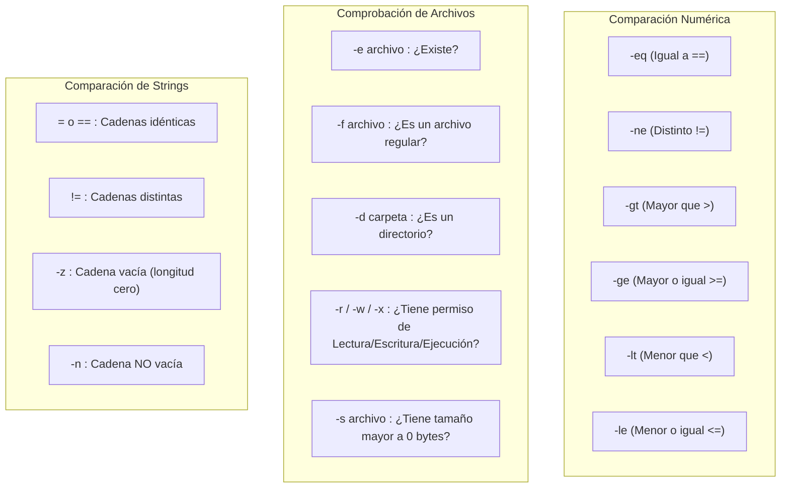

# Introducción a Shell Scripting

Un **Shell Script** es un archivo de texto ejecutable que contiene una secuencia de comandos de Bash e instrucciones de control de flujo. Permite automatizar tareas repetitivas, realizar copias de seguridad, aprovisionar servidores y compilar proyectos.

---

## 1. Anatomía y Ejecución de un Script

### Estructura Básica:

```bash
#!/bin/bash
# ==========================================================
# Script de ejemplo: backup_diario.sh
# Autor: Estudiante
# ==========================================================

echo "Iniciando respaldo del sistema..."
FECHA=$(date +"%Y-%m-%d")
echo "Fecha actual: $FECHA"
```

### El Shebang (`#!/bin/bash`)
La primera línea del archivo debe comenzar con los caracteres `#!` seguidos de la ruta absoluta del intérprete. Le indica al Kernel de Linux que debe usar Bash para ejecutar el resto del archivo.

### Permisos y Ejecución:

```bash
# 1. Otorgar permisos de ejecución al script
chmod +x backup_diario.sh

# 2. Ejecutar el script usando su ruta relativa
./backup_diario.sh

# O ejecutarlo explícitamente con el intérprete:
bash backup_diario.sh
```

---

## 2. Variables, Sustitución y Aritmética

```bash
#!/bin/bash

# Definición de variables (¡IMPORTANTE: Sin espacios alrededor del signo =)
NOMBRE="Juan"
EDAD=21

# Uso de variables con interpolación de cadenas (comillas dobles)
echo "Hola $NOMBRE, tienes $EDAD años."

# Sustitución de comandos $(comando): Captura la salida de un comando en una variable
USUARIO_ACTUAL=$(whoami)
ARCHIVOS_TOTALES=$(ls -1 | wc -l)
echo "El usuario $USUARIO_ACTUAL tiene $ARCHIVOS_TOTALES archivos en esta carpeta."

# Operaciones Aritméticas con $(( ... ))
A=15
B=5
SUMA=$((A + B))
PRODUCTO=$((A * B))
echo "Suma: $SUMA | Multiplicación: $PRODUCTO"
```

---

## 3. Argumentos y Parámetros Especiales

Al ejecutar un script como `./mi_script.sh archivo1.txt produccion`, se pueden recibir parámetros:

| Variable | Significado |
| :---: | :--- |
| **`$0`** | Nombre del script en ejecución (`./mi_script.sh`) |
| **`$1`, `$2`, `$3`** | Primer, segundo y tercer argumento pasado al script |
| **`$#`** | Número total de argumentos pasados |
| **`$@`** | Todos los argumentos juntos como una lista |
| **`$?`** | Código de retorno del último comando (`0` = Éxito, `>0` = Error) |

```bash
#!/bin/bash
if [ $# -lt 1 ]; then
    echo "Uso: $0 <nombre_archivo>"
    exit 1
fi

echo "Procesando archivo: $1"
```

---

## 4. Estructuras Condicionales (`if / elif / else`)

```bash
#!/bin/bash

read -p "Ingrese una calificación (0-100): " NOTA

if [ $NOTA -ge 90 ]; then
    echo "Excelente: Aprobado con honores"
elif [ $NOTA -ge 60 ]; then
    echo "Aprobado"
else
    echo "Desaprobado"
fi
```

### Operadores de Comparación:



---

## 5. Bucles y Repeticiones (`for` y `while`)

### Bucle `for` sobre una lista o rango:
```bash
#!/bin/bash

# Iterar sobre una lista de elementos
for SERVIDOR in web01 web02 bd01; do
    echo "Haciendo ping a: $SERVIDOR"
done

# Iterar sobre un rango numérico de 1 a 5
for i in {1..5}; do
    echo "Iteración número: $i"
done

# Iterar sobre archivos reales en disco
for ARCHIVO in *.txt; do
    echo "Haciendo backup de $ARCHIVO -> ${ARCHIVO}.bak"
    cp "$ARCHIVO" "${ARCHIVO}.bak"
done
```

### Bucle `while` y lectura de archivos línea a línea:
```bash
#!/bin/bash

# Contador mientras sea menor o igual a 5
CONTADOR=1
while [ $CONTADOR -le 5 ]; do
    echo "Valor: $CONTADOR"
    CONTADOR=$((CONTADOR + 1))
done

# Leer un archivo de texto línea por línea (Ideal para CSVs o logs)
while IFS= read -r LINEA; do
    echo "Línea procesada: $LINEA"
done < usuarios.txt
```

---

## 6. Funciones en Bash

Permiten modularizar y reutilizar código:

```bash
#!/bin/bash

# Definición de función
saludar_usuario() {
    local NOMBRE_PERSONA=$1  # 'local' limita la variable a la función
    echo "Hola, bienvenido $NOMBRE_PERSONA!"
}

# Invocar la función con parámetros
saludar_usuario "Carlos"
saludar_usuario "María"
```

---

## 7. Buenas Prácticas para Scripts Profesionales

> [!TIP]
> 1. **Modo estricto de seguridad:** Añade al inicio de tus scripts `set -e` (para que el script se detenga de inmediato si algún comando falla) y `set -u` (para alertar si usas variables no definidas).
> 2. **Comillas en variables:** Usa siempre `"$VARIABLE"` entre comillas dobles para evitar problemas con nombres de archivos que contengan espacios.
> 3. **Códigos de salida explícitos:** Finaliza con `exit 0` en caso de éxito y con `exit 1` o códigos específicos en caso de error.

---

## 🧭 Navegación entre Notas

- Nota anterior: **[[Redirecciones y Tuberías]]**
- Guía rápida y comandos: **[[Comandos Frecuentes]]**
- Volver al índice general de BASH: **[[Index|Índice de BASH]]**
