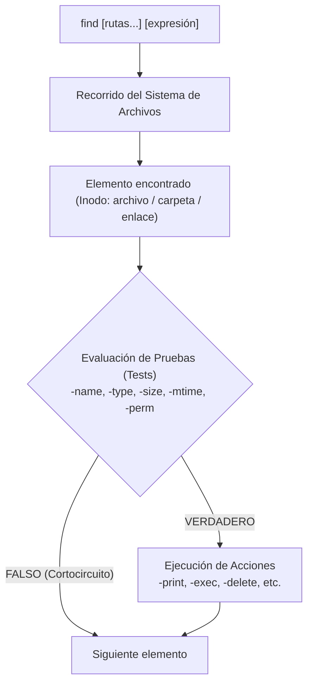

# GNU Find — Manual Completo y de Referencia Práctica

> **Utilidad Oficial:** GNU Findutils (`find`)  
> **Propósito:** Búsqueda recursiva en tiempo real y evaluación de archivos y directorios en la jerarquía del sistema de archivos según criterios de atributos, metadatos y contenido.  
> **Compatibilidad:** Estándar POSIX con extensiones avanzadas de GNU.

---

## 1. Introducción y Arquitectura de `find`

El comando **`find`** es una de las herramientas más potentes y versátiles del ecosistema UNIX y GNU/Linux. A diferencia de comandos que consultan bases de datos preindexadas (como `locate` o `mlocate`), `find` recorre el árbol de directorios **en tiempo real**, consultando directamente la tabla de inodos y los metadatos del sistema de archivos mediante llamadas al sistema como `lstat(2)` y `stat(2)`.



### Diferencias Clave con Otras Herramientas:
- **`find` vs. `locate`:** `locate` es instantáneo porque lee un índice local (`updatedb`), pero no detecta archivos creados recientemente o modificados tras la última indexación. `find` siempre refleja el estado exacto y actual del disco.
- **`find` vs. `grep`:** `find` busca **archivos** basándose en sus metadatos (nombre, tamaño, permisos, fechas, tipo). `grep` busca **dentro del contenido** de los archivos texto que coincida con un patrón. Combinados (`find + grep`), forman la dupla de auditoría e inspección más potente de la terminal.

---

## 2. Sintaxis General y Estructura de la Expresión

### Sinopsis General:
```bash
find [-H] [-L] [-P] [-Onivel] [rutas...] [expresión]
```

Si no se especifica ninguna ruta, `find` toma por defecto el directorio de trabajo actual (`.`).  
Si no se especifica ninguna acción en la expresión, `find` asume por defecto `-print` (imprimir la ruta de cada coincidencia en una nueva línea).

### Los 4 Componentes de una Expresión:
1. **Opciones Globales:** Modifican el comportamiento general del recorrido del árbol (ej. `-maxdepth`, `-mindepth`, `-depth`, `-mount` / `-xdev`).
2. **Pruebas (*Tests*):** Evalúan condiciones de verdadero/falso sobre los metadatos del archivo (ej. `-name`, `-type`, `-size`, `-mtime`, `-perm`).
3. **Acciones (*Actions*):** Tienen efectos secundarios o imprimen información si las pruebas anteriores fueron verdaderas (ej. `-print`, `-print0`, `-exec`, `-delete`, `-prune`).
4. **Operadores Lógicos:** Conectan las pruebas y acciones determinando su evaluación lógica (`-and`, `-or`, `-not`, `!`, `( ... )`).

---

## 2.1 Gestión de Enlaces Simbólicos (*Flags* Iniciales)

Los modificadores de enlaces deben situarse **antes** de la lista de rutas en la línea de comandos:

| Flag | Nombre | Comportamiento |
| :---: | :--- | :--- |
| **`-P`** | *Physical (por defecto)* | **Nunca sigue enlaces simbólicos.** Inspecciona los metadatos del enlace en sí, no del archivo al que apunta. |
| **`-L`** | *Logical* | **Sigue siempre los enlaces simbólicos.** Inspecciona los metadatos del archivo de destino. |
| **`-H`** | *Half-logical* | **Solo sigue enlaces simbólicos si se pasaron explícitamente como argumentos de ruta** en la línea de comandos. |

```bash
# Búsqueda física estándar (no desreferencia enlaces):
find -P /var/www -name "*.html"

# Seguir todos los symlinks durante la búsqueda:
find -L /var/www -type f -name "*.conf"
```

---

## 3. Pruebas y Criterios de Búsqueda (*Tests*)

### 3.1 Búsqueda por Nombre y Ruta

#### `-name "patrón"` / `-iname "patrón"`
Busca por el nombre base del archivo (*basename*). Acepta comodines del shell (*globbing* como `*`, `?`, `[...]`).
- `-name`: Sensible a mayúsculas y minúsculas (*case-sensitive*).
- `-iname`: Insensible a mayúsculas y minúsculas (*case-insensitive*).

> [!IMPORTANT]
> Encierra siempre los patrones con comodines entre comillas simples o dobles (`"*.txt"`) para evitar que la shell los expanda antes de pasárselos a `find`.

```bash
# Buscar archivos que terminen en .log en el directorio actual:
find . -name "*.log"

# Buscar sin importar mayúsculas o minúsculas (ej. Foto.JPG, foto.jpg):
find ~/Imágenes -iname "*.jpg"
```

#### `-path "patrón"` / `-ipath "patrón"`
Evalúa la ruta completa relativa al punto de inicio, permitiendo filtrar jerarquías completas.
```bash
# Buscar archivos .env dentro de cualquier subcarpeta config/:
find . -path "*/config/*.env"
```

#### `-regex "patrón"` / `-iregex "patrón"`
Compara la **ruta completa** contra una expresión regular. Por defecto utiliza expresiones Emacs, pero se puede configurar con `-regextype posix-extended` o `posix-basic`.
```bash
find . -regextype posix-extended -regex ".*\.(jpe?g|png|webp)$"
```

---

### 3.2 Búsqueda por Tipo de Archivo (`-type`)

Filtra el elemento por la clase de inodo que representa:

| Tipo | Letra | Descripción | Ejemplo de Uso |
| :---: | :---: | :--- | :--- |
| **Archivo regular** | **`f`** | Archivos de texto, binarios, imágenes, etc. | `find . -type f` |
| **Directorio** | **`d`** | Carpetas o directorios. | `find /var/log -type d` |
| **Enlace simbólico** | **`l`** | Accesos directos / *soft links*. | `find /etc -type l` |
| **Dispositivo de bloques** | **`b`** | Discos duros, particiones (`/dev/sda`). | `find /dev -type b` |
| **Dispositivo de caracteres** | **`c`** | Terminales, puertos serie (`/dev/tty`). | `find /dev -type c` |
| **Tubería nombrada** | **`p`** | Archivos FIFO (*named pipes*). | `find /tmp -type p` |
| **Socket de red local** | **`s`** | Sockets de comunicación entre procesos. | `find /run -type s` |

---

### 3.3 Búsqueda por Tamaño (`-size`)

Permite filtrar archivos según su tamaño en disco. Admite sufijos de unidades:
- **`c`** : Bytes individuales.
- **`k`** : Kibibytes (1 KiB = 1024 bytes).
- **`M`** : Mebibytes (1 MiB = 1024 KiB).
- **`G`** : Gibibytes (1 GiB = 1024 MiB).
- **`b`** : Bloques de 512 bytes (unidad por defecto si se omite el sufijo).

#### Prefijos de Comparación:
- **`+N`** : Estrictamente **mayor que** `N`.
- **`-N`** : Estrictamente **menor que** `N`.
- **`N`** : **Exactamente** `N` (redondeado hacia arriba al bloque).

```bash
# Archivos regulares de más de 500 MB:
find / -type f -size +500M 2>/dev/null

# Archivos de tamaño entre 10 MB y 50 MB:
find /var/log -type f -size +10M -size -50M

# Archivos de exactamente 0 bytes o directorios vacíos:
find . -empty
```

---

### 3.4 Búsqueda por Marcas de Tiempo (*Timestamps*)

En Linux, cada inodo mantiene tres marcas temporales fundamentales:
- **`atime` (*Access Time*):** Momento de última lectura o apertura del archivo.
- **`mtime` (*Modification Time*):** Momento de última modificación del **contenido** del archivo.
- **`ctime` (*Change Time*):** Momento de última alteración de los **metadatos o inodo** (permisos, dueño, enlaces, renombrado).

```
                      Marcas de Tiempo en Linux
  ┌─────────────────┐   Lectura de datos   ┌────────────────────────┐
  │      atime      │ ◄─────────────────── │ cat, less, lectura     │
  └─────────────────┘                      └────────────────────────┘
  ┌─────────────────┐ Modificación archivo ┌────────────────────────┐
  │      mtime      │ ◄─────────────────── │ nano, echo >>, sed -i  │
  └─────────────────┘                      └────────────────────────┘
  ┌─────────────────┐ Cambio de metadatos  ┌────────────────────────┐
  │      ctime      │ ◄─────────────────── │ chmod, chown, mv       │
  └─────────────────┘                      └────────────────────────┘
```

#### Medición en Días (múltiplos de 24 horas):
- **`-mtime`**, **`-atime`**, **`-ctime`**:
  - `-mtime -7` : Modificado en los **últimos 7 días** (hace menos de 7 días).
  - `-mtime +30` : Modificado hace **más de 30 días**.
  - `-mtime 0` : Modificado en las **últimas 24 horas**.

```bash
# Archivos modificados en las últimas 48 horas:
find /home -type f -mtime -2

# Archivos de log que no se modifican desde hace más de 90 días:
find /var/log -name "*.log" -mtime +90
```

#### Medición en Minutos:
- **`-mmin`**, **`-amin`**, **`-cmin`**:
  - `-mmin -60` : Modificado en la última hora.
  - `-mmin +120` : Modificado hace más de dos horas.

```bash
# Archivos modificados en los últimos 15 minutos:
find /var/www -type f -mmin -15
```

#### Comparación Relativa a Otro Archivo:
- **`-newer archivo_referencia`** : Archivos cuya fecha de modificación sea más reciente que la de `archivo_referencia`.
- **`-anewer`**, **`-cnewer`** : Comparaciones basadas en acceso o cambio de inodo.

```bash
# Buscar archivos modificados después del último despliegue:
find . -type f -newer .last_deploy_timestamp
```

---

### 3.5 Búsqueda por Permisos y Propiedad

#### Permisos (`-perm`)
Evalúa los permisos octales o simbólicos según tres modalidades:

| Sintaxis | Significado | Comportamiento |
| :--- | :--- | :--- |
| **`-perm MODO`** | Coincidencia exacta | Los permisos deben ser **idénticos** a `MODO`. |
| **`-perm -MODO`** | Operación AND (Todos los bits) | El archivo debe tener **al menos todos** los bits especificados en `MODO`. |
| **`-perm /MODO`** | Operación OR (Cualquier bit) | El archivo debe tener **al menos uno cualquiera** de los bits especificados. |

```bash
# Archivos con permisos EXACTOS 644 (rw-r--r--):
find . -type f -perm 644

# Archivos donde CUALQUIERA (usuario, grupo u otros) tenga permisos de escritura:
find . -type f -perm /222

# Scripts que sean ejecutables por TODOS (usuario AND grupo AND otros):
find /usr/local/bin -type f -perm -111

# Auditoría: Archivos con bit SUID activo (permiso 4000 octal):
find / -perm /4000 -type f 2>/dev/null
```

#### Pruebas Rápidas de Acceso para el Usuario Actual:
- **`-readable`** : Legible por el usuario que ejecuta `find`.
- **`-writable`** : Con permisos de escritura para el usuario actual.
- **`-executable`** : Ejecutable o directorio accesible por el usuario actual.

```bash
# Archivos de configuración que el usuario actual puede editar:
find /etc -maxdepth 2 -type f -writable 2>/dev/null
```

#### Propiedad y Grupo:
- **`-user nombre_o_uid`** : Archivos pertenecientes a un usuario específico.
- **`-group nombre_o_gid`** : Archivos pertenecientes a un grupo específico.
- **`-nouser`** / **`-nogroup`** : Archivos cuyo propietario o grupo ya **no existe** en `/etc/passwd` o `/etc/group` (archivos huérfanos).

```bash
# Buscar archivos huérfanos dejados por usuarios eliminados:
find /home -nouser -o -nogroup
```

---

## 4. Operadores Lógicos y Control del Recorrido

Las pruebas y acciones se pueden combinar mediante operadores booleanos con evaluación de **cortocircuito (*short-circuiting*)**:

| Operador | Equivalente | Descripción |
| :---: | :---: | :--- |
| **`-and`** | **`-a`** o espacio | Conjunción lógica (AND). Es el operador implícito por defecto entre pruebas consecutivas. |
| **`-or`** | **`-o`** | Disyunción lógica (OR). Si el lado izquierdo es verdadero, no evalúa el derecho. |
| **`-not`** | **`!`** | Negación lógica (NOT). Invierte el resultado de la prueba siguiente. |
| **`\(` ... `\)`** | Paréntesis | Agrupación de condiciones. Requiere escapar con barra invertida para evitar interpretación de la shell. |

```bash
# Buscar archivos .js O .ts:
find . -type f \( -name "*.js" -o -name "*.ts" \)

# Buscar archivos que NO sean .git ni terminen en .log:
find . -type f ! -path "*/.git/*" ! -name "*.log"
```

---

## 4.1 Control de Profundidad y Límites de Recorrido

#### `-maxdepth N`
Limita la búsqueda a un máximo de `N` niveles por debajo de las rutas de inicio (`-maxdepth 1` busca solo en la carpeta indicada sin descender a subcarpetas).
```bash
find /var/log -maxdepth 1 -name "*.log"
```

#### `-mindepth N`
No aplica ninguna prueba o acción a niveles inferiores a `N` (`-mindepth 1` omite la carpeta raíz indicada y empieza a procesar desde sus hijos).
```bash
# Procesar únicamente los subdirectorios, sin incluir el directorio actual:
find . -mindepth 1 -maxdepth 2 -type d
```

#### `-depth`
Procesa el contenido de cada directorio **antes** que el directorio en sí (*post-order traversal*). Es fundamental para operaciones de renombrado o eliminación de directorios anidados.

#### `-mount` / `-xdev`
Impide a `find` descender en directorios que pertenezcan a **otros sistemas de archivos montados** (como `/proc`, `/sys`, montajes NFS, memorias USB o particiones separadas).
```bash
# Escaneo de la raíz sin entrar en discos montados ni particiones virtuales:
find / -xdev -name "core"
```

---

## 5. Acciones y Ejecución de Comandos (*Actions*)

Una vez que un archivo o carpeta supera las pruebas anteriores, `find` ejecuta la acción especificada.

### 5.1 Salida y Formateo

#### `-print`
Acción predeterminada. Imprime la ruta relativa o absoluta de la coincidencia, seguida de un salto de línea (`\n`).

#### `-print0`
Imprime la ruta completa seguida de un **byte nulo ASCII NUL (`\0`)**. Es la técnica estándar y más segura para conectar `find` con `xargs -0` o tuberías en Bash, garantizando que archivos con espacios, tildes, comillas o saltos de línea no rompan los scripts.
```bash
find . -type f -name "*.tmp" -print0 | xargs -0 rm -f
```

#### `-printf "formato"`
Genera salidas personalizadas de metadatos de alto rendimiento sin requerir tuberías con `ls` o `awk`:

| Especificador | Metadato que imprime |
| :--- | :--- |
| **`%p`** | Ruta completa del archivo. |
| **`%f`** | Nombre base del archivo (*basename* sin la ruta). |
| **`%s`** | Tamaño del archivo en bytes. |
| **`%u` / `%U`** | Nombre de usuario / UID del propietario. |
| **`%g` / `%G`** | Nombre de grupo / GID del propietario. |
| **`%m`** | Permisos octales (ej. `0644`). |
| **`%TY-%Tm-%Td`** | Fecha de modificación en formato AAAA-MM-DD. |
| **`%TH:%TM:%TS`** | Hora de modificación en formato HH:MM:SS. |

```bash
# Reporte tabular con tamaño, permisos y ruta:
find . -maxdepth 2 -type f -printf "%10s bytes | %m | %p\n"
```

---

### 5.2 Modificación Directa: `-delete` y `-prune`

#### `-delete`
Elimina directamente los archivos y directorios coincidentes.
- Activa automáticamente la opción `-depth` para asegurar que el contenido de las carpetas se elimine antes de intentar borrar la carpeta padre.
- No utiliza la shell, por lo que es mucho más rápido y seguro que ejecutar `rm`.

> [!CAUTION]
> `-delete` se ejecuta inmediatamente sin pedir confirmación. Siempre prueba tu consulta antes reemplazando `-delete` por `-print` para verificar la lista de archivos a borrar.

```bash
# Eliminar todos los archivos temporales .bak:
find /tmp -type f -name "*.bak" -delete
```

#### `-prune`
Indica a `find` que **no descienda** dentro del directorio coincidente. Es la técnica más eficiente para omitir directorios gigantescos (como `.git`, `node_modules`, `venv`) sin perder tiempo escaneando sus archivos internos.

```bash
# Buscar archivos .js ignorando por completo la carpeta node_modules:
find . -path "./node_modules" -prune -o -name "*.js" -print
```

---

### 5.3 Ejecución Externa: `-exec`, `-execdir` y `-ok`

Permiten invocar cualquier comando de Linux sobre cada resultado encontrado. En el comando, `{}` representa la ruta del archivo actual coincidente.

#### Modo 1: `-exec comando {} \;` (Ejecución individual)
Ejecuta una instancia del comando **por cada archivo encontrado**. Si `find` halla 1.000 archivos, genera 1.000 procesos independientes.
```bash
find . -name "*.txt" -exec chmod 644 {} \;
```

#### Modo 2: `-exec comando {} +` (Ejecución por lotes - Óptima)
Agrupa tantas rutas coincidentes como permita la longitud máxima de argumentos de la shell (`ARG_MAX`) y ejecuta el comando **una sola vez pasando todos los archivos como argumentos**.
```bash
# Comprime todos los logs antiguos en un solo proceso de tar:
find /var/log -name "*.log" -mtime +30 -exec tar -rvf logs_antiguos.tar {} +
```

#### Modo 3: `-execdir comando {} \;` / `+` (Ejecución segura local)
Ejecuta el comando desde el **subdirectorio directo** donde reside el archivo, en lugar de hacerlo desde el directorio raíz del comando. Previene ataques de sustitución de rutas y condiciones de carrera (*race conditions*).

#### Modo 4: `-ok` / `-okdir` (Modo interactivo)
Funciona igual que `-exec`, pero solicita confirmación interactiva en la terminal (`y` / `n`) antes de ejecutar la acción para cada archivo.
```bash
find /etc -name "*.old" -ok rm -i {} \;
```

---

## 6. Casos Prácticos de Administración y Automatización

### 1. Limpieza Automática de Cachés y Temporales
```bash
# Eliminar archivos .DS_Store o Thumbs.db en todo el proyecto:
find . -type f \( -name ".DS_Store" -o -name "Thumbs.db" \) -delete
```

### 2. Estandarización de Permisos en Servidores Web
Práctica obligatoria en servidores Apache/Nginx donde los directorios deben tener `755` y los archivos `644`:
```bash
# Directorios a 755 (drwxr-xr-x):
find /var/www/html -type d -exec chmod 755 {} +

# Archivos a 644 (-rw-r--r--):
find /var/www/html -type f -exec chmod 644 {} +
```

### 3. Auditoría de Seguridad: Archivos con Permisos Peligrosos (777)
```bash
# Detectar cualquier archivo con permisos totales de lectura/escritura/ejecución para todos:
find /home -type f -perm 0777 -ls
```

### 4. Detección de Archivos Gigantes que saturan el Disco
```bash
# Identificar los archivos mayores a 1 GB en todo el sistema:
find / -xdev -type f -size +1G -printf "%k KB | %p\n" 2>/dev/null | sort -nr | head -n 10
```

### 5. Detección de Enlaces Simbólicos Rotos (*Dead/Broken Symlinks*)
```bash
# Enlaces cuyo archivo de destino ya no existe:
find . -xtype l
```

### 6. Rotación y Depuración de Logs de más de 30 Días
```bash
find /var/log/myapp -type f -name "*.log" -mtime +30 -exec gzip -9 {} +
```

### 7. Búsqueda Combinada: Encontrar Texto dentro de Archivos Filtrados (`find` + `grep`)
```bash
# Buscar la función "handlePayment" solo dentro de archivos TypeScript creados hace menos de 15 días:
find src/ -type f -name "*.ts" -mtime -15 -exec grep -Hn "handlePayment" {} +
```

### 8. Exclusión Múltiple Elegante con `-prune`
```bash
# Escanear omitiendo múltiples carpetas masivas de desarrollo:
find . \( -name ".git" -o -name "node_modules" -o -name "dist" -o -name ".venv" \) -prune -o -type f -print
```

---

## 7. Rendimiento, Optimización y Seguridad

### 1. El Orden de las Pruebas Importa (Cortocircuito)
Dado que `find` evalúa las condiciones de izquierda a derecha con cortocircuito lógico:
- Coloca primero las pruebas **más rápidas y restrictivas** (como `-type f` o `-name`).
- Coloca al final las pruebas más costosas en I/O de disco (como llamadas a comandos con `-exec` o lecturas de contenido).

### 2. Nivel de Optimización Interna (`-O`)
GNU Find incluye un motor de optimización que reordena automáticamente ciertas pruebas para minimizar llamadas a `stat`:
```bash
find -O3 / -name "*.conf"
```
- `-O1` : Básico (optimiza pruebas de nombre antes que lecturas de inodo).
- `-O2` : Intermedio (reordena pruebas de tipo antes de tamaño/fecha).
- `-O3` : Máxima optimización (reordenamiento heurístico de costo/probabilidad).

### 3. Evitar el Límite de `ARG_MAX`
Si ejecutas comandos como `rm $(find ...)` en carpetas con decenas de miles de archivos, la shell fallará con el error:  
`bash: /bin/rm: Argument list too long`.  
Utiliza siempre `-exec ... {} +` o `find ... -print0 | xargs -0 ...`, los cuales dividen automáticamente los argumentos en lotes seguros.

---

## 8. Preguntas Frecuentes (FAQ)

### ¿Por qué `-mtime +7` no es lo mismo que `-mtime 7`?
- **`-mtime 7`** : Modificado exactamente en la ventana de hace 7 días (entre 7×24h y 8×24h atrás).
- **`-mtime +7`** : Modificado hace **más de 7 días** (> 168 horas).
- **`-mtime -7`** : Modificado hace **menos de 7 días** (< 168 horas).

### ¿Por qué se debe escapar `{}` y `\;` en la terminal?
El punto y coma `;` es un delimitador de comandos para la shell Bash. Si no se escapa con barra invertida (`\;`) o comillas (`';'`), la shell interpretará que el comando `find` finaliza allí y fallará con el error `find: missing argument to '-exec'`.

### ¿Cuál es la diferencia entre `-exec rm {} \;` y `-exec rm {} +`?
- Con `\;` se invoca el binario `/bin/rm` **una vez por cada archivo** (1.000 archivos = 1.000 llamadas al sistema `fork/exec`).
- Con `+` se pasan todos los archivos como argumentos a una única ejecución: `rm archivo1 archivo2 archivo3...` (1.000 archivos = 1 proceso), siendo hasta 100 veces más rápido.

---

## 9. Índice Alfabético Rápido de Opciones y Pruebas

| Opción / Prueba | Tipo | Descripción Breve |
| :--- | :---: | :--- |
| **`-amin n`** / **`-atime n`** | Test | Tiempo de último acceso (en minutos u horas/días). |
| **`-cmin n`** / **`-ctime n`** | Test | Tiempo de último cambio de inodo/metadatos. |
| **`-delete`** | Acción | Elimina directamente los archivos/directorios encontrados. |
| **`-depth`** | Opción | Recorrido post-orden (procesa hijos antes que padres). |
| **`-empty`** | Test | Archivos regulares vacíos (0 bytes) o directorios sin elementos. |
| **`-exec comando {} \;`** | Acción | Ejecuta comando individualmente por cada coincidencia. |
| **`-exec comando {} +`** | Acción | Ejecuta comando en lote agrupando argumentos (alto rendimiento). |
| **`-execdir comando {} +`** | Acción | Ejecuta comando dentro del subdirectorio del archivo. |
| **`-group grupo`** | Test | Coincidencia por grupo propietario. |
| **`-iname patrón`** | Test | Búsqueda por nombre de archivo insensible a mayúsculas/minúsculas. |
| **`-maxdepth n`** | Opción | Limita la profundidad máxima del descenso. |
| **`-mindepth n`** | Opción | Define la profundidad mínima a partir de la cual evaluar. |
| **`-mmin n`** / **`-mtime n`** | Test | Tiempo de modificación de contenido del archivo. |
| **`-mount` / `-xdev`** | Opción | No desciende a otros sistemas de archivos montados. |
| **`-name patrón`** | Test | Búsqueda por nombre de archivo sensible a mayúsculas/minúsculas. |
| **`-newer archivo`** | Test | Modificado más recientemente que `archivo`. |
| **`-nogroup` / `-nouser`** | Test | Archivos huérfanos sin grupo o usuario válido en el sistema. |
| **`-ok comando {} \;`** | Acción | Ejecuta comando con confirmación interactiva por teclado. |
| **`-perm modo`** | Test | Búsqueda por permisos octales exactos, AND (`-`) u OR (`/`). |
| **`-print`** | Acción | Imprime la ruta de coincidencia seguida de `\n` (por defecto). |
| **`-print0`** | Acción | Imprime la ruta delimitada por byte nulo `\0` (seguro con `xargs -0`). |
| **`-printf formato`** | Acción | Salida formateada avanzada de metadatos del inodo. |
| **`-prune`** | Acción | No desciende en el directorio coincidente (exclusión eficiente). |
| **`-regex patrón`** | Test | Compara la ruta completa contra una expresión regular. |
| **`-size n[ckMG]`** | Test | Búsqueda por tamaño de archivo (+ mayor, - menor). |
| **`-type [fdlbcs]`** | Test | Búsqueda por tipo de inodo (f: archivo, d: directorio, l: symlink, etc.). |
| **`-user usuario`** | Test | Coincidencia por usuario propietario. |

---

## 🧭 Navegación entre Notas

- Nota complementaria de gestión de archivos: **[[Navegación y Archivos]]**
- Búsqueda de contenido y expresiones regulares: **[[GREP|Manual Completo de GNU Grep]]**
- Permisos y propiedad en Linux: **[[Permisos y Usuarios]]**
- Procesamiento de texto en Bash: **[[Procesamiento de Texto]]**
- Volver al índice general de BASH: **[[Index|Índice de BASH]]**
- Volver al panel principal: **[[Materias/SOII/WSL|Sistemas Operativos II]]**
